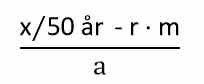
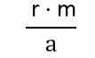
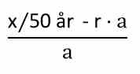
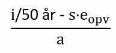

# Bilag 2: Tabeller til kapitel 11 - Energiforbrug

## Tabel 1 - Generelle mindstekrav til klimaskærm

+-------------------------------------------------------------------------------------------------------------------------------------------------------------------------------------------------------------------------------------------------------------------+-----------------------------------+
| **Bygningsdel**                                                                                                                                                                                                                                                   | **U-værdi \[W/m²K\]**             |
+-------------------------------------------------------------------------------------------------------------------------------------------------------------------------------------------------------------------------------------------------------------------+-----------------------------------+
| Ydervægge og kældervægge mod jord                                                                                                                                                                                                                                 | 0,30                              |
+-------------------------------------------------------------------------------------------------------------------------------------------------------------------------------------------------------------------------------------------------------------------+-----------------------------------+
| Etageadskillelser og skillevægge mod rum, hvor temperaturforskellen mellem rummene er 5 °C eller mere                                                                                                                                                             | 0,40                              |
+-------------------------------------------------------------------------------------------------------------------------------------------------------------------------------------------------------------------------------------------------------------------+-----------------------------------+
| Terrændæk, kældergulve mod jord og etageadskillelser over det fri eller ventileret kryberum                                                                                                                                                                       | 0,20                              |
+-------------------------------------------------------------------------------------------------------------------------------------------------------------------------------------------------------------------------------------------------------------------+-----------------------------------+
| Etageadskillelser under gulve med gulvvarme mod rum, der er opvarmede                                                                                                                                                                                             | 0,50                              |
+-------------------------------------------------------------------------------------------------------------------------------------------------------------------------------------------------------------------------------------------------------------------+-----------------------------------+
| Loft- og tagkonstruktioner, herunder skunkvægge, flade tage og skråvægge direkte mod tag                                                                                                                                                                          | 0,20                              |
+-------------------------------------------------------------------------------------------------------------------------------------------------------------------------------------------------------------------------------------------------------------------+-----------------------------------+
| Yderdøre                                                                                                                                                                                                                                                          | 1,0                               |
|                                                                                                                                                                                                                                                                   |                                   |
| Yderdøre med funktionskrav                                                                                                                                                                                                                                        | 1,4                               |
|                                                                                                                                                                                                                                                                   |                                   |
| Referencestørrelse er 1,23 m x 2,18 m                                                                                                                                                                                                                             |                                   |
|                                                                                                                                                                                                                                                                   |                                   |
| Et tilknyttet funktionskrav er brandmodstand, sikring af en flugtvej, personsikkerhed (hvor underkanten af glasfeltet er placeret lavere end 800 mm fra gulv), indbrudshæmning større end modstandsklasse EN 1627/RC3 eller en øget lydreduktion større end 35 dB |                                   |
+-------------------------------------------------------------------------------------------------------------------------------------------------------------------------------------------------------------------------------------------------------------------+-----------------------------------+
| For porte og lemme mod det fri eller mod rum, der er uopvarmede samt glasvægge og vinduer mod rum opvarmet til en temperatur, hvor temperaturforskellen mellem rummene er 5 °C eller mere                                                                         | 1,8                               |
+-------------------------------------------------------------------------------------------------------------------------------------------------------------------------------------------------------------------------------------------------------------------+-----------------------------------+
| Ovenlyskupler                                                                                                                                                                                                                                                     | 1,4                               |
+-------------------------------------------------------------------------------------------------------------------------------------------------------------------------------------------------------------------------------------------------------------------+-----------------------------------+
| Isolerede partier i glasydervægge. Kravet er til center-U-værdi                                                                                                                                                                                                   | 0,60                              |
+-------------------------------------------------------------------------------------------------------------------------------------------------------------------------------------------------------------------------------------------------------------------+-----------------------------------+
| Etageadskillelser og vægge mod fryserum                                                                                                                                                                                                                           | 0,15                              |
+-------------------------------------------------------------------------------------------------------------------------------------------------------------------------------------------------------------------------------------------------------------------+-----------------------------------+
| Etageadskillelser og vægge mod kølerum                                                                                                                                                                                                                            | 0,25                              |
+-------------------------------------------------------------------------------------------------------------------------------------------------------------------------------------------------------------------------------------------------------------------+-----------------------------------+
| Skyde- og foldedøre.\                                                                                                                                                                                                                                             | 1,0                               |
| Alternativt en energibalance på mindst 0 kWh/m² pr. år. Beregningsmetode for energibalance skal følge § 258, stk. 1. Der kan anvendes funktionsglas, svarende til § 258, stk. 1, nr. 3\                                                                           |                                   |
| \                                                                                                                                                                                                                                                                 |                                   |
| Referencestørrelse er 2,50 m x 2,18 m i henholdsvis 2 og 3 fag\                                                                                                                                                                                                   |                                   |
| \                                                                                                                                                                                                                                                                 |                                   |
| \                                                                                                                                                                                                                                                                 |                                   |
| Automatiske skyde- og foldedøre eller skyde- og foldedøre med funktionskrav.\                                                                                                                                                                                     |  \                                |
| \                                                                                                                                                                                                                                                                 | \                                 |
| Et tilknyttet funktionskrav er brandmodstand, sikring af en flugtvej, personsikkerhed (hvor underkanten af glasfeltet er placeret lavere end 800 mm fra gulv), indbrudshæmning større end modstandsklasse EN 1627/RC3 eller en øget lydreduktion større end 35 dB |                                   |
|                                                                                                                                                                                                                                                                   | 1,4                               |
|                                                                                                                                                                                                                                                                   |                                   |
|                                                                                                                                                                                                                                                                   |                                   |
|                                                                                                                                                                                                                                                                   |                                   |
|                                                                                                                                                                                                                                                                   |                                   |
+-------------------------------------------------------------------------------------------------------------------------------------------------------------------------------------------------------------------------------------------------------------------+-----------------------------------+
| Lystunneler eller lignende                                                                                                                                                                                                                                        | 2,0                               |
+-------------------------------------------------------------------------------------------------------------------------------------------------------------------------------------------------------------------------------------------------------------------+-----------------------------------+

  ---------------------------------------------------------------------- -----------------------
  **Bygningsdel**                                                        **Linjetab \[W/mK\]**
  Fundamenter omkring rum, der opvarmes til mindst 5 °C                  0,40
  Samling mellem ydervæg og vinduer eller yderdøre, porte og lemme       0,06
  Samling mellem tagkonstruktion og ovenlysvinduer eller ovenlyskupler   0,20
  ---------------------------------------------------------------------- -----------------------

 

## Tabel 2 - Mindstekrav til klimaskærm ved ændret anvendelse og tilbygninger

+---------------------------------------------------------------------------------------------------------------------------------------------------+-----------------------------+-------------------------------------+
| **Bygningsdel**\                                                                                                                                  | **U-værdi\[W/m²K\]**                                              |
+---------------------------------------------------------------------------------------------------------------------------------------------------+-----------------------------+-------------------------------------+
| Rum opvarmet til                                                                                                                                  | Rum opvarmet til T \> 15 °C | Rum opvarmet til 5 °C \< T \< 15 °C |
+---------------------------------------------------------------------------------------------------------------------------------------------------+-----------------------------+-------------------------------------+
| Ydervægge og kældervægge mod jord                                                                                                                 | 0,15                        | 0,25                                |
+---------------------------------------------------------------------------------------------------------------------------------------------------+-----------------------------+-------------------------------------+
| Etageadskillelser og skillevægge mod rum, hvor temperaturforskellen mellem rummene er 5 °C eller mere                                             | 0,40                        | 0,40                                |
+---------------------------------------------------------------------------------------------------------------------------------------------------+-----------------------------+-------------------------------------+
| Terrændæk, kældergulve mod jord og etageadskillelser over det fri eller ventileret kryberum                                                       | 0,10                        | 0,15\                               |
+---------------------------------------------------------------------------------------------------------------------------------------------------+-----------------------------+-------------------------------------+
| Loft- og tagkonstruktioner, herunder skunkvægge, flade tage og skråvægge direkte mod tag\                                                         | 0,12                        | 0,15\                               |
+---------------------------------------------------------------------------------------------------------------------------------------------------+-----------------------------+-------------------------------------+
| Porte\                                                                                                                                            | 1,8\                        | 1,8\                                |
+---------------------------------------------------------------------------------------------------------------------------------------------------+-----------------------------+-------------------------------------+
| Lemme mod det fri eller mod rum, hvor temperaturforskellen mellem rummene er 5 °C eller mere (gælder ikke ventilationsåbninger på under 500 cm²)\ | 1,4\                        | 1,5\                                |
+---------------------------------------------------------------------------------------------------------------------------------------------------+-----------------------------+-------------------------------------+
| Ovenlyskupler\                                                                                                                                    | 1,4                         | 1,8                                 |
+---------------------------------------------------------------------------------------------------------------------------------------------------+-----------------------------+-------------------------------------+
| Lystunneler eller lignende                                                                                                                        | 2,0                         | 2,0                                 |
+---------------------------------------------------------------------------------------------------------------------------------------------------+-----------------------------+-------------------------------------+

+----------------------------------------------------------------------+-------------------------+-------------------------+
| **Bygningsdel**                                                      | **LinjetabW/mK**                                  |
+----------------------------------------------------------------------+-------------------------+-------------------------+
| Fundamenter\                                                         | 0,12\                   | 0,20\                   |
+----------------------------------------------------------------------+-------------------------+-------------------------+
| Samling mellem ydervæg og vinduer eller yderdøre, porte og lemme     | 0,03\                   | 0,03                    |
+----------------------------------------------------------------------+-------------------------+-------------------------+
| Samling mellem tagkonstruktion og ovenlysvinduer eller ovenlyskupler | 0,10\                   | 0,10\                   |
+----------------------------------------------------------------------+-------------------------+-------------------------+

## Tabel 3 - Mindstekrav til klimaskærm ved ombygninger og andre forandringer i bygningen

  -------------------------------------------------------------------------------------------------------- -----------------------------------
  **Bygningsdel**                                                                                          **U-værdi\[W/m²K\]**

  Ydervægge og kældervægge mod jord\                                                                       0,18

  Etageadskillelser og skillevægge mod rum, hvor temperaturforskellen mellem rummene er 5 °C eller mere\   0,40

  Terrændæk, kældergulve mod jord og etageadskillelser over det fri eller ventileret kryberum\             0,10

  Loft- og tagkonstruktioner, herunder skunkvægge, flade tage og skråvægge direkte mod tag\                0,12

  Porte\                                                                                                   1,8

  Lemme, nye forsatsvinduer og ovenlyskupler\                                                              1,4

  Renoverede forsatsvinduer\                                                                               1,65

  Lystunneler eller lignende                                                                               2,0
  -------------------------------------------------------------------------------------------------------- -----------------------------------

  ----------------------------------------------------------------------- -----------------------------------
  **Bygningsdel**\                                                        **Linjetab \[W/mK\]**

  Fundamenter\                                                            0,12

  Samling mellem ydervæg, vinduer eller yderdøre, porte og lemme\         0,03

  Samling mellem tagkonstruktion og ovenlysvinduer eller ovenlyskupler\   0,10

  ----------------------------------------------------------------------- -----------------------------------

## Tabel 4 -- Mindstekrav til klimaskærm for sommerhuse, campinghytter og lignende ferieboliger

  -------------------------------------------------------------------------------------------------------------------------- -----------------------------------
  **Bygningsdel**                                                                                                            **U-værdi \[W/m²K\]**

  Ydervægge og kældervægge mod jord\                                                                                         0,25

  Skillevægge og etageadskillelser mod rum, der er uopvarmede\                                                               0,40

  Terrændæk, kældergulve mod jord og etageadskillelser over det fri eller ventileret kryberum\                               0,15

  Loft- og tagkonstruktion, herunder skunkvægge samt flade tage                                                              0,15

  Vinduer, yderdøre, ovenlysvinduer, glasydervægge, glastage og ovenlyskupler mod det fri eller mod rum, der er uopvarmede   1,8

  -------------------------------------------------------------------------------------------------------------------------- -----------------------------------

  ---------------------------------------------------------------------- -----------------------------------
  **Bygningsdel**                                                        **Linjetab \[W/mK\]**

  Fundamenter\                                                           0,15

  Samling mellem ydervæg og vinduer eller yderdøre, porte og lemme\      0,03

  Samling mellem tagkonstruktion og ovenlysvinduer eller ovenlyskupler   0,10
  ---------------------------------------------------------------------- -----------------------------------

## Tabel 5 - Mindstekrav til klimaskærm for midlertidige, flytbare pavilloner

  -------------------------------------------------------------------------------------------------------------------------------------------------------------------------------------------- -----------------------------------
  **Bygningsdel**                                                                                                                                                                              **U-værdi \[W/m²K\]**

  Ydervægge\                                                                                                                                                                                   0,20

  Etageadskillelser og skillevægge mod rum, hvor temperaturforskellen mellem rummene er 5 °C eller mere\                                                                                       0,40

  Gulv og etageadskillelser over det fri eller ventileret kryberum                                                                                                                             0,12

  Loft- og tagkonstruktioner, herunder skunkvægge, flade tage og skråvægge direkte mod tag                                                                                                     0,15

  For porte og lemme mod det fri eller mod rum, der er uopvarmede, samt glasvægge og vinduer mod rum opvarmet til en temperatur, hvor temperaturforskellen mellem rummene er 5 °C eller mere   1,8

  Ovenlyskupler                                                                                                                                                                                1,8

  Lystunneler eller lignende                                                                                                                                                                   2,0
  -------------------------------------------------------------------------------------------------------------------------------------------------------------------------------------------- -----------------------------------

  ---------------------------------------------------------------------- -----------------------------------
  **Linjetab**\                                                          **Linjetab \[W/mK\]**

  Fundamenter\                                                           0,20

  Samling mellem ydervæg, vinduer eller yderdøre, porte og lemme\        0,03

  Samling mellem tagkonstruktion og ovenlysvinduer eller ovenlyskupler   0,10
  ---------------------------------------------------------------------- -----------------------------------

## Tabel 6 - Bygningsdele til beregning af klimapåvirkning

Dette bilag beskriver, hvilke bygningsdele der skal indgå i beregningen af bygningers klimapåvirkning.

Værdierne i tabel 6 afgrænser hvilke dele af byggeriet, der indgår i beregningen, jf. § 297, stk. 6. Bygningsdele, der ikke er nævnt, indgår ikke.

Tabellen indeholder desuden detaljerede linjer for forskellige typer af konstruktioner eller installationer.

Alle delkomponenter i konstruktioner medtages.

Bygningsdele, der indgår i den færdige bygning som tag, ydervægge, indervægge, dæk og lignende, medregnes fra den indvendige overflade til den udvendige overflade.

Bygningsdelene er grupperet i typer og kategorier. I kolonnen detaljeringsniveau fremgår eventuelle afgrænsninger af, hvad der skal medregnes af materialer for den pågældende bygningsdel.

***Forenklinger\***
Fastgørelsesmidler, fx søm, skruer, kiler, hulplader til søm eller skruer, murbindere eller lignende, medregnes ikke.

Større samlinger af væsentlig betydning for det bærende system, fx boltesamlinger, medregnes. Dette kan være som et samlet skøn af materialemængder, sådan som materialet er opgjort i [bilag 2, tabel 7](tabel_7 "Tabel_7").

Udstøbning af revner i betonelementer, udstøbning af et filigrandæk eller lignende samling mellem elementer kan anses for samme konstruktion. Delvist præfabrikerede konstruktioner kan beregnes uden at medtage udfyldning imellem elementerne.

Der medregnes ikke fugemateriale, lokale membraner og fugtspærre i fundamenter, samt håndlister, fodpaneler og lignende lister.

Tegloverliggere og lignende indregnes som det omkringliggende murværk.

Brandlukninger, recesser, rørgennemføringer og andre former for lukninger af udsparinger mm. kan udelades fra beregningen, hvis der i stedet foretages beregning på baggrund af den omliggende konstruktion, antaget homogen.

Ved rør eller ledninger til de tekniske installationer medregnes kun de lige strækninger og ikke bøjninger.

Hvor det af tabel 6 fremgår "eventuelt som mængde råmateriale" i kolonnen for Detaljeringsniveau, kan bygningsdelen opgøres ved at antage, at hele bygningsdelen består af det materiale, som er tilstede i størst omfang i bygningsdelen, og beskrives ved den klimapåvirkning for materialet, som fremgår af bilag 2, tabel 7.

***Råhuse***

Såfremt bygningen ved færdigmelding mangler dele, som fx gulv, vægmaling mm., som er nødvendige for at sikre funktionaliteten for bygningen, medregnes sådanne dele af bygningen i beregningen af bygningens klimapåvirkning, uanset at bygningsdelene faktisk ikke er til stede i bygningen på færdigmeldingstidspunktet.

[Download bilag 2, tabel 6 som excel-fil her.](../../../media/4rqdskud/tabel-6-2025.xlsx "Tabel 6 (2025)"){rel="noopener" target="_blank"}

## Tabel 7 - Generisk datagrundlag

Dette dokument indeholder det generiske datagrundlag for modulerne A1-A3, C3-C4 og D, jf. § 297, stk. 7.

Ved anvendelsen af datagrundlaget anvendes det mest repræsentative datasæt for materialet. Såfremt der ikke findes et repræsentativt datasæt, anvendes data for de forskellige delkomponenter. Dog kan der altid anvendes en opgørelse af mængde råmateriale hvor dette fremgår af kolonnen Detaljeringsniveau i [bilag 2, tabel 6](../../../media/4rqdskud/tabel-6-2025.xlsx "Tabel 6 (2025)"){rel="noopener" target="_blank"}.

[Download bilag 2, tabel 7 som excel-fil her](../../../media/1o1nnozd/tabel-7-2025.xlsx "Tabel 7 (2025)"){rel="noopener" target="_blank"}.

For så vidt angår tekniske installationer kan bygningsejer som alternativ til opgørelse af anvendte mængder vælge at opgøre klimapåvirkningen for bygningen på basis af de standardværdier, som fremgår nederst i datasættet, markeret med S før talværdien.

For genbrug anvendes de undtagelser, som fremgår nederst.

*Standardværdier for installationer*

Standardværdierne herunder kan anvendes af bygningsejer som alternativ til faktiske mængder ved at opgøre installationernes klimapåvirkning alene på baggrund af areal. Det anvendte areal i m2 er det samlede opvarmede etageareal (jf. § 256, stk. 3) plus det opvarmede kælderareal. Det således fremkomne areal ganges med standardværdien. Den således fremkomne værdi benyttes i stedet for en opgørelse af installationernes faktiske klimapåvirkning.

*Genbrug*

For genbrugte materialer sættes klimapåvirkningen til 0 kg CO2-ækvivalenter for A1-A3, B4, C3-C4 og D.

Genbrug forstås som defineret i affaldsbekendtgørelsen, dog uden hensyntagen til om den tidligere brug af materialet har haft samme formål.

Såfremt der sammen med genbrugte materialer også anvendes supplerende nye materialer, anvendes datasættet som normalt for de nye materialer, i det omfang, de indgår i beregningen jf. tabel 6. Nødvendig overfladebehandling eller lignende af det genbrugte produkt, sammenligneligt med vedligehold eller reparation, indgår ikke.

## Tabel 8 - Emissionsfaktorer

**Tabel 8.1 -- Emissionsfaktorer for el, fjernvarme og ledningsgas**

Datasættet kan benyttes som emissionsfaktorer for energiforbrug. 

[Download bilag 2, tabel 8.1 som excel-fil her.](../../../media/xoontk4a/tabel-81.xlsx "Tabel 8.1")

**Tabel 8.2 -- Emissionsfaktorer for brændstof**

Datasættet kan benyttes som emissionsfaktorer for brændstof til transport til, fra og på byggepladsen samt til forbrug fra maskiner.

[Download bilag 2, tabel 8.2 som excel-fil her.](../../../media/2bphcenr/tabel-82-september-2025.xlsx "Tabel 8.2 (September 2025)")

## Tabel 9 -- Referenceværdier for beregning af klimapåvirkning, som ikke indgår i beregningen ifølge § 298, stk. 1.

For at fastlægge størrelsen af den berettigede øgede klimapåvirkning, der som følge af § 298, stk. 8, ikke skal medregnes, foretages en isoleret beregning af klimapåvirkningen fra den del af bygningen, der er påvirket af det særlige forhold.

Det fastlægges hvad forskellen i klimapåvirkning er mellem den faktiske del af bygningen og en beregnet reference, som udtryk for den forventede klimapåvirkning hvis ikke det særlige forhold havde nødvendiggjort andre valg i byggeriet.

Forskellen imellem den faktiske beregnede klimapåvirkning og referenceværdien medregnes ikke, når man vurderer byggeriet mod grænseværdien i § 298, stk. 1-4.

Der sondres i det følgende mellem konstruktioner, søjler/bjælker, fundamenter, og installationer.

*** ***

***Konstruktioner\***

For konstruktioner beregnes forskellen vha. referenceværdi jf. tabel 9 og formel 1 herunder

Referenceværdier for konstruktioner:

Tabel 9: Liste over referenceværdier, som anvendes til at beregne den berettigede øgede klimapåvirkning af konstruktioner ved særlige forhold.

  -------------------------- ---------------- ----------------------------------
  Konstruktion               Referenceværdi   Enhed 
  Etage- og kælderdæk        0,99             kg CO2-ækv. /m2 konstruktion/år
  Gulv                       0,15             kg CO2-ækv. /m2 konstruktion/år 
  Loft                       0,16             kg CO2-ækv. /m2 konstruktion/år 
  Indervæg                   0,57             kg CO2-ækv. /m2 konstruktion/år 
  Tag                        1,21             kg CO2-ækv. /m2 konstruktion/år 
  Terrændæk/pladefundament   1,52             kg CO2-ækv. /m2 konstruktion/år 
  Ydervæg og kælderydervæg   1,46             kg CO2-ækv. /m2 konstruktion/år 
  -------------------------- ---------------- ----------------------------------

*** ***

***Konstruktioner\***
For konstruktioner skal forskellen i klimapåvirkning i forhold til en almindelig referenceværdi beregnes som i formel 1 herunder.

Formel 1:

{width="204" height="84"}

hvor

x er klimapåvirkningen fra materialerne i den pågældende bygningskonstruktion (i kg CO2-ækv.) opgjort over den 50-årige betragtningsperiode,

r er referenceværdien for den givne konstruktion (i kg CO2-ækv. /m2 /år),

m er arealet af den konstruktion, som berøres af det særlige forhold (i m2), og

a er arealet som opgjort ifølge § 297, stk. 5, (i m2).

 

***Søjler/bjælker\***
For søjler og bjælker skal forskellen i klimapåvirkning i forhold til en almindelig referenceværdi beregnes som i formel 2 herunder.

Formel 2:

{width="107" height="65"}

hvor

r er en referenceværdi på 0,36 kg CO2-ækv. /m2/år,

m er længden af søjlen/bjælken (i m2), og

a er arealet som opgjort ifølge § 297, stk. 5 (i m2).

 

***Fundamenter\***
For fundamenter skal forskellen i klimapåvirkning i forhold til en almindelig referenceværdi beregnes som i formel 3 herunder. Påvirkningen opgøres samlet for hele fundamentet, også i de tilfælde hvor kun dele af fundamentet har et øget materialeforbrug.

Formel 3: 

{width="178" height="94"}

hvor

x er klimapåvirkningen fra materialerne i fundamentet (i kg CO2-ækv.) opgjort over den 50-årige betragtningsperiode.

r er en referenceværdi på 0,33 kg CO2-ækv. /m2 /år,

a er arealet som opgjort ifølge § 297, stk. 5 (i m2).

***Installationer***

For installationer beregnes forskellen mellem den faktiske klimapåvirkning af installationerne og standardværdierne i BR18 bilag 2, tabel 7, øvrige bygningstyper, som i formel 4 herunder.

Formel 4:

{width="193" height="88"}

hvor

i er klimapåvirkningen fra materialerne i de faktiske installationer (i kg CO2-ækv.) opgjort over den 50-årige betragtningsperiode,

s er standardværdi for installationer, øvrige bygningstyper (i kg CO2-ækv. / m2/ år), jf. BR18 bilag 2, tabel 7, standardværdier,

eopv er summen (i m2) af det samlede opvarmede etageareal (som opgjort ifølge § 256, stk. 3) plus det opvarmede kælderareal, og

a er arealet som opgjort ifølge § 297, stk. 5, (i m2).

 

 

## Tabel 10 -- Beregning af klimapåvirkning fra energiforbrug i byggeprocessen (modul A4 og A5)

*Generelle beregningsprincipper*

Klimapåvirkning fra energiforbrug relateret til transport (i modul A4 og A5) og til energiforbruget på pladsen (i modul A5) beregnes ved måling af forbruget, herunder af brændstof, el og/eller fjernvarme. Forbruget opgøres ved måling, og hvis nødvendigt ved en forholdsmæssig fordeling af et forbrug, såfremt forbruget ikke kun vedrører det pågældende byggeri. For transport kan et forbrug beregnes ud fra antal kørte kilometer sammenholdt med forbrug per kilometer. Det opgjorte forbrug sammenholdes med de emissionsfaktorer som fremgår af tabel [8.1](tabel_8 "Tabel_8"){rel="noopener" target="_blank"} og [8.2](tabel_8 "Tabel_8"){rel="noopener" target="_blank"}, alternativt kan en miljøvaredeklaration for et fjernvarmeforsyningsanlæg anvendes på samme vis som beskrevet i § 297, stk. 11.

Ved eldrevet transport udenfor Danmark kan klimapåvirkningen fra produktionen af el i stedet beregnes ved anvendelse af en miljøvaredeklaration ifølge tilsvarende principper som i § 297, stk. 11.

*Særligt om transport af materialer til byggepladsen*

Transport af materialer til byggepladsen (i modul A4), bortset fra midlertidig oplagring af materialer til byggepladsen ("terminalprocesser"), kan i stedet for beregning af forbruget, jf. de generelle principper, fastsættes ud fra følgende værdier pr. kg materiale som indgår i byggeriet:

  --------------------------------------- ------------------------------ -------------------------
  **Hovedgruppe**                         **Undergruppe**                **GWP \[kgCO~2~e/kg\]**
  Beton                                   Fabriksbeton                   0,0024
  Beton                                   Væg- og dækelementer           0,011
  Beton                                   Øvrige elementer               0,0214
  Træ                                     Konstruktionstræ               0,0074
  Træ                                     Træplader, brædder og gulve    0,0491
  Træ                                     Træelementer                   0,0814
  Stål                                    Armeringsstål                  0,0091
  Stål                                    Plader og profiler             0,0124
  Aluminium                               Plader og profiler             0,0086
  Gips                                    Gipsplader                     0,0166
  Gips                                    Mørtel og puds                 0,0209
  Tegl og mursten                         Mursten                        0,0045
  Tegl og mursten                         Tagsten                        0,009
  Cementbaserede produkter (uden beton)   Porebeton                      0,0701
  Cementbaserede produkter (uden beton)   Letklinker                     0,0041
  Cementbaserede produkter (uden beton)   Fibercement                    0,2011
  Cementbaserede produkter (uden beton)   Cementbaseret mørtel og puds   0,105
  Kalciumsilikat                          Kalksandsten                   0,0185
  Zink                                    Zinkbeklædninger               0,0695
  Bitumen                                 Tagpap                         0,0378
  Facadeåbninger                          Vinduer og døre                0,0846
  Facadeåbninger                          Curtain wall facader           0,019
  Natursten                               Natursten                      0,0614
  Isolering                               EPS                            0,0609
  Isolering                               Kalciumsilikat                 0,0029
  Isolering                               Cellulose                      0,0721
  Isolering                               Træfiber                       0,092
  Isolering                               Mineraluld                     0,0196
  Membraner og overfladebehandlinger      Dampspærre                     0,9375
  Membraner og overfladebehandlinger      Paint                          0,0798
  Tekniske bygningsinstallationer         Solceller                      0,296
  Tekniske bygningsinstallationer         Mekaniske anlæg                0,0561
  Tekniske bygningsinstallationer         Afløb                          0,0561
  Tekniske bygningsinstallationer         Vand                           0,0561
  Tekniske bygningsinstallationer         Varme, ventilation og køl      0,0561
  --------------------------------------- ------------------------------ -------------------------

Det mest repræsentative datasæt for materialet anvendes. 

Hvis transporten beregnes ud fra ovenstående værdier pr. kg materiale, tilføjes endvidere 0,02 kg CO~2~-ækvivalenter pr. m^2^ byggeri pr. år, af hensyn til transport af overskudsmaterialer, emballage og lignende.

For installationer kan antal kg materiale opgøres på baggrund af standardværdierne for installationer i tabel 7 i stedet for faktiske mængder.

*Særligt om terminalprocesser\*
Alle terminalprocesser i forbindelse med transport (i modul A4) opgøres samlet set som 0,02 kg CO~2~-ækvivalenter pr. m^2^ byggeri pr. år

*Særligt om transport af materiel samt transport af affald\*
For følgende delprocesser kan transport - i stedet for beregning af forbruget ifølge principperne ovenfor - fastsættes til følgende værdier:

 

  ----------- ----------------------------------------------------------------------------------------------------------- ------------------------------
  **Modul**   **Delproces**                                                                                               **GWP \[kgCO~2~e/m^2^ år\]**
  A4          Transport af materiel til og fra byggepladsen                                                               0,02
  A5          Bortkørsel af jord, som er affald                                                                           0,06
  A5          Bortkørsel af byggeaffald, herunder afskær og andre materialer som bliver til affald under byggeprocessen   0,06
  ----------- ----------------------------------------------------------------------------------------------------------- ------------------------------

Når der i ovenstående refereres til et antal kvadratmeter byggeri, benyttes samme areal som ifølge § 297, stk. 5.

## Tabel 11 -- Generiske data for behandling af byggeaffald

Tabellen indeholder generiske data for udledninger pr. kg byggeaffald fra byggeprocessen (i modul A5), herunder afskær og andre materialer som bliver til affald under byggeprocessen. Det mest repræsentative datasæt anvendes.  For affald som indsamles blandet anvendes den højeste værdi af de blandede typer. Hvis der benyttes en EPD i stedet for nedenstående værdier, jf. § 297, stk. 7, fastlægges klimapåvirkningen til den samlede værdi af modulerne A1-A3 og C3-C4 for produktet.

  ----------------------------------- -----------------------
  Fraktion                            GWP - \[kg CO~2~/kg\]
  Natursten                           0,29
  Uglaseret tegl (mur- og tagsten)    0,36
  Beton                               0,17
  Jern og metal                       1,97
  Fibergips                           0,33
  Almindelig gips                     0,33
  Stenuld                             0,69
  Glasuld                             0,69 
  Asfalt                              0,07
  Træ                                 0,14
  Plastik                             5,17
  PVC                                 4,95
  Glas                                2,02
  Emballagepap                        0,44
  Sanitet, fliser og glaserede tegl   0,36
  ----------------------------------- -----------------------

## Tabel 12 - Standardværdier for energiforbrug i sommerhuse, campinghytter og lignende ferieboliger

Klimapåvirkningen fra driftsenergi (i modul B6) beregnes på baggrund af energibehovet fra nedenstående standardværdier pr. m2 opvarmet etageareal, med udgangspunkt i bygningens forsyningskilde. Hvis bygningen har flere forsyningskilder, foretages et arealvægtet gennemsnit.

Energibehovet omregnes til klimapåvirkning ifølge de emissionsfaktorer, som fremgår af [bilag 2, tabel 8.1](../../../media/xoontk4a/tabel-81.xlsx "Tabel 8.1").

 

  --------------------------------------------------------------- ------------------------------------ ------------------------------------
  **Energiforbrug  \[kWh/m^2^\]**                                                                       
  **Varmebehov ved elvarme, fjernvarme eller anden opvarmning**   **Varmepumpe luft/luft - elbehov**   **Varmepumpe luft/vand - elbehov**
  33,2                                                            21,2                                 10,1
  --------------------------------------------------------------- ------------------------------------ ------------------------------------

## Tabel 13 - Standardværdier for energiforbrug i tilbygninger.

Klimapåvirkningen fra driftsenergi (i modul B6) beregnes på baggrund af energibehovet fra nedenstående standardværdier pr. m2 opvarmet etageareal, med udgangspunkt i tilbygningens anvendelse. Ved blandet anvendelse foretages et arealvægtet gennemsnit af energibehovene.

Energibehovet omregnes til klimapåvirkning ifølge de emissionsfaktorer, som fremgår af [bilag 2, tabel 8.1](../../../media/xoontk4a/tabel-81.xlsx "Tabel 8.1").

 

  ------------------------------ ---------------- -------------
  **Energiforbrug \[kWh/m²\]**   **Varmebehov**   **Elbehov**
  Enfamiliehuse                  37 kWh/m²        2 kWh/m²
  Øvrige boliger                 32 kWh/m²        2 kWh/m²
  Øvrige                         32 kWh/m²        7 kWh/m²
  ------------------------------ ---------------- -------------

 
