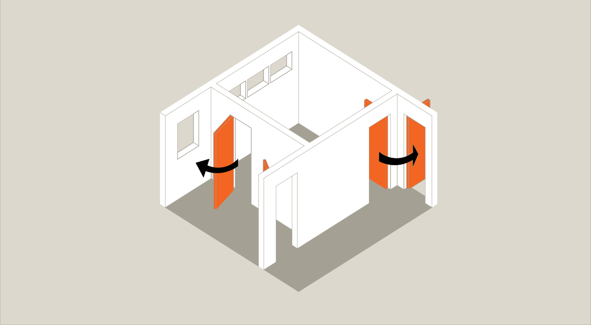
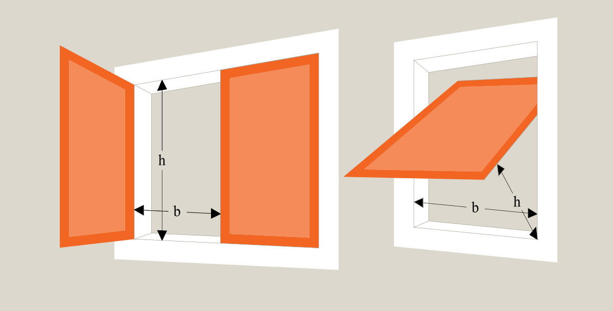

# Brand (§ 82 - § 158)

## Se alle vejledninger om Brand (§ 82 - § 158)

- [Vejledende udtalelse om bygningsreglementets brandkrav efter 1. juli 2018](../../../vejledende-udtalelse-om-bygningsreglementets-brandkrav)
- [Eksempelsamling](../../../eksempelsamling)
- [Bygningsreglementets vejledning om brand - generelt - Under udarbejdelse](../..)
  - [Præaccepterede løsninger - Enfamiliehuse](..)
- [Øvrige vejledninger under udarbejdelse](../../../kommende-vejledninger)

## Præaccepterede løsninger - Enfamiliehuse

### Forord

[1.0.](../generelt)

### Generelt

[1.1.](../dokumentation)

### Dokumentation

[2.0.](../evakuering-og-redning-af-personer)

### Evakuering og redning af personer

[2.1.](../tiltag-til-at-goere-opmaerksom-paa-en-brands-opstaaen)

### Tiltag til at gøre opmærksom på en brands opståen

[2.2.](./)

### Redningsåbninger til personredning

Det fremgår af bygningsreglementet 2018, kap. 5, § 97, at brandmæssige enheder til personophold skal indrettes med redningsåbninger, med mindre et tilsvarende sikkerhedsniveau kan opnås på anden vis.

Ydermere fremgår det af bygningsreglementet 2018, kap. 5, § 98, at redningsåbninger skal designes og udføres under hensyn til:

1.  At personer i rummet skal kunne give sig til kende.

2.  Antallet af personer, som rummet er beregnet til.

3.  At redningsåbninger kan anvendes til redning af personer via redningsberedskabets stiger afhængigt af bygningens højde.

4.  At redningsåbninger i brandmæssige enheder kan åbnes uden brug af nøgle eller særligt udstyr, når der opholder sig personer i de pågældende brandmæssige enheder.

\

Redningsåbninger giver de personer, der opholder sig i bygningen, mulighed for at give sig til kende over for personer udenfor bygningen, herunder redningsberedskabet. Derudover kan redningsåbninger give mulighed for, at personer enten ved egen hjælp eller med hjælp fra redningsberedskabet kan redde sig ud af bygningen. Fordi redningsåbningerne i tilfælde af brand skal kunne bruges af personerne i bygningen, skal de kunne åbnes uden brug af nøgle eller særligt udstyr.

Som det fremgår af § 97, så vil man kunne undlade at udføre bygningen med redningsåbninger, hvis det på anden måde sikres, at personer til enhver tid selv kan forlade bygningen og nå til et sikkert sted i det fri. Dette er ikke omfattet af de præ-accepterede løsninger og Brandklasse 1.

\

### Præaccepterede løsninger for redningsåbninger

\

Selvstændige rum som beboelsesrum og køkken skal udføres med mindst 1 redningsåbning enten som vindue, dør eller lem direkte til det fri. Hvis der fra et rum er redningsmulighed gennem to af hinanden uafhængige naborum, kan redningsåbning i det pågældende rum udelades, jf. *Figur 1.* Princippet kan for eksempel anvendes i forbindelse med opsætning af en udestue foran en redningsåbning.

### 

Figur 1: Adgang til redningsåbning via naborum

Placeringen af karnapper, udestuer og lignende må ikke hindre redningsberedskabets mulighed for adgang til redningsåbningerne. Dette er for eksempel opfyldt, hvis det er muligt at nå redningsåbninger, der ligger over karnapper, udestuer og lignende med en brandstige eller ved, at taget over karnapper, udestuer og lignende udføres trædefast.

Redningsåbninger skal udformes således, at:

> \- Der er en fri højde h på mindst 0,6 m og en fri bredde b på mindst 0,5 m. Der skal tages højde for, om redningsåbningerne er topstyret eller midterhængte vinduer, jf. *Figur 2*,
>
> \- Summen af højden h og bredden b er mindst 1,5 m, jf. *Figur 2*,
>
> \- Underkant af redningsåbninger, som er placeret mindre end 2,0 m over terræn, kan dog udføres med en højde h på mindst 0,5 m.
>
> \- Højden fra overkant af gulv til underkant af redningsåbning må ikke være større end 1,2 m. Alternativt kan der etableres et fast trin eller lignende, så redningsåbningen kan nås indefra.
>
> \- Redningsåbninger let og uhindret kan betjenes og fastholdes i åben stilling således, at der er fri passage såvel indefra som udefra.
>
> \- Solafskærmninger og lignende ikke kan forhindre brugen af redningsåbningerne.
>
> \- Redningsåbningerne let og uhindret kan åbnes indefra uden brug af nøgle eller særligt værktøj.

### 

Figur 2: Udformning af redningsåbning.

[3.0.](../baerende-konstruktioners-braendmodstandsevne)

### Bærende konstruktioners brændmodstandsevne

[4.0.](../antaendelse-brand-og-roegspredning)

### Antændelse, brand- og røgspredning

[4.1.](../risiko-for-antaendelse)

### Risiko for antændelse

[4.2](../brand-og-roegspredning-i-det-rum-hvor-branden-opstaar)

### Brand og røgspredning i det rum, hvor branden opstår

[4.3.](../brand-og-roegspredning-i-den-bygning-hvor-branden-opstaar-eller-til-bygninger-paa-samme-grund)

### Brand og røgspredning i den bygning, hvor branden opstår eller til bygninger på samme grund

[4.4](../saerlige-forhold-ved-sammenbyggede-enfamiliehuse)

### Særlige forhold ved sammenbyggede enfamiliehuse

[4.5.](../brandspredning-til-bygninger-paa-samme-grund)

### Brandspredning til bygninger på samme grund

[4.6.](../saerlige-forhold-ved-sekundaer-bebyggelse)

### Særlige forhold ved sekundær bebyggelse

[4.7.](../saerlige-forhold-ved-integrerede-garager-carporte-og-udhuse)

### Særlige forhold ved integrerede garager, carporte og udhuse

[5.0.](../redningsberedskabets-indsatsmulighed)

### Redningsberedskabets indsatsmulighed

[6.0.](../drift-kontrol-og-vedligehold)

### Drift, kontrol og vedligehold

\
