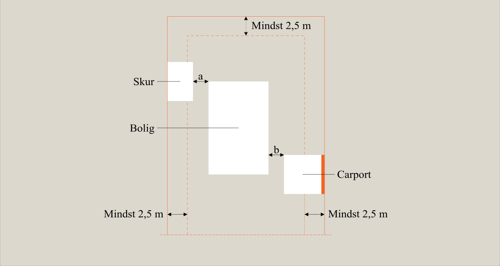
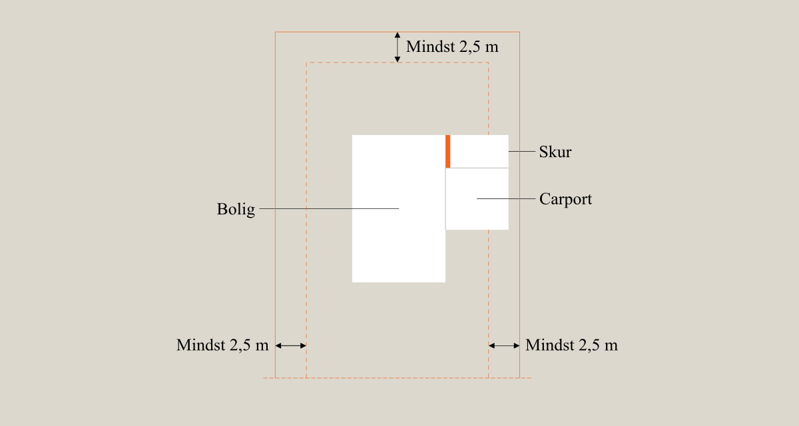

# Brand (§ 82 - § 158)

## Se alle vejledninger om Brand (§ 82 - § 158)

- [Vejledende udtalelse om bygningsreglementets brandkrav efter 1. juli 2018](../../../vejledende-udtalelse-om-bygningsreglementets-brandkrav)
- [Eksempelsamling](../../../eksempelsamling)
- [Bygningsreglementets vejledning om brand - generelt - Under udarbejdelse](../..)
  - [Præaccepterede løsninger - Enfamiliehuse](..)
- [Øvrige vejledninger under udarbejdelse](../../../kommende-vejledninger)

## Præaccepterede løsninger - Enfamiliehuse

### Forord

[1.0.](../generelt)

### Generelt

[1.1.](../dokumentation)

### Dokumentation

[2.0.](../evakuering-og-redning-af-personer)

### Evakuering og redning af personer

[2.1.](../tiltag-til-at-goere-opmaerksom-paa-en-brands-opstaaen)

### Tiltag til at gøre opmærksom på en brands opståen

[2.2.](../redningsaabninger-til-personredning)

### Redningsåbninger til personredning

[3.0.](../baerende-konstruktioners-braendmodstandsevne)

### Bærende konstruktioners brændmodstandsevne

[4.0.](../antaendelse-brand-og-roegspredning)

### Antændelse, brand- og røgspredning

[4.1.](../risiko-for-antaendelse)

### Risiko for antændelse

[4.2](../brand-og-roegspredning-i-det-rum-hvor-branden-opstaar)

### Brand og røgspredning i det rum, hvor branden opstår

[4.3.](../brand-og-roegspredning-i-den-bygning-hvor-branden-opstaar-eller-til-bygninger-paa-samme-grund)

### Brand og røgspredning i den bygning, hvor branden opstår eller til bygninger på samme grund

[4.4](../saerlige-forhold-ved-sammenbyggede-enfamiliehuse)

### Særlige forhold ved sammenbyggede enfamiliehuse

[4.5.](../brandspredning-til-bygninger-paa-samme-grund)

### Brandspredning til bygninger på samme grund

[4.6.](./)

### Særlige forhold ved sekundær bebyggelse

Sekundær bebyggelse omfatter garager, carporte, udhuse, hønsehuse, drivhuse, overdækkede terrasser og lignende.

I brandmæssigt henseende betragtes sekundær bebyggelse på samme grund som sammenbyggede, når der er mindre end 2,5 m mellem bebyggelserne. Sekundær bebyggelse der er sammenbygget betragtes som én bebyggelse med et samlet areal.

Det er ved sekundær bebyggelse vigtigt at forhindre, at der på en grund bliver en sammenhængende bebyggelse over skel, uden at bygningerne på grunden adskilles brandmæssigt.

\

### 

### Præaccepterede løsninger for sekundær bebyggelses afstand til andre bygninger på samme grund og til skel, vej- og stimidte

[\
]{#_Toc513114516}

Sekundær bebyggelse med tagdækning, som ikke er tagdækning klasse B~roof~ (t2) eller transparente tagelementer klasse E-2d, skal holdes i en afstand af 10 m fra andre bygninger på samme grund. Sekundær bebyggelse med brandsikret stråtag kan dog opføres i en afstand af 5 m fra andre bygninger på samme grund.

Sekundær bebyggelse skal holdes i følgende afstande fra naboskel, vej- og stimidte afhængig af deres tagdækning:

\- Sekundær bebyggelse med tagdækning klasse B~ROOF~(t2), eller transparente tagelementer klasse E-d2: 2,5 m

\- Sekundær bebyggelse med brandsikrede stråtage: 5,0 m

\- Sekundær bebyggelse med tagdækning, som ikke er tagdækning klasse B~ROOF~(t2), brandsikrede stråtage eller transparente tagelementer klasse E-d2: 10,0 m

\

Sekundær bebyggelse med tagdækning klasse B~ROOF~(t2), eller transparente tagelementer kan placeres i skel eller tættere på skel end 2,5 m, såfremt bebyggelsen er placeres enten 2,5 m fra andre bygninger (bolig og anden sekundær bebyggelse) eller udføres med væg mod skel mindst udført som bygningsdel klasse EI 60.

Hvis afstanden mellem bolig og udhus samt garage er mindre end 2,5 m, skal udhuset/garagen udføres med væg mod skel mindst udført som bygningsdel klasse EI 60, jf. Figur 12*.*

I tilknytning til sommerhuse, ferieboliger og campinghytter må sekundære bygninger ikke opføres tættere på skel mod nabo, vej- eller stimidte end 2,5 m.

### 

Figur 12: Risiko for brandspredning til anden grund via småbygninger

I forbindelse med sammenbyggede enfamiliehuse skal sekundær bebyggelse, når den ligger i en afstand af mindre end 5,0 m fra enfamiliehuset, udføres med væg mod skel mindst som bygningsdel klasse EI 60. Væggen skal slutte tæt til den yderste tagdækning. Er der kun bygninger mod ét skel, kan der ses bort fra dette.

I forbindelse med et af skellene kan sekundær bebyggelse placeres tættere på et enfamiliehus end 2,5 m -- eventuelt sammenbygges -- uden særlig brandmæssige foranstaltninger imod skel, såfremt følgende er opfyldt for den sekundære bebyggelse:

1.  Det samlede areal af bebyggelse, der er placeres i eller tættere på skel end 2,5 m, er højst 50 m².
2.  De sider, der vender mod skel, har ikke en større samlet længde end 12 m. Anbringes en bebyggelse i et hjørne af grunden, medregnes kun den længste side. Anbringes en bebyggelse tættere på end 2,5 m til to modstående skel, medregnes kun den længste side. Udhæng på mere 0,5 m medregnes til bebyggelsen længde. Længden af en carport måles fra 0,5 m inden for tagfladens begrænsning.
3.  Ingen del af bebyggelsens ydervægge eller tag er højere end 2,5 over terræn eller det for bebyggelsen fastsatte niveauplan indenfor en afstand på 2,5 m fra skel.
4.  Ingen vinduer imod skel.

\

Er ovennævnte sekundære bebyggelse en garage eller et udhus, som sammenbygges eller ligger tættere på end 1,0 m fra enfamiliehuset, skal bygningerne adskilles fra enfamiliehuset med bygningsdele udført mindst som bygningsdel klasse EI 30. Bygningsdelen skal føres op i tæt forbindelse med den yderste tagdækning. Eventuel dør skal udføres mindst som dør klasse EI~2~ 30-C, jf. *Figur 13*.

### 

Figur 13: Bygninger mod ét skel

[4.7.](../saerlige-forhold-ved-integrerede-garager-carporte-og-udhuse)

### Særlige forhold ved integrerede garager, carporte og udhuse

[5.0.](../redningsberedskabets-indsatsmulighed)

### Redningsberedskabets indsatsmulighed

[6.0.](../drift-kontrol-og-vedligehold)

### Drift, kontrol og vedligehold

\
