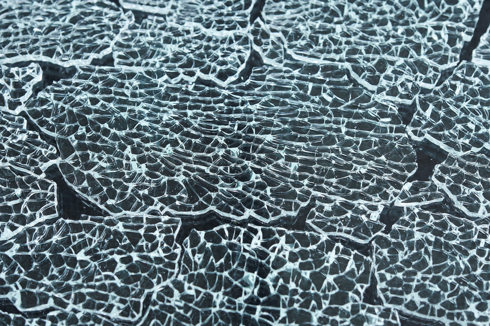

# Bygningens indretning (§ 196 - § 241)

## Se alle vejledninger om Bygningens indretning (§ 196 - § 241)

- [Bygningsreglementets vejledning om glaspartier, glasflader og værn af glas i bygninger](..)
- [DS Håndbog 186: Tilgængelighedskrav i BR18 holdt op mod DS/ISO 21542.](../../ds-186)

## Bygningsreglementets vejledning om glaspartier, glasflader og værn af glas i bygninger

### Kolofon

[1.0.0.](../1_0_0_forord)

### Indledning

[1.1.0.](../1_1_0_anvendelse)

### Anvendelse

[1.2.0.](../1_2_0_forudsaetninger)

### Forudsætninger

[2.0.0.](../2_0_0_vurdering_af_risiko_for_personskader)

### Vurdering af risiko for personskader

[2.1.0.](../2_1_0_glassets_placering)

### Glassets placering - definitioner

[2.2.0.](../2_2_0_niveauspring_og_hoejdeforskelle)

### Niveauspring og højdeforskelle

[2.3.0.](../2_3_0_sikring_mod_skaereskader)

### Sikring mod skæreskader

[2.3.1.](../2_3_1_boliger)

### Boliger

[2.3.2.](../2_3_2_kontorer)

### Kontorer

[2.3.3.](../2_3_3_skoler_daginstitutioner)

### Skoler, daginstitutioner mv.

[2.3.4.](../2_3_4_restauranter_biografer_udstillinger)

### Restauranter, biografer, udstillinger mv.

[2.3.5.](../2_3_5_gymnastiksale_sportshaller)

### Gymnastiksale, sportshaller mv.

[2.3.6.](../2_3_6_musikhuse_forsamlingslokaler)

### Musikhuse, forsamlingslokaler mv.

[2.3.7.](../2_3_7_butikker)

### Butikker

[2.4.0.](../2_4_0_sikring_mod_at_personer_kan_styrte_ned)

### Sikring mod at personer kan styrte ned

[2.4.1.](../2_4_1_vaern)

### Værn

[2.4.2.](../2_4_2_gulve_og_trapper)

### Gulve og trapper

[2.5.0.](../2_5_0_sikring_mod_nedfald_af_glas)

### Sikring mod nedfald af glas

[3.0.0.](../3_0_0_brug_af_bygningsglas)

### Brug af bygningsglas

[3.0.1.](../3_0_1_vinduer)

### Vinduer

[3.0.2.](../3_0_2_yderdoere)

### Yderdøre

[3.0.3.](../3_0_3_ydervaegge)

### Ydervægge

[3.0.4.](../3_0_4_skillevaegge_og_indvendige_doere)

### Skillevægge og indvendige døre

[3.0.5.](../3_0_5_ovenlysvinduer)

### Ovenlysvinduer

[3.0.6.](../3_0_6_glastage_glasoverdaekninger_glaslofter_og_spejle)

### Glastage, glasoverdækninger, glaslofter og spejle

[3.0.7.](../3_0_7_fritstaaende_glasskaerme)

### Fritstående glasskærme

[3.0.8.](../3_0_8_udskiftning_af_bygningsglas)

### Udskiftning af bygningsglas

[3.0.9.](../3_0_9_3_lags_ruder_og_sikkerhedsglas)

### 3-lags ruder og sikkerhedsglas

[3.1.0.](../3_1_0_eksempler_paa_brug_af_glas_til_bygninger)

### Eksempler på brug af glas til bygninger

[4.0.0.](./)

### Bygningsglas og glastyper

Glasmaterialers styrke og brudmønster er ofte afgørende for valget af bygningsglas. En oversigt over glastyper og deres brugsegenskaber fremgår nedenfor.

Planglas kan klassificeres for personsikkerhed efter den europæiske standard EN 12600 i tre principielle klasser i forhold til glassets ydeevne i forbindelse med stød og efter brudform.

Glassets styrke (bøjningsstyrke) kan forbedres væsentligt ved varmebehandling, medens glassets elasticitet (elasticitetsmodul) ikke bliver påvirket af behandlingen.

Enkeltglas og glas i termoruder med samme glastykkelse vil have stort set samme styrke overfor stød fra hårde genstande. Termoruder vil dog have en større styrke overfor stumpe stød, f.eks. fra en person der kolliderer med ruden, end enkeltglas i samme tykkelse, fordi der opstår et samvirke mellem glaslagene i termoruden på grund af luftmellemrummet mellem glassene.

Alt glas er følsomt overfor stød især på kanterne (kantskader), men følgevirkningerne af skaderne er ret forskellige. Se brudformer for planglas nedenfor.

**Brudtype A**

Ved brud dannes frie, skarpe og spidse brudflader, der kan forårsage alvorlige skæreskader.

### 

**Brudtype B**

Ved brud fastholder en folie glasset med reduceret risiko for skæreskader.

### 

**Brudtype C**

Ved brud granulerer glasset med reduceret risiko for skæreskader.

### 

[4.1.0.](../4_1_0_almindeligt-glas)

### Almindeligt glas

[4.2.0.](../4_2_0_varmeforstaerket_glas)

### Varmeforstærket glas

[4.3.0.](../4_3_0_sikkerhedsglas)

### Sikkerhedsglas

[4.3.1.](../4_3_1_lamineret_glas)

### Lamineret glas

[4.3.2.](../4_3_2_haerdet_glas)

### Hærdet glas

[4.4.0.](../4_4_0_glastypers_egenskaber_og_anvendelse)

### Glastypers egenskaber og anvendelse

\
