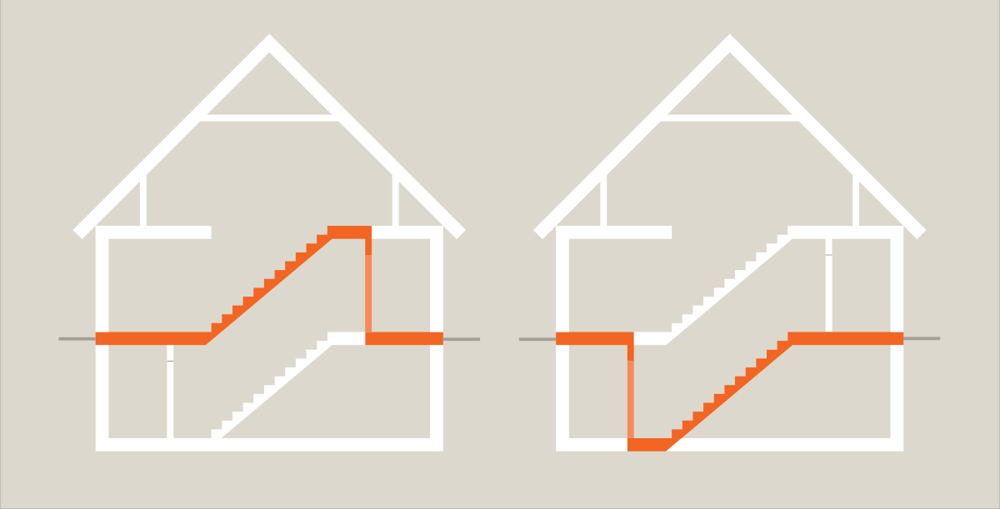
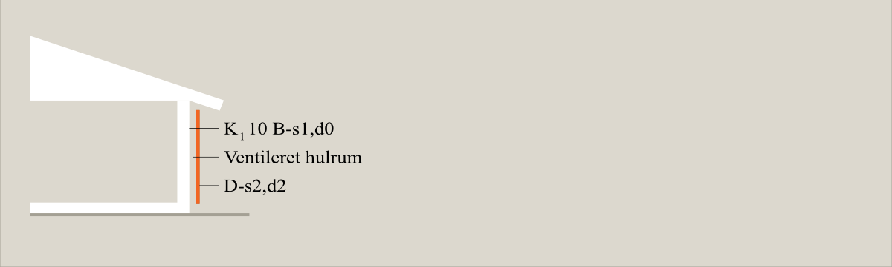
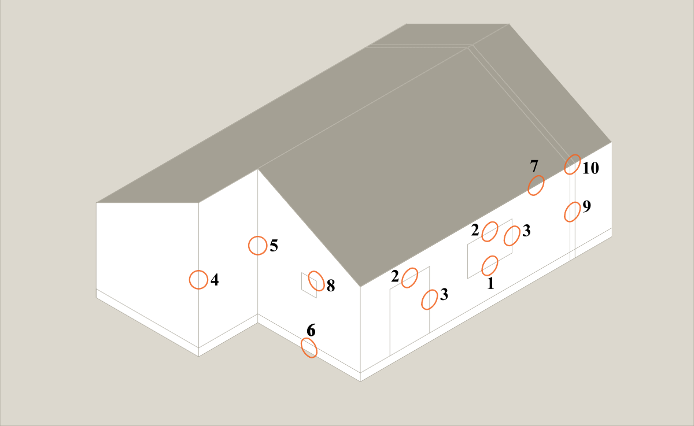
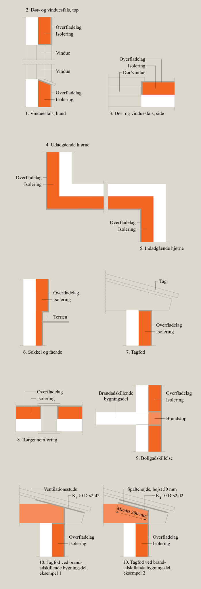

# Brand (§ 82 - § 158)

## Se alle vejledninger om Brand (§ 82 - § 158)

- [Vejledende udtalelse om bygningsreglementets brandkrav efter 1. juli 2018](../../../vejledende-udtalelse-om-bygningsreglementets-brandkrav)
- [Eksempelsamling](../../../eksempelsamling)
- [Bygningsreglements vejledning til kapitel 5 - Brand](../..)
  - [Bilag 1 - Præ-accepterede løsninger - Enfamiliehuse](..)
  - [Bilag 3 - Præ-accepterede løsninger - Kontorbygninger](../../kontorbygninger)
  - 
- [Øvrige vejledninger under udarbejdelse](../../../kommende-vejledninger)

## Bilag 1 - Præ-accepterede løsninger - Enfamiliehuse

### Forord

[1.0.](../generelt)

### Generelt

[1.1.](../dokumentation)

### Dokumentation

[2.0.](../evakuering-og-redning-af-personer)

### Evakuering og redning af personer

[2.1.](../tiltag-til-at-goere-opmaerksom-paa-en-brands-opstaaen)

### Tiltag til at gøre opmærksom på en brands opståen

[2.2.](../redningsaabninger-til-personredning)

### Redningsåbninger til personredning

[3.0.](../baerende-konstruktioners-braendmodstandsevne)

### Bærende konstruktioners brændmodstandsevne

[4.0.](../antaendelse-brand-og-roegspredning)

### Antændelse, brand- og røgspredning

[4.1.](../risiko-for-antaendelse)

### Risiko for antændelse

[4.2](../brand-og-roegspredning-i-det-rum-hvor-branden-opstaar)

### Brand og røgspredning i det rum, hvor branden opstår

[4.3.](./)

### Brand og røgspredning i den bygning, hvor branden opstår eller til bygninger på samme grund

Det fremgår af bygningsreglementet 2018, kap. 5, § 111, at bygningen skal opdeles i en eller flere brandmæssige enheder.

Derudover fremgår det af bygningsreglementet 2018, kap. 5, § 118, at bygninger på samme grund skal placeres i en sådan afstand til hinanden eller udføres på en sådan måde, at brandspredning mellem bygningerne begrænses i den tid, som er nødvendig for evakuering og redningsberedskabets indsats.

Opdeling og placering af bygninger skal forhindre brand- og røgspredning i den bygning, hvor branden opstår, og til bygninger på samme grund.

\

### 

### Præaccepterede løsninger for brandmæssig opdeling i den enkelte boligenhed

[\
]{#_Toc513114507}

I boliger med 2 etager og kælder, skal etageadskillelsen over kælderen udføres mindst som bygningsdel klasse EI 60. Trappe mellem kælder og stueetage skal enten adskilles fra kælder eller fra stueetage med bygningsdel udført mindst som klasse EI 60 og med dør mindst som dør klasse EI~2~ 30-C, jf. *Figur 3*.

Enhver gennemføring i brandklassificerede bygningsdele skal udføres, så bygningsdelenes brandmæssige egenskaber ikke forringes.

Der er ikke yderligere krav til brandmæssige opdelinger i den enkelte boligenhed.

### 

Figur 3: På skitsen til venstre er vist, hvorledes adskillelsen mod kælder skal ske i stueetagen. På skitsen til højre er vist, hvorledes adskillelsen skal ske i kælderen. Den brandmæssige adskillelse er vist med to nuancer af orange.

### [Præaccepterede løsninger for udvendige vægoverflader]{#_Toc513114508}

[\
]{#_Toc513114508}

Udvendige overflader på ydervægge skal udføres mindst som beklædning klasse K~1~ 10 D-s2,d2 \[klasse 2 beklædning\]. Alternativt kan udvendige overflader udføres mindst som materiale klasse D-s2,d2 \[klasse B materiale\].

Uden på en ydervæg, der er udført med udvendig overflade mindst som beklædning klasse K~1~ 10 B-s1,d0 \[klasse 1 beklædning\], kan der anbringes en regnskærm med bagvedliggende hulrum. Regnskærmen (inklusive ophængningssystemet) skal udføres mindst som materiale klasse D-s2,d2 \[klasse B materiale\], jf. Figur 4.

### 

Figur 4: Eksempel på regnskærm

### [Præaccepterede løsninger for anvendelse af isoleringsmaterialer (indvendigt og udvendigt)]{#_Toc513114509}

\

Isoleringsmaterialer skal anvendes på en sådan måde, at det ikke medfører en øget brandrisiko. Ved et isoleringsmateriale forstås i denne sammenhæng ethvert materiale, der har en densitet, som er mindre end 300 kg/m³.

Isoleringsmaterialer skal anvendes på følgende måde:

\

> \- Isoleringsmaterialer, der opfylder kravene til mindst materiale klasse B-s1, d0 \[klasse A materiale\], kan anvendes uden begrænsninger.

> \- Isoleringsmaterialer, der opfylder kravene til mindst materiale klasse D-s2,d2 \[klasse B materiale\], kan anvendes med de begrænsninger, der i den konkrete sammenhæng gælder for alle andre materialer.

> \- Isoleringsmaterialer, der ikke mindst er materiale klasse D-s2,d2 \[klasse B materiale\], kan anvendes:
>
> \

> > \- Ovenpå etageadskillelser, som er mindst bygningsdel klasse REI 60 A2-s1,d0,
>
> > \- I vægge, hvis isoleringsmaterialet på begge sider af en lodret bygningsdel er afdækket med mindst bygningsdel klasse REI/EI 30 A2-s1,d0,
>
> > \- I tagkonstruktioner, såfremt den underliggende del af tagkonstruktionen er mindst bygningsdel klasse REI/EI 30,
>
> > \- I terrændæk og i krybekælderdæk, eller
>
> > \- I bygninger, hvor gulv i øverste etage er højst 9,6 m over terræn, når:

> > > \
> >
> > > \- Isoleringsmaterialet er afdækket med mindst beklædning klasse K1 10 B-s1,d0 \[klasse 1 beklædning\] langs begge sider af en lodret bygningsdel og langs undersiden af en vandret eller skråtstillet bygningsdel, såfremt der ikke er hulrum mellem isoleringsmaterialet og beklædningen, eller
>
> > > \- Isoleringsmaterialet er afdækket med mindst bygningsdel klasse EI 30 langs begge sider af en lodret bygningsdel og langs undersiden af en vandret eller skråtstillet bygningsdel.
> >
> > > \

Isoleringsmaterialer, der ikke mindst er materiale klasse B-s1,d0 \[klasse A materiale\], må ikke anvendes i bygninger, hvor højde til gulv i øverste etage er mere end 5,1 m over terræn, og som har bærende konstruktioner, der ikke er udført af mindst klasse A2-s1,d0 \[ubrændbart materiale\].

Endvidere må disse isoleringsmaterialer ikke anvendes uden på bygninger med tagdækning, som ikke er mindst tagdækning klasse B~ROOF~(t2).

Til udvendig isolering af fritliggende enfamiliehuse og helt eller delvist sammenbyggede enfamiliehuse i højst 2 etager med ydervægge af letbeton, beton eller murværk, kan der anvendes isoleringsmateriale, der ikke er mindst materiale klasse D-s2,d2 \[klasse B materiale\], når disse inddækkes med et pudssystem eller tilsvarende udvendige overfladelag.

Det er generelt vigtigt at være opmærksom på, at isoleringsmaterialet inddækkes langs alle bygningsdelenes flader både lodret og vandret, så isoleringsmaterialet ingen steder er blotlagt.

Tilsvarende lag i forhold til et pudssystem er for eksempel natursten, keramik, mursten, beton og letbeton. En forudsætning er dog at overfladelag og isolering, prøvet som et samlet facadesystem, kan dokumenteres at overholde følgende kriterier ved prøvning efter den svenske brandprøvningsmetode *SP FIRE 105 -- Large scale testing og facade systems*:

1.  Der må ikke falde store dele ned, for eksempel store pudsstykker, plader eller lignende, som kan udgøre en fare for personer under evakuering eller for redningsmandskabet,
2.  Brandspredning på overfladen samt i væggen skal begrænses til underkanten af vinduet, som er 2 etager over brandrummet, og der må ikke opstå flammer udvendigt, som kan give anledning til antændelse af tagudhæng, som er beliggende over vinduet 2 etager over brandrummet. Som ligeværdigt alternativ gælder, at røggastemperaturen umiddelbart under tagudhænget ikke må overstige 500 °C i en sammenhængende periode i mere end 2 minutter eller 450 °C i mere end 10 minutter. Kriteriet er et udtryk for, hvor meget det samlede facadesystem bidrager til brandens udvikling.

\

Ved brug af isoleringsmaterialer, der ikke er mindst materiale klasse D-s2,d2 \[klasse B materiale\], skal isoleringsmaterialet afdækkes langs alle bygningsdelenes flader, så isoleringsmaterialet ingen steder er blotlagt. Det er særligt vigtigt langs bygningsdelenes kanter og langs åbninger i bygningsdelene, for eksempel langs sokkel og langs åbninger til vinduer og døre, men også ved udtag til ventilation mv.

Facadesystemet skal monteres, som beskrevet i monteringsanvisningen fra leverandøren.

Se Figur 5 og Figur 6 for eksempler på områder, hvor det er vigtig at sikre, at afdækningen af isoleringsmaterialet, som ikke mindst er materiale klasse D-s2,ds \[klasse B materiale\], er udført korrekt.

Det skal sikres, at overfladerne på systemer med isoleringsmaterialer, der ikke er mindst materiale klasse D-s2,d2 \[klasse B materiale\],  er robuste overfor de oftest forekommende belastninger, så sandsynligheden for at der opstår skader, som forringer brandsikkerheden, minimeres. Eftervisning af systemernes robusthed skal ske ved anvendelse af ISO 7892: 1988, Vertical building elements -- Impact resistance tests -- Impact bodies and general test procedures, som beskrevet i ETAG 004: 2000 Guideline for european technical approval of external thermal insulation composite systems with rendering.

Ved montage af isoleringsmateriale, der ikke er mindst materiale klasse D-s2,d2 \[klasse B materiale\],  skal der tages hensyn til risikoen for antændelse af isoleringsmateriale, som endnu ikke er inddækket. Isoleringsmaterialet skal derfor løbende afdækkes under byggeprocessen, og evt. antændelseskilder skal holdes under kontrol.

### 

Figur 5: Eksempler på områder, hvor det er vigtigt at sikre, at afdækningen af isoleringsmaterialet, som ikke mindst er materiale klasse D-s2,d2 \[klasse B materiale\], er korrekt udført. Figur 6 viser eksempler på inddækning ved disse områder.

### 

Figur 6: Eksempler på indækning af isoleringsmateriale, som ikke mindst er materiale klasse D-s2,d2 \[klasse B materiale. Bemærk at nr. 10 er eksempler på inddækning ved tagudhæng.

### [Præaccepterede løsninger for afstand mellem bygninger på samme grund afhængigt af tagdækning]{#_Ref512857960}

[\
]{#_Ref512857960}

Afstandene, som er beskrevet i dette afsnit, tager udelukkende højde for de brandmæssige forhold. Der kan derfor være andre forhold i bygningsreglementet, som medfører, at der skal være en større afstand til naboskel, sti- eller vejmidte.

Afstandene måles vandret uden hensyntagen til eventuelle terrænforskelle. Den angivne afstand er den mindste fri afstand mellem bygninger på samme grund. De beskrevne afstande kan for tagudhæng, vindskeder, lætage over døre, gesimser og lignende mindre bygningsdele normalt nedsættes med 0,5 meter.

Tagdækninger skal udføres mindst som tagdækning klasse B~ROOF~(t2).

Karnapper, udestuer og lignende mindre bygningsdele kan dog udføres med transparente tagelementer klasse E-d2. Et transparent tagelement kan for eksempel være et ovenlys.

Tagdækning af strå (stråtag) opfylder ikke kravene til tagdækning klasse B~ROOF~(t2) \[klasse T tagdækning\], men kan anvendes på enfamiliehuse, der er placeret mindst 7,5 m fra bygninger på samme grund med tagdækning klasse B~ROOF~(t2), og mindst 10,0 m fra enfamiliehuse på samme grund med en tagdækning, der ikke er mindst klasse B~ROOF~(t2). Ovenstående afstande kan kun anvendes, hvis stråtagene er brandsikret. For eksempler på bygningers placering på samme grund se Figur 7.

### 

Figur 7: Afstanden mellem enfamiliehuse på samme grund, hvis et eller flere af bygninger har tagdækning, som ikke er tagdækning klasse Broof(t2), men hvor stråtagene er brandsikret.

Stråtaget er brandsikret når følgende er overholdt:

> \- Stråtaget er udført af traditionelle tagrør og tækket direkte, uden bagvedliggende hulrum, på en bagvedliggende bygningsdel klasse EI 30 udført af materiale klasse D-s2,d2 \[klasse B materiale\]. Tagdækningen af strå fastgøres til underliggende bygningsdel med ubrændbart materiale,
>
> \- Over døre og andre redningsåbninger i bygninger skal stråtage sikres mod nedskridning ved brand.
>
> \

Ved anden tagdækning, som ikke mindst er klasse B~ROOF~(t2), eller hvor tagdækningen er med strå, hvor stråtaget ikke er brandsikret, kan denne tagdækning anvendes på bygninger, der er placeret mindst 12,5 m fra bygninger på samme grund med tagdækning klasse B~ROOF~(t2), og mindst 20 m fra bygninger på samme grund med en tagdækning, der ikke er mindst klasse B~ROOF~(t2), jf. Figur 8.  

Et stråtag skal, uanset om det er brandsikret eller ej, sikres, så der ikke sker nedskridning over døre og redningsåbninger i tilfælde af brand.

### 

Figur 8: Afstanden mellem enfamiliehuse på samme grund, hvis et eller flere af bygningerne har tagdækning, som ikke er tagdækning klasse BROOF(t2), og stråtagene ikke er brandsikret.

[4.4](../saerlige-forhold-ved-sammenbyggede-enfamiliehuse)

### Særlige forhold ved sammenbyggede enfamiliehuse

[4.5.](../brandspredning-til-bygninger-paa-anden-grund)

### Brandspredning til bygninger på anden grund

[4.6.](../saerlige-forhold-ved-sekundaer-bebyggelse)

### Særlige forhold ved sekundær bebyggelse

[4.7.](../saerlige-forhold-ved-integrerede-garager-carporte-og-udhuse)

### Særlige forhold ved integrerede garager, carporte og udhuse

[5.0.](../redningsberedskabets-indsatsmulighed)

### Redningsberedskabets indsatsmulighed

[6.0.](../drift-kontrol-og-vedligehold)

### Drift, kontrol og vedligehold

\
