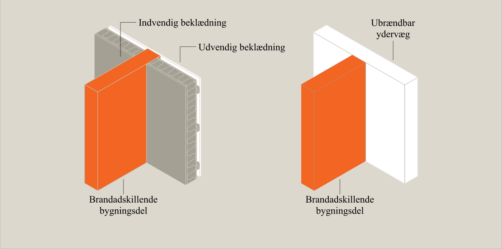
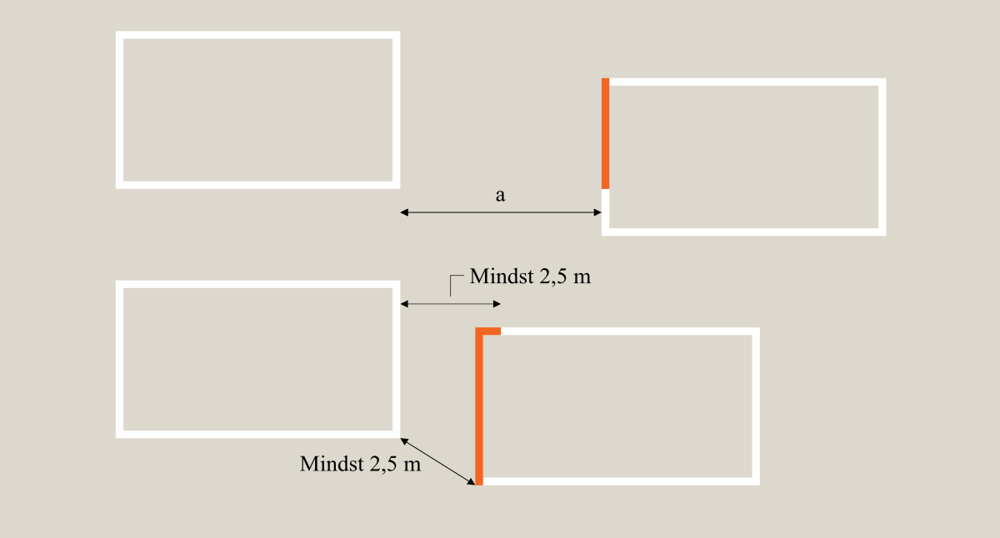
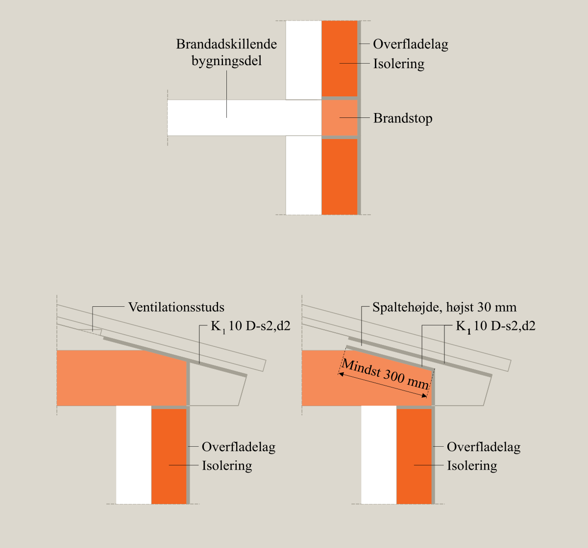

# Brand (§ 82 - § 158)

## Se alle vejledninger om Brand (§ 82 - § 158)

- [Vejledende udtalelse om bygningsreglementets brandkrav efter 1. juli 2018](../../../vejledende-udtalelse-om-bygningsreglementets-brandkrav)
- [Eksempelsamling](../../../eksempelsamling)
- [Bygningsreglements vejledning til kapitel 5 - Brand](../..)
  - [Bilag 1 - Præ-accepterede løsninger - Enfamiliehuse](..)
  - [Bilag 3 - Præ-accepterede løsninger - Kontorbygninger](../../kontorbygninger)
  - 
- [Øvrige vejledninger under udarbejdelse](../../../kommende-vejledninger)

## Bilag 1 - Præ-accepterede løsninger - Enfamiliehuse

### Forord

[1.0.](../generelt)

### Generelt

[1.1.](../dokumentation)

### Dokumentation

[2.0.](../evakuering-og-redning-af-personer)

### Evakuering og redning af personer

[2.1.](../tiltag-til-at-goere-opmaerksom-paa-en-brands-opstaaen)

### Tiltag til at gøre opmærksom på en brands opståen

[2.2.](../redningsaabninger-til-personredning)

### Redningsåbninger til personredning

[3.0.](../baerende-konstruktioners-braendmodstandsevne)

### Bærende konstruktioners brændmodstandsevne

[4.0.](../antaendelse-brand-og-roegspredning)

### Antændelse, brand- og røgspredning

[4.1.](../risiko-for-antaendelse)

### Risiko for antændelse

[4.2](../brand-og-roegspredning-i-det-rum-hvor-branden-opstaar)

### Brand og røgspredning i det rum, hvor branden opstår

[4.3.](../brand-og-roegspredning-i-den-bygning-hvor-branden-opstaar-eller-til-bygninger-paa-samme-grund)

### Brand og røgspredning i den bygning, hvor branden opstår eller til bygninger på samme grund

[4.4](./)

### Særlige forhold ved sammenbyggede enfamiliehuse

I brandmæssig henseende betragtes enfamiliehuse som sammenbyggede, når de ligger med mindre indbyrdes afstand end 5,0 m.

### 

### Præaccepterede løsninger for vandret brandspredning

[\
]{#_Toc513114512}

Hvis der ligger flere enfamiliehuse på samme grund, skal bygningerne brandmæssigt adskilles fra hinanden på en sådan måde, at adskillelsen svarer til den brandmæssige adskillelse, som opnås i forbindelse med tilsvarende bygninger, der er placeret for tæt på skel på udmatrikulerede grunde.

Enfamiliehuse på samme grund, der ligger med mindre end 5,0 m indbyrdes afstand til hinanden, skal adskilles med bygningsdel klasse REI 60 uden åbninger, og adskillelsen skal slutte tæt til undersiden af den yderste tagdækning. Ved ydervægge, der ikke er udført af mindst materiale klasse B-s1,d0  \[klasse A materiale\], skal den brandadskillende bygningsdel mindst føres frem til indersiden af den udvendige beklædning, jf. figur 9.

### 

Figur 9: Eksempel på, hvorledes den brandadskillende bygningsdel skal føres frem til indersiden af den udvendige beklædning.

Ved bygninger med tagudhæng må branden ikke kunne sprede sig uden om den brandadskillende bygningsdel via tagudhænget.

Danner to enfamiliehuse, som er placeret mindre end 2,5 m fra hinanden, en vinkel, der er mindre end 135°, eller er de placeret forskudt fra hinanden, skal det sikres, at der inden for en afstand på 2,5 m ikke sker vandret brandspredning mellem de to enfamiliehuse.

Sikring mod vandret brandspredning skal inden for afstanden på 2,5 m udføres med bygningsdel klasse REI 60 uden åbninger, som slutter tæt til undersiden af den yderste tagdækning.

Når vinklen mellem de to ydervægge er større end 135°, stilles der ingen krav til ydervæggenes brandmodstandsevne på grund af den nedsatte risiko for vandret brandspredning.

Hvis den vinkelrette afstand mellem bygningerne er mindre end 2,5 m, skal der sikres yderligere mod brandspredning langs ydervæggene, jf. figur 10.

### 

Figur 10: Princip for brandmæssig adskillelse. A er større end 2,5 m men mindre end 5 m. Nederste tegning viser principper for vinkelsmitte.

Et enfamiliehus, som sammenbygges med eller ligger i en afstand på mindre end 5,0 m fra en bygning, der ikke er omfattet af denne vejledning, skal adskilles fra den anden bygning med bygningsdele mindst udført som bygningsdel klasse REI 60 A2-s1,d0. Adskillelsen skal slutte tæt til den yderste tagdækning. Ved ydervægge, der ikke er udført af mindst materiale klasse B-s1,d0 \[klasse A materiale\], skal den brandadskillende bygningsdel mindst føres frem til indersiden af den udvendige beklædning. Dette omfatter for eksempel også stuehuse, der sammenbygges med avls- og driftsbygninger.

Sammenbyggede enfamiliehuse kan udføres med stråtag, men der skal i disse tilfælde umiddelbart under stråtaget være indbygget en bygningsdel mindst klasse EI 30. Ethvert hulrum mellem undersiden af stråtaget og oversiden af den nævnte bygningsdel udført som mindst klasse EI 30 må intet sted have en højde, som er større end 100 mm, og hulrummet skal være lukket langs alle kanter af tagfladerne, således at en brand ikke kan sprede sig til hulrummet fra tagfladernes kanter. Lukningerne langs tagfladernes kanter skal udføres med mindst materiale klasse A2-s1,d0 \[ubrændbart materiale\].

Hulrum mellem stråtaget og oversiden af den nævnte bygningsdel udført som mindst klasse EI 30 må ikke passere bygningens brandcelleafgrænsende bygningsdele. På disse steder, skal der udføres brandstop.

For sammenbyggede enfamiliehuse gælder, at udvendig isolering med isoleringsmateriale, som ikke er mindst materiale klasse B-s1,d0 \[klasse A materiale\], skal afbrydes med brandstop for hvert enfamiliehus. Brandstoppet skal udføres med fastholdt isoleringsmateriale, som mindst er klasse A2-s1,d0, jf. Figur 11. Brandstoppet skal udføres, så det sikre, at der ikke sker brandspredning fra en bolig til den næste inden for den tid, det tager at evakuere bygningen. Brandstoppet skal udføres i en bredde svarende til den adskillende vægs bredde.

Når en regnskærm anvendes uden på en ydervæg med beklædning klasse K~1~ 10 B-s1,d0 \[klasse 1 beklædning\], skal det ventilerede hulrum bag regnskærmen iagttages mod brandspredning mellem de sammenbyggede enfamiliehuses brandcelle- og brandsektionsafgrænsende bygningsdele. Brandadskillelserne skal her afbrydes med brandstop, der hindre at brand kan sprede sig via hulrum ud for en anden brandcelle. Brandstoppet skal udføres af et fastholdt isoleringsmateriale, der opfylder kravene til materiale klasse A2-s1,d0 eller træ eller træbaserede plader, som hindrer brandspredning mellem hulrum.

### 

Figur 11: Eksempler på brandstop ved boligadskillelse, og inddækning af isoleringsmateriale, som ikke mindst er materiale klasse D-s2,ds \[klasse B materiale\] ved tagudhæng.

[4.5.](../brandspredning-til-bygninger-paa-anden-grund)

### Brandspredning til bygninger på anden grund

[4.6.](../saerlige-forhold-ved-sekundaer-bebyggelse)

### Særlige forhold ved sekundær bebyggelse

[4.7.](../saerlige-forhold-ved-integrerede-garager-carporte-og-udhuse)

### Særlige forhold ved integrerede garager, carporte og udhuse

[5.0.](../redningsberedskabets-indsatsmulighed)

### Redningsberedskabets indsatsmulighed

[6.0.](../drift-kontrol-og-vedligehold)

### Drift, kontrol og vedligehold

\
