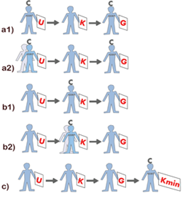

# Certificerede statikers og brandrådgivers virke (§ 531 - § 535)

## Se alle vejledninger om Certificerede statikers og brandrådgivers virke (§ 531 - § 535)

- 
- [Vejledning til BR18 kapitel 32, certificerede statiker og brandrådgivers virke](..)

## Vejledning til BR18 kapitel 32, certificerede statiker og brandrådgivers virke

### Vejledning til § 531 stk. 1

### Vejledning til § 532 stk. 1

### Vejledning til § 533 stk. 1

### Vejledning til § 533 stk. 2

### Vejledning til § 534 stk. 1

Ved den certificerede statikers og brandrådgivers virke ved udarbejdelse, kontrol og godkendelse af den statiske henholdsvis brandtekniske dokumentation sikres, at byggeriet er tilstrækkelig dokumenteret og at dokumentationen er kontrolleret og godkendt.\
\
Udarbejde (U)\
Den certificerede virker som udarbejdende når denne aktivt udarbejder henholdsvis hele eller dele af den statiske dokumentation i overensstemmelse med BR18, kapitel 28 og 30 eller hele eller dele af den brandtekniske dokumentation i overensstemmelse med BR18 kapitel 29 og 30.\
\
Kontrollere (K)\

Den certificerede statiker henholdsvis brandrådgiver skal ved kontrol påse, at

> \- den statiske eller brandtekniske dokumentation er dækkende, tilstrækkelig og overholder bygningsreglementets krav til dokumentation, jf. BR18, kapitel 28 -- 30.\
> - de valgte løsninger er hensigtsmæssige til formålet og følger god byggeskik.\

Kontrolniveauer er angivet i BR18, bilag 4 og bilag 5.

Godkende (G)

Den certificerede statiker henholdsvis brandrådgiver skal være bekendt med dokumentationens indhold, samt at denne er udarbejdet og kontrolleret i overensstemmelse med projektets grundlag.\
Den certificerede statiker henholdsvis brandrådgiver kan alene godkende dokumenter i egen organisation samt start- og sluterklæringen. Dokumenterne godkendes i den organisation, hvori de udfærdiges, det vil sige den organisation, hvor den udarbejdende eller kontrollerende er tilknyttet. Den certificerede skal være bekendt med indholdet af alle dokumenter i den statiske henholdsvis den brandtekniske dokumentation.\

Minimumskrav til den certificeredes virke afhænger af om den certificerede statiker og brandrådgiver virker som udarbejdende eller kontrollant. Kravene fremgår af BR18, kapitel 33 og 34 med tilhørende bilag 4 og 5.

Den certificerede statiker henholdsvis brandrådgiver skal som minimum udarbejde eller kontrollere visse dele af dokumentationen, som beskrevet i BR18, kapitel 33 henholdsvis kap 34.\
\
Hvis der ikke er stillet minimumskrav til, at den certificerede selv skal udarbejde eller kontrollere, jf. BR18, kapitel 33 og 34, kan den certificerede indhente assistance fra en meddesigner, medprojekterende eller medkontrollant, når den certificerede udfærdiger dokumentet i egen organisation, se figur 1 a og 1 b. Det vil være nødvendigt, at den certificerede indhenter kompetent assistance på områder, hvor den certificerede ikke selv har tilstrækkelig kompetence.\
\
Hvis både udarbejdelse og kontrol af dele af dokumentationen udfærdiges af andre kompetente aktører end den certificerede, skal den certificerede ved mindst en minimumskontrol sikre og dokumentere i sluterklæringen, at udarbejdelsen og kontrollen er gennemført, som hvis den certificerede selv var udarbejdende eller kontrollant, se figur 1c. Minimumskontrollen kan suppleres med en udvidet kontrol i form af en stikprøvekontrol, der kontrollerer særligt kritiske dele af det tekniske indhold, og/eller fx en ekstra grundig gennemgang af kontrolrapporterne, både for kontrol af design, projektering og udførelse, for vitale dele af konstruktionen eller brandsikringstiltag. Hvis det ved den certificeredes kontrol viser sig, at dokumentationen af kontrollen ikke er tilstrækkelig, skal den certificerede gennemføre en fuld kontrol af den udarbejdede dokumentation i overensstemmelse med kontrolniveauerne i BR18, bilag 4 henholdsvis bilag 5. Det skal fremgå af redegørelsen til start- og sluterklæringen, hvorledes kontrollen er gennemført.

### 

*Figur 1. a)* Den certificeredes virke som udarbejdende, hvor den certificerede udarbejder dokumentationen. a1: hvor han selv udarbejder eller a2: med indhentet assistance fra meddesignere eller medprojekterende. Hvis der er krav herom, jf. BR18, bilag 4 og 5, er det den certificerede, der godkender dokumentationen i begge tilfælde. Kontrollen gennemføres af anden kompetent aktør. b) Den certificeredes virke som kontrollant, b1 hvor den certificerede selv kontrollerer dokumentationen, b2 med indhentet assistance fra medkontrollant. Den certificerede skal sikre, at kontrollen er gennemført, som hvis han selv havde udført den. Dokumentationen er udarbejdet af anden kompetent aktør og c) Den certificeredes virke når både den udarbejdende, kontrollerende og godkendende opgave er udfærdiget af andre kompetente aktører. Her skal den certificerede som minimum gennemføre en minimumskontrol af dokumentationen, herunder kontrolrapporter.\

*Start- og sluterklæring*

Den certificerede skal udarbejde en redegørelse til starterklæringen, der godtgør, at den statiske henholdsvis brandtekniske dokumentation er fremsendt, og at dokumentationen godtgør, at bygværket vil overholde bygningsreglementets krav til bærende konstruktioner, jf. BR18, kapitel 15, henholdsvis brandforhold, jf. kapitel 5.\
\
Den certificerede skal udarbejde en redegørelse til sluterklæring, der godtgør, at den statiske henholdsvis den brandtekniske dokumentation er fremsendt, og at dokumentationen godtgør, at bygværket overholder bygningsreglementets krav til bærende konstruktioner, jf. BR18, kapitel 15, henholdsvis brandforhold, jf. kapitel 5.\
\
Redegørelserne i start- og sluterklæringerne skal dokumentere, at den certificerede er bekendt med indholdet af dokumentationen, at den er udarbejdet og kontrolleret i overensstemmelse med grundlaget herfor samt erklære, at dokumentationen er i overensstemmelse med og overholder bygningsreglementet og kan anvendes, som den foreligger.\

### Vejledning til § 535 stk. 1

\
