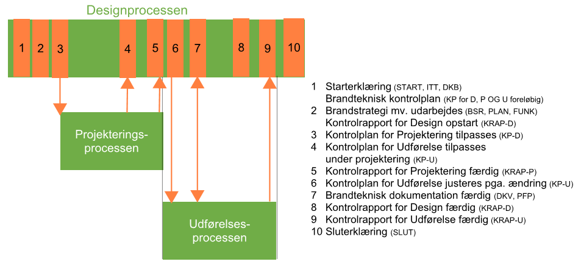

# Certificeret brandrådgivers virke (§ 545 - § 551)

## Vejledning til BR18 kapitel 34, certificeret brandrådgivers virke

### Indledning

I denne vejledning beskrives den certificerede brandrådgivers virke med udgangspunkt i BR18, kapitel 34. Denne vejledning er primært rettet mod den certificerede brandrådgiver, mens *Vejledning til dokumentation og kontrol af brandforhold* er rettet mod alle byggeriets aktører.

I denne vejledning gennemgås og beskrives den certificerede brandrådgivers opgaver og virke, som der er krav om i bygningsreglementet.

 I forhold til dokumentation og kontrol af brandtekniske forhold kan et byggeri opdeles i tre overordnede processer. Disse benævnes:

> • designprocessen, hvor hovedparten af den overordnede brandtekniske dokumentation udfærdiges,
>
> • projekteringsprocessen og
>
> • udførelsesprocessen.

De tre processer overlapper ofte hinanden, men den certificerede brandrådgiver vil være involveret i alle tre processer på forskellige måder.

Gennem alle tre processer skal brandsikringen dokumenteres og kontrolleres. Indledningsvist sker dette ved udarbejdelse og kontrol af den brandtekniske dokumentation inkl.  en brandteknisk kontrolplan. I de videre projekterings- og udførelsesprocesser er den certificerede brandrådgiver tilknyttet gennem den løbende vedligeholdelse af kontrolplanen og kontrol af kontrolrapporter for de projekterendes og de udførendes arbejder. Slutteligt inddrages den certificerede brandrådgiver ved den afsluttende kontrol af den samlede brandtekniske kontrolplan (som dækker både brandteknisk dokumentation samt projektering og udførelse af de brandtekniske tiltag) og udarbejdelsen af sluterklæring.

Designprocessen er den periode, hvor den overordnede disponering og planlægning af byggeriet sker, herunder fastlæggelse af den overordnede brandstrategi med tilhørende funktionskrav og andre forudsætninger. Disse krav og forudsætninger beskrives i de dokumenter, der indsendes til kommunen ved ansøgning om byggetilladelse sammen med starterklæringen, som beskrevet i BR18, kapitel 29. De øvrige brandtekniske dokumenter, som ikke fremsendes med ansøgning om byggetilladelse, udfærdiges efterfølgende af aktører, der ikke nødvendigvis indbefatter den certificerede.

+-----------------+--------------------------------------------------------+-------------------------------+-----------------+
| ID              | Dokumenter                                             | Ansøgning om byggetilladelse  | Færdigmelding   |
+-----------------+--------------------------------------------------------+-------------------------------+-----------------+
| START           | Starterklæring                                         |  X                            |                 |
+-----------------+--------------------------------------------------------+-------------------------------+-----------------+
| SLUT            | Sluterklæring                                          |                               |  X              |
+-----------------+--------------------------------------------------------+-------------------------------+-----------------+
| DBK             | Dokumentation for indplacering i brandklasse(r)        |  X                            |                 |
+-----------------+--------------------------------------------------------+-------------------------------+-----------------+
| ITT             | Erklæring om byggeriet er indsatstaktisk traditionelt  |  X                            |                 |
+-----------------+--------------------------------------------------------+-------------------------------+-----------------+
| BSR             | Brandstrategirapport                                   |                               |  X              |
+-----------------+--------------------------------------------------------+-------------------------------+-----------------+
| PLAN            | Brandplaner                                            |                               |  X              |
+-----------------+--------------------------------------------------------+-------------------------------+-----------------+
| PFP             | Pladsfordelingsplaner og belægningsplaner              |                               |  X              |
|                 |                                                        |                               |                 |
|                 |                                                        |                               |                 |
+-----------------+--------------------------------------------------------+-------------------------------+-----------------+
| DIM             | Brandteknisk dimensionering                            |                               |  X              |
+-----------------+--------------------------------------------------------+-------------------------------+-----------------+
| FUNK            | Funktionsbeskrivelse                                   |                               |  X              |
+-----------------+--------------------------------------------------------+-------------------------------+-----------------+
| KP              | Brandteknisk kontrolplan                               |                               |  X              |
+-----------------+--------------------------------------------------------+-------------------------------+-----------------+
| KRAP            | Brandtekniske kontrolrapporter                         |                               |  X              |
+-----------------+--------------------------------------------------------+-------------------------------+-----------------+
| DKV             | Drifts-, kontrol, og vedligeholdelsesplan (DKV-plan)   |                               |  X              |
+-----------------+--------------------------------------------------------+-------------------------------+-----------------+

Tabel 1: Dokumenter i designprocessen, som skal fremsendes til byggemyndighed, jf. BR18, § 23 og § 509. 

Projekteringsprocessen er den periode, hvor de brandmæssige funktionskrav, forudsætninger mv. udarbejdes. Disse vil typisk blive udarbejdet af de projekterende aktører fra andre fagområder end den certificerede brandrådgivers.

Udførelsesprocessen er den periode, hvor det projekterede og hermed opfyldelsen af de brandmæssige funktionskrav, forudsætninger mv. udføres af de udførende.

BR18 stiller kun direkte krav til, at den certificerede brandrådgiver løser specifikke opgaver i designprocessen. I projekterings- og udførelsesprocesserne løser den certificerede brandrådgiver kun opgaver, hvis dette følger af krav i den brandtekniske kontrolplan.

På nedenstående figur ses et eksempel på en certificeret brandrådgivers deltagelse på et byggeprojekt, hvor udfærdigelse og tilpasning af de brandtekniske dokumenter er koblet til projekterings- og udførelsesprocesserne. Tilpasninger af kontrolplan kan f.eks. ske ved projektændringer eller ved kontrahering med entreprenører.

### 

Figur 1: Eksempel på skematisk oversigt over relationer mellem design-, projekterings- og udførelsesprocessen på et byggeprojekt.

### Vejledning til § 545

### Vejledning til § 546

### Vejledning til § 547

### Vejledning til § 548

### Vejledning til § 549

### Vejledning til § 550

### Vejledning til § 551

\
