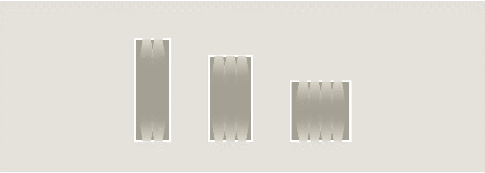

# Bygningens indretning (§ 196 - § 241)

## Se alle vejledninger om Bygningens indretning (§ 196 - § 241)

- [Spørgsmål og svar om bygningens indretning](../../qa)
- [Vejledning om boligindretning](..)
- [Bygningsreglementets vejledning om glaspartier, glasflader og værn af glas i bygninger](../../bygningsglas)
- [DS Håndbog 186: Tilgængelighedskrav i BR18 holdt op mod DS/ISO 21542.](../../ds-186)

## Vejledning om boligindretning

### Kolofon

### Forord

[1.](../boligens-beboere)

### Boligens beboere

[1.1.](../bygning_bolig_hjem)

### Bygning, bolig, hjem

[1.2.](../beboerne)

### Beboerne

[1.3.](../fleksibilitet-i-boligen)

### Fleksibilitet i boligen

[2.](../overordnede-planlaegning)

### Boligens overordnede planlægning

[2.1.](../kontekst-og-kompakthed)

### Boligens kontekst og bebyggelsens kompakthed

[2.2.](../adgangsveje)

### Fælles adgangsveje til boligen

[2.3.](../boligens-storrelse)

### Boligens størrelse

[2.4.](./)

### Boligens rumforløb og rummenes udformning

Den overordnede planløsning sætter rammen for organiseringen af boligens rumforløb og rummenes udformning. Boligens planløsning kan tilføre rummene oplevelsesmæssige kvaliteter og har indflydelse på rummenes indbyrdes sammenhæng, færdslen i boligen samt rummenes anvendelighed. Boligens rum kan være placeret, så de giver mulighed for et interessant blik, fx igennem eller på tværs af boligen, og derigennem være med til at skabe et oplevelsesrigt rumforløb. Det betyder, at der -- ud over de funktionelle krav til rummenes anvendelighed, placering og størrelse -- også kan lægges et arkitektonisk blik på rummets udformning og rumforløbets kvalitet.

En planløsning med smal facade og stor husdybde vil have begrænset fleksibilitet ift. indretningen, da meget areal optages af gangforløb. Den dybe bolig har, på trods af vinduer i facaderne, et mørkt område midt i boligen, der typisk ikke opleves nær så attraktivt som rummene, der ligger ud til facaden. I den mørke del bør der kun placeres rum uden ophold som fx fordelingsareal, trappe og skabsrum. Modsat vil en plan med lille husdybde og med en bredere facade give mulighed for at placere flere funktioner ud til facaden i den lyse del af boligen.

Udformningen og proportioneringen af boligens enkelte rum har betydning for både op-levelsen og anvendeligheden. Vekslen mellem høje og lavere rumhøjder, eller mellem store og små rum, kan give interessante rumforløb og dermed øge boligkvaliteten. Et meget højloftet rum, fx en stue gennem halvanden eller to etager, kan give boligen et åbent og rummeligt præg. Samtidig med at et højt vindue kan trække lyset længer ind i rummet.

Åbninger i etageadskillelsen kan være en måde at skabe en tættere forbindelse imellem to etager. Man bør dog være opmærksom på, at rum gennem to etager kan give uheldig varmefordeling samt eventuelle lyd-, træk- og lugtgener.

Rige rumoplevelser tilfører kvalitet til boligen, og arkitektoniske elementer, som fx nicher eller karnapper, kan bidrage til det, samtidig med at de kan lægge op til en opdeling af rummet i mindre områder.

### 

Illustration 02: Boligens dybde. Plantegninger med samme areal men med tre forskellige husdybder og samme størrelse, form og placering af vinduer. Den dybe bolig har, på trods af vinduer i facaderne, et mørkt område midt i boligen, der typisk ikke opleves nær så attraktivt som rummene, der ligger ud til facaden.

[2.5.](../dagslysforhold)

### Dagslysforhold

[2.6.](../lydforhold)

### Lydforhold

[2.7.](../trapper)

### Trapper

[2.8.](../opbevaring)

### Opbevaring

[2.9.](../tekniske-installationer)

### Tekniske installationer

[2.10.](../uderum)

### Uderum

[3.](../boligens-aktiviteter)

### Boligens aktiviteter

[3.1.](../at-komme-ind)

### At komme ind

[3.2.](../at-lave-mad)

### At lave mad

[3.3.](../at-spise)

### At spise

[3.4.](../at-vaere-sammen)

### At være sammen

[3.5.](../at-arbejde)

### At arbejde

[3.6.](../at-sove)

### At sove

[3.7.](../at-bade)

### At bade

### Appendix: Litteratur

\
