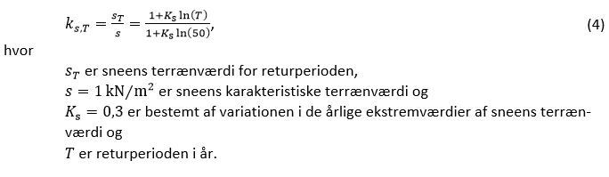

# Konstruktioner (§ 340 - § 357)

## Se alle vejledninger om Konstruktioner (§ 340 - § 357)

- [Bygningsreglementets vejledning om konstruktioner](../../generel_vejledning)
  - [Vedligehold af altaner](../../generel_vejledning/vedligehold-af-altaner)
- [Vejledning om konstruktionsforhold for transportable konstruktioner](..)

## Vejledning om konstruktionsforhold for transportable konstruktioner

[0](../forord)

### Forord

[1](../konstruktionsklasse)

### Indplacering af transportable konstruktioner i konstruktionsklasse

[1.1](../konsekvensklasse)

### Konsekvensklasse

[1.2](../kompleksitet)

### Konstruktionens kompleksitet

[1.3](../erfaring)

### Erfaring med konstruktionstypen

[1.4](../konstruktioner_der_ikke_skal_indplaceres)

### Transportable konstruktioner der ikke skal indplaceres i en konstruktionsklasse

[2](../generelt)

### Generelt for transportable konstruktioner

[2.1](../projekteringsgrundlag)

### Projekteringsgrundlag

[2.2](../lavrisikokonstruktioner)

### Transportable lavrisikokonstruktioner

[3](../laster)

### Laster på transportable konstruktioner

[3.1](../vindlast)

### Vindlast

[3.1.1](../eksempel_tribune)

### Eksempel: Tribune

[3.1.2](../eksempel_telt)

### Eksempel: Telt

[3.2](./)

### Snelast

For transportable konstruktioner kan varigheden af anvendelsen på en given lokalitet indgå ved fastsættelsen af den karakteristiske snelast sammen med:

- Muligheden for at forudsige kraftigt snefald,
- Nødvendig tid til at beskytte eller forstærke konstruktionen i tilfælde af varsel om kraftigt snefald, og
- Muligheden for at fjerne sne fra konstruktionen.

Såfremt den transportable konstruktion er opført i en kort periode, hvor vejrudsigten relativt sikkert forudser ingen sne, eller der er tale om sommermånederne, vil der således helt kunne ses bort fra snelasten.

I DS/EN 1991-1-3 er angivet betingelserne for, hvordan der kan tages hensyn til afsmeltning (den termiske faktor, C~t~). Hvorvidt der kan tages hensyn til afsmeltning, bør ske på baggrund af en konkret vurdering af konstruktionens opvarmning og varmetab, og i hvilket omfang sneen eksempelvis vil kunne glide af konstruktionen.

Fjernelsen af sne fra taget skal igangsættes, når snemængden har nået en vis kritisk værdi. Denne snelast kan baseres på en vurdering af den aktuelle snedybde på taget og en densitet af sneen, som normalt kan regnes som angivet i tabel 2.

  ----------------------------------------------------- ---------------------
  Snetype                                               Rumvægt \[kN/m^3^\]
   Nyfalden                                             1,0
   Fastliggende (flere timer eller dage efter nedbør)   2,0
   Gammel (flere uger eller måneder efter nedbør)       2,5 - 3,5
   Våd                                                  4,0
  ----------------------------------------------------- ---------------------

*Tabel 3: Middelrumvægt af sne (fra DS/EN 1991-1-3).*

Sneens karakteristiske terrænværdi regnes til 1 kN/m², se det nationale anneks til DS/EN 1991-1-3. Terrænværdiens afhængighed af returperioden *T* i år fremgår af udtrykket

### 

Returperioden *T* er defineret som den gennemsnitlige tid mellem overskridelser af den betragtede terrænværdi. Beregningen af reduktionsfaktoren på 0,64 for sneens terrænværdi anført i afsnit 3.1 for transportable lavrisikokonstruktioner med en levetid regnet til et år er baseret på faktoren K~s~ = 0,30 og følger fremgangsmåden illustreret ovenfor for peakhastighedstrykket i forbindelse med Tabel 2.

[3.3](../rytmisk_personlast)

### Rytmisk personlast

[3.4](../lodret_belastning)

### Lodret belastning

[4](../fundering-og-forankring)

### Fundering og forankring

[4.1](../jordbundsforhold)

### Jordbundsforhold

[4.2](../geotekniske_undersoegelse)

### Geotekniske undersøgelser

[4.3](../geoteknisk_dokumentation)

### Geoteknisk dokumentation

[4.4](../jordankre)

### Jordankre

[4.5](../ballastankre)

### Ballastankre

[4.6](../simple_jordankre)

### Simple Jordankre

[4.7](../proevetraekning_af_ankre)

### Prøvetrækning af ankre

[Bilag 1](../bilag_1)

### Standarder der skal efterleves

[Bilag 2](../bilag_2)

### Frivillige standarder

[Bilag 3](../bilag_3)

### Vindlast på teltkonstruktioner

[B3.1](../peak-vindhastighed)

### Peak vindhastighed

[B3.2](../lastklasser)

### Lastklasser

[B3.3](../formfaktorer)

### Formfaktor

[B3.4](../konstruktionsfaktor)

### Konstruktionsfaktor

[B3.5](../anbefalet_certificeringsformat)

### Anbefalet certificeringsformat

[B3.5.1](../eksempel_telt-1)

### Eksempel: Telt

\
