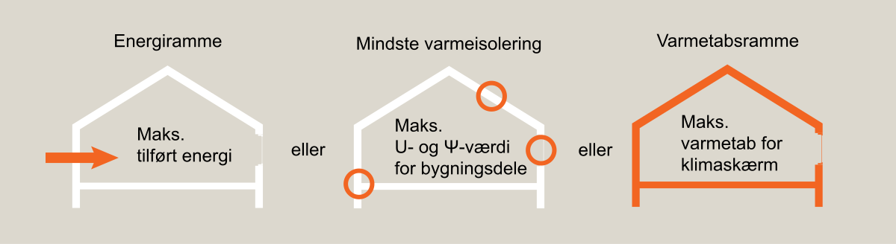

# Energiforbrug (§ 250 - § 298)

## Se alle vejledninger om Energiforbrug (§ 250 - § 298)

- [Spørgsmål og svar om energiforbrug](../../qa)
- [Bygningsreglementets vejledning om energiforbrug](..)
- [Vejledning om ofte rentable konstruktioner](../../ofte-rentable-konstruktioner)
- [Vejledning om funktionsafprøvning](../../funktionsafprovning)
- [Vejledning om håndtering af forskelligt energibehov i energirammen](../../haandtering-af-forskelligt-energibehov)
- [Vejledning om energiberegning af hospitaler](../../energiberegning-af-hospitaler)
- [Eksempelsamling for energi](../../eksempelsamling)

## Bygningsreglementets vejledning om energiforbrug

### Forord

[1.0.](../kap-1_0)

### Generelt

[1.1.](../kap-1_1)

### Energifaktorer

[1.2.](../kap-1_2)

### Rum og bygninger med særlige bestemmelser

[1.3.](../kap-1_3)

### Begrænsning af varmetab

[1.4.](../kap-1_4)

### Forudsætninger for beregning af bygningers varmetab

[1.5.](../kap-1_5)

### Mindste varmeisolering

[1.6.](../kap-1_6)

### Energikrav til vinduer, glasydervægge, ovenlysvinduer og glastage

[1.7.](../kap-1_7)

### Energirammen

[1.8.](../kap-1_8)

### Tillæg til energirammen

[1.9.](../kap-1_9)

### Bygninger med blandet anvendelse

[1.10.](../kap-1_10)

### Tæthed og trykprøvning af bygninger

[1.11.](../kap-1_11)

### Bestemmelse af det dimensionerede transmissionstab

[1.12.](../kap-1_12)

### Vedvarende energi

[2.0.](../kap-2_0)

### Ændret anvendelse

[2.1.](../kap-2_1)

### Bygningsmæssige ændringer

[3.0.](../kap-3_0)

### Tilbygninger

[3.1.](./)

### Varmetabsrammen

### 

Energikrav ved tilbygninger

Som alternativ til energirammen kan varmetabsrammen benyttes for mindre tilbygninger. Varmetabsrammen er en beregning af hvor meget energi, en tilbygning ville have behov for, hvis den var opført så den netop opfyldte kravene i §268. Varmetabsrammen etableres ved at benytte U-værdierne og linjetabene i §268, ligesom vinduesarealet tilpasses så det svarer til 22 pct. af det opvarmede etageareal. Beregningen af varmetabet fra den reelle tilbygning skal være mindre end varmetabsrammen. Der er et eksempel på en beregning af varmetabsrammen i SBi-anvisning 213 Bygningers energibehov.

Når der gennemføres beregninger af varmetabsrammen kan vinduerne indregnes som de reelle vinduer eller som vinduer med U-værdi på 1,2 W/m²K. I beregningen af de reelle forhold i bygningen skal der benyttes de reelle vinduer.

Når der gennemføres beregninger af de reelle forhold i bygningen, så er det vigtigt at medregne kuldebroer, inhomogene lag og tilsvarende, der har betydning for den resulterende U-værdi.

Hvis der etableres eksempelvis tagboliger eller tilbygges ekstra etager på et eksisterende tag kan det eksisterende varmetab gennem taget ikke medregnes i varmetabsrammen, da varmetabet ikke foregår gennem facaden.

Benyttes energirammen for tilbygninger, gælder energirammen kun for tilbygningen. Den eksisterende bygning skal således ikke opfylde energirammen. Størrelsen af energirammen for tilbygningen beregnes på grundlag af arealet af den samlede bygning. Sker der fx en tilbygning på 20 m2 til et hus på 130 m2 bliver energirammen 36,7 kWh/m2 pr. år.

Uanset om der er vandinstallationer i tilbygningen eller ikke, benyttes standardforudsætningerne om brugsvandsforbrug for tilbygningen. Såfremt der ikke indgår en ny varmeforsyning i tilbygningen, kan bygningsreglementets mindstekrav for varmeanlægget benyttes. Er der naturlig ventilation i tilbygningen, indgår det i beregningen. Forsynes tilbygningen med balanceret mekanisk ventilation, indgår det i beregningerne.

-  [Gå til energikrav ved tilbygninger (§ 271 - § 273)](https://tbstsc.dev.local/home/historical/br18_version6/tekniske-bestemmelser/11/krav/271_273){target="_blank"}

#### 

SBi-Anvisning 213 Bygningers energibehov

#### Anvendelsesområde

Denne anvisning beskriver metoden til beregning af bygningers energibehov i henhold til bygningsreglementets energiramme.

#### http://www.anvisninger.dk {target="_blank"}

[4.0.](../kap-4_0)

### Ombygninger og udskiftninger af bygningsdele

[4.1.](../kap-4_1)

### Fredede og bevaringsværdige bygninger

[4.2.](../kap-4_2)

### Forsatsvinduer, porte, lemme og ovenlyskupler

[5.0.](../kap-5_0)

### Renoveringsklasser

[6.0.](../kap-6_0)

### Sommerhuse, campinghytter og lignende ferieboliger

[7.0.](../kap-7_0)

### Midlertidige, flytbare pavilloner

[8.0.](../kap-8_0)

### Bygningsopvarmning

[8.1.](../kap-8_1)

### Fjernvarme og vedvarende energi

[8.2.](../kap-8_2)

### Individuel naturgasforsyning og vedvarende energi

[8.3.](../kap-8_3)

### Områder uden adgang til fjernvarme eller naturgas

[8.4.](../kap-8_4)

### Dispensation

[8.5.](../kap-8_5)

### Vedvarende energi

\
