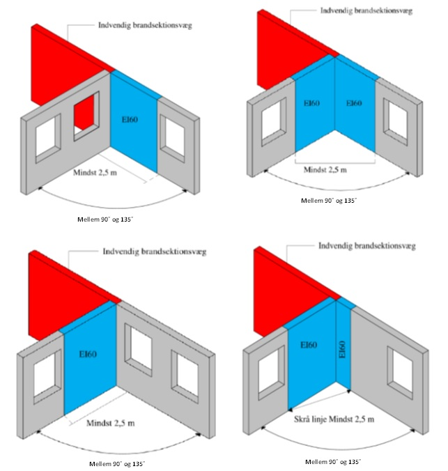

# Brand (§ 82 - § 158)

## Se alle vejledninger om Brand (§ 82 - § 158)

- [Spørgsmål og svar](../../../spoergsmaal-og-svar)
- [Vejledende udtalelse om bygningsreglementets brandkrav efter 1. juli 2018](../../../vejledende-udtalelse-om-bygningsreglementets-brandkrav)
- [Bygningsreglementets vejledning til kapitel 5 - Brand](../..)
  - [Bilag 1a - Præ-accepterede løsninger - Enfamiliehuse](..)
  - [Bilag 1b - Præ-accepterede løsninger - Sekundær bebyggelse i tilknytning til enfamiliehuse](../../sekundear-bebyggelse)
  - [Bilag 2 - Præ-accepterede løsninger - Etageboligbyggeri](../../etageboligbyggeri)
  - [Bilag 3 - Præ-accepterede løsninger - Kontorbygninger](../../kontorbygninger)
  - [Bilag 4 - Præ-accepterede løsninger - Forsamlingslokaler, butikker mv.](../../forsamlingslokaler-og-butikker)
  - [Bilag 5 - Præ-accepterede løsninger - Undervisningslokaler](../../undervisningslokaler)
  - [Bilag 6 - Præ-accepterede løsninger - Hoteller mv.](../../hoteller)
  - [Bilag 7 - Præ-accepterede løsninger - Bygningsafsnit, hvor personer ikke kan bringe sig i sikkerhed ved egen hjælp](../../bygningsafsnit-i-anv-6)
  - [Bilag 8 - Præ-accepterede løsninger - Landbrugserhvervets avls- og driftsbygninger](../../avls-og-driftsbygninger)
  - [Bilag 9 - Præ-accepterede løsninger - Bygningsafsnit med garageanlæg](../../garageanlaeg)
  - [Bilag 10 - Præ-accepterede løsninger - Industri- og lagerbygninger](../../industri-og-lagerbygninger)
  - [Bilag 11 - Vejledning om udendørsarrangementer, salgsområder, midlertidige opstillinger, midlertidige overnatning og transportable konstruktioner](../../markeder-transportable-konstruktioner-mv)
  - [Bilag 12 - Præ-accepterede løsninger - Brandtekniske installationer](../../brandtekniske-installationer)
  - [Bilag 13 - Udfærdigelse af planer i forhold til brand](../../bilag-13-udfaerdigelse-af-planer-i-forhold-til-brand)
- [Oversigt over Bygningsreglementets vejledninger til kapitel 5 -- Brand, inkl. udgivelsesdatoer](../../../oversigt-over-brs-vejledninger-til-kapitel-5-brand-inkl-udgivelsesdatoer-mv)

## Bilag 1a - Præ-accepterede løsninger - Enfamiliehuse

[1](../introduktion)

### Introduktion

[1.1](../byggerier-som-er-omfattet-af-dette-bilag)

### Byggerier, som er omfattet af dette bilag

[1.2](../opdeling-i-anvendelseskategori-risikoklasse-og-brandklasse)

### Opdeling i anvendelseskategori, risikoklasse og brandklasse

[1.3](../omfang-af-dokumentation)

### Omfang af dokumentation

[1.4](../materialer-konstruktioner-og-bygningsdele)

### Materiale, konstruktioner og bygningsdele

[1.5](../laesevejledning)

### Læsevejledning

[2](../evakuering-og-redning-af-personer)

### Evakuering og redning af personer

[2.1](../roegalarmanlaeg)

### Røgalarmanlæg

[3](../baerende-konstruktioners-brandmodstandsevne)

### Bærende konstruktioners brandmodstandsevne

[3.2](../altaner)

### Altaner

[4](../antaendelse-brand-og-roegspredning)

### Antændelse, brand- og røgspredning

[4.1](../fyringsanlaeg-og-ildsteder)

### Fyringsanlæg og ildsteder

[4.2](../oliefyr-pillefyr-og-koksfyr-mv)

### Oliefyr, pillefyr og koksfyr mv.

[4.3](../udvendige-vaegoverflader)

### Udvendige vægoverflader

[4.4](../tagdaekning)

### Tagdækning

[4.5](../placering-paa-grund)

### Placering på grund

[4.6](./)

### Vandret brandspredning

I enfamiliehuse der er nærmere skel end 2,5 m, skal væg mod skel udføres som bygningsdel klasse EI 60 \[BD-bygningsdel 60\], der slutter tæt til underside af yderste tagdækning, samt udført med beklædning klasse K~1~ 10 D-s2,d2 \[klasse 2 beklædning\].

Ved flere enfamiliehuse på samme grund, der ligger med en indbyrdes afstand på mindre end 5,0 m, skal adskilles med bygningsdel klasse REI 60 \[BD-bygningsdel 60\] uden åbninger, og adskillelsen skal slutte tæt til undersiden af den yderste tagdækning. Ved ydervægge, der ikke er udført af mindst materiale klasse B-s1,d0  \[klasse A materiale\], skal den brandadskillende bygningsdel mindst føres frem til indersiden af den udvendige beklædning, jf. Figur 4.

Hvis der, ved brandsektionsafgrænsende vægge, er mulighed for vinkelsmitte, skal mindst den ene af ydervæggene, inklusiv vinduer m.v., udføres mindst som bygningsdel klasse EI 60 \[BD-bygningsdel 60\] uden åbninger, bortset fra åbninger, der lukkes med mindst dør klasse EI~2~ 60-C \[BD-dør 60\].

Er vinklen mindre en 90° skal der sikres mod vinkelsmitte i en afstand af mindst 5,0 m.\
Er vinklen mellem 90° og 135°, begge inklusive, skal der sikres mod vinkelsmitte inden for en afstand af mindst 2,5 m fra sektionsafgrænsningen. De angivne 2,5 m kan måles enten langs en af facadelinjerne eller på skrå over hjørnet, svarende til Figur 5. Hvis der placeres et glasparti, inden for det område, hvor der sker sikring mod vinkelsmitte, må dette ikke kunne åbnes, og det bør have samme brandmæssige egenskaber, som den væg, hvori det monteres.

Når vinklen mellem de to ydervægge er større end 135°, stilles der ingen krav til ydervæggenes brandmodstandsevne på grund af den nedsatte risiko for vandret brandspredning.

Et enfamiliehus, som ligger i en afstand på mindre end 5,0 m fra byggeri der ikke er omfattet af dette bilag (undtagen sekundær bebyggelse omfattet af bilag 1b -- præ-accepterede løsning for sekundært bebyggelse i tilknytning til enfamiliehuse) skal adskilles fra dette med bygningsdele mindst udført som bygningsdel klasse EI 60 / A2-s1,d0 \[BS-bygningsdel 60\]. Adskillelsen skal slutte tæt til den yderste tagdækning. Ved ydervægge, der ikke er udført af mindst materiale klasse A2-s1,d0 \[Ubrændbart materiale\], skal den brandadskillende bygningsdel mindst føres frem til indersiden af den udvendige beklædning.

### 

Figur 4: Eksempel på, hvorledes den brandadskillende bygningsdel skal føres frem til indersiden af den udvendige beklædning.

### 

Figur 5: Sikring af vandret brandspredning/vinkelsmitte ved brandsektionsafgrænsende vægge (midlertidig illustration)

### 4.6.1 Supplerende krav til sammenbyggede enfamiliehuse

 

I et sammenbygget enfamiliehuse skal de enkelte boligenheder, der indgår i byggeriet, indbyrdes adskilles med en bygningsdel klasse EI 60 \[BD-bygningsdel 60\]. Den adskillende bygningsdel må ikke have åbninger, og skal slutte tæt til undersiden af den yderste tagdækning.

Sammenbyggede enfamiliehuse skal opdeles med bygningsdel klasse EI 60 / A2-s1,d0 \[BS-bygningsdel 60\] for hver 1.200 m² etageareal. Opdelingen skal være uden åbninger og skal slutte tæt til undersiden af den yderste tagdækning.

Ved ydervægge, der ikke er udført af mindst materiale klasse B-s1,d0 \[klasse A materiale\], skal den brandadskillende bygningsdel mellem de enkelte boligenheder, mindst føres frem til indersiden af den udvendige beklædning.

Ved tagudhæng må branden ikke kunne sprede sig uden om den brandadskillende bygningsdel via tagudhænget.

[4.7](../vaeg-og-loftkonstruktioner)

### Væg- og loftkonstruktioner

[4.8](../indvendige-overflader)

### Indvendige overflader

[4.9](../trapper)

### Trapper

[4.10](../gennembrydninger-i-brandadskillende-bygningsdele)

### Gennembrydninger i brandadskillende bygningsdele

[4.11](../isoleringsmateriale)

### Isoleringsmateriale

[4.12](../saerligt-for-integrerede-garager-carporte-udhuse-og-overdaekkede-terrasser-mv)

### Særligt for integrerede garager, carporte og udhuse mv.

[5.](../redningsberedskabets-indsatsmulighed)

### Redningsberedskabets indsatsmulighed

[5.1](../generelt-vedroerende-adgangs-og-tilkoerselsforhold)

### Generelt vedrørende adgangs- og tilkørselsforhold

[5.2](../udfoerelse-af-brandveje-vendepladser-svingarealer-mv)

### Udførelse af brandveje, vendepladser og svingarealer mv.

[5.3](../udstigningsarealer)

### Udstigningsarealer

[6.](../drift-kontrol-og-vedligehold)

### Drift, kontrol og vedligehold

[6.1.](../udarbejdelse-af-dkv-plan)

### Udarbejdelse af DKV-plan

\
