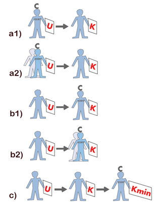

# Certificerede statikers og brandrådgivers virke (§ 531 - § 535)

## Se alle vejledninger om Certificerede statikers og brandrådgivers virke (§ 531 - § 535)

- [Vejledning til BR18 kapitel 32, certificerede statiker og brandrådgivers virke](..)
- [Vejledning om den certificeredes virke i lovliggørelsessager](../../lovliggoerelse)
- [Temasiden Brandogkonstruktioner.dk om certificeringsordningen for brandforhold og bærende konstruktioner](../../temasiden-brandogkonstruktioner-dk)

## Vejledning til BR18 kapitel 32, certificerede statiker og brandrådgivers virke

### Kolofon

### Vejledning til § 531 stk. 1

### Vejledning til § 532 stk. 1

### Vejledning til § 532 stk. 2

### Vejledning til § 532 stk. 3

### Vejledning til § 533 stk. 1

### Vejledning til § 533 stk. 2

### Vejledning til § 533 stk. 3

### Vejledning til § 534 stk. 1

Ved den certificerede statikers og brandrådgivers virke ved udarbejdelse eller kontrol af den statiske henholdsvis brandtekniske dokumentation sikres det, at byggeriet er tilstrækkelig dokumenteret, og at dokumentationen er kontrolleret.

Ved udfærdigelse af dokumentation skal den certificerende statiker eller brandrådgiver, afhængigt af sit virke jf. BR 18 §§ 536 og 545, enten som udarbejdende udarbejde dokumentation eller som kontrollerende kontrollere dokumentation dvs. at udfærdige betyder at udarbejde eller at kontrollere alt efter den certificeredes virke.

**Udarbejdende**\
Den certificerede virker som udarbejdende, når denne aktivt udarbejder henholdsvis hele eller dele af den statiske dokumentation i overensstemmelse med BR18, kapitel 28 og 30, eller hele eller dele af den brandtekniske dokumentation i overensstemmelse med BR18, kapitel 29 og 30.

**Kontrollerende**\
Den certificerede virker som kontrollerende, når denne aktivt kontrollerer henholdsvis hele eller dele af den statiske eller brandtekniske dokumentation i overensstemmelse med BR18, kapitel 30. Den certificerede statiker henholdsvis brandrådgiver skal ved kontrol påse, at:

\- den statiske eller brandtekniske dokumentation er dækkende, tilstrækkelig og overholder bygningsreglementets krav til dokumentation, jf. BR18, kapitel 28 -- 30

\- de valgte løsninger er hensigtsmæssige til formålet og følger god byggeskik.

Kontrolniveauer er angivet i BR18, bilag 3.

**Udarbejdende og kontrollerende**\
Den certificerede statiker henholdsvis brandrådgiver skal være bekendt med dokumentationens indhold samt sikre, at denne er udarbejdet og kontrolleret i overensstemmelse med BR 18, kapitel 28, 29 og 30. 

Den certificerede statiker henholdsvis brandrådgiver skal som minimum udarbejde eller kontrollere visse dele af dokumentationen, som beskrevet i BR18, kapitel 33 henholdsvis kapitel 34.

**Assistance og uddelegering**\
Hvor der ikke er stillet minimumskrav til at den certificerede selv skal udarbejde eller kontrollere dokumentationen, jf. BR18, kapitel 33 og 34, kan den certificerede indhente kompetent assistance fra en meddesigner, medprojekterende eller medkontrollant, når den certificerede udfærdiger dokumentet, se figur 1 model a2) og b2).

Det kan være nødvendigt, at den certificerede indhenter kompetent assistance fra en meddesigner eller medkontrollant på områder, hvor den certificerede ikke selv har tilstrækkelig kompetence.

I sådanne tilfælde skal den certificerede sikre, at den assisterende har den fornødne kompetence, samt ved en løbende styring af kvaliteten foretaget af den certificerede selv sikre, at det udførte er gennemført, som hvis den certificerede selv var udarbejdende eller kontrollerende, se figur 1 model a2) og b2).

Hvis både udarbejdelse og kontrol af dele af dokumentationen udfærdiges af andre kompetente aktører end den certificerede, svarende til at opgaven er uddelegeret, se figur 1 model c), skal den certificerede uanset sit virke, ved mindst en minimumskontrol jf. BR18, §527, og vejledning til BR 18, kapitel 28 eller 29, sikre og dokumentere i sluterklæringen, at udarbejdelsen og kontrollen er gennemført, som hvis den certificerede selv var udarbejdende eller kontrollerende. Minimumskontrollen kan suppleres med en udvidet kontrol, jf. BR18, §527 i form af en stikprøvekontrol, der kontrollerer særligt kritiske dele af det tekniske indhold, og/eller f.eks. en ekstra grundig gennemgang af kontrolrapporterne, både for kontrol af design, projektering og udførelse, for vitale dele af de bærende konstruktioner eller brandsikringstiltag. Hvis det ved den certificeredes kontrol viser sig, at dokumentationen af kontrollen ikke er tilstrækkelig, skal den certificerede gennemføre en fuld kontrol af den udarbejdede dokumentation i overensstemmelse med kontrolniveauerne i BR18, bilag 3. Det skal fremgå af redegørelsen til start- og sluterklæringen, hvorledes kontrollen er gennemført.

\

### 

Figur 1. Modeller for den certificeredes virke.

Model a) Den certificeredes virke som udarbejdende, og hvor kontrollen gennemføres af anden kompetent aktør,-

model a1): hvor den certificerende selv udarbejder eller

model a2): med indhentet kompetent assistance fra meddesignere eller medprojekterende. Den certificerede skal sikre, at udarbejdelsen er gennemført, som hvis han selv havde udført den. Som udarbejdende er den certificerede bekendt med indholdet og erklærer, at den samlede dokumentation, herunder kontroldokumentation, er i overensstemmelse med kapitel 28 til 30 og kan anvendes, som den foreligger.

Model b) Den certificeredes virke som kontrollerende, og hvor udarbejdelsen gennemføres af anden kompetent aktør,-

model b1) hvor den certificerede selv kontrollerer eller,

model b2) med indhentet kompetent assistance fra medkontrollant. Den certificerede skal sikre, at kontrollen er gennemført, som hvis han selv havde udført den. Som kontrollerende er den certificerede bekendt med indholdet og skal erklære, at den samlede dokumentation er i overensstemmelse med kapitel 28 til 30 og kan anvendes, som den foreligger.

Model c) Den certificeredes virke som udarbejdende eller kontrollerende og hvor både den udarbejdende og kontrollerende opgave er uddelegeret til andre kompetente aktører. Her skal den certificerede som minimum gennemføre en minimumskontrol af dokumentationen, herunder kontrolrapporter, således, at den certificerede er bekendt med indholdet og sikrer, at dokumentationen er udarbejdet og kontrolleret, i overensstemmelse med kravene i BR18 kapitel 28 eller kapitel 29, og kan anvendes, som den foreligger. 

### Vejledning til § 535 stk. 1

\
