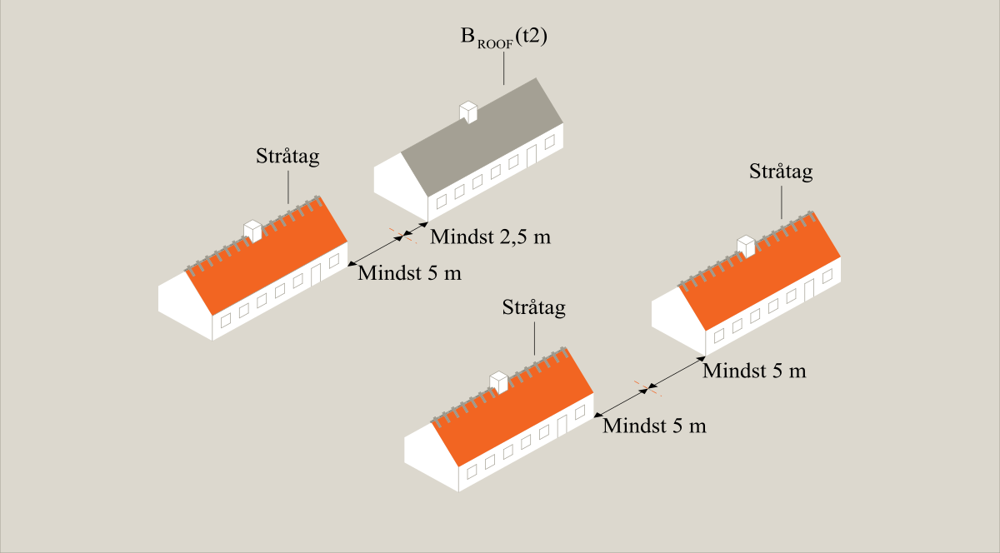
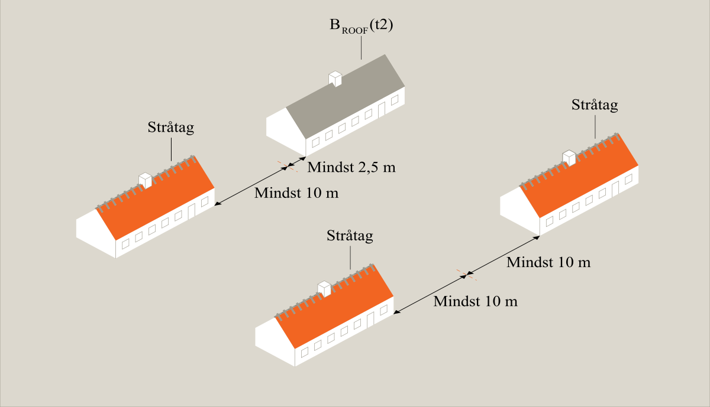

# Brand (§ 82 - § 158)

## Se alle vejledninger om Brand (§ 82 - § 158)

- [Spørgsmål og svar](../../../spoergsmaal-og-svar)
- [Vejledende udtalelse om bygningsreglementets brandkrav efter 1. juli 2018](../../../vejledende-udtalelse-om-bygningsreglementets-brandkrav)
- [Bygningsreglementets vejledning til kapitel 5 - Brand](../..)
  - [Bilag 1a - Præ-accepterede løsninger - Enfamiliehuse](..)
  - [Bilag 1b - Præ-accepterede løsninger - Sekundær bebyggelse i tilknytning til enfamiliehuse](../../sekundear-bebyggelse)
  - [Bilag 2 - Præ-accepterede løsninger - Etageboligbyggeri](../../etageboligbyggeri)
  - [Bilag 3 - Præ-accepterede løsninger - Kontorbygninger](../../bilag-3-kontorbygninger)
  - [Bilag 4 - Præ-accepterede løsninger - Forsamlingslokaler, butikker mv.](../../bilag-4-forsamlingslokaler-og-butikker)
  - [Bilag 5 - Præ-accepterede løsninger - Undervisningslokaler](../../undervisningslokaler)
  - [Bilag 6 - Præ-accepterede løsninger - Hoteller mv.](../../hoteller)
  - [Bilag 7 - Præ-accepterede løsninger - Bygningsafsnit, hvor personer ikke kan bringe sig i sikkerhed ved egen hjælp](../../bilag-7-bygningsafsnit-i-anv-6)
  - [Bilag 8 -- Præ-accepterede løsninger - Jordbrugserhvervets avls- og driftsbygninger samt væksthuse til produktion](../../bilag-8-praeaccepterede-loesninger-jordbrugserhvervets-avls-og-driftsbygninger-mv)
  - [Bilag 9 - Præ-accepterede løsninger - Bygningsafsnit med garageanlæg](../../bilag-9-garageanlaeg)
  - [Bilag 10 - Præ-accepterede løsninger - Industri- og lagerbygninger](../../industri-og-lagerbygninger)
  - [Bilag 11 - Vejledning om udendørsarrangementer, salgsområder, midlertidige opstillinger, midlertidige overnatning og transportable konstruktioner](../../bilag-11-markeder-transportable-konstruktioner-mv)
  - [Bilag 12 - Præ-accepterede løsninger - Brandtekniske installationer](../../brandtekniske-installationer)
  - [Bilag 13 - Udfærdigelse af planer i forhold til brand](../../bilag-13-udfaerdigelse-af-planer-i-forhold-til-brand)
  - [Bilag 15 - Præ-accepterede løsninger for sekundær bebyggelse i tilknytning til andet end enfamiliehuse](../../bilag-15-sekundaert-bebyggelse)
  - [Bilag 16 - Præ-accepterede løsninger for mindre bebyggelse i anvendelseskategori 1 og 4](../../bilag-16-praeaccepterede-loesninger-for-mindre-bebyggelse-i-anvendelseskategori-1-og-4)
- [Oversigt over Bygningsreglementets vejledninger til kapitel 5 -- Brand, inkl. udgivelsesdatoer](../../../oversigt-over-brs-vejledninger-til-kapitel-5-brand-inkl-udgivelsesdatoer-mv)
- [Temasiden Brandogkonstruktioner.dk om certificeringsordningen for brandforhold og bærende konstruktioner](../../../temasiden-brandogkonstruktioner-dk)

## Bilag 1a - Præ-accepterede løsninger - Enfamiliehuse

[1](../introduktion)

### Introduktion

[1.1](../byggerier-som-er-omfattet-af-dette-bilag)

### Byggerier, som er omfattet af dette bilag

[1.2](../opdeling-i-anvendelseskategori-risikoklasse-og-brandklasse)

### Opdeling i anvendelseskategori, risikoklasse og brandklasse

[1.3](../omfang-af-dokumentation)

### Omfang af dokumentation

[1.4](../materialer-konstruktioner-og-bygningsdele)

### Materiale, konstruktioner og bygningsdele

[1.5](../laesevejledning)

### Læsevejledning

[2](../evakuering-og-redning-af-personer)

### Evakuering og redning af personer

[2.1](../roegalarmanlaeg)

### Røgalarmanlæg

[3](../baerende-konstruktioners-brandmodstandsevne)

### Bærende konstruktioners brandmodstandsevne

[3.2](../altaner)

### Altaner

[4](../antaendelse-brand-og-roegspredning)

### Antændelse, brand- og røgspredning

[4.1](../fyringsanlaeg-og-ildsteder)

### Fyringsanlæg og ildsteder

[4.2](../oliefyr-pillefyr-og-koksfyr-mv)

### Oliefyr, pillefyr og koksfyr mv.

[4.3](../udvendige-vaegoverflader)

### Udvendige vægoverflader

[4.4](../tagdaekning)

### Tagdækning

[4.5](./)

### Placering på grund

Placering af enfamiliehuse skal som udgangspunkt sikre, at det enkelte byggeri (evt. med flere boligenheder) brandmæssigt kan betragtes som fritliggende, og være brandmæssigt adskilt fra andet byggeri på samme grund og på nabogrunde. 

Eventuelle afstande, som er beskrevet i dette afsnit tager udelukkende højde for de brandmæssige forhold. Der kan derfor være andre forhold i bygningsreglementet, som medfører at der skal være en større afstand til f.eks. naboskel, sti- eller vejskel.

Afstande måles vandret uden hensyntagen til eventuelle terrænforskelle. Den angivne afstand er den mindste fri afstand mellem bygninger og naboskel, vej- og stimidte.

De beskrevne afstande kan for tagudhæng, vindskeder, lætage over døre, gesimser og lignende mindre bygningsdele nedsættes med op til 0,5 meter.

 

### 4.5.1 Afstand til naboskel, vej- og stimidte

 

Enfamiliehuse skal opføres med en mindste afstand til naboskel, vej- og stimidte afhængig af tagdækningen, ydervæg og vægoverflade som angivet i Tabel 2. Afstandene gælder ikke for naboskel mellem de enkelte boligenheder i et sammenbygget enfamiliehus, hvilket bl.a. muliggør sammenbyggede enfamiliehus med tagdækning ringere end klasse B~ROOF~ (t2) \[klasse T tagdækning\], herunder stråtag.

+----------------------------------------------------------+-------------------------------------------------------------------------------------------+-------------------------------------+-------------------------------------------------------------------------------------------------------------------------+-------------------------------------+
| Tagdækning på enfamiliehus                                                                                                                           | Ydervæg mod skel, vej- og stimidte  | Vægoverflade mod skel, vej- og stimidte                                                                                 | Afstand til skel, vej- og stimidte  |
+----------------------------------------------------------+-------------------------------------------------------------------------------------------+-------------------------------------+-------------------------------------------------------------------------------------------------------------------------+-------------------------------------+
| Klasse B~ROOF~ (T2) \[klasse T tagdækning\]              |                                                                                           |                                     | Beklædning klasse K~1~ 10 / D-s2,d2 \[klasse 2 beklædning\], alternativt materialeklasse D-s2,d2 \[klasse B materiale\] | 2,5 m                               |
|                                                          +-------------------------------------------------------------------------------------------+-------------------------------------+-------------------------------------------------------------------------------------------------------------------------+-------------------------------------+
|                                                          |                                                                                           | EI 60 \[BD-bygningsdel 60\]         | Beklædning klasse K~1~ 10 / D-s2,d2 \[klasse 2 beklædning\], alternativt materialeklasse D-s2,d2 \[klasse B materiale\] | Ingen krav                          |
+----------------------------------------------------------+-------------------------------------------------------------------------------------------+-------------------------------------+-------------------------------------------------------------------------------------------------------------------------+-------------------------------------+
| Ringere end klasse B~ROOF~ (t2) \[klasse T tagdækning\]  |                                                                                           |                                     | Beklædning klasse K~1~ 10 / D-s2,d2 \[klasse 2 beklædning\], alternativt materialeklasse D-s2,d2 \[klasse B materiale\] | 2,5 m                               |
|                                                          |                                                                                           |                                     |                                                                                                                         |                                     |
|                                                          | Karnapper, udestuer og lignende mindre bygningsdele, udført med tagelementer klasse E-d2. |                                     |                                                                                                                         |                                     |
|                                                          +-------------------------------------------------------------------------------------------+-------------------------------------+-------------------------------------------------------------------------------------------------------------------------+-------------------------------------+
|                                                          | Stråtag (brandsikret)                                                                     |                                     | Beklædning klasse K~1~ 10 / D-s2,d2 \[klasse 2 beklædning\], alternativt materialeklasse D-s2,d2 \[klasse B materiale\] | 5,0 m                               |
|                                                          +-------------------------------------------------------------------------------------------+-------------------------------------+-------------------------------------------------------------------------------------------------------------------------+-------------------------------------+
|                                                          | Stråtag (ikke brandsikret)                                                                |                                     | Beklædning klasse K~1~ 10 / D-s2,d2 \[klasse 2 beklædning\], alternativt materialeklasse D-s2,d2 \[klasse B materiale\] | 10,0 m                              |
|                                                          +-------------------------------------------------------------------------------------------+-------------------------------------+-------------------------------------------------------------------------------------------------------------------------+-------------------------------------+
|                                                          | Anden tagdækning                                                                          |                                     | Beklædning klasse K~1~ 10 / D-s2,d2 \[klasse 2 beklædning\], alternativt materialeklasse D-s2,d2 \[klasse B materiale\] | 10,0 m                              |
+----------------------------------------------------------+-------------------------------------------------------------------------------------------+-------------------------------------+-------------------------------------------------------------------------------------------------------------------------+-------------------------------------+

*Tabel 2: Afstand til skel, vej- og stimidte afhængig af tagdækning, ydervæg og vægoverflade*

 

### 4.5.2 Afstand til byggeri på samme grund

 

Enfamiliehuse skal opføres med en mindste afstand til andet byggeri på samme grund afhængig af tagdækningen som angivet i Tabel 3. Afstandene gælder indbyrdes mellem de enkelte boligenheder i et sammenbygget enfamiliehus, hvilket bl.a. muliggør sammenbyggede enfamiliehus med tagdækning ringere end klasse B~ROOF~ (t2) \[klasse T tagdækning\], herunder stråtag.

Med opfyldelse af disse afstande betragtes de individuelle bebyggelser som brandmæssigt fritliggende.

Det fremgår af *bilag 1b -- præ-accepterede løsninger for sekundært bebyggelse i tilknytning til enfamiliehuse*, hvilke afstande sekundært bebyggelse skal overholde.

+-------------------------------------------------------+-------------------------------------------------------------------------------------------+--------------------------------------+------------------------+----------------------------+------------------+-------------------------------------------------------------------------------------------+
| **Indbyrdes afstand mellem enfamiliehuse og andet byggeri på samme grund (undtagen sekundær bebyggelse)**                                         |  **Tagdækning på byggeri på samme grund **                                                                                                                                                                |
|                                                                                                                                                   +--------------------------------------+------------------------+----------------------------+------------------+-------------------------------------------------------------------------------------------+
|                                                                                                                                                   | B~ROOF~ (t2) \[klasse T tagdækning\] | Stråtag (brandsikret)  | Stråtag (ikke brandsikret) | Anden tagdækning | Karnapper, udestuer og lignende mindre bygningsdele, udført med tagelementer klasse E-d2. |
+-------------------------------------------------------+-------------------------------------------------------------------------------------------+--------------------------------------+------------------------+----------------------------+------------------+-------------------------------------------------------------------------------------------+
|  **Tagdækning på enfamiliehus **                      | B~ROOF~ (t2) \[klasse T tagdækning\]                                                      | 5,0 m                                | 7,5 m                  | 12,5 m                     | 12,5 m           | 5,0 m                                                                                     |
|                                                       +-------------------------------------------------------------------------------------------+--------------------------------------+------------------------+----------------------------+------------------+-------------------------------------------------------------------------------------------+
|                                                       | Stråtag (brandsikret)                                                                     | 7,5 m                                | 10,0 m                 | 15,0 m                     | 15,0 m           | 7,5 m                                                                                     |
|                                                       +-------------------------------------------------------------------------------------------+--------------------------------------+------------------------+----------------------------+------------------+-------------------------------------------------------------------------------------------+
|                                                       | Stråtag (ikke brandsikret)                                                                | 12,5 m                               | 15,0 m                 | 20,0 m                     | 20,0 m           | 12,5 m                                                                                    |
|                                                       +-------------------------------------------------------------------------------------------+--------------------------------------+------------------------+----------------------------+------------------+-------------------------------------------------------------------------------------------+
|                                                       | Anden tagdækning                                                                          | 12,5 m                               | 15,0 m                 | 20,0 m                     | 20,0 m           | 12,5 m                                                                                    |
|                                                       +-------------------------------------------------------------------------------------------+--------------------------------------+------------------------+----------------------------+------------------+-------------------------------------------------------------------------------------------+
|                                                       | Karnapper, udestuer og lignende mindre bygningsdele, udført med tagelementer klasse E-d2. | 5,0 m                                | 7,5 m                  | 12,5 m                     | 12,5 m           | 5,0 m                                                                                     |
+-------------------------------------------------------+-------------------------------------------------------------------------------------------+--------------------------------------+------------------------+----------------------------+------------------+-------------------------------------------------------------------------------------------+

*Tabel* *3: Indbyrdes afstand mellem enfamiliehuse og andre bygninger på samme grund (undtagen sekundær bebyggelse)*

### 

Figur 2: Afstanden mellem enfamiliehuse på samme grund, hvis et eller flere af bygninger har tagdækning, som ikke er tagdækning klasse BROOF (t2), men hvor stråtagene er brandsikret.

### 

Figur 3: Afstanden mellem enfamiliehuse på samme grund, hvis et eller flere af bygningerne har tagdækning, som ikke er tagdækning klasse BROOF(t2), og stråtagene ikke er brandsikret.

[4.6](../vandret-brandspredning)

### Vandret brandspredning

[4.7](../vaeg-og-loftkonstruktioner)

### Væg- og loftkonstruktioner

[4.8](../indvendige-overflader)

### Indvendige overflader

[4.9](../trapper)

### Trapper

[4.10](../gennembrydninger-i-brandadskillende-bygningsdele)

### Gennembrydninger i brandadskillende bygningsdele

[4.11](../isoleringsmateriale)

### Isoleringsmateriale

[4.12](../saerligt-for-integrerede-garager-carporte-udhuse-og-overdaekkede-terrasser-mv)

### Særligt for integrerede garager, carporte og udhuse mv.

[5.](../redningsberedskabets-indsatsmulighed)

### Redningsberedskabets indsatsmulighed

[5.1](../generelt-vedroerende-adgangs-og-tilkoerselsforhold)

### Generelt vedrørende adgangs- og tilkørselsforhold

[5.2](../udfoerelse-af-brandveje-vendepladser-svingarealer-mv)

### Udførelse af brandveje, vendepladser og svingarealer mv.

[5.3](../udstigningsarealer)

### Udstigningsarealer

[6.](../drift-kontrol-og-vedligehold)

### Drift, kontrol og vedligehold

[6.1.](../udarbejdelse-af-dkv-plan)

### Udarbejdelse af DKV-plan

\
