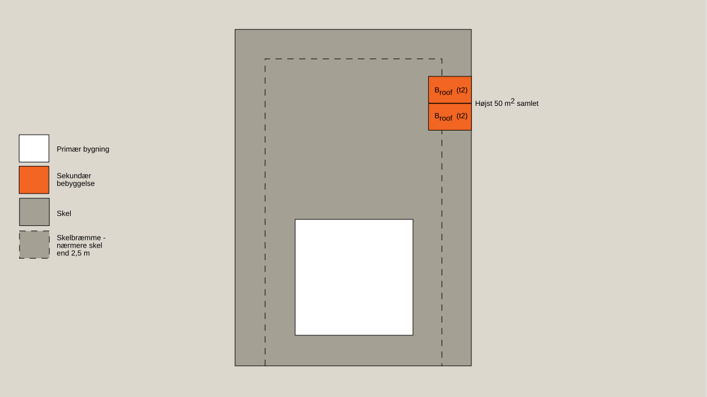
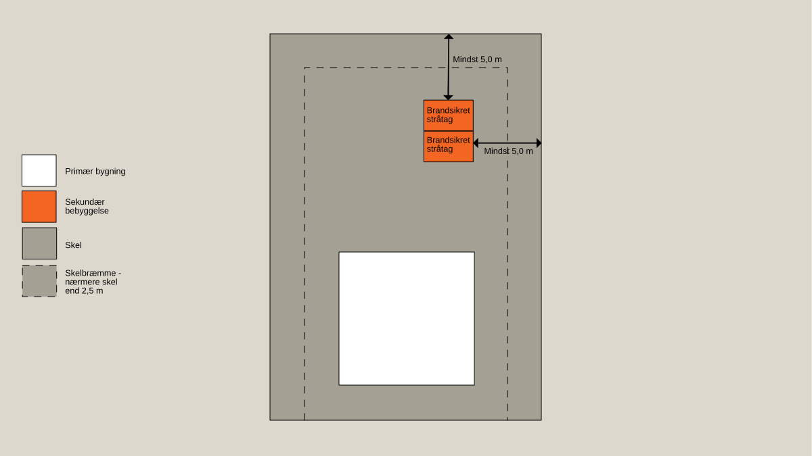
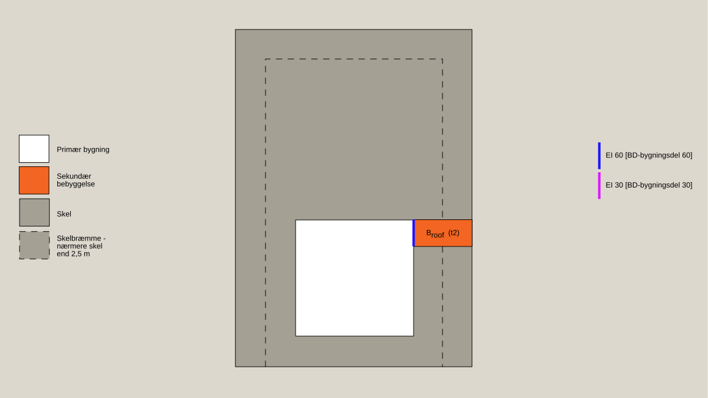
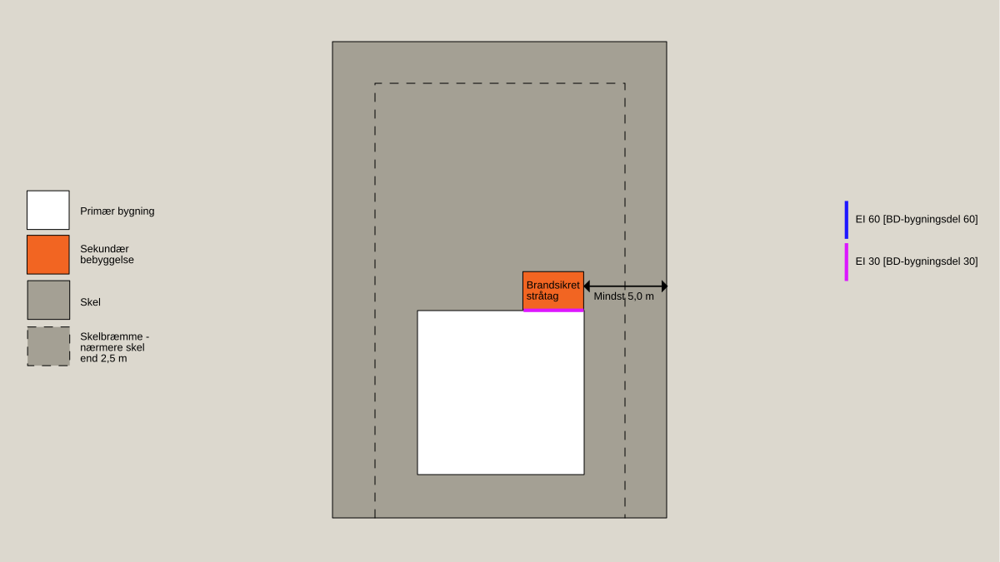
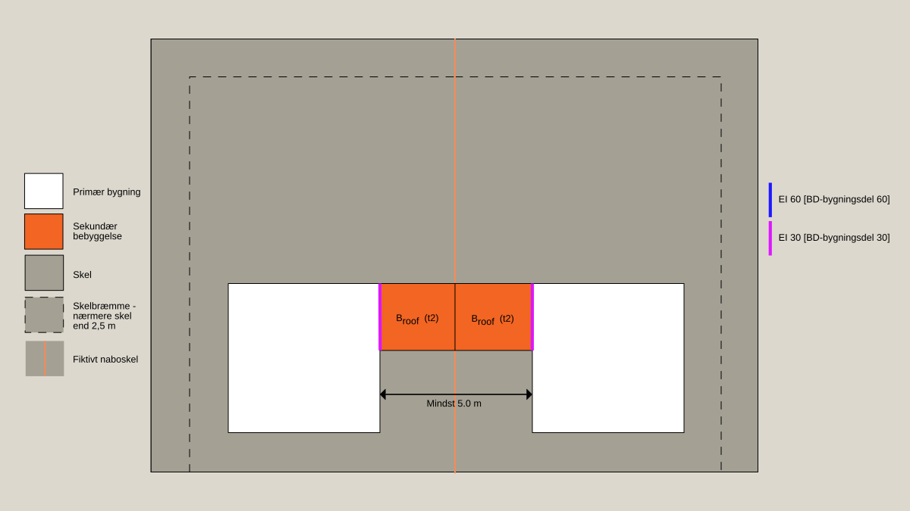
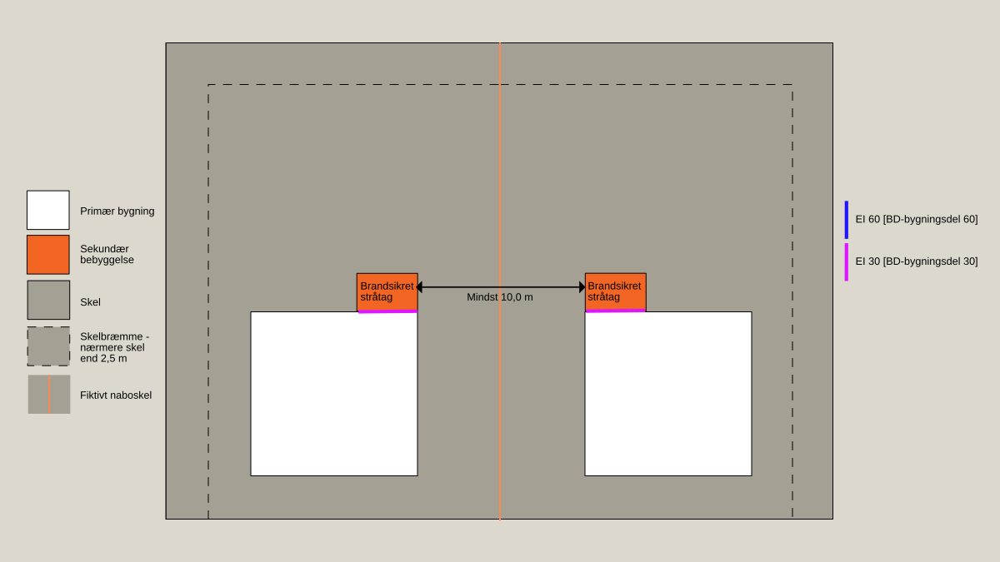

# Brand (§ 82 - § 158)

## Se alle vejledninger om Brand (§ 82 - § 158)

- [Spørgsmål og svar](../../../spoergsmaal-og-svar)
- [Vejledende udtalelse om bygningsreglementets brandkrav efter 1. juli 2018](../../../vejledende-udtalelse-om-bygningsreglementets-brandkrav)
- [Bygningsreglementets vejledning til kapitel 5 - Brand](../..)
  - [Bilag 1a - Præ-accepterede løsninger - Enfamiliehuse](../../enfamiliehuse)
  - [Bilag 1b - Præ-accepterede løsninger - Sekundær bebyggelse i tilknytning til enfamiliehuse](..)
  - [Bilag 2 - Præ-accepterede løsninger - Etageboligbyggeri](../../etageboligbyggeri)
  - [Bilag 3 - Præ-accepterede løsninger - Kontorbygninger](../../bilag-3-kontorbygninger)
  - [Bilag 4 - Præ-accepterede løsninger - Forsamlingslokaler, butikker mv.](../../bilag-4-forsamlingslokaler-og-butikker)
  - [Bilag 5 - Præ-accepterede løsninger - Undervisningslokaler](../../undervisningslokaler)
  - [Bilag 6 - Præ-accepterede løsninger - Hoteller mv.](../../hoteller)
  - [Bilag 7 - Præ-accepterede løsninger - Bygningsafsnit, hvor personer ikke kan bringe sig i sikkerhed ved egen hjælp](../../bilag-7-bygningsafsnit-i-anv-6)
  - [Bilag 8 -- Præ-accepterede løsninger - Jordbrugserhvervets avls- og driftsbygninger samt væksthuse til produktion](../../bilag-8-praeaccepterede-loesninger-jordbrugserhvervets-avls-og-driftsbygninger-mv)
  - [Bilag 9 - Præ-accepterede løsninger - Bygningsafsnit med garageanlæg](../../bilag-9-garageanlaeg)
  - [Bilag 10 - Præ-accepterede løsninger - Industri- og lagerbygninger](../../industri-og-lagerbygninger)
  - [Bilag 11 - Vejledning om udendørsarrangementer, salgsområder, midlertidige opstillinger, midlertidige overnatning og transportable konstruktioner](../../bilag-11-markeder-transportable-konstruktioner-mv)
  - [Bilag 12 - Præ-accepterede løsninger - Brandtekniske installationer](../../brandtekniske-installationer)
  - [Bilag 13 - Udfærdigelse af planer i forhold til brand](../../bilag-13-udfaerdigelse-af-planer-i-forhold-til-brand)
  - [Bilag 15 - Præ-accepterede løsninger for sekundær bebyggelse i tilknytning til andet end enfamiliehuse](../../bilag-15-sekundaert-bebyggelse)
  - [Bilag 16 - Præ-accepterede løsninger for mindre bebyggelse i anvendelseskategori 1 og 4](../../bilag-16-praeaccepterede-loesninger-for-mindre-bebyggelse-i-anvendelseskategori-1-og-4)
- [Oversigt over Bygningsreglementets vejledninger til kapitel 5 -- Brand, inkl. udgivelsesdatoer](../../../oversigt-over-brs-vejledninger-til-kapitel-5-brand-inkl-udgivelsesdatoer-mv)
- [Temasiden Brandogkonstruktioner.dk om certificeringsordningen for brandforhold og bærende konstruktioner](../../../temasiden-brandogkonstruktioner-dk)

## Bilag 1b - Præ-accepterede løsninger - Sekundær bebyggelse i tilknytning til enfamiliehuse

[1](../introduktion)

### Introduktion

[1.1](../bebyggelse-som-er-omfattet-af-dette-bilag)

### Bebyggelse, som er omfattet af dette bilag

[1.2](../opdeling-i-anvendelseskategori-risikoklasse-og-brandklasse)

### Opdeling i anvendelseskategori, risikoklasse og brandklasse

[1.3](../omfang-af-dokumentation)

### Omfang af Dokumentation

[1.4](../materialer-konstruktioner-og-bygningsdele)

### Materialer, konstruktioner og bygningsdele

[1.5](../laesevejledning)

### Læsevejledning

[2](../evakuering-og-redning)

### Evakuering og redning

[3](../baerende-konstruktioners-brandmodstandsevne)

### Bærende konstruktioners brandmodstandsevne

[4](../antaendelse-brand-og-roegspredning)

### Antændelse, brand og røgspredning

[4.1](../tagdaekning)

### Tagdækning

[4.2](./)

### Placering af sekundær bebyggelse

Placering af sekundær bebyggelse skal som udgangspunkt sikre, at den enkelte bebyggelse kan betragtes som brandmæssigt fritliggende, og være brandmæssigt adskilt fra den primære bygning, herunder beboelse og evt. annekser.

Hvornår bebyggelse er brandmæssigt fritliggende er nærmere beskrevet i afsnit 1.2.3.1.

Eventuelle afstande, som er beskrevet i dette afsnit, tager udelukkende højde for de brandmæssige forhold. Der kan derfor være andre forhold i bygningsreglementet, som medfører at der skal være en større afstand til f.eks. nabo-, vej- og stiskel.

Afstande måles vandret uden hensyntagen til eventuelle terrænforskelle. Den angivne afstand er den mindste fri afstand mellem bygninger og naboskel, vej- og stimidte.

De beskrevne afstande kan for tagudhæng, vindskeder, lætage over døre, gesimser og lignende mindre bygningsdele normalt nedsættes med 0,5 m. Udhæng på mere 0,5 m medregnes til bebyggelsen længde. Længden af en carport måles til tagfladens afgrænsning.

 

### 4.2.1 Afstand til skel, vej- og stimidte

 

Sekundær bebyggelse skal opføres med en afstand til naboskel, vej- og stimidte afhængig af tagdækningen som angivet i Tabel 1.

  --------------------------------------- -----------------------------------------
  **Tagdækning på sekundær bebyggelse**   **Afstand til skel, vej- og stimidte** 
  B~ROOF~(T2) \[klasse T tagdækning\]     Ingen krav 
  Transparente tagelementer klasse E-d2   Ingen krav 
  Stråtag (brandsikret)                   5,0 m
  Stråtag (ikke brandsikret)              10,0 m
  Anden tagdækning                        10,0 m
  --------------------------------------- -----------------------------------------

*Tabel* *1: Afstand til skel, vej- og stimidte*

* *

### 4.2.2 Afstand til bygninger på samme grund

 

Der er som udgangspunkt ikke krav til afstanden mellem flere sekundære bebyggelser på samme grund, hvis de overholder afstanden til skel, vej- og stimidte som angivet i Tabel 1 i afsnit 4.2.1.

Nedenfor er der angivet eksempler på, hvor sekundære bebyggelser kan placeres i forhold til hinanden og i forhold til naboskel.

### 

Figur 1: Sekundære bebyggelser med tagdækning klasse Broof (t2) \[klasse T tagdækning\] kan evt. sammenbygges og placeres i skelbræmmen uden sikring mod vandret brandspredning mod skel, hvis det samlede areal er højst 50 m2.

### 

Figur 2: Sekundære bebyggelser med tagdækning af brandsikret stråtag kan evt. sammenbygges og placeres mindst 5,0 m fra naboskel.

Der er som udgangspunkt ikke krav til afstanden mellem sekundær bebyggelse og den primære bygning, hvis den sekundære bebyggelse overholder afstanden til skel, vej- og stimidte som angivet i Tabel 1 i afsnit 4.2.1. Bemærk dog, at der i visse situationer stilles krav til sikring mod vandret brandspredning, hvilet fremgår af afsnit 4.3.

Nedenfor er der angivet eksempler på, hvor sekundær bebyggelse kan placeres i forhold til den primære bygning og i forhold til naboskel. 

### 

Figur 3: Sekundær bebyggelse med tagdækning klasse Broof (t2) \[klasse T tagdækning\] kan evt sammenbygges med den primære bygning og placeres i skelbræmmen. Der skal sikres mod vandret brandspredning mod primær bygning, hvis den sekundære bebyggelse er med mindre end 2 fuldt åbne sider, som f.eks. en garage eller udhus.

### 

Figur 4: Sekundær bebyggelse med tagdækning af brandsikret stråtag kan evt. sammenbygges med den primære bygning og placeres mindst 5,0 m fra naboskel. Sekundær bebyggelse der er placeret nærmere end 1 m fra den primære bygning, skal sikres imod vandret brandspredning mod den primære bygning.

Hvis der er flere primære bygninger på samme grund, der har hver sin sekundære bebyggelse tilknyttet, skal afstanden mellem disse sekundære bebyggelser svare til summen af den tilladte afstand til skel, vej og stimidte som er angivet i Tabel 1 i afsnit 4.2.1 (dvs. at de skal være brandmæssig fritliggende).

Nedenfor er der angivet eksempler på, hvor sekundær bebyggelse, der er tilknyttes forskellige primære bygninger på samme grund, kan placeres i forhold til hinanden.

### 

Figur 5: Sekundære bebyggelser på samme grund, der er tilknyttet forskellige primære bygninger, kan evt. sammenbygges med hinanden og med den primære bygning, hvis de sekundære bebyggelser er med tagdækning Broof (t2) \[klasse T tagdækning\], og hvis de primære bygninger er brandmæssig fritliggende. Sekundær bebyggelse der er placeret nærmere end 1 m fra den primære bygning, skal sikres imod vandret brandspredning mod den primære bygning.

### 

Figur 6: Sekundære bebyggelser på samme grund, der er tilknyttet forskellige primære bygninger, kan placeres mindst 10,0 m fra hinanden, og evt. sammenbygges med den primære bygning, hvis de sekundære bebyggelser er med brandsikret stråtag. Sekundær bebyggelse der er placeret nærmere end 1 m fra den primære bygning, skal sikres imod vandret brandspredning mod den primære bygning.

[4.3](../vandret-brandspredning)

### Vandret brandspredning

[5](../redningsberedskabets-indsatsmulighed)

### Redningsberedskabets indsatsmulighed

\
