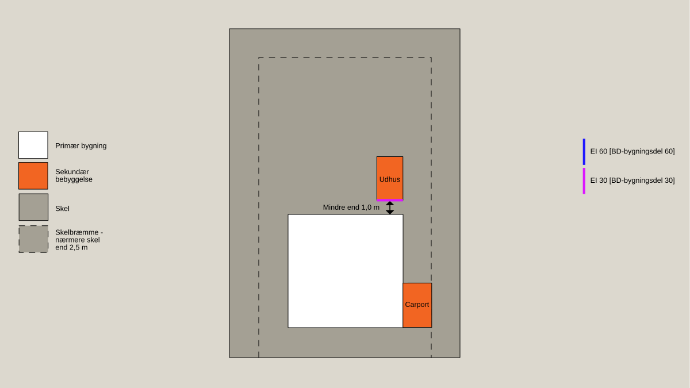
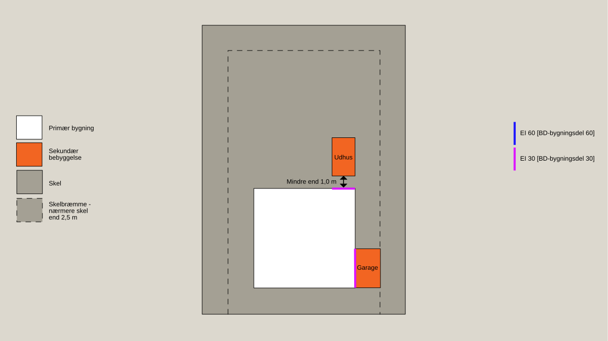
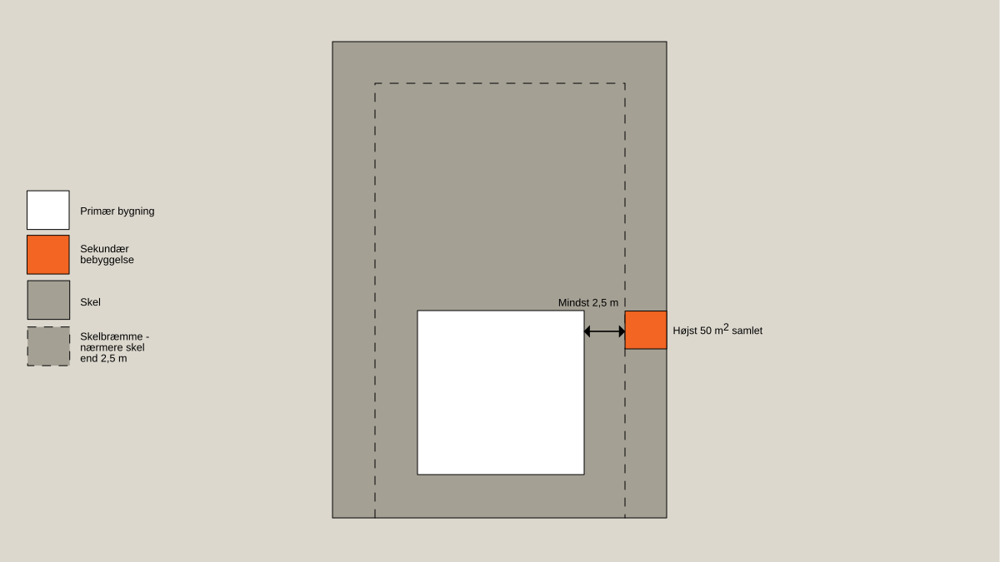
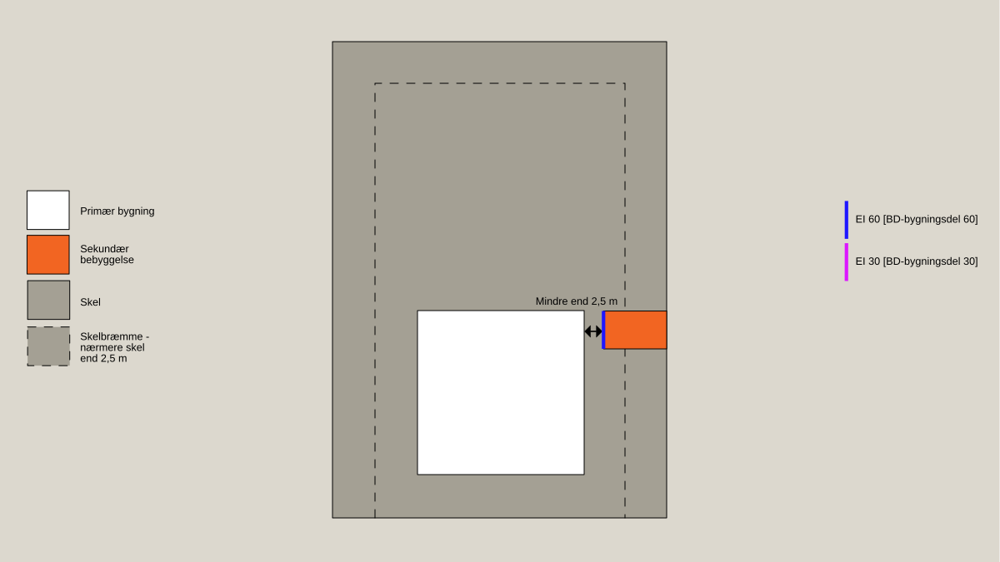
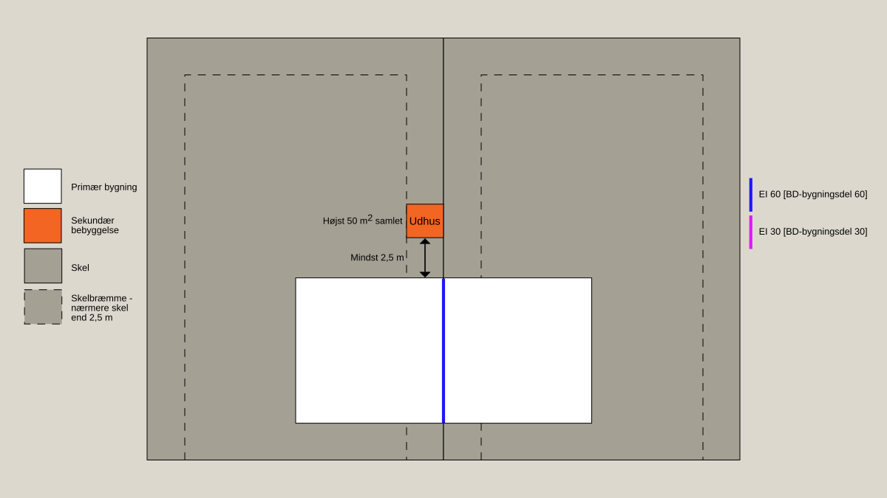
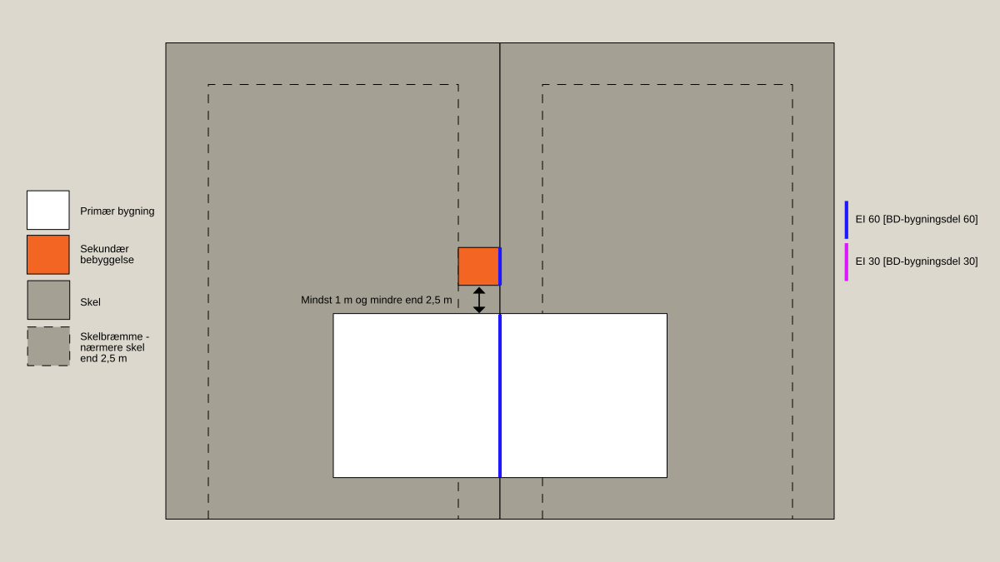
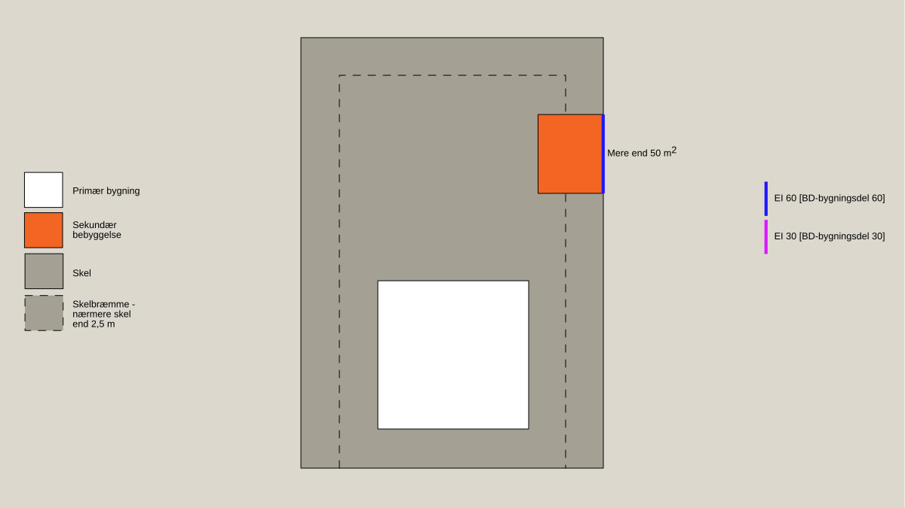

# Brand (§ 82 - § 158)

## Se alle vejledninger om Brand (§ 82 - § 158)

- [Spørgsmål og svar](../../../spoergsmaal-og-svar)
- [Vejledende udtalelse om bygningsreglementets brandkrav efter 1. juli 2018](../../../vejledende-udtalelse-om-bygningsreglementets-brandkrav)
- [Bygningsreglementets vejledning til kapitel 5 - Brand](../..)
  - [Bilag 1a - Præ-accepterede løsninger - Enfamiliehuse](../../enfamiliehuse)
  - [Bilag 1b - Præ-accepterede løsninger - Sekundær bebyggelse i tilknytning til enfamiliehuse](..)
  - [Bilag 2 - Præ-accepterede løsninger - Etageboligbyggeri](../../etageboligbyggeri)
  - [Bilag 3 - Præ-accepterede løsninger - Kontorbygninger](../../bilag-3-kontorbygninger)
  - [Bilag 4 - Præ-accepterede løsninger - Forsamlingslokaler, butikker mv.](../../bilag-4-forsamlingslokaler-og-butikker)
  - [Bilag 5 - Præ-accepterede løsninger - Undervisningslokaler](../../undervisningslokaler)
  - [Bilag 6 - Præ-accepterede løsninger - Hoteller mv.](../../hoteller)
  - [Bilag 7 - Præ-accepterede løsninger - Bygningsafsnit, hvor personer ikke kan bringe sig i sikkerhed ved egen hjælp](../../bilag-7-bygningsafsnit-i-anv-6)
  - [Bilag 8 -- Præ-accepterede løsninger - Jordbrugserhvervets avls- og driftsbygninger samt væksthuse til produktion](../../bilag-8-praeaccepterede-loesninger-jordbrugserhvervets-avls-og-driftsbygninger-mv)
  - [Bilag 9 - Præ-accepterede løsninger - Bygningsafsnit med garageanlæg](../../bilag-9-garageanlaeg)
  - [Bilag 10 - Præ-accepterede løsninger - Industri- og lagerbygninger](../../industri-og-lagerbygninger)
  - [Bilag 11 - Vejledning om udendørsarrangementer, salgsområder, midlertidige opstillinger, midlertidige overnatning og transportable konstruktioner](../../bilag-11-markeder-transportable-konstruktioner-mv)
  - [Bilag 12 - Præ-accepterede løsninger - Brandtekniske installationer](../../brandtekniske-installationer)
  - [Bilag 13 - Udfærdigelse af planer i forhold til brand](../../bilag-13-udfaerdigelse-af-planer-i-forhold-til-brand)
  - [Bilag 15 - Præ-accepterede løsninger for sekundær bebyggelse i tilknytning til andet end enfamiliehuse](../../bilag-15-sekundaert-bebyggelse)
  - [Bilag 16 - Præ-accepterede løsninger for mindre bebyggelse i anvendelseskategori 1 og 4](../../bilag-16-praeaccepterede-loesninger-for-mindre-bebyggelse-i-anvendelseskategori-1-og-4)
- [Oversigt over Bygningsreglementets vejledninger til kapitel 5 -- Brand, inkl. udgivelsesdatoer](../../../oversigt-over-brs-vejledninger-til-kapitel-5-brand-inkl-udgivelsesdatoer-mv)
- [Temasiden Brandogkonstruktioner.dk om certificeringsordningen for brandforhold og bærende konstruktioner](../../../temasiden-brandogkonstruktioner-dk)

## Bilag 1b - Præ-accepterede løsninger - Sekundær bebyggelse i tilknytning til enfamiliehuse

[1](../introduktion)

### Introduktion

[1.1](../bebyggelse-som-er-omfattet-af-dette-bilag)

### Bebyggelse, som er omfattet af dette bilag

[1.2](../opdeling-i-anvendelseskategori-risikoklasse-og-brandklasse)

### Opdeling i anvendelseskategori, risikoklasse og brandklasse

[1.3](../omfang-af-dokumentation)

### Omfang af Dokumentation

[1.4](../materialer-konstruktioner-og-bygningsdele)

### Materialer, konstruktioner og bygningsdele

[1.5](../laesevejledning)

### Læsevejledning

[2](../evakuering-og-redning)

### Evakuering og redning

[3](../baerende-konstruktioners-brandmodstandsevne)

### Bærende konstruktioners brandmodstandsevne

[4](../antaendelse-brand-og-roegspredning)

### Antændelse, brand og røgspredning

[4.1](../tagdaekning)

### Tagdækning

[4.2](../placering-af-sekundaer-bebyggelse)

### Placering af sekundær bebyggelse

[4.3](./)

### Vandret brandspredning

I forhold til vandret brandspredning stilles der i nogle situationer forskellige krav afhængig af om den sekundære bebyggelse har mindst 2 fuldt åbne sider, eller mindre end 2 fuldt åbne sider. Sekundær bebyggelse med mindst 2 fuldt åbne sider omfatter bl.a. mange carporte og overdækninger, som, på grund af sine åbne sider, kan lede varme og røg væk mere effektivt end sekundær bebyggelse med mindre end 2 fuldt åbne sider, som bl.a. omfatter garager og udhuse.

Sekundær bebyggelse med mindre end 2 fuldt åbne sider, der placeres nærmere end 1,0 m fra den primære bygning, skal udføres med væg mod skel som bygningsdel klasse EI 30 \[BD-bygningsdel 30\]. Alternativt kan den del af væggen i den primære bygning, der er nærmere end 1,0 m fra den sekundære bebyggelse, udføres som en bygningsdel klasse EI 30 \[BD-bygningsdel 30\] i stedet for. Døre, vinduer og andre åbninger i den adskillende væg (der er nærmere end 1,0 m fra den modstående væg) skal udføres med den samme brandmodstandsevne som den adskillende væg. Døre skal således udføres som dør klasse EI~2~ 30-C \[BD-dør 30\], og vinduer skal udføres som klasse EI 30 \[BD-bygningsdel 30\].

Der stilles ikke lignende krav til sekundær bebyggelse, der placeres nærmere end 1,0 m fra den primære bygning, hvis den sekundære bebyggelse er udført med mindst 2 fuldt åbne sider. Hvis den sekundære bebyggelse derimod er en garage med en fuldt åben side, kan døre i den adskillende væg udføres klassificeret som EI~2~ 30 \[BD-dør 30-M\], idet disse døre normalt vil være lukkede.

Nedenfor er der angivet eksempler på, hvor sekundær bebyggelse, placeret mindre end 1,0 m fra den primære bygning, skal sikres mod vandret brandspredning.

### 

Figur 7: Sekundær bebyggelse med mindre end 2 fuldt åbne sider (udhuse og garager), der placeres nærmere den primære bygning end 1,0 m, skal sikres mod vandret brandspredning. Dette gælder ikke for sekundær bebyggelse med mindst 2 fuldt åbne sider (carporte og overdækninger).

### 

Figur 8: Sekundær bebyggelse med mindre end 2 fuldt åbne sider (udhuse og garager), der placeres nærmere den primære bygning end 1,0 m, skal sikres mod vandret brandspredning. Dette gælder ikke for sekundær bebyggelse med mindst 2 fuldt åbne sider (carporte og overdækninger).

### 4.3.1 Sekundær bebyggelse placeret nærmere skel end 2,5 m

 

Sekundær bebyggelse der opføres nærmere end 2,5 m fra skel, skal udføres med væg mod skel som bygningsdel klasse EI 60 \[BD-bygningsdel 60\], med mindre, at den sekundære bebyggelse er placeret 2,5 m fra den primære bygning (5,0 m, hvis det er et sammenbygget enfamiliehus). Brandadskillelsen kan være i væg mod skel eller væg mod den primære bygning, men skal føres frem i tæt forbindelse med den yderste tagdækning.

Sekundær bebyggelse som opføres nærmere skel end 2,5 m, må ikke have vindue mod skel.

Nedenfor er der angivet eksempler på, hvor sekundær bebyggelse, placeret mindre end 2,5 m fra skel, skal sikres mod vandret brandspredning.

### 

Figur 9: Sekundær bebyggelse placeret mindre end 2,5 m fra skel, kan opføres uden sikring mod vandret brandspredning, hvis bebyggelsen er placeret mindst 2,5 m fra den primære bygning, og er højst 50 m2

### 

Figur 10: Sekundær bebyggelse placeret mindre end 2,5 m fra skel og mindst 1 m og mindre end 2,5 m fra den primære bygning, skal sikres mod vandret brandspredning.

### 

Figur 11: Sekundær bebyggelse placeret mindre end 2,5 m fra både skel og den primære bygning, skal sikres mod vandret brandspredning.

### 

Figur 12: Sekundær bebyggelse placeret mindre end 2,5 m fra skel, kan opføres uden sikring mod vandret brandspredning, hvis bebyggelsen er placeret mindst 2,5 m fra den primære bygning (sammenbygget enfamiliehus)

### 

Figur 13: Sekundær bebyggelse placeret mindre end 2,5 m fra skel og mindre end 5,0 m fra den primære bygning (sammenbygget enfamiliehus), skal sikres mod vandret brandspredning.

Sekundær bebyggelse med et samlet areal på mere end 50 m^2^, der placeres nærmere skel end 2,5 m, skal udføres med væg mod skel som bygningsdel klasse EI 60 \[BD-bygningsdel 60\]. Arealet beregnes over flere sekundære bebyggelser, der indbyrdes *ikke* kan betragtes som brandmæssig fritliggende. Alle sekundære bebyggelser behøves i så fald ikke at være placeret nærmere skel end 2,5 m. 

Hvornår bebyggelse er brandmæssigt fritliggende er nærmere beskrevet i afsnit 1.2.3.1.

Nedenfor er der angivet et eksempel på, hvor sekundært bebyggelse, der er mere end 50 m^2^, skal sikres mod vandret brandspredning.

### 

Figur 14: Sekundær bebyggelse med et samlet areal på mere end 50 m2, der placeres nærmere skel end 2,5 m, skal sikres mod vandret brandspredning.

[5](../redningsberedskabets-indsatsmulighed)

### Redningsberedskabets indsatsmulighed

\
