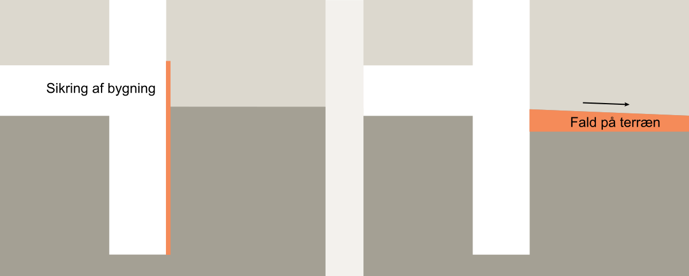
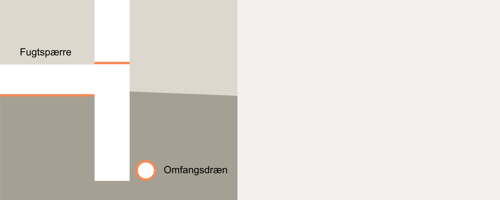
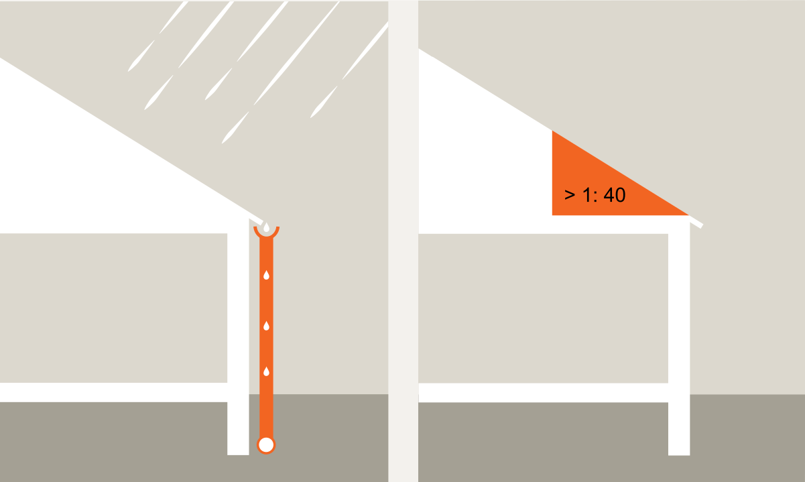

# Fugt og vådrum (§ 334 - § 339)

## Se alle vejledninger om Fugt og vådrum (§ 334 - § 339)

- [Spørgsmål og svar om fugt og vådrum](../../qa)
- [Bygningsreglementets vejledning om fugt og vådrum](..)

## Bygningsreglementets vejledning om fugt og vådrum

### Generelt om fugt og vådrum

[1.0.](./)

### Fugt

1.1.

Kondens på kolde indvendige overflader opstår sædvanligvis som følge af utilsigtet høj luftfugtighed, kombineret med utilstrækkelig ventilation og ringe luftbevægelse i områder med kolde overflader. Kolde indvendige overflader optræder typisk ved kuldebroer og ved utætheder i klimaskærmen, mm. Ved nybyggeri og renovering bør fugtbelastningen medtages i vurderingen af, om der er tilstrækkelig ventilation og luftbevægelse i alle rum. Ved valg af ventilationsstrategi, materialer, konstruktioner og bygningsdele bør der i projekterings-, udførelses- samt brugsfasen tages hensyn til den fugtproduktion, temperatur, luftudskiftning og luftbevægelse, der kan forekomme i bygningen, således at forudsætningerne for et sundt indeklima skabes, og så byggekomponenter og konstruktioner ikke nedbrydes eller skimmelsvampe dannes.

Visse bygningstyper, som for eksempel svømmehaller, har forhøjede fugtpåvirkninger. Beskyttelsen mod fugt skal derfor i disse bygninger have ekstra fokus.

\

1.2.

Det skal sikres, at konstruktionerne ved indbygning ikke har et fugtindhold, der medfører risiko for vækst af skimmelsvamp. Ligeledes skal det sikres, at konstruktionerne ikke opfugtes i byggefasen eller at der indbygges materialer med synlig skimmelvækst.

Der henvises til Vejledning om håndtering af fugt i byggeriet (SBi 2010).

1.3.

En måde at beskytte bygningen mod indtrængen af overfladevand, er at sikre, at der er fald på terrænet væk fra bygningen og ved at sikre, at den del af bygningen der kan blive udsat for påvirkning af overfladevand kan modstå denne påvirkning.

Der skal træffes tilstrækkelige tiltag til at sikre, at bygningen er beskyttet mod fugt fra undergrunden. Mulige tiltag inkluderer for eksempel kapillarbrydende lag, vandtætning af bygningens yderside, omfangsdræn og fugtspærre imellem fundamentet og ydervæggen.

En måde at beskytte bygningen mod indtrængen af overfladevand, er at sikre, at der er fald på terrænet væk fra bygningen eller ved at sikre, at den del af bygningen der kan blive udsat for påvirkning af overfladevand kan modstå denne påvirkning.

### 

Måder at beskytte mod overfaldevand

### 

Tiltag til at sikre mod fugt fra undergrunden

1.4.

Det er vigtigt for overholdelse af kravet, at regn og smeltevand fra sne føres væk fra bygningen. Det betyder bl.a. at taget skal udføres med tilstrækkelig hældning til at sikre, at vandet føres væk fra bygningen. Hvis hældningen på tagfladen er større end 1:40 svarende til 2,5 cm pr. m, vil vand fra tage normalt kunne løbe af på forsvarlig vis. Tagvand skal desuden via tagrender og/eller tagnedløb ledes til afløb, så vandet ikke fugtbelaster facaden. I visse tilfælde kan tagrender udelades ved bygninger med særlig fri beliggenhed, herunder sommerhuse samt ved garager, udhuse og lignende mindre bygninger, forudsat at tagvandet ikke afledes til gene for vejarealer eller nabogrunde. Tilsvarende kan tagrender udelades ved bygninger med særlig traditionel byggeskik, der tilsiger dette. Der skal dog tages særligt hensyn til overfladevand i forhold til begrænsning af skader på bygning og miljø.

\

### 

Afledning af tagvand og tiltrækkelig taghældning

Af hensyn til grundvandsressourcerne og rensningsanlægs funktion kan overfladevand og tagvand, hvor det kan godkendes af kommunalbestyrelsen, ledes til nedsivningsanlæg fremfor kloak, se Miljøministeriets bekendtgørelse om spildevandstilladelser mv. efter miljøbeskyttelseslovens kapitel 3 og 4

#### Miljøministeriets bekendtgørelse om

Spildevandstilladelser

#### Anvendelsesområde

#### Se bekendtgørelsen her [Se bekendtgørelsen her](https://www.retsinformation.dk/Forms/R0710.aspx?id=194212 "Miljøministeriets bekendtgørelse om "){target="_blank"}

-  [Gå til krav om Fugt](https://tbstsc.dev.local/home/historical/br18_version8/tekniske-bestemmelser/14/krav/334_338){target="_blank"}

[2.0.](../kap-2_0)

### Vådrum

\
