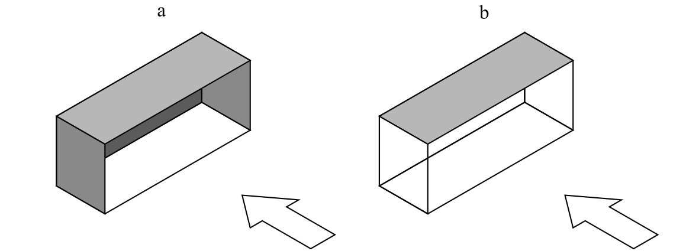

# Konstruktioner (§ 340 - § 357)

## Se alle vejledninger om Konstruktioner (§ 340 - § 357)

- [Bygningsreglementets vejledning om konstruktioner](../../generel_vejledning)
  - [Vedligehold af altaner](../../generel_vejledning/vedligehold-af-altaner)
- [Vejledning om konstruktionsforhold for transportable konstruktioner](..)
- [Temasiden Brandogkonstruktioner.dk om certificeringsordningen for brandforhold og bærende konstruktioner](../../temasiden-brandogkonstruktioner-dk)

## Vejledning om konstruktionsforhold for transportable konstruktioner

[0](../forord)

### Forord

[1](../konstruktionsklasse)

### Indplacering af transportable konstruktioner i konstruktionsklasse

[1.1](../konsekvensklasse)

### Konsekvensklasse

[1.2](../kompleksitet)

### Konstruktionens kompleksitet

[1.3](../erfaring)

### Erfaring med konstruktionstypen

[1.4](../konstruktioner_der_ikke_skal_indplaceres)

### Transportable konstruktioner der ikke skal indplaceres i en konstruktionsklasse

[2](../generelt)

### Generelt for transportable konstruktioner

[2.1](../projekteringsgrundlag)

### Projekteringsgrundlag

[2.2](../lavrisikokonstruktioner)

### Transportable lavrisikokonstruktioner

[3](../laster)

### Laster på transportable konstruktioner

[3.1](../vindlast)

### Vindlast

[3.1.1](./)

### Eksempel: Tribune

Alternativ A: Den transportable tribune dimensioneres og udføres, som anført i konstruktionsnormerne for permanente konstruktioner.

Alternativ B: Sikkerhed og funktion opfyldes ved en række tiltag. Der etableres en vindmålestation, eksempelvis ved at placere en vindmåler over tribunens tag, og således, at tribunekonstruktionen ikke ændrer vindforholdene markant ved målestationen. Der kan eventuelt etableres 2 målestationer, hvor den uforstyrrede vind altid registreres ved hjælp af mindst en af vindmålerne. Hvis den uforstyrrede vind passerer en given tærskelværdi, skal vindlasten på tribunekonstruktionen reduceres, eller der skal etableres forstærkninger af konstruktionen. Den reducerede vindlast kan opnås ved at fjerne dele af konstruktionens sider, og den øgede forstærkning kan eventuelt være i form af ekstra ballast for at hindre for store opadrettede påvirkninger i understøtningspunkterne.

Følgende forhold indgår i vurderingen:

1\) Når vinden måles på stedet, kan partialkoefficienten på vindlasten reduceres. En stor del af den normfastsatte partialkoefficient på 1,5 tager hensyn til muligheden for peakhastighedstryk, som er større end 50-års trykket, og usikkerhed på indflydelsen af terrænforholdene er også omfattet af partialkoefficienten. Disse usikkerheder er reduceret til et minimum ved at måle vindforholdene på stedet, og partialkoefficienten kan derfor nedsættes, da den nu primært skal dække usikkerhed forbundet med omsætningen af vindens peakhastighedstryk til vindlast på konstruktionen. Når vindforholdene måles på stedet, vil en partialkoefficient på 1,2 derfor normalt dække de tilbageværende usikkerheder.

2\) Den transportable tribune kunne dimensioneres for en 1-års vind. Når vinden måles på stedet opnås hermed, at den regningsmæssige vindlast bliver 1,2 \* 0,56/1,5 = 0,45 gange den sædvanlige regningsmæssige vindlast. En regningsmæssig vindlast, der er under halvdelen af den sædvanlige værdi for permanente konstruktioner, betyder selvsagt en væsentlig besparelse. Denne besparelse skal holdes op mod den ekstra omkostning forbundet med tiltag, når vindens peakhastighedstryk overstiger 1-års værdien.

3\) Når det målte peakhastighedstryk overstiger 1-års værdien skal de vindudsatte flader reduceres i størrelse eller der skal etableres ekstra forstærkninger af konstruktionen.

Det optimale varslingsniveau bestemmes på basis af økonomiske overvejelser, idet konstruktionens sikkerhed er tilstrækkelig ved hjælp af de ekstra tiltag i tilfælde af høj vind.

Den valgte procedure skal dokumenteres, og de relevante personer, som skal sørge for tiltagenes iværksættelse, skal informeres herom. 

### 

Figur 2: Tribunekonstruktion med (a) lukkede sidder og (b) åbne sider.

[3.1.2](../eksempel_telt)

### Eksempel: Telt

[3.2](../snelast)

### Snelast

[3.3](../rytmisk_personlast)

### Rytmisk personlast

[3.4](../lodret_belastning)

### Lodret belastning

[4](../fundering-og-forankring)

### Fundering og forankring

[4.1](../jordbundsforhold)

### Jordbundsforhold

[4.2](../geotekniske_undersoegelse)

### Geotekniske undersøgelser

[4.3](../geoteknisk_dokumentation)

### Geoteknisk dokumentation

[4.4](../jordankre)

### Jordankre

[4.5](../ballastankre)

### Ballastankre

[4.6](../simple_jordankre)

### Simple Jordankre

[4.7](../proevetraekning_af_ankre)

### Prøvetrækning af ankre

[Bilag 1](../bilag_1)

### Standarder der skal efterleves

[Bilag 2](../bilag_2)

### Frivillige standarder

[Bilag 3](../bilag_3)

### Vindlast på teltkonstruktioner

[B3.1](../peak-vindhastighed)

### Peak vindhastighed

[B3.2](../lastklasser)

### Lastklasser

[B3.3](../formfaktorer)

### Formfaktor

[B3.4](../konstruktionsfaktor)

### Konstruktionsfaktor

[B3.5](../anbefalet_certificeringsformat)

### Anbefalet certificeringsformat

[B3.5.1](../eksempel_telt-1)

### Eksempel: Telt

\
