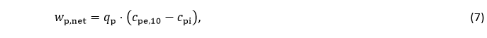

# Konstruktioner (§ 340 - § 357)

## Se alle vejledninger om Konstruktioner (§ 340 - § 357)

- [Bygningsreglementets vejledning om konstruktioner](../../generel_vejledning)
  - [Vedligehold af altaner](../../generel_vejledning/vedligehold-af-altaner)
- [Vejledning om konstruktionsforhold for transportable konstruktioner](..)
- [Temasiden Brandogkonstruktioner.dk om certificeringsordningen for brandforhold og bærende konstruktioner](../../temasiden-brandogkonstruktioner-dk)

## Vejledning om konstruktionsforhold for transportable konstruktioner

[0](../forord)

### Forord

[1](../konstruktionsklasse)

### Indplacering af transportable konstruktioner i konstruktionsklasse

[1.1](../konsekvensklasse)

### Konsekvensklasse

[1.2](../kompleksitet)

### Konstruktionens kompleksitet

[1.3](../erfaring)

### Erfaring med konstruktionstypen

[1.4](../konstruktioner_der_ikke_skal_indplaceres)

### Transportable konstruktioner der ikke skal indplaceres i en konstruktionsklasse

[2](../generelt)

### Generelt for transportable konstruktioner

[2.1](../projekteringsgrundlag)

### Projekteringsgrundlag

[2.2](../lavrisikokonstruktioner)

### Transportable lavrisikokonstruktioner

[3](../laster)

### Laster på transportable konstruktioner

[3.1](../vindlast)

### Vindlast

[3.1.1](../eksempel_tribune)

### Eksempel: Tribune

[3.1.2](../eksempel_telt)

### Eksempel: Telt

[3.2](../snelast)

### Snelast

[3.3](../rytmisk_personlast)

### Rytmisk personlast

[3.4](../lodret_belastning)

### Lodret belastning

[4](../fundering-og-forankring)

### Fundering og forankring

[4.1](../jordbundsforhold)

### Jordbundsforhold

[4.2](../geotekniske_undersoegelse)

### Geotekniske undersøgelser

[4.3](../geoteknisk_dokumentation)

### Geoteknisk dokumentation

[4.4](../jordankre)

### Jordankre

[4.5](../ballastankre)

### Ballastankre

[4.6](../simple_jordankre)

### Simple Jordankre

[4.7](../proevetraekning_af_ankre)

### Prøvetrækning af ankre

[Bilag 1](../bilag_1)

### Standarder der skal efterleves

[Bilag 2](../bilag_2)

### Frivillige standarder

[Bilag 3](../bilag_3)

### Vindlast på teltkonstruktioner

[B3.1](../peak-vindhastighed)

### Peak vindhastighed

[B3.2](../lastklasser)

### Lastklasser

[B3.3](./)

### Formfaktor

Den karakteristiske nettovindlast på en facade bestemmes af

### 

Formfaktoren for udvendig vindlast *c~pe,10~* specificeres i EN 1991-1-4. Formfaktoren for indvendig vindlast *c*~*pi*~ regnes til den mindst gunstige af +0,2 og -0,3, når der ikke er dominerende åbninger i konstruktionen. For teltkonstruktioner, hvor der fortrinsvis vil være åbninger i områder med udvendig sug, og når åbningerne er ikke-dominerende, kan den indvendige vindlast regnes til den mest ugunstige af +0,0 og -0,3.

[B3.4](../konstruktionsfaktor)

### Konstruktionsfaktor

[B3.5](../anbefalet_certificeringsformat)

### Anbefalet certificeringsformat

[B3.5.1](../eksempel_telt-1)

### Eksempel: Telt

\
