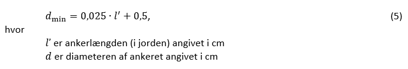

# Konstruktioner (§ 340 - § 357)

## Se alle vejledninger om Konstruktioner (§ 340 - § 357)

- [Bygningsreglementets vejledning om konstruktioner](../../generel_vejledning)
  - [Vedligehold af altaner](../../generel_vejledning/vedligehold-af-altaner)
- [Vejledning om konstruktionsforhold for transportable konstruktioner](..)
- [Temasiden Brandogkonstruktioner.dk om certificeringsordningen for brandforhold og bærende konstruktioner](../../temasiden-brandogkonstruktioner-dk)

## Vejledning om konstruktionsforhold for transportable konstruktioner

[0](../forord)

### Forord

[1](../konstruktionsklasse)

### Indplacering af transportable konstruktioner i konstruktionsklasse

[1.1](../konsekvensklasse)

### Konsekvensklasse

[1.2](../kompleksitet)

### Konstruktionens kompleksitet

[1.3](../erfaring)

### Erfaring med konstruktionstypen

[1.4](../konstruktioner_der_ikke_skal_indplaceres)

### Transportable konstruktioner der ikke skal indplaceres i en konstruktionsklasse

[2](../generelt)

### Generelt for transportable konstruktioner

[2.1](../projekteringsgrundlag)

### Projekteringsgrundlag

[2.2](../lavrisikokonstruktioner)

### Transportable lavrisikokonstruktioner

[3](../laster)

### Laster på transportable konstruktioner

[3.1](../vindlast)

### Vindlast

[3.1.1](../eksempel_tribune)

### Eksempel: Tribune

[3.1.2](../eksempel_telt)

### Eksempel: Telt

[3.2](../snelast)

### Snelast

[3.3](../rytmisk_personlast)

### Rytmisk personlast

[3.4](../lodret_belastning)

### Lodret belastning

[4](../fundering-og-forankring)

### Fundering og forankring

[4.1](../jordbundsforhold)

### Jordbundsforhold

[4.2](../geotekniske_undersoegelse)

### Geotekniske undersøgelser

[4.3](../geoteknisk_dokumentation)

### Geoteknisk dokumentation

[4.4](../jordankre)

### Jordankre

[4.5](../ballastankre)

### Ballastankre

[4.6](./)

### Simple Jordankre

Når der er tale om simple jordankre med et cirkulært tværsnit og en minimum nedramningsdybde på 80 cm, kan bæreevnen bestemmes i henhold til DS/EN 13782 pkt. 8.3 tabel 5.

Udføres jordankrenes bæreevnebestemmelse efter disse principper, skal man være opmærksom på, at jorden, specielt i det tidlige forår kan have lavere styrker end de nedenfor angivne. Tabel 5's (i DS/EN 13782) angivelse af bæreevnebestemmelsen i sand, "Dense cohesion less soils" kan være på den usikre side -- specielt hvor der er tale om sand med meget lavt lerindhold (når det tørre sand kan løbe ud mellem fingrene).

På den anden side vil man ofte skulle opstille de midlertidige konstruktioner på steder med gunstigere jordbundsforhold. Det anbefales derfor at udføre de for det angivne projekt nødvendige undersøgelser, og på den baggrund foretage den nødvendige dimensionering af jordankrene.

Tabel 5 i DS/EN 13782 omhandler tre jordtyper:

- "Stiff cohesive soils" kan beskrives som "stift sammenhængende jord" -- LER med en karakteristisk udrænet forskydningsstyrke, *C~u~* \> eller = 80 kN/m^2^.
- "Dense cohesion less soils" kan beskrives som "fast ikke sammenhængende jord" -- fastlejret SAND.
- "Very stiff cohesive soils" kan beskrives som "meget hård sammenhængende jord" -- fx fast moræneler med en karakteristisk udrænet forskydningsstyrke, *C~u~* \> eller =  100 kN/m^2^.

Beregningsprincippet er vist i figur 4 i DS/EN 13782.

Tabel 5 (i DS/EN 13782) giver bæreevnen for et anker med cirkulært tværsnit, der minimum nedrammes 80 cm i jorden (totallængde ca. 1,0 m), og hvor diameteren af ankerstangen er 3,0 cm, jf. udtrykket

### 

Ankerstangen skal have konstant diameter. Bardunens fastgørelse skal være fikseret i eller umiddelbart under terræn. Værdierne for forskellige vinkler er vist i på figur 5 i DS/EN 13782. Det er en forudsætning, at ankret ikke er løst efter nedramning eller glider ned under ganske få slag, se dog tabel 3.

Bæreevnebestemmelsen, som angivet ovenfor, finder også anvendelse på simple ankre med kvadratisk tværsnit, på opsvejste eller valsede profiler og på skrueankre med flere vindinger.

- Tværsnittets sidelængde indsættes i formlen som *d*, når tværsnittet er kvadratisk.
- Er ankerstangen opsvejst eller valset, indsættes diameteren af tværsnittets omskrevne cirkel som *d*, og *l\'* er længden af den del af ankret, der har dette profil
- For skrueankre med flere vindinger er *d *skruevindingernes diameter, og *l\'* er længden af den del af ankret, der har den anvendte diameter.

For ankre i lerfrit fastlejret sand foreslås de i Tabel 4 angivne værdier for *Z~v,h~* og *Z~h,d~*. Som grundlag for værdierne er forudsat en karakteristisk plan friktionsvinkel på 330, og en rumvægt på 18 kN/m^2^ -- idet grundvandsspejlet forudsættes at være lavere end forankringsdybden. Ligger grundvandsspejlet umiddelbart under terræn i sand, halveres værdierne.

  -------------- ------------ -------------- --------------- --------------- --------------- ---------------
  *l\'* \[cm\]   *d* = 2,5    3,8            5               7,5             10              15
   80            *245\\300*    *370\\420*     *490\\515*      *730\\690*      *980\\850*     *1470\\1140* 
   90             -            *470\\560*     *620\\690*      *930\\930*      *1240\\1140*    *1860\\1530*
   100            -            *580\\720*     *760\\980*      *1150\\1200*    *1530\\1480*    *2290\\1990*
   120            -            *830\\1130*    *1100\\1390*    *1650\\1890*    *2200\\2330*    *3300\\3110*
   140            -            -              *1500\\2020*    *2250\\2740*    *3000\\3392*    *4500\\4543*
   160            -            -              *1960\\2760*    *2930\\3781*    *3910\\4680*    *5870\\6280*
  -------------- ------------ -------------- --------------- --------------- --------------- ---------------

*Tabel 4: Vandret og lodret ankertræk i sand i N. (Venstre tal er max. lodret træk i N \\ Højre tal er max. vandret træk i N).*

Det aktuelle skrå træk, *Z~d~*, kan bestemmes ved at tegne det på figur 4 i DS/EN 13782 viste kraftdiagram og derefter måle diagonalen.

Hvis jordbundsforholdene er af en sådan beskaffenhed, at de ankre, der ønskes anvendt, ikke har den fornødne bæreevne, kan der anvendes flere indbyrdes forbundne ankre, således at toppen af det primære anker forbindes med en bardun til et eller flere sekundære ankre -- fastgørelsespunkt på det sekundære anker skal også være i eller under terræn. Afstanden mellem ankrene skal overalt være min. 1,5 gange rammedybden. Alternativt anvendes ballastankre.

Anvend altid den tungest mulige hammer. En for lille hammer ødelægger ankrets top og kan medføre, at ankret løsnes fra den omgivende jord. Hvis jorden er hård, er det bedre at bruge små slag med en tung hammer, i stedet for mange hårde slag med en lille hammer.

\
[4.7](../proevetraekning_af_ankre)

### Prøvetrækning af ankre

[Bilag 1](../bilag_1)

### Standarder der skal efterleves

[Bilag 2](../bilag_2)

### Frivillige standarder

[Bilag 3](../bilag_3)

### Vindlast på teltkonstruktioner

[B3.1](../peak-vindhastighed)

### Peak vindhastighed

[B3.2](../lastklasser)

### Lastklasser

[B3.3](../formfaktorer)

### Formfaktor

[B3.4](../konstruktionsfaktor)

### Konstruktionsfaktor

[B3.5](../anbefalet_certificeringsformat)

### Anbefalet certificeringsformat

[B3.5.1](../eksempel_telt-1)

### Eksempel: Telt

\
