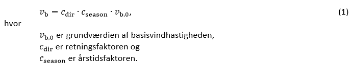
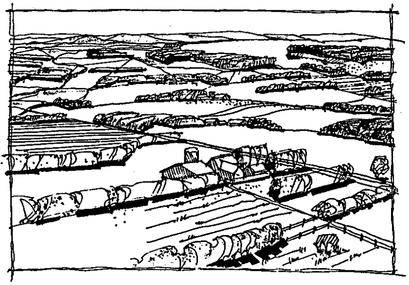
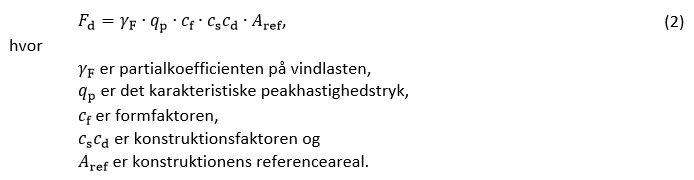
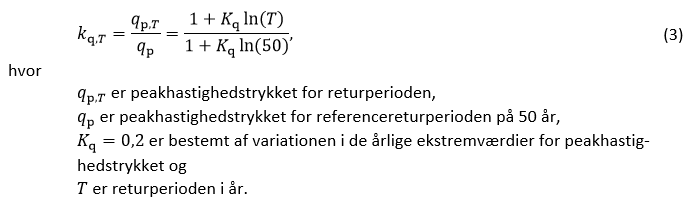

# Konstruktioner (§ 340 - § 357)

## Se alle vejledninger om Konstruktioner (§ 340 - § 357)

- [Bygningsreglementets vejledning om konstruktioner](../../generel_vejledning)
  - [Vedligehold af altaner](../../generel_vejledning/vedligehold-af-altaner)
- [Vejledning om konstruktionsforhold for transportable konstruktioner](..)
- [Temasiden Brandogkonstruktioner.dk om certificeringsordningen for brandforhold og bærende konstruktioner](../../temasiden-brandogkonstruktioner-dk)

## Vejledning om konstruktionsforhold for transportable konstruktioner

[0](../forord)

### Forord

[1](../konstruktionsklasse)

### Indplacering af transportable konstruktioner i konstruktionsklasse

[1.1](../konsekvensklasse)

### Konsekvensklasse

[1.2](../kompleksitet)

### Konstruktionens kompleksitet

[1.3](../erfaring)

### Erfaring med konstruktionstypen

[1.4](../konstruktioner_der_ikke_skal_indplaceres)

### Transportable konstruktioner der ikke skal indplaceres i en konstruktionsklasse

[2](../generelt)

### Generelt for transportable konstruktioner

[2.1](../projekteringsgrundlag)

### Projekteringsgrundlag

[2.2](../lavrisikokonstruktioner)

### Transportable lavrisikokonstruktioner

[3](../laster)

### Laster på transportable konstruktioner

[3.1](./)

### Vindlast

Vindlasterne afhænger af lokaliteten for den transportable konstruktion, og da der normalt bliver tale om mange lokaliteter for den transportable konstruktion, vil vindlasten variere hen over konstruktionens levetid. For mange transportable konstruktioner kan der således opereres med flere klasser, eksempelvis mindre udsat, middel udsat og meget udsat, og dimensioneringen af de transportable konstruktioner kan baseres på opfyldelse af forholdene i en given klasse.

Lignende overvejelser kan anvendes i forbindelse med de geotekniske forhold.

I vindnormen, DS/EN 1991-1-4, specificeres vindklimaet ved hjælp af basisvindhastigheden, der beregnes ved

### 

Grundværdien for basisvindhastigheden er den karakteristiske 10-minutters middel-vindhastighed i 10 m højde over referenceterrænet, der er et åbent terræn med lav vegetation, se Figur 1. Grundværdien regnes til 24 m/s i hovedparten af Danmark og til 27 m/s ved Vesterhavet og Ringkøbing Fjord. Der interpoleres lineært mellem disse værdier i en 25 km bred randzone langs kysten.

### 

Figur 1: Illustration af referenceterrænet med basisvind: åbent terræn med lav vegetation.

Retningsfaktoren giver lastreduktioner på op til 20 %, når vinden ikke kommer fra vest eller vestnordvest, og årstidsfaktoren giver lastreduktioner på op til 10-30 % for månederne marts til november.

Årstidsfaktorens lastreduktioner indgår kun i dimensioneringen af de transportable konstruktioner, der ikke anvendes i månederne december til februar. Vindnormen DS/EN 1991-1-4 anfører eksplicit, at årstidsfaktoren *c~season~* regnes til 1 for transportable konstruktioner, der kan benyttes hele året.

For transportable konstruktioner kan varigheden af anvendelsen på en given lokalitet indgå ved fastsættelsen af den karakteristiske vindhastighed sammen med:

- Muligheden for at forudsige kraftig vind

- Nødvendig tid til at reducere vindlasten på konstruktionen, typisk ved at fjerne vindudsatte flader

- Nødvendig tid til at beskytte eller forstærke konstruktionen i tilfælde af varsel om kraftig vind.

Den karakteristiske vindlast på konstruktionen bestemmes ved at multiplicere det karakteristiske peakhastighedstryk med formfaktorer, konstruktionsfaktorer og de vindudsatte arealer. Det karakteristiske peakhastighedstryk optræder i gennemsnit en gang over en periode på 50 år, og det afhænger af vindklimaet, terrænets ruhed og orografi, og referencehøjden.

Den regningsmæssige vindlast for sædvanlige permanente konstruktioner bestemmes med udtrykket

### 

For transportable konstruktioner vil der ofte være en betydelig økonomisk gevinst ved at etablere den krævede sikkerhed og funktion for konstruktionen for vindhastigheder op til et sjældent forekommende niveau, der er væsentlig mindre end svarende til returperioden på 50 år, og for højere vinde reducere de vindudsatte flader eller forstærke konstruktionen.

For at gøre disse vurderinger så hensigtsmæssige som muligt, er det vigtigt at vide, hvor tit et givet niveau overskrides. Peakhastighedstrykkets afhængighed af returperioden fremgår af udtrykket for faktoren *k~q,T~*:

### 

Returperioden *T* er defineret som den gennemsnitlige tid mellem overskridelser af det betragtede peakhastighedstryk. Peakhastighedstrykket med en returperiode på eksempelvis 5 år overskrides således i gennemsnit 1 gang hver femte år; men det udelukker ikke, at 2 storme indenfor samme måned begge overskrider værdien, eller at værdien slet ikke opnås indenfor en 5-års periode.

Nedenstående Tabel 2 viser betydningen af returperioden for lastreduktionen. Valget mellem gevinsten ved reduceret vindlast og omkostningen til varsling etc. bør indgå i vurderingen af en passende returperiode.

  ------------------------ ------ ------ ------ ------ ----------- -----------
  Returperiode, T \[år\]   1      5      10     50     84\*^)^     4300\*^)^
   Faktor, k~q,T~ \[-\]    0,56   0,74   0,82   1,00   1,06\*^)^   1,50
  ------------------------ ------ ------ ------ ------ ----------- -----------

Tabel 2: Faktor for returperiode i hele år. \*^)^ Se forklaring nedenfor.

Ser man på det regningsmæssige hastighedstryk -- altså efter det er blevet ganget med en lastpartialkoefficient på 1,5 -- kan man regne ud, hvilken returperiode dette hastighedstryk svarer til vha. udtryk (3):

\(1\) Peakhastighedstrykket på en transportabel lavrisikokonstruktion med en levetid på 1 år kan reduceres med en faktor på 0,71. Det regningsmæssige peakhastighedstryk bliver altså 1,5 \* 0,71 = 1,06 gange større end det karakteristiske peakhastighedstryk for en returperiode på 50 år. Som det kan ses af Tabel 2 svarer dette til et karakteristisk peakhastighedstryk med en returperiode på *T* = 84 år.  . Sandsynligheden for at dette peakhastighedstryk overskrides inden for konstruktionens etårige levetid er altså 1/84 = 0,012.

\(2\) For en permanent konstruktion med et peakhastighedstryk svarende til returperioden er *T* = 50 år, er det regningsmæssige hastighedstryk altså 1,5 gange større end det karakteristiske. Som man kan se i Tabel 2 svarer det regningsmæssige hastighedstryk altså til en returperiode på ca. *T* = 4300 år. Den årlige sandsynlighed for overskridelse for denne returperiode er 1/4300. Sandsynligheden for overskridelse af denne værdi i løbet af en levetid på 50 år er altså 1 - (1 - 1/4300)^50 ^= 0,012.

Sandsynligheden for overskridelse inden for konstruktionens levetid er altså den samme for den transportable lavrisikokonstruktion (1) og for den permanente konstruktion (2). Dette viser, at det samme sikkerhedsniveau opnås for en transportabel lavrisikokonstruktion med en levetid på 1 år, hvis peakhastighedstrykket reduceres med en faktor på 0,71.

Princippet i en konstruktiv anvendelse af reducerede vindlaster samtidig med en bibeholdelse af den ønskede sikkerhed og funktion beskrives bedst ved et eksempel med en tribune og et telt. Disse konstruktioner kan normalt ikke henføres til lav risiko, da de anvendes af mange personer. Der regnes med normal konsekvensklasse.

[3.1.1](../eksempel_tribune)

### Eksempel: Tribune

[3.1.2](../eksempel_telt)

### Eksempel: Telt

[3.2](../snelast)

### Snelast

[3.3](../rytmisk_personlast)

### Rytmisk personlast

[3.4](../lodret_belastning)

### Lodret belastning

[4](../fundering-og-forankring)

### Fundering og forankring

[4.1](../jordbundsforhold)

### Jordbundsforhold

[4.2](../geotekniske_undersoegelse)

### Geotekniske undersøgelser

[4.3](../geoteknisk_dokumentation)

### Geoteknisk dokumentation

[4.4](../jordankre)

### Jordankre

[4.5](../ballastankre)

### Ballastankre

[4.6](../simple_jordankre)

### Simple Jordankre

[4.7](../proevetraekning_af_ankre)

### Prøvetrækning af ankre

[Bilag 1](../bilag_1)

### Standarder der skal efterleves

[Bilag 2](../bilag_2)

### Frivillige standarder

[Bilag 3](../bilag_3)

### Vindlast på teltkonstruktioner

[B3.1](../peak-vindhastighed)

### Peak vindhastighed

[B3.2](../lastklasser)

### Lastklasser

[B3.3](../formfaktorer)

### Formfaktor

[B3.4](../konstruktionsfaktor)

### Konstruktionsfaktor

[B3.5](../anbefalet_certificeringsformat)

### Anbefalet certificeringsformat

[B3.5.1](../eksempel_telt-1)

### Eksempel: Telt

\
