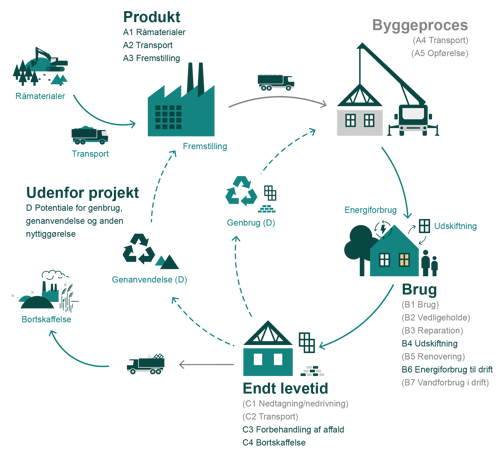

# Energiforbrug og klimapåvirkning (§ 250 - § 298)

## Se alle vejledninger om Energiforbrug og klimapåvirkning (§ 250 - § 298)

- [Spørgsmål og svar om energiforbrug](../../qa)
- [Spørgsmål og svar om bygningers klimapåvirkning](../../spoergsmaal-og-svar-om-bygningers-klimapaavirkning)
- [Bygningsreglementets vejledning om energiforbrug (Version 2, opdateret 1. juli 2023)](../../energiforbrug-2)
- [Bygningsreglementets vejledning om energiforbrug](../../energiforbrug)
- [Bygningsreglementets vejledning om efterisolering](../../ofte-rentable-konstruktioner)
- [Vejledning om funktionsafprøvning (Opdateret 1. juli 2023)](../../version-2-funktionsafprovning)
- [Vejledning om funktionsafprøvning](../../funktionsafprovning)
- [Vejledning om håndtering af forskelligt energibehov i energirammen](../../haandtering-af-forskelligt-energibehov)
- [Bygningsreglementets vejledning om bygningers klimapåvirkning (Version 2, opdateret 1. juli 2023)](../../version-2-bygningers-klimapaavirkning)
- [Bygningsreglementets vejledning om bygningers klimapåvirkning](..)
- [Vejledning om energiberegning af hospitaler](../../energiberegning-af-hospitaler)
- [Eksempelsamling for energi](../../eksempelsamling)

## Bygningsreglementets vejledning om bygningers klimapåvirkning

[1.0.](../kap_1_0)

### Forord

[1.1.](../kap-1_1)

### Generelt

[1.2.](./)

### Livscyklus og betragtningsperiode

I en livscyklusvurdering (Life Cycle Assessment, LCA) af en bygning opgøres bygningens påvirkning af forskellige miljøindikatorer, som for eksempel forsuring, klimapåvirkninger mv., igennem hele livscyklussen. Kravet i bygningsreglementet vedrører udelukkende klimapåvirkningen, der opgøres i CO~2~-ækvivalenter, og således ikke andre miljøindikatorer. I det følgende uddybes de forudsætninger, der skal lægges til grund for livscyklusvurdering i henhold til kravet i bygningsreglementet.

#### **Beregningsprincipper for beregning af klimapåvirkningen**

Til beregning af klimapåvirkningen skal der tages udgangspunkt i de beregningsprincipper, som fremgår af standarden DS/EN15978:2012 "Bæredygtighed inden for byggeri og anlæg - Vurdering af bygningers miljømæssige kvalitet -- Beregningsmetode".

Standarden DS/EN15978:2012 skal følges med de præciseringer, der fremgår af § 297.  Det vil sige, at:

- modulerne og betragtningsperioden som defineret i stk. 2
- arealer skal opgøres som defineret i stk. 3
- de bygningsdele, der skal medregnes, fremgår af stk. 4
- det datagrundlag, der skal anvendes, fremgår af stk. 5 og stk. 6
- de levetider, der skal anvendes, fremgår af stk. 7
- de emissionsfaktorer, der skal anvendes, fremgår af stk. 8

#### **Livscyklusfaser og moduler**

Ifølge standarden er bygningers livscyklus opdelt i forskellige faser, som igen er opdelt i moduler.

Figur 2.1 og figur 2.2 viser samtlige livscyklusfaser og -moduler, der indgår i en LCA beregning ifølge standarden EN15978. Ikke alle moduler i en LCA beregning skal opgøres og dokumenteres ved overholdelse af kravet i bygningsreglementet § 297.

De moduler, som skal medregnes og dokumenteres, jf. kravet i bygningsreglementet, omfatter A1-A3, B4, B6, C3, C4 og D. De moduler, der skal medregnes, er markeret med grøn tekst i figur 1. De moduler, der ikke skal medtages, er markeret med gråt og parentes. Byggeprocesfasen samt flere moduler i brugs- og endt levetidsfasen indgår ikke ifølge § 297. Modul D angiver de potentielle klimamæssige gevinster eller belastninger, som kan forekomme. Klimapåvirkningerne fra modul D skal medtages i beregningen, jf. § 297, men skal ikke indgå i overholdelse af grænseværdien for bygninger over 1.000 m^2^, jf. § 298

.

{width="500" height="452"}

 

***Figur 2.1:*** *Grafisk illustration af bygningens livscyklus iht. EN15978. De moduler og faser, der indgår i kravet, jf. § 297, er fremhævet med grøn skrift. Moduler, der ikke indgår, er markeret med grå skrift og parentes.*

Figur 2.2 understøtter figur 2.1 på en alternativ grafisk måde. Det, der fremgår som "uden for projektet"/"udenfor systemgrænsen", angiver de potentielle klimamæssige gevinster (modul D), som for eksempel kan forekomme efter bygningens levetid.

.%3C/em%3E%3C/p%3E%3Cp%3Ei%20tabel%202.1%20fremgår%20de%20moduler,%20der%20indgår%20i%20kravet%20med%20en%20forklaring%20på,%20hvad%20de%20enkelte%20moduler%20indeholder.%20det%20datagrundlag,%20der%20skal%20anvendes%20til%20beregning%20af%20klimapåvirkningen,%20er%20allerede%20opdelt%20på%20de%20moduler,%20der%20fremgår%20af%20tabellen.%20derfor%20er%20det%20ikke%20nødvendigt%20at%20forholde%20sig%20konkret%20til%20de%20enkelte%20moduler%20i%20forbindelse%20med%20beregningen%20(se%20nærmere%20i%20vejledning:%20§%20297,%20stk.%205,%20datagrundlag).%3C/p%3E%3Ctable%20style=) Faser Moduler Uddybning af modulers processer Produkt  A1 Råmaterialer  Klimamæssige konsekvenser som følge af processer for udvinding af råstoffer og brug af sekundære materialer. A2  Transport til fremstilling Klimamæssige konsekvenser som følge af transport til fabrikken til fremstilling af den færdige byggevare eller det præfabrikerede system. A3 Fremstilling Klimamæssige konsekvenser som følge af processer til fremstilling af den færdige byggevare eller det præfabrikerede system.  Brug B4  Udskiftning  Klimamæssige konsekvenser som følge af påvirkninger relateret til udskiftninger af bygningsdele. B6 Energiforbrug til drift Klimamæssige konsekvenser som følge af produktion af energi til bygningsdrift.    Endt levetid C3 Forbehandling af affald Klimamæssige konsekvenser som følge af affaldsbehandling forud for nyttiggørelse. C4  Bortskaffelse Klimamæssige konsekvenser som følge af bortskaffelse af affald, inklusive forbehandling forud for bortskaffelse.  Udenfor projekt  D Potentiale for genbrug, genanvendelse og anden nyttiggørelse Potentielle miljømæssige gevinster eller belastninger fra genbrug og genanvendelse af byggevarer og anden nyttiggørelse som for eksempel energiindvinding fra afbrænding.

***Tabel 2.1: ****Oversigt og beskrivelse af de moduler, der skal indgå i beregning af klimapåvirkningen jf. § 297*

Da modul D ifølge standard EN15978 er udenfor projektet, opgøres modul D separat fra den øvrige opgørelse, jf. § 297. I forbindelse med overholdelse af grænseværdien, jf. § 298, medregnes modul D ikke. Se yderligere vejledning til § 298, stk. 2

#### **Betragtningsperioden**

For at opfylde kravet om beregning af bygningers klimapåvirkning i bygningsreglementet skal klimapåvirkningen opgøres for en betragtningsperiode på 50 år. De 50 år tælles fra tidspunktet, hvor bygningen færdigmeldes.

Betragtningsperioden angiver den beregningsmæssige periode, som bygningens livscyklus beregnes over. Den fastsatte betragtningsperiode på 50 år svarer ikke nødvendigvis til den konkrete bygnings forventede levetid, men er fastsat i bygningsreglementet for at gøre beregningerne af klimapåvirkning fra de enkelte bygninger sammenlignelige.

Alle moduler i tabel 1 skal medtages i beregningen, også selvom bygningen eller byggematerialer vurderes at have en levetid på mere end betragtningsperiodens 50 år. Det gælder også modulerne C3 og C4, som vedrører endt levetid.

#### **Beregningsenhed**

Klimapåvirkninger opgøres i enheden kg CO~2~-ækvivalenter pr. m^2^ pr. år.

CO~2~-ækvivalenter er en samlet betegnelse for effekten af alle drivhusgasarter omregnet til en fælles enhed. De data, der skal anvendes i beregningen af klimapåvirkning, fremgår af [BR18, bilag 2, tabel 7](../../../../../../../media/1e3b1ki2/br18-bilag-2-tabel-7-version-2-201222-2.xlsx "BR18 bilag 2 tabel 7 version 2 201222") (nyt vindue). Data er opgjort samlet i Global Warming Potential (GWP) i enheden CO~2~-ækvivalenter. Den samlede klimapåvirkning skal i beregningen sættes i forhold til den konkrete bygnings referenceareal og opvarmede etageareal, som beregnes iht. § 297 stk. 3 og § 256, nr. 3 og betragtningsperioden på 50 år.

Den beregnede klimapåvirkning kan fordeles ud på hhv. referenceareal og opvarmet etageareal, jf. følgende formel: 

((A1 + A2 + A3 + B4 + C3 + C4) / (A~*ref*~ \* 50 år)) + (B6 / (A~*opv *~*\* *50 år)) 

Hvor A1 angiver modul A1, A2 angiver modul A2 osv., A*~ref~* angiver referencearealet beregnet iht. § 297, stk. 3 (se vejledningen til dette stk.), og A*~opv~* angiver det opvarmede etageareal beregnet iht. § 256, nr. 3.

Modul D kan opgøres på lignende vis:

((D~*mat*~ / (A*~ref~* \* 50 år)) + (D*~drift~* / (A~*opv*~ \* 50 år))

Hvor D*~mat~* angiver materialernes D-modul, og D*~drift~* angiver driftens D-modul.

[1.3.](../kap-1_3)

### Arealopgørelse

[1.4.](../kap-1_4)

### Bygningsdele

[1.5.](../kap-1_5)

### Datagrundlag

[1.6.](../kap-1_6)

### Miljøvaredeklarationer

[1.7.](../kap-1_7)

### Levetider

[1.8.](../kap-1_8)

### Emissionsfaktorer

[1.9.](../kap-1_9)

### Lavemissionsklassen

[2.1.](../kap-2_1)

### Grænseværdi

[2.2.](../kap-2_2)

### Modul D

[2.3.](../kap-2_3)

### Energitillæg

[2.4.](../kap-2_4)

### Særlige forhold

\
