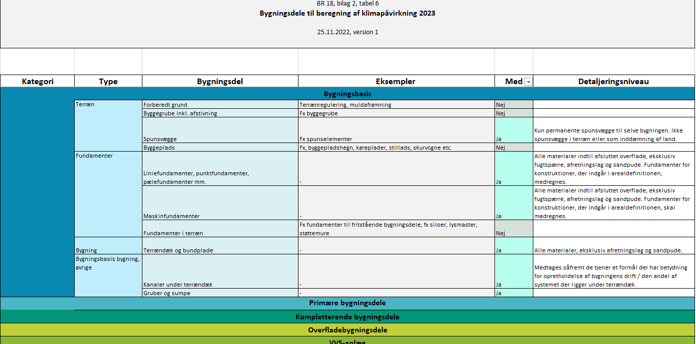

# Energiforbrug og klimapåvirkning (§ 250 - § 298)

## Se alle vejledninger om Energiforbrug og klimapåvirkning (§ 250 - § 298)

- [Spørgsmål og svar om energiforbrug](../../qa)
- [Spørgsmål og svar om bygningers klimapåvirkning](../../spoergsmaal-og-svar-om-bygningers-klimapaavirkning)
- [Bygningsreglementets vejledning om energiforbrug (Version 2, opdateret 1. juli 2023)](../../energiforbrug-2)
- [Bygningsreglementets vejledning om energiforbrug](../../energiforbrug)
- [Bygningsreglementets vejledning om efterisolering](../../ofte-rentable-konstruktioner)
- [Vejledning om funktionsafprøvning (Opdateret 1. juli 2023)](../../version-2-funktionsafprovning)
- [Vejledning om funktionsafprøvning](../../funktionsafprovning)
- [Vejledning om håndtering af forskelligt energibehov i energirammen](../../haandtering-af-forskelligt-energibehov)
- [Bygningsreglementets vejledning om bygningers klimapåvirkning (Version 2, opdateret 1. juli 2023)](..)
- [Bygningsreglementets vejledning om bygningers klimapåvirkning](../../bygningers-klimapaavirkning)
- [Vejledning om energiberegning af hospitaler](../../energiberegning-af-hospitaler)
- [Eksempelsamling for energi](../../eksempelsamling)

## Bygningsreglementets vejledning om bygningers klimapåvirkning (Version 2, opdateret 1. juli 2023)

[1.0.](../kap_1_0)

### Forord

[1.1.](../kap-1_1)

### Generelt

[1.2.](../kap-1_2)

### Livscyklus og betragtningsperiode

[1.3.](../kap-1_3)

### Arealopgørelse

[1.4.](./)

### Bygningsdele

Til brug for beregning af klimapåvirkningen skal udledningerne fra de materialer, der indgår i de enkelte dele af bygningen, medregnes. Som udgangspunkt bør en bygnings livscyklusvurdering omfatte så mange bygningsdele som muligt, for at repræsentere bygningens klimapåvirkning så godt som muligt. Da en bygning består af mange bygningsdele, kan der opstå spørgsmål om, hvor grænsen skal trækkes, for at afspejle den rette balance mellem ressourceforbrug og præcision.

For at sikre ensartede livscyklusvurderinger med samme afgrænsning for alle bygninger er der udarbejdet en oversigt over de dele af en bygning, der som minimum skal indgå i livscyklusvurderingen (markeret med ja), herunder også præcisering af det detaljeringsniveau, der skal ligge til grund for opgørelsen. Oversigten fremgår af BR18, bilag 2, tabel 6, og kan hentes [her](../../../../../../../bilag/b2/bilag_2/tabel_6){rel="noopener noreferrer" target="_blank"} (nyt vindue). Der skelnes generelt mellem bygningsdele og så de materialer, der indgår i hver bygningsdel.

I det følgende uddybes, hvordan BR18, bilag 2, tabel 6 skal anvendes i forbindelse med beregningen. Det uddybes også, hvordan man kan opgøre klimapåvirkningerne for visse dele af bygningen, hvor det ikke er muligt at opgøre de enkelte materialer grundet manglende data, jf. BR18, bilag 2, tabel 7. 

Udearealer er ikke del af kravet om bygningers klimapåvirkning, jf. § 297.

#### **Tabellens opbygning og anvendelse**

BR18, bilag 2, tabel 6 er opbygget i forhold til bygningskategorier. Hver kategori er igen opdelt i typer, og for hver type fremgår de enkelte bygningsdele. Se et uddrag af tabellen nedenfor.

### 

Figur 4.1: Eksempel fra BR18, bilag 2, tabel 6, for hvilke bygningsdele der skal medtages for bygningsdele i terræn.

Hvorvidt en bygningsdel skal medtages i beregningen, fremgår af kolonnen *Med.* Hvis der for den konkrete bygningsdel står "Ja", så skal bygningsdelen og tilhørende materialer medregnes. For at undgå mulige tvivlstilfælde er der også en række bygningsdele med i tabellen, som ikke skal indgå i beregningen. Dette er angivet ved et "Nej".

Af tabellen fremgår endvidere informationer om *Detaljeringsniveauet*, som kan afgrænse yderligere hvilke delkomponenter og materialer, der skal medregnes for den pågældende bygningsdel. I de tilfælde, hvor der ikke er nærmere beskrivelse af detaljeringsniveauet, betyder det, at alle materialer i bygningsdelen som udgangspunkt medregnes. Der kan være visse undtagelser fra denne regel, som er nærmere uddybet senere i denne vejledning.

Endvidere fremgår det for nogle bygningsdele; "*Evt. som mængde råmateriale"*.  For disse bygningsdele er det muligt at opgøre påvirkningen ved at opgøre mængden af råmateriale, frem for at opgøre påvirkningen fra det specifikke produkt. Dette gælder særligt for tekniske installationer, hvor opgørelse af klimapåvirkninger kan være vanskelig at foretage.  Se nærmere herom under "Vejledningen til datagrundlaget stk. 5; *Mængde råmateriale*".

Overordnet kan nævnes, at for de tekniske installationer medregnes tekniske anlæg og hovedføringsveje, dog kun de lige kanaler og rør, samt ventilationsaggregat, inklusiv varme- og køleflader samt kanalsystemet til ventilation. Indblæsningsarmaturer, spjæld eller lignende medregnes ikke. Nærmere afgrænsninger fremgår ligesom for de øvrige bygningsdele af BR18, bilag 2, tabel 6.

#### **Øvrige principper for hvilke bygningsdele, der skal medtages**

Udover selve tabellen indeholder BR18, bilag 2, tabel 6, et indledende afsnit, som beskriver overordnede principper for, hvad der skal medtages, og hvilke forenklinger, der kan foretages i beregning for bygningers klimapåvirkning.

 

#### **Accepterede udeladelser**

For visse bygningsdele kan det være svært at opgøre konkrete mængder. Derfor kan følgende kategorier af maten: rialer udelades i beregninge

- Fastgørelsesmidler, for eksempel søm, skruer, kiler, hulplader til søm eller skruer, murbindere eller lignende
- Fugemateriale
- Lokale membraner (fx fugtspærrer, der er placeret lokale mindre steder og ikke er del af den regulære opbygning af bygningsdelen)
- Fugtspærre i fundamenter
- Hndlister, fodpaneler og lignende lister

#### **Forenklinger ift. mængdeopgørelse**

Større samlinger af væsentlig betydning for det bærende system, for eksempel boltesamlinger, skal medregnes, men kan eventuelt medregnes som et samlet skøn af mængden af råmateriale.  Hvis det ikke er muligt at opgøre konkrete mængder inden for den enkelte samling, kan en samlet mængde opgøres. Se hertil: *Eksempel for mængder for samlinger.*

Udstøbning af fuger mellem betonelementer, udstøbning af et filigrandæk eller lignende samling mellem elementer kan forenkles ved at medregne den øvrige konstruktion som gennemgående. Denne forenkling kan anvendes, hvis der er tale om den samme materialetype. Hvis fx en stålbjælke udstøbes med beton, så kan dette ikke ses som et homogent materiale. 

Hvis der er eventuelle huller mm. i en bygningsdel, kan man for at forsimple opgørelsen se bort herfra. Det betyder dog, at klimapåvirkningen vil være lidt højere, end hvis man laver en mere nøjagtig beregning. Det gælder fx recesser, udsparinger eller rørgennemføringer, hvor den underliggende bygningsdel kan regnes som gennemgående homogen konstruktion. På baggrund af det behøver brandlukninger og andre former for lukninger af udsparinger mm. ikke at blive medregnet.

Delvist præfabrikerede konstruktioner kan beregnes uden at medtage udfyldning imellem elementerne.

Tegloverliggere og lignende kan indregnes som det omkringliggende murværk, dvs. det kan antages, at tegloverliggere anses som almindeligt murværk.

#### **Anvendelse af standardværdier for installationer**

For tekniske installationer kan opgørelsen af klimapåvirkning enten opgøres specifikt for de materialer og produkter, der anvendes, eller alternativt ved at anvende standardværdier for installationer. Der er udviklet standardværdier for følgende tre installationskategorier:

- Afløb
- Vand
- Varme, ventilation og køl.

Værdierne er forskellige alt efter bygningstypologien, det vil sige:

- Enfamiliehuse
- Rækkehuse
- Etageboligbyggeri
- Kontorer, skoler og daginstitutioner

Bygningstypologier, som ikke er dækket af ovenstående, kan anvende standardværdier for:

- ·Øvrigt byggeri

Disse værdier fremgår af [BR18, bilag 2, tabel 7](../../../../../../../bilag/b2/bilag_2/tabel_7){rel="noopener noreferrer" target="_blank"} (nyt vindue).

Standard installationsværdierne er angivet i enheden kg CO~2~-ækvivalenter pr. *m^2^ opvarmet areal* pr. år. Værdierne skaleres altså med arealet, som svarer til det samlede opvarmet etageareal, jf. § 256 stk. 3, plus arealet for opvarmet kælder.

Værdierne er fastsat ud fra en betragtningsperiode på 50 år. Det betyder, at der ikke skal knyttes levetider til værdierne (læs mere om levetider i vejledningen om § 297, stk. 7). Udskiftninger undervejs i betragtningsperioden er indregnet i henholdsvis modulerne A1-A3 og C3/C4. Klimapåvirkningerne fra installationer ved anvendelse af standard installationsværdier fremgår derfor kun for modulerne A1-A3 og C3 og C4, og modul D.

Da værdierne er opdelt i tre kategorier 1) Afløb, 2) Vand, 3) Varme, ventilation og køl, er det muligt at vælge en, to eller alle tre værdier samlet i én beregning.

Værdierne er fastsat på baggrund af rapporter om udvikling af standardværdier og er fastsat konservativt. Se baggrundsrapporterne [her](https://bpst.dk/da/Byggeri/Baeredygtigt-byggeri/NY-Klimakrav-i-bygningsreglementet#fra-politisk-aftale-til-ikrafttr%C3%A6delse-af-klimakrav) (nyt vindue).

Der er altid mulighed for at opgøre installationer på den samme måde som de resterende bygningsdele, dvs. at der ikke behøves anvendt standardværdierne, disse er udelukkende et tilbud for en nemmere opgørelse.

Se "*Eksempel for anvendelse af standardværdier for installationer*" for uddybning om brug af standardværdier for installationer.

***Råhuse***\
Hvis en bygning ikke afleveres i den stand, at den er klar til ibrugtagning, men for eksempel betegnes som et råhus, og ved færdigmelding mangler dele, som for eksempel gulv, vægmaling mm., som er nødvendige for at sikre funktionaliteten af bygningen, medregnes sådanne dele af bygningen i beregningen af bygningens klimapåvirkning. Dette gælder, uanset at bygningsdelene ikke er til stede i bygningen på færdigmeldingstidspunktet. Se eksempel for råhus nedenfor.

***Solceller\***
Materialernes klimapåvirkning regnes kun med til den andel af solceller, hvis ydelse kan indregnes i energiberegningen. Dette er en afgrænsning, jf. BR18, bilag 2, tabel 6, under "Solcelleanlæg". Det vil sige, at kun materialernes klimapåvirkning fra de solceller, som er medregnet i bygningens driftsforbrug eller indgår som en del af tagbeklædningen, medtages i modulerne A1-3, B4, C3-4 og D. Se nærmere herom under vejledning til stk. 8 emissionsfaktorer.

Hvis der for en bygning opføres solceller, som ikke placeres på bygningen, men et andet sted, skal disse stadigvæk medtages i beregningen af bygningers klimapåvirkning, såfremt disse medtages i energirammen, jf. § 259 og § 260, og etableres i samme byggesag.

## Eksempler

#### **Eksempel på en mængdeberegning for samlinger**

En større fleretagers kontorbygning projekteres som søjle-bjælkekonstruktion i CLT-træ. Søjlerne er forankret i fundamentet ved hjælp af fodbeslag, mens søjler og bjælker samles i etagekryds. Begge samlinger udføres i metal. Samlingerne er kraftige og går udover mindre samlinger med sømplader i materialemængde. Det betyder, at disse samlinger skal opgørelse i beregningen om bygningers klimapåvirkning. Det kan være svært at finde mængder på samlinger og det rette data, jf. BR18, bilag 2, tabel 7.

Herunder vises, hvordan der findes mængden på samlinger og hvilket data, der vælges ift. BR18, bilag 2, tabel 7. Selvom bygningens samlede klimapåvirkning kun skal angives med et decimal, kan det for mere nøjagtige beregninger anbefales at være mere præcis i mellemregningerne.

+-----------------------------+--------------------------------------+----------------------+----------------------+-----------------------+------------------+
|                             |  **Formel**                          |  **Areal** \[mm^2^\] |  **Tykkelse** \[mm\] | **Volumen **\[m^3^\]  | **Vægt **\[kg\]  |
+-----------------------------+--------------------------------------+----------------------+----------------------+-----------------------+------------------+
|  **Fodbeslag**                                                                                                                                              |
+-----------------------------+--------------------------------------+----------------------+----------------------+-----------------------+------------------+
|  Dorn plade                 |                                      |  98.850              |  15                  |  0,00135              |                  |
+-----------------------------+--------------------------------------+----------------------+----------------------+-----------------------+------------------+
|  Ankerplade                 |                                      |  442.500             |  15                  |  0,00634              |                  |
+-----------------------------+--------------------------------------+----------------------+----------------------+-----------------------+------------------+
|  Forskydningsknast          |                                      |  50.400              |  6                   |  0,00030              |                  |
+-----------------------------+--------------------------------------+----------------------+----------------------+-----------------------+------------------+
|  Dorne                      |                                      |  4 x 200             |  24                  |  0,00036              |                  |
+-----------------------------+--------------------------------------+----------------------+----------------------+-----------------------+------------------+
|  Samlet volumen             |                                      |                      |                      |  0,00835              |                  |
+-----------------------------+--------------------------------------+----------------------+----------------------+-----------------------+------------------+
|  Samlet vægt for samling    | Volumen x densitet af stål           |                      |                      |                       |  65,798          |
|                             |                                      |                      |                      |                       |                  |
|                             | 0,00835 m^3^ x 7.880 kg/m^3^         |                      |                      |                       |                  |
+-----------------------------+--------------------------------------+----------------------+----------------------+-----------------------+------------------+
|  Samlet vægt i projektet    | Vægt for samling x antal i projektet |                      |                      |                       |  2.105,536       |
|                             |                                      |                      |                      |                       |                  |
|                             | 65,798 kg x 32                       |                      |                      |                       |                  |
+-----------------------------+--------------------------------------+----------------------+----------------------+-----------------------+------------------+
| ** Etagekryds**                                                                                                                                             |
+-----------------------------+--------------------------------------+----------------------+----------------------+-----------------------+------------------+
| Dorn plader                 |                                      |  760.000             |  760.000             |  0,01140              |                  |
+-----------------------------+--------------------------------------+----------------------+----------------------+-----------------------+------------------+
|  Ankerplader                |                                      |  360.400             |  360.400             |  0,00721              |                  |
+-----------------------------+--------------------------------------+----------------------+----------------------+-----------------------+------------------+
|  Bundplader                 |                                      |  193.800             |  193.800             |  0,00388              |                  |
+-----------------------------+--------------------------------------+----------------------+----------------------+-----------------------+------------------+
|  Dorne                      |                                      |  40 x 200            |  40 x 200            |  0,00251              |                  |
+-----------------------------+--------------------------------------+----------------------+----------------------+-----------------------+------------------+
|  Bolte                      |                                      |  20 x 460            |  20 x 460            |  0,00289              |                  |
+-----------------------------+--------------------------------------+----------------------+----------------------+-----------------------+------------------+
|  Samlet volumen             |                                      |                      |                      |  0,02789              |                  |
+-----------------------------+--------------------------------------+----------------------+----------------------+-----------------------+------------------+
|  Samlet vægt for samling    | volumen \* densitet af stål          |                      |                      |                       |  219,773         |
|                             |                                      |                      |                      |                       |                  |
|                             | 0,01048 m3 \* 7880 kg/m3             |                      |                      |                       |                  |
+-----------------------------+--------------------------------------+----------------------+----------------------+-----------------------+------------------+
|  Samlet vægt i projektet    | Vægt for samling x antal i projektet |                      |                      |                       |  23076,186       |
|                             |                                      |                      |                      |                       |                  |
|                             | 219,773 x 105                        |                      |                      |                       |                  |
+-----------------------------+--------------------------------------+----------------------+----------------------+-----------------------+------------------+
|  **Sum samlinger**                                                                                                                                          |
+--------------------------------------------------------------------+----------------------+----------------------+-----------------------+------------------+
|  *Samlet vægt af fodbeslag og etagekryds i projektet*              |                      |                      |                       |  *25181,722*     |
+--------------------------------------------------------------------+----------------------+----------------------+-----------------------+------------------+

Følgende miljødata fra BR18, bilag 2, tabel 7, vælges:

#### Datagrundlaget for materialerne

  ---------------------------------- ----------------- ----------- --------- ------------- ----------- -----------------------
   **Materiale**                     **ID **           ** A1-3**   ** C3**   ** C4**       ** D**      ** Funktionel enhed**
   Stål, varmvalset plade, 2-20 mm    #G0767, #G0122    2,67628               0,00068207    -1,81062    1 kg 
  ---------------------------------- ----------------- ----------- --------- ------------- ----------- -----------------------

#### ** **

#### **Eksempel for anvendelse af standardværdier for installationer**

Bygherren skal lave en beregning om bygningens klimapåvirkning for sit enfamiliehus. Grundet arbejdsomfanget vurderes det mest optimalt at bruge standardværdier for installation for dokumentationen om bygningens klimapåvirkning, da der spares tid på den måde. Følgende værdier fra BR18, bilag 2, tabel 7, er relevante for enfamiliehuset; #S0001, #S0002, #S0003.

+-----------------+-------------------------------------------+---------------------------------+------------------------------+------------------------------+-----------------------------+
|  **Standardværdier for installationer** \[i kg CO~2~-ækv. pr. m^2^ pr. år\]                                                                                                               |
+-----------------+-------------------------------------------+---------------------------------+------------------------------+------------------------------+-----------------------------+
|  ID             |  Navn                                     |  Global Opvarmning, modul A1-A3 |  Global Opvarmning, modul C3 |  Global Opvarmning, modul C4 |  Global Opvarmning, modul D |
+-----------------+-------------------------------------------+---------------------------------+------------------------------+------------------------------+-----------------------------+
|  #S0001         |  Enfamiliehuse, afløb                     |  0,00863                        |  0,01137                     |  -                           |  -0,01137                   |
+-----------------+-------------------------------------------+---------------------------------+------------------------------+------------------------------+-----------------------------+
|  #S0002         |  Enfamiliehuse, vand                      |  0,04831                        |  0,01169                     |  -                           |  -0,0294                    |
+-----------------+-------------------------------------------+---------------------------------+------------------------------+------------------------------+-----------------------------+
|  #S0003         |  Enfamiliehuse, varme, ventilation og køl |  0,49399                        |  0,10567                     |  0,00034                     |  -0,1975                    |
+-----------------+-------------------------------------------+---------------------------------+------------------------------+------------------------------+-----------------------------+

Bygherren kender det samlede opvarmede etageareal, jf. § 256 stk. 3, som i dette eksempel svarer til 110 m2.\
\
Klimapåvirkningen for afløb for enfamiliehus for bygningens livscyklus beregnes vha.:

Bygningens livscyklus A1-C4: (0,00863+0,01137+0) ∙ 110m^2^ ∙ 50 år = 108,001 kg CO^2^ - ækv.\
\
Modul D: (-0,0056158) ∙ 110m^2^ ∙ 50 år = -30,887 kgCO2 - ækv.

Hvor 50 år svarer til betragtningsperioden, for at ende med den samme enhed og opgørelse som for de resterende bygningsdele i kg CO2-ækvivalenter.\
\
Resultaterne anvendes i den samlede beregning for bygningens klimapåvirkning.\
\
Samme beregning foretages også for vand samt varme, ventilation og køl.

#### **Eksempel på beregning af bygningsdele ved færdigmelding af råhus**

Et etageboligbyggeri færdigmeldes uden køkken og bad og overfladebehandlinger i disse rum, da det er op til fremtidige købere at indrette dette personligt.\
\
Gulve og vægmaling samt fliser er nødvendige for at sikre funktionaliteten og skal ifølge BR18, bilag 2, tabel 6, medregnes. Beregningen af bygningers klimapåvirkning skal afspejle de mængder og materialer, der anvendes i bygningen, når den står færdig og kan tages i brug. Da de sidste dele til endelig ibrugtagning ikke kendes, skal disse opgøres ud fra bedste vurdering. Det vil sige, at påvirkninger medtages, selvom den faktiske overfladebehandling ikke kendes.\
\
Der medtages standard fliser, vægbehandling og en typisk gulvbelægning i køkken og bad, samt den nødvendige gulvopbygning hertil. Værdier hertil findes i BR18, bilag 2, tabel 7.\
\
For fliser vælges for eksempel datasættet #G0340, Keramikfliser, u-glaseret. Det betyder ikke, at den fremtidig ejer af bygningen skal anvende disse typer af fliser.\
\
Køkken og bad inventar medtages ikke, da det ikke skal opgøres, jf. BR18, bilag 2, tabel 6.

[1.5.](../kap-1_5)

### Datagrundlag

[1.6.](../kap-1_6)

### Miljøvaredeklarationer

[1.7.](../kap-1_7)

### Levetider

[1.8.](../kap-1_8)

### Emissionsfaktorer

[1.9.](../kap-1_9)

### Lavemissionsklassen

[2.1.](../kap-2_1)

### Grænseværdi

[2.2.](../kap-2_2)

### Modul D

[2.3.](../kap-2_3)

### Energitillæg

[2.4.](../kap-2_4)

### Særlige forhold

\
