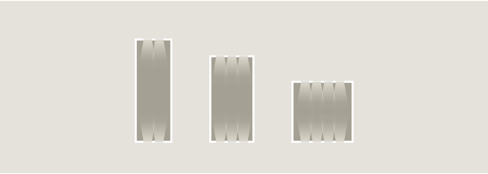
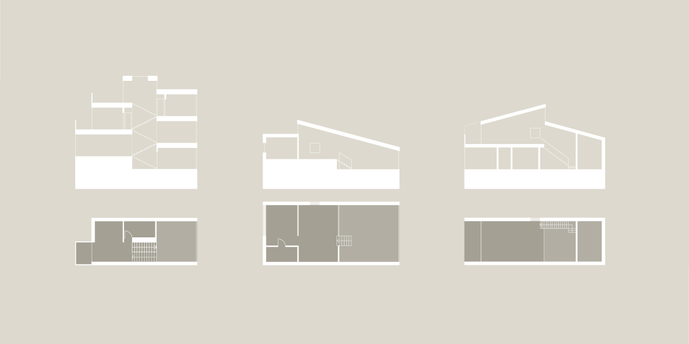

# Bygningens indretning (§ 196 - § 241)

## Se alle vejledninger om Bygningens indretning (§ 196 - § 241)

- [Spørgsmål og svar om bygningens indretning](../../qa)
- [Vejledning om boligindretning](..)
- [Bygningsreglementets vejledning om glaspartier, glasflader og værn af glas i bygninger](../../bygningsglas)

## Vejledning om boligindretning

### Kolofon

### Forord

[1.](../boligens-beboere)

### Boligens beboere

[1.1.](../bygning_bolig_hjem)

### Bygning, bolig, hjem

[1.2.](../beboerne)

### Beboerne

[1.3.](../fleksibilitet-i-boligen)

### Fleksibilitet i boligen

[2.](../boligens-overordnede-planlaegning)

### Boligens overordnede planlægning

[2.1.](../boligens-kontekst-og-bebyggelsens-kompakthed)

### Boligens kontekst og bebyggelsens kompakthed

[2.2.](../bebyggelsestype)

### Bebyggelsestype

[2.3.](../adgangsveje)

### Fælles adgangsveje til boligen

[2.4.](../boligens-storrelse)

### Boligens størrelse

[2.5.](./)

### Boligens rumforløb og rummenes udformning

Den overordnede planløsning sætter rammen for organiseringen af boligens rumforløb og rummenes udformning. Størrelse og form kan have indflydelse på, hvad der kan lade sig gøre.\
Boligens planløsning kan tilføre rummene oplevelsesmæssige kvaliteter og har indflydelse på rummenes indbyrdes sammenhæng, færdslen i boligen samt rummenes anvendelighed. Boligens\
rum kan være placeret, så de giver mulighed for et interessant blik, fx igennem flere af boligens rum, og derigennem være med til at skabe et oplevelsesrigt rumforløb.

En planløsning med smal facade og stor husdybde vil have begrænset fleksibilitet ift. indretningen, da meget areal optages af gangforløb. Den dybe bolig har, på trods af vinduer i facaderne, et mørkt område midt i boligen, der typisk ikke opleves nær så attraktivt som rummene, der ligger ud til facaden. I den mørke del bør der kun placeres rum uden ophold som fx bad, fordelingsareal, trappe og skabsrum. Modsat vil en plan med lille husdybde og med en bredere facade give mulighed for at placere flere funktioner ud til facaden i den lyse del af boligen.

Udformningen og proportioneringen af boligens enkelte rum har betydning for både oplevelsen og anvendeligheden. Vekslen mellem høje og lavere rumhøjder, eller mellem store og små rum, kan give interessante rumforløb og dermed øge boligkvaliteten. Et meget højloftet rum, fx en stue gennem halvanden eller to etager, kan give boligen et åbent og rummeligt præg. Samtidig med at et højt placeret vindue kan trække lyset længere ind i rummet.\
Et trappeløb kan skabe sammenhæng mellem flere etager, et ensidigt hældende tag kan skabe oplevelsen af, at to rumligheder hænger sammen, eller en åben forbindelse mellem to etager kan give overblik over boligens funktioner.

Åbninger i etageadskillelsen kan være en måde at skabe en tættere forbindelse mellem to etager. Man bør dog være opmærksom på, at rum gennem to etager kan give en uheldig varmefordeling samt eventuelle lyd-, træk- og lugtgener.\
Rige rumoplevelser tilfører kvalitet til boligen. Arkitektoniske elementer, som fx nicher eller karnapper, kan bidrage til at øge kvaliteten, samtidig med at de kan lægge op til en opdeling af rummet i mindre områder. Det betyder, at der -- ud over de funktionelle krav til rummenes anvendelighed, placering og størrelse -- også kan lægges et arkitektonisk blik på rummets udformning og rumforløbets kvalitet.

 

### 

Illustration 06: Boligens dybde. Plantegninger med samme areal, men med tre forskellige husdybder og samme størrelser, form og placering af vinduer. Den dybe bolig har, på trods af vinduer i facaderne i et varieret antal, et mørkt område midt i boligen, der typisk ikke opleves nær så attraktivt som rummene, der ligger ud til facaden.

### 

Illustration 07: Boligens runforløb og sammenhæng på tværs af etager. Trappeløb, niveauforskelle og åben forbindelse mellem flere etager og på tværs af boligen kan give spændende rumforløb og oplevelsen af tættere forbindelse mellem forskellige rumligheder og funktioner. (Diagrammer frit efter: Vandkunsten, arkitekt Mogens Lassen og arkitekt Arne Jacobsen)

[2.6.](../dagslysforhold)

### Dagslysforhold

[2.7.](../lydforhold)

### Lydforhold

[2.8.](../trapper)

### Trapper

[2.9.](../opbevaring)

### Opbevaring

[2.10.](../tekniske-installationer)

### Tekniske installationer

[2.11.](../uderum)

### Uderum

[3.](../boligens-aktiviteter)

### Boligens aktiviteter

[3.1](../at-komme-ind)

### At komme ind

[3.2.](../at-lave-mad)

### At lave mad

[3.3](../at-spise)

### At spise

[3.4.](../at-vaere-sammen)

### At være sammen

[3.5.](../at-arbejde)

### At arbejde

[3.6.](../at-sove)

### At sove

[3.7.](../at-bade)

### At bade

### Appendix: Litteratur

\
