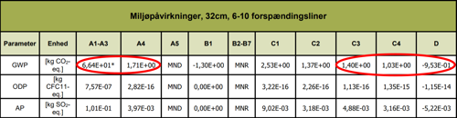
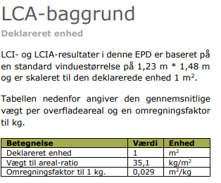
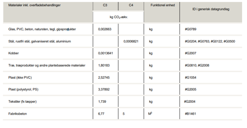

# Energiforbrug og klimapåvirkning (§ 250 - § 298)

## Se alle vejledninger om Energiforbrug og klimapåvirkning (§ 250 - § 298)

- [Spørgsmål og svar om energiforbrug](../../qa)
- [Spørgsmål og svar om bygningers klimapåvirkning](../../spoergsmaal-og-svar-om-bygningers-klimapaavirkning)
- [Bygningsreglementets vejledning om energiforbrug](../../energiforbrug-2)
- [Bygningsreglementets vejledning om efterisolering](../../ofte-rentable-konstruktioner)
- [Vejledning om funktionsafprøvning](../../version-2-funktionsafprovning)
- [Vejledning om håndtering af forskelligt energibehov i energirammen](../../haandtering-af-forskelligt-energibehov)
- [Bygningsreglementets vejledning om bygningers klimapåvirkning](..)
- [Vejledning om energiberegning af hospitaler](../../energiberegning-af-hospitaler)
- [Eksempelsamling for energi](../../eksempelsamling)

## Bygningsreglementets vejledning om bygningers klimapåvirkning

[1.0.](../kap_1_0)

### Forord

[1.1.](../kap-1_1)

### Generelt

[1.2.](../kap-1_2)

### Livscyklus og betragtningsperiode

[1.3.](../kap-1_3)

### Arealopgørelse

[1.4.](../kap-1_4)

### Bygningsdele

[1.5.](../kap-1_5)

### Datagrundlag

[1.6.](./)

### Miljøvaredeklarationer

Ved beregning af klimapåvirkningen skal der for hvert materiale eller produkt anvendes oplysninger om miljøpåvirkninger. For nogle materialer eller produkter findes mere specifikke miljødata, end det, der fremgår af det generiske datagrundlag, beskrevet i Vejledning: § 297, stk. 5. Specifikke miljødata, såkaldte produktspecifikke EPD'er (Environmental Product Declaration, EPD) er mere retvisende for de faktiske miljøpåvirkninger af det anvendte materiale eller produkt end generiske miljødata. Derfor kan EPD'er anvendes, hvis de er gyldige og relevante for de konkrete materialer eller produkter, der anvendes i bygningen. Gyldigheden fremgår af EPD'en. Det er ikke et krav, at EPD'en skal være dansk. 

EPD'er kan også være projektspecifikke, dvs. udarbejdet for et specifikt materiale eller produkt, der anvendes i det specifikke projekt. Udover det, findes der branche EPD'er, som repræsenterer et gennemsnit for en bestemt produkttype. Et eksempel på en EPD, der repræsenterer et gennemsnit for en bestemt produkttype, er en branche-EPD, hvor et repræsentativt antal producenter og leverandører er gået sammen om at udregne en produkttypes gennemsnitlige miljøbelastning.

I det følgende uddybes reglerne for, hvornår EPD'er kan anvendes. Endvidere beskrives specifikke eksempler på, hvilke data fra en EPD, man skal anvende i beregningen af bygningers klimapåvirkning.

***Gyldighed af EPD'er\***
EPD'er kan være projektspecifikke, produktspecifikke eller repræsentere et gennemsnit for en bestemt produkttype. Fælles for dem er, at de skal være udført i henhold til EN15804, være verificeret af en 3. part og godkendt af en EPD programoperatør, før de betragtes som gyldige og kan anvendes i beregning af bygningens klimapåvirkning i henhold til § 297.  EPD'er er gyldige i op til 5 år fra udstedelse, og gyldighedsperioden fremgår fra EPD'en.

Grundlæggende gælder, at den anvendte EPD skal repræsentere det anvendte produkt og produktets produktion.

EPD'er er udført iht. standarden EN15804. Standarden EN15804 (+A1) blev revideret i 2019 til en ny version (+A2), og i en overgangsperiode (fra slut 2019 frem til 1. oktober 2022) kunne der udføres miljøvaredeklarationer efter begge standarder. Det medfører, at der i den periode blev udarbejdet miljøvaredeklarationer efter både +A1 og +A2, som er gyldig til op til 5 år efter udstedelse.

Alle gyldige miljøvaredeklarationer, uanset hvilken version de er udført efter, kan anvendes. Selvom der er forskel på, hvordan klimapåvirkningen opgøres i henholdsvis +A1 og +A2 standarden, kan begge versioner anvendes.

For at kunne bruge en EPD iht.  § 297, skal den være gyldig, hvilket i denne sammenhæng betyder, at EPD'en har været gyldig på det tidspunkt, hvor materialet eller produktet blev anvendt i byggeriet. Det vil sige, at en EPD kan være gyldig, selvom selve EPD'en evt. er udløbet, inden bygningen er færdigmeldt.

Man kan også forestille sig tilfælde, hvor der er anvendt et materiale eller produkt, som der senere udarbejdes en EPD for. Det vil det også være inden for rammerne af kravet om gyldighed at anvende denne EPD, så længe EPD'en er gyldig og repræsenterer det konkret anvendte materiale eller produkt ved anvendelse i byggeriet.

***Relevans af EPD'er\***
Projekt- og produktspecifikke EPD'er er relevante, hvis det "deklarerede produkt", som fremgår af EPD'en repræsenterer det konkrete produkt, der anvendes i bygningen. Endvidere findes EPD'er, der repræsenterer et gennemsnit af produkter i en branche, og dermed gælder for en type produkter. Disse EPD'er anses for at være relevante, hvis det anvendte produkt i bygningen stemmer overens med det deklarerede produkt henholdsvis den angivne produktbeskrivelse, jf. EPD'en.

***Anvendelse af data fra EPD'er\***
En EPD dokumenterer produkters miljøpåvirkning indenfor flere miljøpåvirkningskategorier. For at opgøre bygningers klimapåvirkninger, er det udelukkende miljøindikatoren global opvarmning (Global warming potential, GWP), som skal anvendes, da kun bygningens klimapåvirkning skal opgøres, jf. § 297, stk. 2. GWP opgøres i enheden kg CO~2~-ækvivalenter (kg CO~2~-ækv.).

I en EPD er GWP angivet for de deklarerede livscyklusmoduler for et produkt. For at opgøre og dokumentere klimapåvirkningen for produktet, skal data fra modul A1-A3 og C3 og C4 og D anvendes, jf. § 297, stk, 2.

Klimapåvirkningen aflæses under enten GWP eller GWP-total, afhængigt om miljøvaredeklarationen er udført efter standarden 15804+A1 eller +A2. Se figur 6.1 og 6.3. Vær opmærksom på, hvilken enhed (deklareret enhed) GWP er opgjort i, da der er forskellige enheder i forskellige EPD'er, se figur 6.2.

{width="500" height="130"}

**Figur 6.1:** Eksempel på hvilket data fra miljøpåvirkningen der typisk anvendes for en EPD iht. +A1.

{width="314" height="261"}

**Figur 6.2:** Eksempel på hvad der er relevant at forholde sig til i en EPD, som eksempel at kende til den deklarerede enhed, som oplyses i starten af EPD'en, for at vide hvad miljøpåvirkningen forholder sig til.

Når der anvendes EPD'er til opgørelse af klimapåvirkningen fra produkter, skal de\
moduler, der medregnes, stamme fra den samme EPD.\
**Håndtering** **af modul C3/C4**\
Ved anvendelse af EPD'er skal affaldsscenarierne (modul C3/C4), som de fremgår af\
EPD'en, anvendes i beregningen.\
**Manglende C3 modul**\
Hvis ikke der er en opgjort påvirkning for modul C3, så bruges kun C4 for endt-levetid. **Forskellige scenarier for affaldshåndtering (C3/C4)**Hvis en EPD i modul C3/C4 indeholder flere forskellige scenarier for affaldshåndtering\
(fx et scenarie for både genbrug og forbrænding), vil det relevante scenarie være det,\
som bedst beskriver den nuværende affaldshåndteringen. Ved tvivl om scenariet,\
anbefales det at anvende det mest konservative for ikke at undervurdere bygningens\
påvirkning.\
**Manglende scenarie for affaldshåndtering**\
Hvis EPD'er hverken indeholder et C3- eller C4-modul, kan beregningen ikke udføres\
fyldestgørende i henholdt til bestemmelsen. For at kompensere for manglende moduler\
kan der anvendes et passende modul fra det generiske datagrundlag (BR18, bilag 2,\
tabel 7), som er gengivet i tabel 6.1 forneden.\
Der gøres opmærksom på, at sammensat data kun skal benyttes, hvis der ikke findes\
den nødvendige data indenfor samme datasæt af et materiale.\
Hvis der mangler en værdi for D-modulet i EPD'en, sættes værdien til 0, dette vil være\
på den mest konservative side.\
For biogene materialer, hvor der mangler modul C3 og/eller C4, kan der være en forskel\
i det CO -optag, der ligger i modul A1-A3, som kan afvige fra det CO -udslip, der ligger i\
det valgte C3 og C4-modul. Dette er en usikkerhed, som pt. ikke kan imødekommes\
fuldt korrekt.\
**Tabel 6.1:** Erstatningsdata for manglende C3/4-moduler fra det generiske datagrundlag\
(BR18, bilag 2, tabel 7). 

{width="500" height="259"}

***Eksempel***

*Eksempel på opgørelse af modul C3/C4, når det ikke fremgår af EPD'en*

En EPD for armeringsstål mangler C3/4-modulerne. Her anvendes der erstatningsdata fra Tabel 6.1 "Stål mv." på 0,0006821 kg CO~2~-ækvivalenter for 1 kg stål i modul C4.

[1.7.](../kap-1_7)

### Levetider

[1.8.](../kap-1_8)

### Emissionsfaktorer

[1.9.](../kap-1_9)

### Lavemissionsklassen

[2.0](../kap-2_0)

### Standardformat til LCA aflevering

[2.1.](../kap-2_1)

### Grænseværdi

[2.2.](../kap-2_2)

### Modul D

[2.3.](../kap-2_3)

### Energitillæg

[2.4.](../kap-2_4)

### Særlige forhold

\
