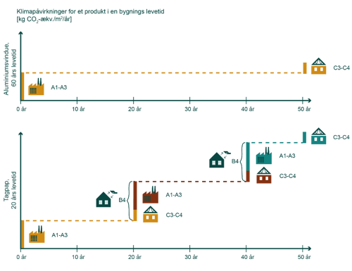

# Energiforbrug og klimapåvirkning (§ 250 - § 298)

## Se alle vejledninger om Energiforbrug og klimapåvirkning (§ 250 - § 298)

- [Spørgsmål og svar om energiforbrug](../../qa)
- [Spørgsmål og svar om bygningers klimapåvirkning](../../spoergsmaal-og-svar-om-bygningers-klimapaavirkning)
- [Bygningsreglementets vejledning om energiforbrug](../../energiforbrug-2)
- [Bygningsreglementets vejledning om efterisolering](../../ofte-rentable-konstruktioner)
- [Vejledning om funktionsafprøvning](../../version-2-funktionsafprovning)
- [Vejledning om håndtering af forskelligt energibehov i energirammen](../../haandtering-af-forskelligt-energibehov)
- [Bygningsreglementets vejledning om bygningers klimapåvirkning](..)
- [Vejledning om energiberegning af hospitaler](../../energiberegning-af-hospitaler)
- [Eksempelsamling for energi](../../eksempelsamling)

## Bygningsreglementets vejledning om bygningers klimapåvirkning

[1.0.](../kap_1_0)

### Forord

[1.1.](../kap-1_1)

### Generelt

[1.2.](../kap-1_2)

### Livscyklus og betragtningsperiode

[1.3.](../kap-1_3)

### Arealopgørelse

[1.4.](../kap-1_4)

### Bygningsdele

[1.5.](../kap-1_5)

### Datagrundlag

[1.6.](../kap-1_6)

### Miljøvaredeklarationer

[1.7.](./)

### Levetider

Som nærmere uddybet i vejledning: § 297, stk. 2, udføres beregningen for bygningers klimapåvirkning over en betragtningsperiode på 50 år. Det 50-årige perspektiv medfører, at beregningen skal inkludere klimapåvirkninger fra udskiftning af bygningsdele og materialer i løbet af denne betragtningsperiode.

For at vide hvornår udskiftningerne sker, skal der knyttes forventede levetider til bygningsdele og -materialer.

Levetider for bygningsdele er anført i rapporten *BUILD RAPPORT 2021:32 -- BUILD levetidstabel -- Version 2021,* [se her](../../../../../../../external/vbn.aau.dk/da/publications/build-levetidstabel-version-2021){rel="noopener" target="_blank"} (nyt vindue)*,* under rapportens bilag 4. Endvidere er principperne i rapportens kapitel 3 vigtige at forholde sig til.

Hvis levetiden af en konkret bygningsdel eller materiale er kortere end betragtningsperioden på 50 år, antages denne at skulle udskiftes i løbet af de 50 år, og dermed skal klimapåvirkningen fra den nye bygningsdel, der installeres, også medregnes i bygningens samlede klimaregnskab. Desuden skal klimapåvirkningen fra endt levetidfasen for den erstattede/forrige bygningsdel eller materiale medregnes.

#### *Opgørelse af udskiftninger* 

Klimapåvirkningerne fra udskiftninger opgøres samlet under modul B4: "Udskiftninger" for den pågældende bygningsdel eller materiale. Modul B4 kommer kun i spil, når bygningsdelen eller materialets levetid er under 50 år. Udskiftningen svarer til summen af udskiftninger, det vil sige modulerne A1-3 og C3-4 for den pågældende bygningsdel eller materiale. Dette er illustreret i figur 7.1.

{width="500" height="385"}

***Figur 7.1:** Klimapåvirkninger for et produkt i en bygnings levetid. *

Modul C3-C4 i endt-levetid regnes med, da det antages, at levetiden ophører ved slutningen af betragtningsperioden på 50 år, selv om den reelle levetid kan være længere.

 

[1.8.](../kap-1_8)

### Emissionsfaktorer

[1.9.](../kap-1_9)

### Lavemissionsklassen

[2.0](../kap-2_0)

### Standardformat til LCA aflevering

[2.1.](../kap-2_1)

### Grænseværdi

[2.2.](../kap-2_2)

### Modul D

[2.3.](../kap-2_3)

### Energitillæg

[2.4.](../kap-2_4)

### Særlige forhold

\
