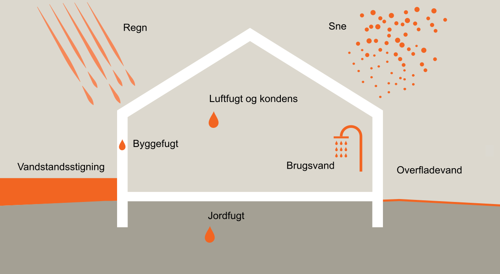

# Fugt og vådrum (§ 334 - § 339)

## Se alle vejledninger om Fugt og vådrum (§ 334 - § 339)

- [Spørgsmål og svar om fugt og vådrum](../../qa)
- [Bygningsreglementets vejledning om fugt og vådrum](..)

## Bygningsreglementets vejledning om fugt og vådrum

### Generelt om fugt og vådrum

Kravene i kapitel 14 om fugt og vådrum er indført for at beskytte bygninger mod fugt og vand. Fugt og vand må ikke medføre risiko for personers sundhed eller give risiko for skader på bygninger. Fugtskader er et af de mest udbredte problemer i byggeriet. Typiske problemer i forhold til utilsigtet fugtpåvirkning i bygninger er skimmelsvampevækst, råd og svampevækst, der kan give helbredsproblemer.

Fugtpåvirkninger kan stamme fra regn, sne, overfladevand, grundvand, vandstandsstigninger, jordfugt, byggefugt, påvirkninger fra brugsvand samt luftfugtighed, herunder kondensfugt.

Høj relativ luftfugtighed kan give problemer med kondens eller skimmelvækst på kolde overflader.

Det er derfor vigtigt, at vælge robuste løsninger, dvs. enten løsninger der forhindrer fugtpåvirkninger eller at der vælges materialer, der kan modstå de påvirkninger der er, eller kan forventes, i eller på bygningen.

\

### 

Typer af fugtpåvirkninger

-  [Gå til krav om Fugt og vådrum](../../../../../../../external/tbstsc.dev.local/home/historical/version-9/tekniske-bestemmelser/14/krav/334_338){target="_blank"}

[1.0.](../kap-1_0)

### Fugt

[2.0.](../kap-2_0)

### Vådrum

\
