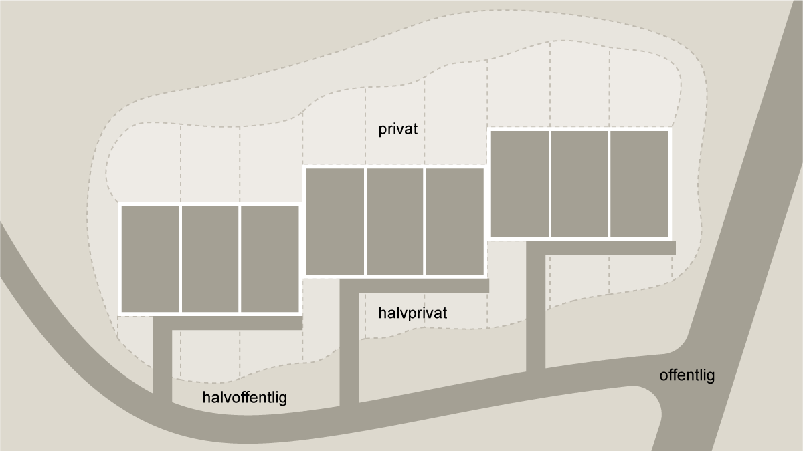

# Bygningens indretning (§ 196 - § 241)

## Se alle vejledninger om Bygningens indretning (§ 196 - § 241)

- [Spørgsmål og svar om bygningens indretning](../../qa)
- [Vejledning om boligindretning](./)
- [Bygningsreglementets vejledning om glaspartier, glasflader og værn af glas i bygninger](../../bygningsglas)

## Vejledning om boligindretning

### Kolofon

### Forord

### Boligens beboere {#f036d581-3495-4f91-bd3a-93c1361c0e4d}

### Bygning, bolig, hjem {#5f878365-aa02-4194-8447-7fcc6189ec0a}

### Beboerne {#33549032-41a0-4646-be36-72772f125276}

### Fleksibilitet i boligen {#0fa8534b-a98a-4234-ad46-d742c17f3559}

### Boligens overordnede planlægning {#12dadcbe-9992-4eef-b8a9-6906c7e57fe4}

### Boligens kontekst og bebyggelsens kompakthed {#a404c180-f32f-443d-8641-7373bfa4512d}

### Bebyggelsestype {#49d2454d-b336-4632-ac9b-5dc69da24e35}

### Fælles adgangsveje til boligen {#bdd680c0-6bb9-4838-b4d1-219dcf123a62}

Adgangsvejen til boligen er overgangen mellem det offentlige rum og den private bolig. I etageboligen kan trappeopgangen, vindfanget, forrummet, gangarealerne, altangangen, svalegangen, pladsen foran elevatorerne, ramperne og reposerne tilsammen betragtes som en overgangszone. Ved en rækkehusbebyggelse kan det være uderummet mellem boligerne, forhaven eller gårdrummet op mod boligen. Overgangszonens arkitektoniske udformning kan være med til at nuancere, hvor grænsen for privatlivet går, og hvor det offentlige liv starter. Dermed viser udformningen, hvor det er naturligt at sidde og spise, hvor det opleves som sikkert at sætte en barnevogn med et sovende barn, og hvor man uden at føle, at man trænger sig på, kan tale med sine naboer.

Overgangszonen kan desuden tænkes som et fællesområde, der kan udformes, så det lægger op til uformelt samvær og spontant møde mellem de beboere, der deler ejendom eller bor i bebyggelsen. Overgangszonen kan tillige udformes, så den modvirker, at vind, træk og kulde kommer ind i boligen, ligesom den kan skærme for generende indblik.

Se SBi-anvisning 272, Anvisning om Bygningsreglementet 2018 -- 2. Adgangsforhold, Fælles adgangsveje i bygningen (de Place Hansen, 2018).

###

Illustration 04: Boligens adgangsveje kan alt efter deres karakter bruges til rekreative områder og give beboerne mulighed for at skabe uformelle mødesteder. Udformningen af overgangszonen med niveauer af privathed fra det offentlige rum til den private bolig eller zonen tæt på boligen kan sikre, at det føles naturligt at trække uden for sin bolig, uden at føle sig eksponeret.

### Boligens størrelse {#5799d662-e35a-47a9-be19-daccfe701c15}

### Boligens rumforløb og rummenes udformning {#bdf8d6bb-12e6-4fa0-b45c-915bcdc0c7b9}

### Dagslysforhold {#d79cf6a3-805b-4e7d-a359-3b318e98482b}

### Lydforhold {#7f0c5c71-a8ea-42e4-94f8-0a5f927cf94b}

### Trapper {#f8d68305-3a9d-45d6-a18e-1f82ef752426}

### Opbevaring {#384b515f-6eb0-4cea-b038-30f5f2032df1}

### Tekniske installationer {#e013f663-8cb8-455d-b0bd-533fd112e89e}

### Uderum {#069a16f1-9b52-4f41-8fc9-7e4609b24a3a}

### Boligens aktiviteter {#29b603f5-2588-4abb-a33b-7f51ad402e5d}

### At komme ind {#c74c1f75-2366-4a20-baae-6d8c92abaa73}

### At lave mad {#e5951ab1-95e3-4dfb-9f63-a0e915cad343}

### At spise {#a87b524d-c50a-488d-a401-15eb0c43887a}

### At være sammen {#6433174c-c36e-4a18-99c8-1b7cef14b315}

### At arbejde {#1b801ec0-afb5-42ea-b57d-a25f3b069b01}

### At sove {#4d77aa18-d434-46d5-83f1-65ed094fd1e7}

### At bade {#9d95ee42-38e2-41d4-ae53-1d23da54a544}

### Appendix: Litteratur

