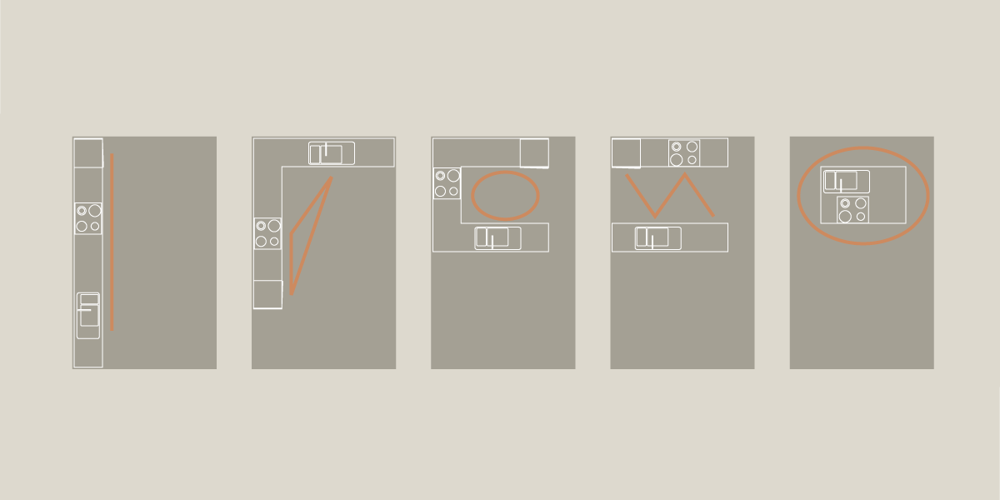

# Bygningens indretning (§ 196 - § 241)

## Se alle vejledninger om Bygningens indretning (§ 196 - § 241)

- [Spørgsmål og svar om bygningens indretning](../../qa)
- [Vejledning om boligindretning](./)
- [Bygningsreglementets vejledning om glaspartier, glasflader og værn af glas i bygninger](../../bygningsglas)

## Vejledning om boligindretning

### Kolofon

### Forord

### Boligens beboere {#f036d581-3495-4f91-bd3a-93c1361c0e4d}

### Bygning, bolig, hjem {#5f878365-aa02-4194-8447-7fcc6189ec0a}

### Beboerne {#33549032-41a0-4646-be36-72772f125276}

### Fleksibilitet i boligen {#0fa8534b-a98a-4234-ad46-d742c17f3559}

### Boligens overordnede planlægning {#12dadcbe-9992-4eef-b8a9-6906c7e57fe4}

### Boligens kontekst og bebyggelsens kompakthed {#a404c180-f32f-443d-8641-7373bfa4512d}

### Bebyggelsestype {#49d2454d-b336-4632-ac9b-5dc69da24e35}

### Fælles adgangsveje til boligen {#bdd680c0-6bb9-4838-b4d1-219dcf123a62}

### Boligens størrelse {#5799d662-e35a-47a9-be19-daccfe701c15}

### Boligens rumforløb og rummenes udformning {#bdf8d6bb-12e6-4fa0-b45c-915bcdc0c7b9}

### Dagslysforhold {#d79cf6a3-805b-4e7d-a359-3b318e98482b}

### Lydforhold {#7f0c5c71-a8ea-42e4-94f8-0a5f927cf94b}

### Trapper {#f8d68305-3a9d-45d6-a18e-1f82ef752426}

### Opbevaring {#384b515f-6eb0-4cea-b038-30f5f2032df1}

### Tekniske installationer {#e013f663-8cb8-455d-b0bd-533fd112e89e}

### Uderum {#069a16f1-9b52-4f41-8fc9-7e4609b24a3a}

### Boligens aktiviteter {#29b603f5-2588-4abb-a33b-7f51ad402e5d}

### At komme ind {#c74c1f75-2366-4a20-baae-6d8c92abaa73}

### At lave mad {#e5951ab1-95e3-4dfb-9f63-a0e915cad343}

Køkkenet er et centralt sted i boligen og ofte et af de mest anvendte fællesarealer i boligen. Køkkenet er et arbejdssted, hvor man enten alene eller i fællesskab med familie eller venner samles om aktiviteten 'at lave mad'. På den måde fungerer køkkenet både som socialt samlingssted og som arbejdssted, hvor mange specifikke funktioner i forbindelse med madlavningen skal fungere bedst muligt.

Køkkenet kan tilrettelægges med eller uden spiseplads: som et lille køkken, der fx er placeret i en niche, eller som et stort køkken-alrum med mange funktioner. Og køkkenet kan være udformet, så det åbner mere eller mindre op til resten af boligen. Det lukkede køkkenrum og det åbne køkken har hver deres fordele og ulemper. Det lukkede køkken kan optimeres i forhold til funktion og effektivitet og dermed være et koncentreret madlavningssted, hvor støj og mados bliver i køkkenet og ikke generer de andre rum og deres aktiviteter. Men det lukkede køkken tillader ikke umiddelbart den eller de personer, der laver mad, at have tæt kontakt til boligens andre rum og beboere. Det åbne køkken giver derimod personerne, der laver mad, god mulighed for at følge med i de andre beboeres aktiviteter, hvorved man ikke er isoleret omkring madlavningen. Det åbne køkken kan ligeledes være en god idé, hvis man ønsker at optimere pladsen og gøre en mindre bolig mere luftig og dermed skabe en oplevelse af større rumlighed. Ulempen er, at køkkenet, og dertilhørende mados og støj fra køkkenets aktiviteter, kan komme til at dominere en stor del af boligen. Derfor er det vigtigt, at der i det åbne køkken er god mulighed for ventilation, så mados og fugt fra madlavning kan mindskes.

At lave mad kræver redskaber og inventar, der er mere eller mindre målrettet den specifikke aktivitet. Derfor kan køkkenet indrettes i forhold til madlavningens arbejdsgange, der typisk består af at tilberede maden, at skylle af og vaske op samt at bruge komfuret. Tilberedningspladsen anbringes mest hensigtsmæssigt med tilpas afstand til vask, komfur og køleskab. Opvaskepladsen kan have bordplads til våde ting på den ene side og afsætningsplads på den anden side af vasken samt plads til installation af opvaskemaskine. Kogepladsen kan have plads til installation af

emhætte og bordplads på begge sider af komfuret, til henholdsvis tilberedning og afsætning. Jo flere beboere i boligen, desto flere brugere vil der typisk være af køkkenet, og dermed vil der være et større behov for plads ved de enkelte arbejdspladser. Udformningen af køkkenet kan tillade færre eller flere at deltage i madlavningen. Det langstrakte køkken kan tillade mange at komme til, men der kan være langt fra opbevaring til komfur til køleskab. Er køkkenbordene stillet over for hinanden, L-formet eller U-formet, kan det optimere afstanden til de forskellige funktioner, men tillige give mindre plads til personer i køkkenet. Imellem to køkkenborde, der er stillet over for hinanden, bør der være tilstrækkelig plads til, at to personer kan arbejde på hver sin side. En køkkenø kan give gode muligheder for, at flere personer kan være fælles om madlavningen og tillige have let ved at følge med i, hvad hinanden laver. Men der kan være langt mellem de forskellige funktioner.

I køkkenet er det praktisk, at der er god plads til service og bestik og til gryder og pander, der gerne skal kunne nås fra de tilhørende arbejdspladser. I forbindelse med madlavning gør man ofte brug af mange forskellige køkkenmaskiner (kaffemaskine, elkedel, brødrister, røremaskine, mikrobølgeovn etc.). Det er hensigtsmæssigt, at de køkkenmaskiner, der bruges til dagligt, har plads til at kunne stå fremme. De køkkenmaskiner, der bruges mindre, bør der være opbevaringsplads til. Et depotrum eller et bryggers kan aflaste opbevaringsbehovet i køkkenet. Her kan der være ekstra kolonialvarer, køkkenmaskiner, drikkevarer, service. Der kan gøres plads til genbrugssortering eller en fryser. I nogle tilfælde indeholder køkkenet også andre funktioner som fx opbevaring af støvsuger, kost, spand, vaskemaskine og tørretumbler. Se SBi-anvisning 253, Småhuse -- indretning og funktion, 3.6.4 Køkken (de Place Hansen, 2015).

For forhold vedrørende tilgængelighed i køkkener, se SBi-anvisning 249, Tilgængelige boliger -- Indretning, 2.3 Køkken (Sigbrand & Jensen, 2015).

###

Illustration 12: Køkkenets indretning kan understøtte en hensigtsmæssig arbejdsgang. Den rumlige organisering af køkkenet påvirker arbejdsgangene. Det langstrakte køkken og kogeøen kan give god plads til, at flere personer deltager i madlavningen. Det mere kompakt organiserede køkken optimerer arbejdsgangen for færre personer.

### At spise {#a87b524d-c50a-488d-a401-15eb0c43887a}

### At være sammen {#6433174c-c36e-4a18-99c8-1b7cef14b315}

### At arbejde {#1b801ec0-afb5-42ea-b57d-a25f3b069b01}

### At sove {#4d77aa18-d434-46d5-83f1-65ed094fd1e7}

### At bade {#9d95ee42-38e2-41d4-ae53-1d23da54a544}

### Appendix: Litteratur

