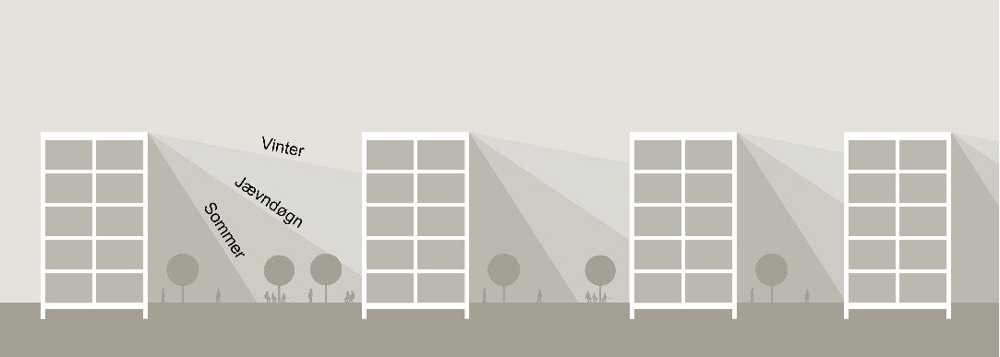

# Bygningens indretning (§ 196 - § 241)

## Se alle vejledninger om Bygningens indretning (§ 196 - § 241)

- [Spørgsmål og svar om bygningens indretning](../../qa)
- [Vejledning om boligindretning](..)
- [Bygningsreglementets vejledning om glaspartier, glasflader og værn af glas i bygninger](../../bygningsglas)

## Vejledning om boligindretning

### Kolofon

### Forord

[1.](../boligens-beboere)

### Boligens beboere

[1.1.](../bygning_bolig_hjem)

### Bygning, bolig, hjem

[1.2.](../beboerne)

### Beboerne

[1.3.](../fleksibilitet-i-boligen)

### Fleksibilitet i boligen

[2.](../boligens-overordnede-planlaegning)

### Boligens overordnede planlægning

[2.1.](./)

### Boligens kontekst og bebyggelsens kompakthed

Kontekst og kompakthed har indflydelse på boligens kvaliteter, og når boligen skal placeres, bør man allerede i de indledende overvejelser forholde sig til de aspekter. Det vil sige grundens orientering i forhold til verdenshjørnerne og eksisterende bebyggelse på og i nærheden af grunden, foruden forhold som fx udsyn, adgangsveje og relationen til det eksisterende vejnet.\
En tæt og kompakt bebyggelse har en høj udnyttelsesgrad af grunden. Her er afstanden imellem bygningerne lille, samtidig med at antallet af etager ofte er det maksimalt tilladte. Den kompakt udformede bebyggelse findes ofte i storbyer og er med til at definere storbyernes karakter. Den tætte bebyggelse kan skabe fortættede rum, som kan understøtte fornemmelsen af at være i en by eller landsby og kan danne basis for nærhed mellem beboerne.\
Men den kompakte bebyggelse kan udfordre mulighederne for at placere boligen attraktivt på grunden og skabe anvendelige, rekreative udearealer samt at sikre gode dagslysforhold i boligen uden indbliksgener.

### 

Illustration 02: Boligens kontekst og bebyggelsens kompakthed. Afstanden mellem bygningerne og højden på genbobygningerne har især indflydelse på boligens dagslysforhold, evt. indbliksgener og anvendeligheden af uderummet mellem bygningerne.

[2.2.](../bebyggelsestype)

### Bebyggelsestype

[2.3.](../adgangsveje)

### Fælles adgangsveje til boligen

[2.4.](../boligens-storrelse)

### Boligens størrelse

[2.5.](../boligens-rumforlob-og-rummenes-udformning)

### Boligens rumforløb og rummenes udformning

[2.6.](../dagslysforhold)

### Dagslysforhold

[2.7.](../lydforhold)

### Lydforhold

[2.8.](../trapper)

### Trapper

[2.9.](../opbevaring)

### Opbevaring

[2.10.](../tekniske-installationer)

### Tekniske installationer

[2.11.](../uderum)

### Uderum

[3.](../boligens-aktiviteter)

### Boligens aktiviteter

[3.1](../at-komme-ind)

### At komme ind

[3.2.](../at-lave-mad)

### At lave mad

[3.3](../at-spise)

### At spise

[3.4.](../at-vaere-sammen)

### At være sammen

[3.5.](../at-arbejde)

### At arbejde

[3.6.](../at-sove)

### At sove

[3.7.](../at-bade)

### At bade

### Appendix: Litteratur

\
