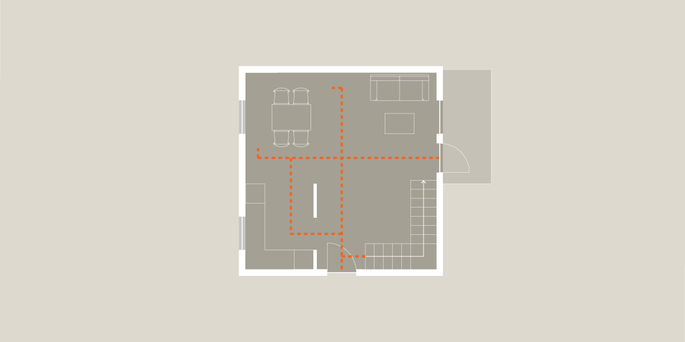

# Bygningens indretning (§ 196 - § 241)

## Se alle vejledninger om Bygningens indretning (§ 196 - § 241)

- [Spørgsmål og svar om bygningens indretning](../../qa)
- [Vejledning om boligindretning](./)
- [Bygningsreglementets vejledning om glaspartier, glasflader og værn af glas i bygninger](../../bygningsglas)

## Vejledning om boligindretning

### Kolofon

### Forord

### 1. Boligens beboere {#f036d581-3495-4f91-bd3a-93c1361c0e4d}

### 1.1. Bygning, bolig, hjem {#5f878365-aa02-4194-8447-7fcc6189ec0a}

### 1.2. Beboerne {#33549032-41a0-4646-be36-72772f125276}

### 1.3. Fleksibilitet i boligen {#0fa8534b-a98a-4234-ad46-d742c17f3559}

### 2. Boligens overordnede planlægning {#12dadcbe-9992-4eef-b8a9-6906c7e57fe4}

### 2.1. Boligens kontekst og bebyggelsens kompakthed {#a404c180-f32f-443d-8641-7373bfa4512d}

### 2.2. Bebyggelsestype {#49d2454d-b336-4632-ac9b-5dc69da24e35}

### 2.3. Fælles adgangsveje til boligen {#bdd680c0-6bb9-4838-b4d1-219dcf123a62}

### 2.4. Boligens størrelse {#5799d662-e35a-47a9-be19-daccfe701c15}

Kvaliteten af en bolig er ikke nødvendigvis relateret til dens størrelse. En stor bolig er ikke nødvendigvis lig med en bedre bolig. Men jo større en bolig er, jo flere funktioner og rumlige variationer vil der selvsagt være plads til. Et begrænset areal betyder typisk, at det kræver mere omtanke at planlægge en både interessant og velfungerende bolig. I indretningen af en stor bolig er der derimod god plads til oplevelsesrige rumligheder og ikke mindst pladskrævende funktioner i forbindelse med fx køkken, bryggers, bad og opbevaring.

Åbne boligplaner kan virke store og luftige og derved få en mindre bolig til at opleves større. Åbne boligplaner kræver imidlertid, at der er taget højde for ganglinjerne, så de ikke vanskeliggør møblering og brug af boligen. Mange rum vil naturligt lægge op til en bestemt indretning, der dikterer ganglinjer. Det vil være ganglinjer, der går omkring den centrale møblering eller leder til tilstødende rum eller udgang via fx terrassedøre eller indgangsdøre. Ved at tage højde for de ganglinjer, en bolig kan lægge op til, vil man give mulighed for en mere hensigtsmæssig indretning, der understøtter boligens funktionalitet.

En lille bolig, der er udfordret på sit areal, vil typisk have behov for, at nogle af hjemmets funktioner ligger uden for den private bolig. Det kan dog reducere følelsen af privathed og besværliggøre praktiske aktiviteter. Derfor kræver det stillingtagen til, hvilke funktioner boligen som minimum bør rumme. Funktioner, der kan placeres uden for boligen, kan fx være faciliteter til tøjvask, fællesrum med plads til større arrangementer, gæsteværelser til overnattende gæster, værksted, teenagerum eller fælles uderum. Den lille bolig får derved en elasticitet, der øger funktionaliteten og kvaliteten af boligen, uden at det er nødvendigt at øge arealet. På samme måde kan de fælles adgangsveje, der ud over at skabe adgang til boligen, udformes, så de giver mulighed for ophold eller plads til større ting som fx barnevogn, børnelegetøj, snavsede sko og gangstativer.

En bebyggelse, der indeholder flere forskellige boligstørrelser og boligplaner, kan give mulighed for en differentieret beboersammensætning. Det vil kunne give stedets beboere mulighed for, at finde en anden og mere passende bolig, uden at skulle flytte fra området, hvis eller når deres boligbehov ændrer sig.

###

Illustration 05: For at en bolig fungerer optimalt, bør man være opmærksom på dens ganglinjer. Det er de usynlige områder, der er omkring en møblering, eller forbindelsen imellem tilstødende rum og adgang til terrassedøren og hovedindgangen

### 2.5. Boligens rumforløb og rummenes udformning {#bdf8d6bb-12e6-4fa0-b45c-915bcdc0c7b9}

### 2.6. Dagslysforhold {#d79cf6a3-805b-4e7d-a359-3b318e98482b}

### 2.7. Lydforhold {#7f0c5c71-a8ea-42e4-94f8-0a5f927cf94b}

### 2.8. Trapper {#f8d68305-3a9d-45d6-a18e-1f82ef752426}

### 2.9. Opbevaring {#384b515f-6eb0-4cea-b038-30f5f2032df1}

### 2.10. Tekniske installationer {#e013f663-8cb8-455d-b0bd-533fd112e89e}

### 2.11. Uderum {#069a16f1-9b52-4f41-8fc9-7e4609b24a3a}

### 3. Boligens aktiviteter {#29b603f5-2588-4abb-a33b-7f51ad402e5d}

### 3.1 At komme ind {#c74c1f75-2366-4a20-baae-6d8c92abaa73}

### 3.2. At lave mad {#e5951ab1-95e3-4dfb-9f63-a0e915cad343}

### 3.3 At spise {#a87b524d-c50a-488d-a401-15eb0c43887a}

### 3.4. At være sammen {#6433174c-c36e-4a18-99c8-1b7cef14b315}

### 3.5. At arbejde {#1b801ec0-afb5-42ea-b57d-a25f3b069b01}

### 3.6. At sove {#4d77aa18-d434-46d5-83f1-65ed094fd1e7}

### 3.7. At bade {#9d95ee42-38e2-41d4-ae53-1d23da54a544}

### Appendix: Litteratur

