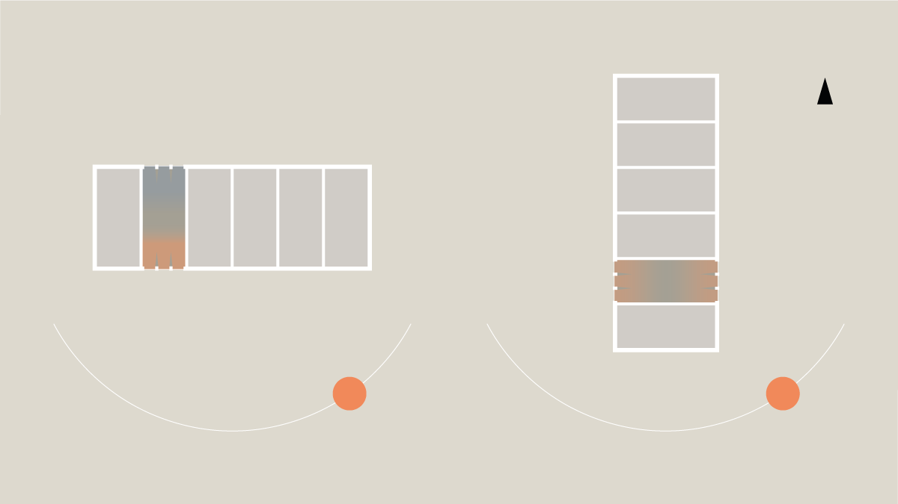

# Bygningens indretning (§ 196 - § 241)

## Se alle vejledninger om Bygningens indretning (§ 196 - § 241)

- [Spørgsmål og svar om bygningens indretning](../../qa/)
- [Vejledning om boligindretning](../)
- [Bygningsreglementets vejledning om glaspartier, glasflader og værn af glas i bygninger](../../bygningsglas/)

## Vejledning om boligindretning

### Kolofon {#818585de-abef-41f2-b417-27010078f7d0}

### Forord {#a65228a9-ae42-48b3-b79b-97cd2de40d36}

### 1. Boligens beboere {#f036d581-3495-4f91-bd3a-93c1361c0e4d}

### 1.1. Bygning, bolig, hjem {#5f878365-aa02-4194-8447-7fcc6189ec0a}

### 1.2. Beboerne {#33549032-41a0-4646-be36-72772f125276}

### 1.3. Fleksibilitet i boligen {#0fa8534b-a98a-4234-ad46-d742c17f3559}

### 2. Boligens overordnede planlægning {#12dadcbe-9992-4eef-b8a9-6906c7e57fe4}

### 2.1. Boligens kontekst og bebyggelsens kompakthed {#a404c180-f32f-443d-8641-7373bfa4512d}

### 2.2. Bebyggelsestype {#49d2454d-b336-4632-ac9b-5dc69da24e35}

### 2.3. Fælles adgangsveje til boligen {#bdd680c0-6bb9-4838-b4d1-219dcf123a62}

### 2.4. Boligens størrelse {#5799d662-e35a-47a9-be19-daccfe701c15}

### 2.5. Boligens rumforløb og rummenes udformning {#bdf8d6bb-12e6-4fa0-b45c-915bcdc0c7b9}

### 2.6. Dagslysforhold {#d79cf6a3-805b-4e7d-a359-3b318e98482b}

Lys har afgørende betydning for menneskers trivsel. Dagslys er derfor et vigtigt element i planlægningen af boligen og har afgørende indflydelse på anvendeligheden og kvaliteten af boligens rum. En velbelyst bolig med et godt visuelt indeklima, der understøtter aktiviteterne i rummene, opleves behagelig og komfortabel.

Vinduerne i boligen bør placeres, så de er orienteret mod flere verdenshjørner. Det giver sollyset mulighed for at præge boligen på flere forskellige tidspunkter i løbet af dagen og året. En bolig,

der er orienteret mod øst/vest, vil have dagslysforhold, der tilgodeser forskellige rumtyper, og have variation i lyset dagen igennem. Hvorimod en nord/syd-orienteret bolig skaber mere kontrastfyldte rum, hvor den ene orientering har mulighed for sollys, og den anden orientering ikke har. At kunne observere en solplet vandre gennem et rum er en kvalitet ved lyset i rummet og kan være med til at give en fornemmelse af tid og sted. En ensidigt belyst bolig vil være udfordret på lysfordelingen. En nordvendt bolig vil således mangle sollysets variation og bidrag til boligens oplevelsesmæssige kvaliteter.

Dagslysforholdene i et rum afhænger af vinduets placering, form og størrelse. Det er begrænset, hvor langt ind i et rum dagslys kan nå. Derfor bør det overvejes, hvor dyb en bolig kan være, for at de gode lysforhold opnås. Det dagslys, der kommer ind i et rum, er sammensat af henholdsvis sollys, himmellys og reflekslys fra omgivelserne. Bliver himmellyset begrænset, reduceres dagslysniveauet i rummet generelt. Når sollyset begrænses, reduceres dagslysniveauet også, samtidig med at man ikke får glæde af sollysets variation i intensitet, retning og farve. Ligeledes vil det være af stor betydning, om rummets overflader er enten lyse eller mørke, da de reflekterer henholdsvis mere eller mindre lys og derved påvirker rummets lysniveau positivt eller negativt.

Store vinduer giver flere muligheder for at se ud ad vinduet. Samtidig bør man være opmærksom på eventuelt indblik, der kan være i konflikt med ønsket om privathed. Store vinduer bør desuden kunne skærmes for sollysindfald, der kan give overophedning i boligen.

For at sikre tilstrækkeligt dagslys skal vinduets glasareal korrigeres for de forhold, der eventuelt reducerer dagslysadgangen. For en specifik beskrivelse af korrektionerne, se Bygningsreglementets vejledning om korrektioner til 10 pct.-reglen for dagslys (Trafik-, Bygge- og Boligstyrelsen, 2019).

En markant reduktion af dagslysniveauet i et rum kan forekomme, hvis der er skyggende modstående bygninger, udhæng eller fremspring, der blokerer for dagslysindfaldet. Sådanne skyggevirkninger er større, jo tættere den modstående bygning ligger, og jo højere den er. For at få en indikation af, hvor meget dagslys der kommer ind i boligen, kan man gøre brug af himmelgrænseplanet; et skitseringsredskab, der illustrerer, hvordan dagslyset fordeler sig i rummet.

Himmelgrænseplanet definerer grænsefladen mellem det område i rummet, som modtager dagslys direkte fra himlen, og det område, der kun modtager reflekslys. På den måde illustrerer himmelgrænseplanet, hvor henholdsvis den største og mindste lysintensitet er i rummet. Himmelgrænseplanet findes ved at tegne en linje fra overkanten af genbobygningen igennem overkanten af vindueshullet og forlænge linjen ind i rummet. Lyset under linjen kommer direkte fra himlen og har størst intensitet. Lyset over linjen er reflekslys og har mindre intensitet. Se SBi-anvisning 219, Dagslys i rum og bygninger, 4 Dagslyset på facaden (Johnsen & Christoffersen, 2008).

Illustration 08: Alt afhængig af boligens orientering vil dagslyset præge den forskelligt. Er boligen orienteret mod nord/syd, er det kun sydsiden, der har mulighed for, at sollyset kan påvirke rummet. Øst/vest-orientering tillader begge sider at få sollys, og derved fremstår rummene med variationer i lyset.

Illustration 09: Himmelgrænseplan. Himmelgrænseplanet indikerer, hvilket område i rummet der modtager dagslys direkte fra himlen, og hvilket der kun modtager reflekslys. Himmelgrænseplanet findes ved at tegne en linje fra overkanten af genbobygningen igennem overkanten af vindueshullet og forlænge linjen ind i rummet. Lyset under linjen kommer direkte fra himlen og har størst intensitet. Lyset over linjen er reflekslys og har mindre intensitet.

### 2.7. Lydforhold {#7f0c5c71-a8ea-42e4-94f8-0a5f927cf94b}

### 2.8. Trapper {#f8d68305-3a9d-45d6-a18e-1f82ef752426}

### 2.9. Opbevaring {#384b515f-6eb0-4cea-b038-30f5f2032df1}

### 2.10. Tekniske installationer {#e013f663-8cb8-455d-b0bd-533fd112e89e}

### 2.11. Uderum {#069a16f1-9b52-4f41-8fc9-7e4609b24a3a}

### 3. Boligens aktiviteter {#29b603f5-2588-4abb-a33b-7f51ad402e5d}

### 3.1 At komme ind {#c74c1f75-2366-4a20-baae-6d8c92abaa73}

### 3.2. At lave mad {#e5951ab1-95e3-4dfb-9f63-a0e915cad343}

### 3.3 At spise {#a87b524d-c50a-488d-a401-15eb0c43887a}

### 3.4. At være sammen {#6433174c-c36e-4a18-99c8-1b7cef14b315}

### 3.5. At arbejde {#1b801ec0-afb5-42ea-b57d-a25f3b069b01}

### 3.6. At sove {#4d77aa18-d434-46d5-83f1-65ed094fd1e7}

### 3.7. At bade {#9d95ee42-38e2-41d4-ae53-1d23da54a544}

### Appendix: Litteratur {#dad94911-d8be-4830-9756-dcbefa202590}
