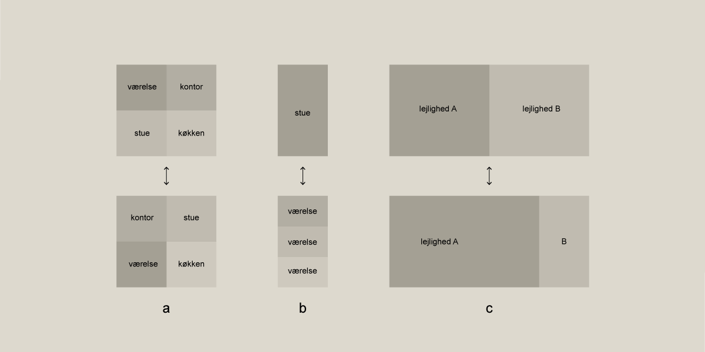

# Bygningens indretning (§ 196 - § 241)

## Se alle vejledninger om Bygningens indretning (§ 196 - § 241)

- [Spørgsmål og svar om bygningens indretning](../../qa)
- [Vejledning om boligindretning](..)
- [Bygningsreglementets vejledning om glaspartier, glasflader og værn af glas i bygninger](../../bygningsglas)

## Vejledning om boligindretning

### Kolofon

### Forord

[1.](../boligens-beboere)

### Boligens beboere

[1.1.](../bygning_bolig_hjem)

### Bygning, bolig, hjem

[1.2.](../beboerne)

### Beboerne

[1.3.](./)

### Fleksibilitet i boligen

En bolig kommer i løbet af sin levetid til at rumme forskellige beboere. Og i løbet af den tid vil husstandens sammensætning ofte variere: Børn kommer til, børn flytter hjemmefra, par bliver skilt, nye kærester kommer til. Ligesom beboernes fysiske formåen varierer igennem det tidsrum, de bor i boligen. Samlet skaber det behov for en fleksibilitet i boligen, så varierende behov og ønsker kan tilgodeses.\
Den norske arkitekturforsker Jon Guttu opererer med tre kategorier af foranderlige boliger, som han benævner den generelle bolig, den fleksible bolig og den elastiske bolig.\
De tre kategorier rummer forskellige muligheder, og de kan inddrages i den overordnede tilrettelæggelse af boligen, for at tilgodese beboerens mange forskellige ønsker i forbindelse med at skabe et hjem.

Den generelle bolig: Her opnås foranderligheden igennem at dimensionere boligens rum, så de kan skabe rammerne for forskellige funktioner. Det betyder, at planløsningen bør tage højde for, at fx køkken og bad ikke låser anvendelsen af de øvrige rum, ved at man fx kun kan komme til badet igennem et af boligens opholdsrum. Boligens vægge er statiske, men der er indbygget en generel anvendelighed i de enkelte rum, så forandringen kan opstå ved en simpel ommøblering af rummene. Når der skal være plads til forskellige funktioner og dermed forskellige møbeltyper, er det rummenes dimensioner, der er afgørende, så der er plads til fx en seng langs flere af rummets vægge. Det betyder, at rummenes størrelse og form er afgørende for at skabe den generelle bolig. (se ill. 01, a)

Den fleksible bolig: Her opnås foranderligheden ved at udvikle løsninger, der gør det muligt at ændre boligens plan og indre organisering. Det kan fx ske ved at lave møbler, dobbeltdøre og andet inventar, der kan trækkes for eller skydes til side og gemmes væk, hvorved der kan ændres i rummets udformning eller funktion, afhængig af hvilke elementer der er gjort plads til. Eller det kan ske ved, at der i selve boligens plan og konstruktion er forberedt til vægsystemer eller rummoduler, der kan tilføjes eller flyttes. Det giver mulighed for enten at opdele rum i mindre rum eller at koble rumligheder sammen, hvilket bør tilgodeses i den overordnede planlægning af rum og konstruktion. (se ill. 01, b)

Den elastiske bolig: Her kan boligen ændre størrelse efter behov. Det kan ske ved, at arealet af de enkelte boliger i en bebyggelse udvides eller reduceres afhængigt af modsvarende ændringer i de tilgrænsende boliger. Eller det kan ske ved, at et boligområde rummer lokaler (arbejdsrum, gæsteværelser, teenagerum e.l.), der kan lejes midlertidigt. Dette bør indarbejdes i den overordnede planlægning af bebyggelsen. (se ill. 01, c)

### 

Illustration 01 BR vejledning om boligindretning

[2.](../boligens-overordnede-planlaegning)

### Boligens overordnede planlægning

[2.1.](../boligens-kontekst-og-bebyggelsens-kompakthed)

### Boligens kontekst og bebyggelsens kompakthed

[2.2.](../bebyggelsestype)

### Bebyggelsestype

[2.3.](../adgangsveje)

### Fælles adgangsveje til boligen

[2.4.](../boligens-storrelse)

### Boligens størrelse

[2.5.](../boligens-rumforlob-og-rummenes-udformning)

### Boligens rumforløb og rummenes udformning

[2.6.](../dagslysforhold)

### Dagslysforhold

[2.7.](../lydforhold)

### Lydforhold

[2.8.](../trapper)

### Trapper

[2.9.](../opbevaring)

### Opbevaring

[2.10.](../tekniske-installationer)

### Tekniske installationer

[2.11.](../uderum)

### Uderum

[3.](../boligens-aktiviteter)

### Boligens aktiviteter

[3.1](../at-komme-ind)

### At komme ind

[3.2.](../at-lave-mad)

### At lave mad

[3.3](../at-spise)

### At spise

[3.4.](../at-vaere-sammen)

### At være sammen

[3.5.](../at-arbejde)

### At arbejde

[3.6.](../at-sove)

### At sove

[3.7.](../at-bade)

### At bade

### Appendix: Litteratur

\
