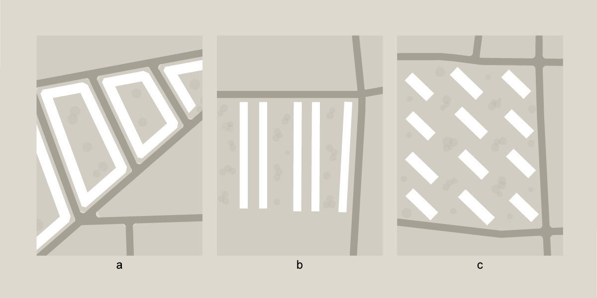
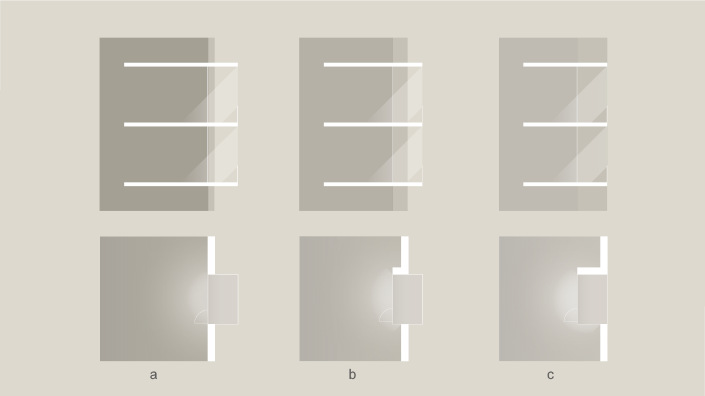
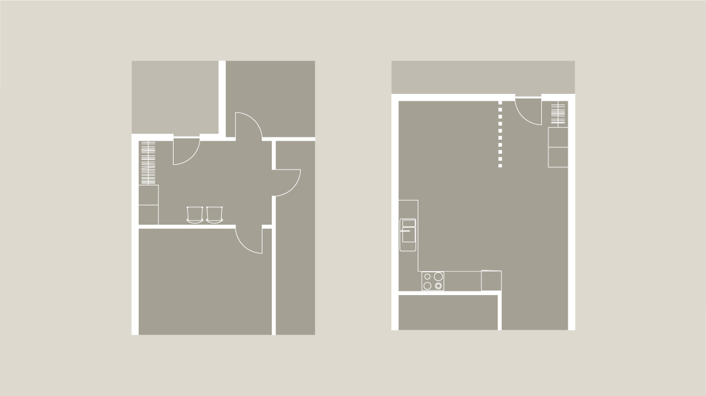
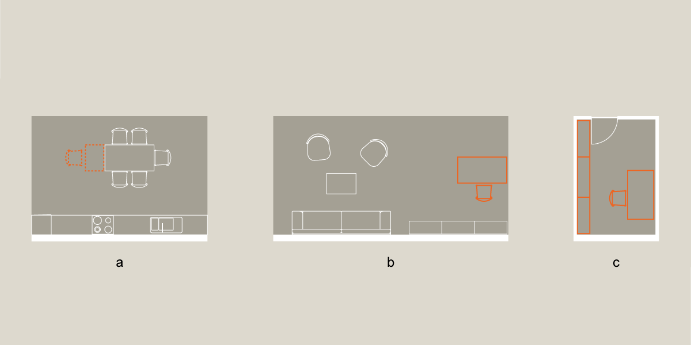

# Bygningens indretning (§ 196 - § 241)

## Se alle vejledninger om Bygningens indretning (§ 196 - § 241)

- [Spørgsmål og svar om bygningens indretning](../../qa)
- [Vejledning om boligindretning](..)
- [Bygningsreglementets vejledning om glaspartier, glasflader og værn af glas i bygninger](../../bygningsglas)

## Vejledning om boligindretning

### Kolofon

**Bygningsreglementets vejledning om boligindretning**

2. udgave, September 2022

### Forord

Målsætningen med denne vejledning er, at beskrive hvilke muligheder man har indenfor lovgivningens rammer for at planlægge en bolig, der sikre en god boligkvalitet. Vejledningen adskiller sig fra de fleste andre vejledninger til BR18 idet den ikke beskriver konkrete løsninger men i højere grad beskriver de overvejelser man bør gøre i forbindelse med planlægningen af boligbyggeri. Det betyder at vejledningen primært retter sig mod to målgrupper: bygherre og rådgivere (arkitekten, ingeniøren m.fl.).

Bygningsreglementets kapitel 9 indeholder konkrete minimumskrav om bygningens indretning, som man naturligvis altid skal følge. Men mange af kravene i BR kapitel 9 er såkaldte funktionskrav, der fremfor konkrete mål og afstandsangivelser udstikker rammerne for de målsætninger, der ligger til grund for Bygningsreglementets bestemmelser. Derfor er det relevant med en vejledning der beskriver disse hensyn i mere brede formuleringer, så de kan danne grundlag for de overvejelser man kan gøre sig ved planlægningen af boliger. Det er alene forhold der gælder etageboliger, række- og kædehuse der er beskrevet og ikke fritliggende enfamiliehuse. For mere præcise anvisninger henviser vejledningen til andre vejledninger i BR, SBi anvisninger og branchestandarder.

Vejledningen er opdelt i tre afsnit der beskriver forhold fra den overordnede planlægning af boligen og ned til det helt konkrete rum:

Boligens beboere

Her introduceres et begrebsapparat der relaterer sig til beskrivelserne af beboeren, bygningen og det at skabe et hjem. Herunder også den mangfoldighed af beboere, som boliger ofte skal kunne rumme.

Boligens overordnede planlægning

Dette afsnit beskriver de overordnede greb der har indflydelse på hvordan boligen kan udformes og hvordan det påvirker boligens kvaliteter.

Boligens aktiviteter

Dette afsnit indeholder en mere detaljeret beskrivelse af de enkelte aktiviteter i en bolig, og hvordan rum indrettes mest praktisk og hensigtsmæssigt i forhold til deres funktion.

Afslutningsvis findes der en litteraturliste over de bøger og artikler der er indgået i udfærdigelsen af vejledningen.

Vejledningen er tilrettelagt at arkitekt MAA, seniorforsker, Anne Kathrine Frandsen og arkitekt MAA, forsker, Nanet Mathiasen ved Statens Byggeforskningsinstitut (SBi), Aal-borg Universitet (AAU).

Følgende har rådgivet om vejledningens indhold og format:

Arkitekt MAA, professor Claus Bech-Danielsen, AAU, SBi

Arkitekt MAA, Anette Brunsvig Sørensen

Arkitekt MAA, lektor emeritus Peder Duelund Mortensen, Kunstakademiets Arkitektskole

Arkitekt MAA, partner Jan Albrechtsen, Tegnestuen Vandkunsten

Arkitekt MAA, partner Anders Halgren, Arkitema Architects

Anette Brunsvig Sørensen, Peder Duelund Mortensen og Claus Bech-Danielsen har yderligere indgået i en redaktionsgruppe, der har bidraget direkte til udarbejdelse af vejledningens tekst.

Ruut Peuhkuri

Forskningschef, Forskningsafdelingen for Byggeteknik og Proces, SBi AAU

**2. udgave, September 2022**

I den anden udgave er teksten let revideret og underbygget af diagrammer. Tekstrevisionen og tilrettelæggelsen af diagrammerne er udført af arkitekt MAA, seniorforsker Anne Kathrine Frandsen og arkitekt MAA, forsker Nanet Mathiasen. Diagrammerne er rentegnet af stud.arch. Vilhelm Carlstrøm.

Ruut Peuhkuri

Forskningschef, Sektionen for Bygge-, Anlægsteknik og Proces, BUILD AAU

### 1. Boligens beboere {#f036d581-3495-4f91-bd3a-93c1361c0e4d}

### 1.1. Bygning, bolig, hjem {#5f878365-aa02-4194-8447-7fcc6189ec0a}

En bolig er en bygning, der har en særlig funktion: Den er beregnet til beboelse. Boligen kan udvikle sig til at blive et hjem, når beboerne flytter ind i boligen og knytter sig til den. Mens bygninger og boliger er fysiske rammer, er hjemmet forbundet med en følelsesmæssig relation. De fysiske rammer kan være afgørende for udviklingen af hjemfølelsen, men også andre kvaliteter, som fx gode naboer og minder, kan være afgørende.

Boligens status som hjem har fået øget betydning gennem de seneste årtier. Boligen er knyttet til oplevelsen af identitet, og mange beboere giver deres bolig et personligt præg, ikke mindst gennem indretning og boligens brug. Med det personlige præg bliver boligen til et særligt sted, som beboeren knytter sig til. Det kan derfor være en stor kvalitet ved en bolig, når beboerne har mulighed for at præge den og dens umiddelbare omgivelser. Det gælder såvel i det store som i det små. En bolig kan blive personliggjort ved fx at tilføje individuelle tilbygninger, flytte vægge i boligen, placere en lille gruppe af opholdsmøbler ved indgangspartiet eller blot et par krukker med blomster foran hoveddøren. På den måde markerer beboeren sit område, udformer boligen, så den passer til de aktuelle behov, sætter sit personlige præg på boligen – og skaber et hjem.

Gennem lovgivningen i bygningsreglementet kan man sætte en minimumsgrænse for de komforthensyn, der udgør rammen for boligen, og som danner grundlag for, at boligen kan udvikle sig til et hjem.

### 1.2. Beboerne {#33549032-41a0-4646-be36-72772f125276}

Den eller de personer, der bor i boligen, er boligens beboere og udgør tilsammen en husstand. Beboere har, som i mange andre af livets forhold, forskellige behov og ønsker til deres bolig. Antallet og sammensætningen af beboere i en bolig spiller en afgørende rolle for, hvilke behov og ønsker der kan være til boligen: Om det er en enkelt person, en familie, en sammenbragt familie, hvor antallet af beboere varierer fra uge til uge, eller om det er flere personer, som deler boligen i et bofællesskab. Det har alt sammen betydning for, hvilke rum der er behov for, og hvilket behov for plads til fællesskab og til privathed der skal tilgodeses.

Ligeledes er der stor forskel på den enkelte persons fysiske, sensoriske, kognitive og psykiske forudsætninger. Er man barn, er man ældre, har man en funktionsnedsættelse, enten kronisk eller i en kortere eller længere periode, så spiller det en afgørende rolle i forhold til, hvilke behov og ønsker man har til boligen. Og da boligen er en vigtig ramme for vores sociale liv, er det ikke alene beboerne i den enkelte bolig, der er afgørende for, hvilke behov der skal tilgodeses. Man må også tage højde for nogle af de behov, som beboernes gæster kan have, således at det er muligt fx for den dårligt gående bedsteforælder at hjælpe med at passe børn eller komme til fødselsdag, eller for den svagtseende veninde at komme til middag. Det vil sige, at boligen bør give mulighed for at rumme en mangfoldighed af brugere og deres behov.

Se endvidere SBi-anvisning 249 Tilgængelige boliger – indretning. København: Statens Byggeforskningsinstitut, Aalborg Universitet (Sigbrand & Jensen, 2015).

### 1.3. Fleksibilitet i boligen {#0fa8534b-a98a-4234-ad46-d742c17f3559}

En bolig kommer i løbet af sin levetid til at rumme forskellige beboere. Og i løbet af den tid vil husstandens sammensætning ofte variere: Børn kommer til, børn flytter hjemmefra, par bliver skilt, nye kærester kommer til. Ligesom beboernes fysiske formåen varierer igennem det tidsrum, de bor i boligen. Samlet skaber det behov for en fleksibilitet i boligen, så varierende behov og ønsker kan tilgodeses.

Den norske arkitekturforsker Jon Guttu opererer med tre kategorier af foranderlige boliger, som han benævner den generelle bolig, den fleksible bolig og den elastiske bolig.

De tre kategorier rummer forskellige muligheder, og de kan inddrages i den overordnede tilrettelæggelse af boligen, for at tilgodese beboerens mange forskellige ønsker i forbindelse med at skabe et hjem.

Den generelle bolig: Her opnås foranderligheden igennem at dimensionere boligens rum, så de kan skabe rammerne for forskellige funktioner. Det betyder, at planløsningen bør tage højde for, at fx køkken og bad ikke låser anvendelsen af de øvrige rum, ved at man fx kun kan komme til badet igennem et af boligens opholdsrum. Boligens vægge er statiske, men der er indbygget en generel anvendelighed i de enkelte rum, så forandringen kan opstå ved en simpel ommøblering af rummene. Når der skal være plads til forskellige funktioner og dermed forskellige møbeltyper, er det rummenes dimensioner, der er afgørende, så der er plads til fx en seng langs flere af rummets vægge. Det betyder, at rummenes størrelse og form er afgørende for at skabe den generelle bolig. (se ill. 01, a)

Den fleksible bolig: Her opnås foranderligheden ved at udvikle løsninger, der gør det muligt at ændre boligens plan og indre organisering. Det kan fx ske ved at lave møbler, dobbeltdøre og andet inventar, der kan trækkes for eller skydes til side og gemmes væk, hvorved der kan ændres i rummets udformning eller funktion, afhængig af hvilke elementer der er gjort plads til. Eller det kan ske ved, at der i selve boligens plan og konstruktion er forberedt til vægsystemer eller rummoduler, der kan tilføjes eller flyttes. Det giver mulighed for enten at opdele rum i mindre rum eller at koble rumligheder sammen, hvilket bør tilgodeses i den overordnede planlægning af rum og konstruktion. (se ill. 01, b)

Den elastiske bolig: Her kan boligen ændre størrelse efter behov. Det kan ske ved, at arealet af de enkelte boliger i en bebyggelse udvides eller reduceres afhængigt af modsvarende ændringer i de tilgrænsende boliger. Eller det kan ske ved, at et boligområde rummer lokaler (arbejdsrum, gæsteværelser, teenagerum e.l.), der kan lejes midlertidigt. Dette bør indarbejdes i den overordnede planlægning af bebyggelsen. (se ill. 01, c)

###

Illustration 01 BR vejledning om boligindretning

### 2. Boligens overordnede planlægning {#12dadcbe-9992-4eef-b8a9-6906c7e57fe4}

### 2.1. Boligens kontekst og bebyggelsens kompakthed {#a404c180-f32f-443d-8641-7373bfa4512d}

Kontekst og kompakthed har indflydelse på boligens kvaliteter, og når boligen skal placeres, bør man allerede i de indledende overvejelser forholde sig til de aspekter. Det vil sige grundens orientering i forhold til verdenshjørnerne og eksisterende bebyggelse på og i nærheden af grunden, foruden forhold som fx udsyn, adgangsveje og relationen til det eksisterende vejnet.

En tæt og kompakt bebyggelse har en høj udnyttelsesgrad af grunden. Her er afstanden imellem bygningerne lille, samtidig med at antallet af etager ofte er det maksimalt tilladte. Den kompakt udformede bebyggelse findes ofte i storbyer og er med til at definere storbyernes karakter. Den tætte bebyggelse kan skabe fortættede rum, som kan understøtte fornemmelsen af at være i en by eller landsby og kan danne basis for nærhed mellem beboerne.

Men den kompakte bebyggelse kan udfordre mulighederne for at placere boligen attraktivt på grunden og skabe anvendelige, rekreative udearealer samt at sikre gode dagslysforhold i boligen uden indbliksgener.

###

Illustration 02: Boligens kontekst og bebyggelsens kompakthed. Afstanden mellem bygningerne og højden på genbobygningerne har især indflydelse på boligens dagslysforhold, evt. indbliksgener og anvendeligheden af uderummet mellem bygningerne.

### 2.2. Bebyggelsestype {#49d2454d-b336-4632-ac9b-5dc69da24e35}

Valget af bebyggelsestype spiller en afgørende rolle for kompaktheden af bebyggelsen og dermed også betingelserne for dagslys i boligen og anvendeligheden af uderummet.

Karrébebyggelsen, længehusbebyggelsen og punkthusbebyggelsen repræsenterer tre principielt forskellige bebyggelsestyper.

Karrébebyggelsen (ill. 03, a) skaber indre gårdrum, hvor der kan etableres halvprivate fællesområder med mulighed for både rekreative arealer, legeområder og funktioner som tørrepladser. Karrébebyggelsen har den udfordring, at orienteringen i forhold til sol varierer for boligerne i karréen, og at bebyggelsens huskroppe kan skygge for lys i andre dele af bebyggelsens nederste etager, afhængigt af karréens størrelse og husenes højde.

Det langstrakte længehus eller rækkehus (ill. 03, b) kan planlægges med ankomstområde foran bebyggelsen, hvor der fx kan etableres opbevaringsrum eller udendørs opholdsområder, som kan lægge op til uformelle møder med naboerne. Ligesom der til den modsatte side af bebyggelsen kan etableres et mere privat område til fritidsaktiviteter, leg og udendørsophold. Længehusbebyggelsen kan give mulighed for at sikre en orientering af boligerne i forhold til solen og dermed skabe variation i dagslyset i boligerne hen over dagen.

I punkthusbebyggelsen (ill. 03, c) er boligen placeret mere frit i et åbent område. Dette giver gode muligheder for plads til leg og ophold mellem husene, men også mindre klart definerede grænser for, hvad der er private eller halvprivate zoner.

Punkthusbebyggelsen giver mulighed for at orientere alle boliger i forhold til dagslys og fx prioritere at have opholdsrum, der er orienteret mod syd/sydvest.

Bebyggelsestype, sammen med kontekst og kompakthed, har således stor indflydelse på boligens kvaliteter. Derfor bør der tages stilling til, hvordan boligens kvaliteter fastholdes i forhold til bebyggelsens muligheder og udfordringer.

I planlægningen af boligens placering på grunden skal parkeringsmulighederne også indtænkes. Parkeringsmuligheder, der tilrettelægges med blik for adgangsforholdenes og uderummets landskabelige kvaliteter og opholdsmuligheder, kan bidrage positivt til stedet som helhed. Et passende antal parkeringspladser skal desuden være tilgængelige for handicapegnede køretøjer.

Se SBi-anvisning 272, Anvisning om Bygningsreglementet 2018-20. Ubebyggede arealer ved bebyggelsen, Parkeringsarealer (de Place Hansen, 2018).

Se SBi-anvisning 249, Tilgængelige boliger – Indretning, 1.2 Parkeringsarealer for biler og cykler m.m. (Sigbrand & Jensen, 2015).

###

Illustration 03: Tre forskellige bebyggelsesprincipper:

a) karrébebyggelsen,

b) længe/rækkehusbebyggelsen og

c) punkthusbebyggelsen.

### 2.3. Fælles adgangsveje til boligen {#bdd680c0-6bb9-4838-b4d1-219dcf123a62}

Adgangsvejen til boligen er overgangen mellem det offentlige rum og den private bolig. I etageboligen kan trappeopgangen, vindfanget, forrummet, gangarealerne, altangangen, svalegangen, pladsen foran elevatorerne, ramperne og reposerne tilsammen betragtes som en overgangszone. Ved en rækkehusbebyggelse kan det være uderummet mellem boligerne, forhaven eller gårdrummet op mod boligen. Overgangszonens arkitektoniske udformning kan være med til at nuancere, hvor grænsen for privatlivet går, og hvor det offentlige liv starter. Dermed viser udformningen, hvor det er naturligt at sidde og spise, hvor det opleves som sikkert at sætte en barnevogn med et sovende barn, og hvor man uden at føle, at man trænger sig på, kan tale med sine naboer.

Overgangszonen kan desuden tænkes som et fællesområde, der kan udformes, så det lægger op til uformelt samvær og spontant møde mellem de beboere, der deler ejendom eller bor i bebyggelsen. Overgangszonen kan tillige udformes, så den modvirker, at vind, træk og kulde kommer ind i boligen, ligesom den kan skærme for generende indblik.

Se SBi-anvisning 272, Anvisning om Bygningsreglementet 2018 – 2. Adgangsforhold, Fælles adgangsveje i bygningen (de Place Hansen, 2018).

###

Illustration 04: Boligens adgangsveje kan alt efter deres karakter bruges til rekreative områder og give beboerne mulighed for at skabe uformelle mødesteder. Udformningen af overgangszonen med niveauer af privathed fra det offentlige rum til den private bolig eller zonen tæt på boligen kan sikre, at det føles naturligt at trække uden for sin bolig, uden at føle sig eksponeret.

### 2.4. Boligens størrelse {#5799d662-e35a-47a9-be19-daccfe701c15}

Kvaliteten af en bolig er ikke nødvendigvis relateret til dens størrelse. En stor bolig er ikke nødvendigvis lig med en bedre bolig. Men jo større en bolig er, jo flere funktioner og rumlige variationer vil der selvsagt være plads til. Et begrænset areal betyder typisk, at det kræver mere omtanke at planlægge en både interessant og velfungerende bolig. I indretningen af en stor bolig er der derimod god plads til oplevelsesrige rumligheder og ikke mindst pladskrævende funktioner i forbindelse med fx køkken, bryggers, bad og opbevaring.

Åbne boligplaner kan virke store og luftige og derved få en mindre bolig til at opleves større. Åbne boligplaner kræver imidlertid, at der er taget højde for ganglinjerne, så de ikke vanskeliggør møblering og brug af boligen. Mange rum vil naturligt lægge op til en bestemt indretning, der dikterer ganglinjer. Det vil være ganglinjer, der går omkring den centrale møblering eller leder til tilstødende rum eller udgang via fx terrassedøre eller indgangsdøre. Ved at tage højde for de ganglinjer, en bolig kan lægge op til, vil man give mulighed for en mere hensigtsmæssig indretning, der understøtter boligens funktionalitet.

En lille bolig, der er udfordret på sit areal, vil typisk have behov for, at nogle af hjemmets funktioner ligger uden for den private bolig. Det kan dog reducere følelsen af privathed og besværliggøre praktiske aktiviteter. Derfor kræver det stillingtagen til, hvilke funktioner boligen som minimum bør rumme. Funktioner, der kan placeres uden for boligen, kan fx være faciliteter til tøjvask, fællesrum med plads til større arrangementer, gæsteværelser til overnattende gæster, værksted, teenagerum eller fælles uderum. Den lille bolig får derved en elasticitet, der øger funktionaliteten og kvaliteten af boligen, uden at det er nødvendigt at øge arealet. På samme måde kan de fælles adgangsveje, der ud over at skabe adgang til boligen, udformes, så de giver mulighed for ophold eller plads til større ting som fx barnevogn, børnelegetøj, snavsede sko og gangstativer.

En bebyggelse, der indeholder flere forskellige boligstørrelser og boligplaner, kan give mulighed for en differentieret beboersammensætning. Det vil kunne give stedets beboere mulighed for, at finde en anden og mere passende bolig, uden at skulle flytte fra området, hvis eller når deres boligbehov ændrer sig.

###

Illustration 05: For at en bolig fungerer optimalt, bør man være opmærksom på dens ganglinjer. Det er de usynlige områder, der er omkring en møblering, eller forbindelsen imellem tilstødende rum og adgang til terrassedøren og hovedindgangen

### 2.5. Boligens rumforløb og rummenes udformning {#bdf8d6bb-12e6-4fa0-b45c-915bcdc0c7b9}

Den overordnede planløsning sætter rammen for organiseringen af boligens rumforløb og rummenes udformning. Størrelse og form kan have indflydelse på, hvad der kan lade sig gøre.

Boligens planløsning kan tilføre rummene oplevelsesmæssige kvaliteter og har indflydelse på rummenes indbyrdes sammenhæng, færdslen i boligen samt rummenes anvendelighed. Boligens

rum kan være placeret, så de giver mulighed for et interessant blik, fx igennem flere af boligens rum, og derigennem være med til at skabe et oplevelsesrigt rumforløb.

En planløsning med smal facade og stor husdybde vil have begrænset fleksibilitet ift. indretningen, da meget areal optages af gangforløb. Den dybe bolig har, på trods af vinduer i facaderne, et mørkt område midt i boligen, der typisk ikke opleves nær så attraktivt som rummene, der ligger ud til facaden. I den mørke del bør der kun placeres rum uden ophold som fx bad, fordelingsareal, trappe og skabsrum. Modsat vil en plan med lille husdybde og med en bredere facade give mulighed for at placere flere funktioner ud til facaden i den lyse del af boligen.

Udformningen og proportioneringen af boligens enkelte rum har betydning for både oplevelsen og anvendeligheden. Vekslen mellem høje og lavere rumhøjder, eller mellem store og små rum, kan give interessante rumforløb og dermed øge boligkvaliteten. Et meget højloftet rum, fx en stue gennem halvanden eller to etager, kan give boligen et åbent og rummeligt præg. Samtidig med at et højt placeret vindue kan trække lyset længere ind i rummet.

Et trappeløb kan skabe sammenhæng mellem flere etager, et ensidigt hældende tag kan skabe oplevelsen af, at to rumligheder hænger sammen, eller en åben forbindelse mellem to etager kan give overblik over boligens funktioner.

Åbninger i etageadskillelsen kan være en måde at skabe en tættere forbindelse mellem to etager. Man bør dog være opmærksom på, at rum gennem to etager kan give en uheldig varmefordeling samt eventuelle lyd-, træk- og lugtgener.

Rige rumoplevelser tilfører kvalitet til boligen. Arkitektoniske elementer, som fx nicher eller karnapper, kan bidrage til at øge kvaliteten, samtidig med at de kan lægge op til en opdeling af rummet i mindre områder. Det betyder, at der – ud over de funktionelle krav til rummenes anvendelighed, placering og størrelse – også kan lægges et arkitektonisk blik på rummets udformning og rumforløbets kvalitet.

###

Illustration 06: Boligens dybde. Plantegninger med samme areal, men med tre forskellige husdybder og samme størrelser, form og placering af vinduer. Den dybe bolig har, på trods af vinduer i facaderne i et varieret antal, et mørkt område midt i boligen, der typisk ikke opleves nær så attraktivt som rummene, der ligger ud til facaden.

###

Illustration 07: Boligens runforløb og sammenhæng på tværs af etager. Trappeløb, niveauforskelle og åben forbindelse mellem flere etager og på tværs af boligen kan give spændende rumforløb og oplevelsen af tættere forbindelse mellem forskellige rumligheder og funktioner. (Diagrammer frit efter: Vandkunsten, arkitekt Mogens Lassen og arkitekt Arne Jacobsen)

### 2.6. Dagslysforhold {#d79cf6a3-805b-4e7d-a359-3b318e98482b}

Lys har afgørende betydning for menneskers trivsel. Dagslys er derfor et vigtigt element i planlægningen af boligen og har afgørende indflydelse på anvendeligheden og kvaliteten af boligens rum. En velbelyst bolig med et godt visuelt indeklima, der understøtter aktiviteterne i rummene, opleves behagelig og komfortabel.

Vinduerne i boligen bør placeres, så de er orienteret mod flere verdenshjørner. Det giver sollyset mulighed for at præge boligen på flere forskellige tidspunkter i løbet af dagen og året. En bolig,

der er orienteret mod øst/vest, vil have dagslysforhold, der tilgodeser forskellige rumtyper, og have variation i lyset dagen igennem. Hvorimod en nord/syd-orienteret bolig skaber mere kontrastfyldte rum, hvor den ene orientering har mulighed for sollys, og den anden orientering ikke har. At kunne observere en solplet vandre gennem et rum er en kvalitet ved lyset i rummet og kan være med til at give en fornemmelse af tid og sted. En ensidigt belyst bolig vil være udfordret på lysfordelingen. En nordvendt bolig vil således mangle sollysets variation og bidrag til boligens oplevelsesmæssige kvaliteter.

Dagslysforholdene i et rum afhænger af vinduets placering, form og størrelse. Det er begrænset, hvor langt ind i et rum dagslys kan nå. Derfor bør det overvejes, hvor dyb en bolig kan være, for at de gode lysforhold opnås. Det dagslys, der kommer ind i et rum, er sammensat af henholdsvis sollys, himmellys og reflekslys fra omgivelserne. Bliver himmellyset begrænset, reduceres dagslysniveauet i rummet generelt. Når sollyset begrænses, reduceres dagslysniveauet også, samtidig med at man ikke får glæde af sollysets variation i intensitet, retning og farve. Ligeledes vil det være af stor betydning, om rummets overflader er enten lyse eller mørke, da de reflekterer henholdsvis mere eller mindre lys og derved påvirker rummets lysniveau positivt eller negativt.

Store vinduer giver flere muligheder for at se ud ad vinduet. Samtidig bør man være opmærksom på eventuelt indblik, der kan være i konflikt med ønsket om privathed. Store vinduer bør desuden kunne skærmes for sollysindfald, der kan give overophedning i boligen.

For at sikre tilstrækkeligt dagslys skal vinduets glasareal korrigeres for de forhold, der eventuelt reducerer dagslysadgangen. For en specifik beskrivelse af korrektionerne, se Bygningsreglementets vejledning om korrektioner til 10 pct.-reglen for dagslys (Trafik-, Bygge- og Boligstyrelsen, 2019).

En markant reduktion af dagslysniveauet i et rum kan forekomme, hvis der er skyggende modstående bygninger, udhæng eller fremspring, der blokerer for dagslysindfaldet. Sådanne skyggevirkninger er større, jo tættere den modstående bygning ligger, og jo højere den er. For at få en indikation af, hvor meget dagslys der kommer ind i boligen, kan man gøre brug af himmelgrænseplanet; et skitseringsredskab, der illustrerer, hvordan dagslyset fordeler sig i rummet.

Himmelgrænseplanet definerer grænsefladen mellem det område i rummet, som modtager dagslys direkte fra himlen, og det område, der kun modtager reflekslys. På den måde illustrerer himmelgrænseplanet, hvor henholdsvis den største og mindste lysintensitet er i rummet. Himmelgrænseplanet findes ved at tegne en linje fra overkanten af genbobygningen igennem overkanten af vindueshullet og forlænge linjen ind i rummet. Lyset under linjen kommer direkte fra himlen og har størst intensitet. Lyset over linjen er reflekslys og har mindre intensitet. Se SBi-anvisning 219, Dagslys i rum og bygninger, 4 Dagslyset på facaden (Johnsen & Christoffersen, 2008).

###

Illustration 08: Alt afhængig af boligens orientering vil dagslyset præge den forskelligt. Er boligen orienteret mod nord/syd, er det kun sydsiden, der har mulighed for, at sollyset kan påvirke rummet. Øst/vest-orientering tillader begge sider at få sollys, og derved fremstår rummene med variationer i lyset.

###

Illustration 09: Himmelgrænseplan. Himmelgrænseplanet indikerer, hvilket område i rummet der modtager dagslys direkte fra himlen, og hvilket der kun modtager reflekslys. Himmelgrænseplanet findes ved at tegne en linje fra overkanten af genbobygningen igennem overkanten af vindueshullet og forlænge linjen ind i rummet. Lyset under linjen kommer direkte fra himlen og har størst intensitet. Lyset over linjen er reflekslys og har mindre intensitet.

### 2.7. Lydforhold {#7f0c5c71-a8ea-42e4-94f8-0a5f927cf94b}

Lydforholdene i en bolig, eller boligens akustiske indeklima, omfatter både hørbar lyd og mærkbare vibrationer, der kan opfattes af beboeren. Det akustiske indeklima kan ikke beskrives blot ved angivelse af styrken af de lyde, der forekommer i det enkelte rum, men er i lige så høj grad karakteriseret ved lydpåvirkningens art, dens frekvensmæssige sammensætning, variationen med tiden og lydens hendøen i det aktuelle rum.

Det akustiske indeklima i en bolig omfatter desuden forhold, der har indflydelse på, i hvilken grad boligen yder beboerne akustisk integritet. Dvs. fornemmelsen af at være uforstyrret af lyd, der skyldes kilder uden for eller i rummet, samt bevidstheden om i rimeligt omfang at kunne udfolde sig i akustisk henseende, hvor lyden hverken kan høres eller er til gene for uvedkommende.

Boligens facader, herunder vinduerne, skal dimensioneres sådan, at den forventede trafikstøj ikke giver anledning til et generende indendørs støjniveau. Se SBi-anvisning 272, Anvisning om Bygningsreglementet 2018, 17 Lydforhold (de Place Hansen (red.), 2018). Disse forskrifter kan i lokalplaner være suppleret med krav om, at facader i boligers opholdsrum skal forsynes med oplukkelige partier, som yder en sådan reduktion af lydtransmissionen, at der selv med disse i åben tilstand sikres en begrænsning af trafikstøjen inde i boligen.

Luftlydisolationen er en betegnelse for adskillelsens evne til at isolere over for tale og musik. Der er krav til luftlydisolationen mellem sammenbyggede boliger, uanset om de selvstændige boliger ligger oven på eller ved siden af hinanden. De specifikke krav til luftlydisolationen er beskrevet i Bygningsreglementet, og supplerende vejledning findes i SBi-anvisning 258, Anvisning om Bygningsreglementet 2015, 3. udg., 6.4 Akustisk indeklima (de Place Hansen (red.), 2017).

Gulvkonstruktioner i boligbyggeri skal udføres således, at trinlydniveauet i den enkelte bolig ikke overstiger de grænseværdier, som er formuleret i Bygningsreglementet. Der er lidt lempeligere krav til badeværelsesgulve end til boligens øvrige gulvflader.

Der er ikke krav til den interne lydisolation omkring rum inden for samme bolig. Inden for boligen kan rummenes placering nogle gange disponeres ud fra støjmæssige overvejelser, således at eksempelvis soveværelser placeres ud mod de mindst støjbelastede facader og længst muligt væk fra rum eller skakte med tekniske installationer.

Den lyd og de vibrationer, som udbreder sig gennem de boligadskillende konstruktioner, afhænger af, hvordan konstruktionerne er opbygget. Karakteren af lydtransmissionen vil oftest være påvirket af, om bygningen er opført med tunge konstruktioner eller med lette konstruktioner. Dette gælder særligt for transmissionen af trinlyd gennem etageadskillelserne. Selvom en bygning opfylder samtlige lydkrav i Bygningsreglementet, må det forventes, at op til 20 % af beboerne vil opleve lydforholdene som dårlige (Lydklasse C iht. DS490).

I boliger bidrager møbleringen traditionelt set med en lydabsorberende effekt, der gør, at efterklangstiden begrænser sig til et forholdsvis lavt niveau. Derfor er der kun formuleret krav til efterklangstiden i fællesrum, trapperum og fælles gangarealer. Imidlertid kan boliger med åbne planer eller med stor rumhøjde opleves klangfulde og støjende, hvis møbleringen samtidig er sparsom. I sådanne opholdsrum kan der være behov for at regulere lyden.

### 2.8. Trapper {#f8d68305-3a9d-45d6-a18e-1f82ef752426}

Trappen er et arkitektonisk element, der kan give boligen rumlig karakter, samtidig med at den opfylder en specifik funktion. Placeringen af trappen har stor betydning for planløsningens funktionalitet og bevægelsesmønstrene i boligen. I boligbyggeri fungerer trappen som henholdsvis adgangsvej til de enkelte boliger og som intern forbindelse imellem to etager og andre niveauforskelle inde i boligen.

En intern trappe fungerer godt, hvis den er placeret, så den giver ugeneret passage imellem boligens områder og ikke besværliggør møbleringen af rummene eller generer rummets ganglinjer. En trappe, der forbinder entréen med en gang på etagen ovenover, giver ugeneret adgang til begge etager og opdeler samtidig boligen i to adskilte dele. Det giver mulighed for at opdele boligen i fx et område til hjemmearbejde, et område, der kan fremlejes, eller med adskilte boligarealer til forskellige generationer. En trappe, der forbinder fx et køkken-alrum med en stue på etagen over, kan give oplevelsen af et sammenhængende rum, men også mere gennemgangstrafik og uheldig varmefordeling (kap. 2.5, ill. 07).

Se SBi-anvisning 253, Småhuse – indretning og funktion, 3.7 Trapper i boligen (de Place Hansen, 2015).

### 2.9. Opbevaring {#384b515f-6eb0-4cea-b038-30f5f2032df1}

Til mange af boligens aktiviteter følger et behov for opbevaring. Det vil naturligvis variere fra aktivitet til aktivitet og fra beboer til beboer, men set i forhold til boligens funktionalitet bør det være en forudsætning, at muligheder for opbevaring er tænkt ind i planløsningen fra start.

Opbevaringen kan med fordel indarbejdes i de enkelte rum i et rimeligt omfang og i forhold til rummets anvendelse. Indbyggede skabe kan ofte give større frihed i indretningen end flytbare skabe. En skabsgang eller et skabsrum kan også være effektive opbevaringsmåder, der kan være med til at fastholde rummenes generelle anvendelighed.

Hvis beboeren tilføjer mere opbevaring, end rummene er planlagt til, vil rummene ofte opleves som overfyldte og trange, og rummenes anvendelighed vil mindskes. Åbne boligplaner kan få boligen til at virke større, men efterlader typisk ikke mange muligheder for at placere opbevaringsmøbler. Derfor bliver det endnu vigtigere i denne type bolig, at opbevaringsmulighederne er tænkt ind i boligens overordnede planløsning, så behovet for opbevaring dækkes.

Hvis det er en større bolig, kan det være hensigtsmæssigt at indrette et bryggers, der kan aflaste entréen, køkkenet og badeværelset. Derfor er det hensigtsmæssigt at placere bryggerset tæt på disse rum og om muligt med udgang til det fri. Bryggerset kan planlægges, så der er plads til ekstra kolonialvarer, fryser, vaskemaskine, tørretumbler, sæsontøj, kosteskab, hobbyredskaber, værktøj, trappestige, strygebræt etc. Det er desuden praktisk med bordplads til fralægning af genstande, der hentes eller arbejdes med. I bryggerset kan der også afsættes plads til vvs-komponenter og opvarmningsanlæg, så de er let tilgængelige.

### 2.10. Tekniske installationer {#e013f663-8cb8-455d-b0bd-533fd112e89e}

De tekniske installationer bør på lige fod med boligens øvrige dispositioner tænkes ind i den overordnede planløsning. Installationer og føringsveje optager plads, og det kræver omtanke at få dem placeret, så de er optimalt og korrekt placeret, uden at de forstyrrer oplevelsen af boligens rumligheder eller reducerer boligarealets fleksibilitet.

Installationer til afløb og ventilation bør placeres samlet i boligen. Varme-, el- og datainstallationer skal derimod ud i alle rum og er mere fleksible i forhold til, hvordan de placeres. Derudover skal der afsættes plads til vvs-komponenter som opvarmningsanlæg og varmtvandsforsyning samt deres rørinstallationer. Disse komponenter kan placeres i et bryggers eller i et andet rum som fx køkken, gang, opbevaringsrum eller badeværelse, således at de er lette at komme til.

Se SBi-anvisning 253, Småhuse – indretning og funktion, 3.8 Disponering af installationer og føringsveje (de Place Hansen, 2015).

### 2.11. Uderum {#069a16f1-9b52-4f41-8fc9-7e4609b24a3a}

De fleste rum i boligen vil vinde ved direkte adgang til et uderum, der tilbyder lys, luft og grønne områder. Både haver, terrasser, gårdrum, altaner og fælles grønne arealer kan – alt efter deres udformning – fungere som en udvidelse af boligarealet, og navnlig i sommerhalvåret vil de opleves som en stor kvalitet i boligen. Hvis uderummet skal bidrage til boligens kvalitet, bør planlægningen af det indgå i den overordnede disposition af boligens planløsning. Især boligens fælles opholdsrum, køkken og spiseplads vil vinde ved at have direkte adgang til uderummet. Et uderum med gode sol- og læforhold, god udsigt samt plads til spisning, leg, grønne planter etc. vil være attraktivt. Men også franske altaner og større vinduespartier i tag og facade, der kan åbnes eller skydes til side, kan bidrage positivt til boligens kvalitet. Har boligen mulighed for flere uderum, kan de placeres, så deres dagslysforhold, karakter og stemning er forskellige.

Terrasser, gårdhaver og haver bør placeres, så der tages hensyn til grundens orientering og til særlig attraktive udsigts- og terrænforhold. Ved at placere det størst mulige samlede haverum mod syd eller vest, under hensyntagen til udsigt og eventuel trafikstøj, sikrer man, at uderummet er solfyldt en stor del af dagen. I planlægningen af udeområderne kan udhus og garage indgå som skærmende elementer, der kan sikre behagelige udendørs siddepladser uden indblik og vindgener. En eventuel udestue eller overdækket terrasse bør hverken hindre udsynet fra boligen eller tage dagslys fra opholdsrum.

En altan udgør et markant arkitektonisk element og kan udformes enten som udenpåliggende, delvist indeliggende eller indeliggende element. Altaner, især den udenpåliggende altan, er et markant træk ved facaden og kan være udfordrende at integrere i en facadekomposition.

Især den udenpåliggende altan kan skygge for den underliggende bolig og reducere lysniveauet, primært i området tættest på vinduet. Hvis der yderligere er en genbobygning, der skygger, kan boligen risikere ikke at have tilgang af direkte sollys eller himmellys, hvorved lysniveauet i boligen sænkes (se kap. 2.6 Dagslysforhold, ill. 09).

Udformes den delvist indeliggende eller indeliggende altan med vinduer i flere sider (altan-karnap-princippet), vil det give mulighed for at trække lys fra flere verdenshjørner ind og skabe varieret lys i rummene bag altanen.

Altanen kan have mange udformninger, og samspillet mellem dagslyset, vinduesåbningen og rummet bag er komplekst. Ud over skyggen fra en altan kan andre elementer som fx vægtykkelse, faste solafskærmninger og fremspring over eller ved siden af vinduet have indflydelse på rummets lysniveau og lysfordeling. For yderligere beskrivelse, se Bygningsreglementets vejledning om korrektioner til 10 pct.-reglen for dagslys.

En tagterrasse kan være et fælles eller et privat uderum, som er integreret i eller på bebyggelsens tag. Tagterrassen kan placeres, så flere boliger, fx fra en hel opgang, har adgang til den. Den kan derved have samme sociale funktion, som uderum og haverum mellem husene har. Tagterrassen kan tilbyde udsigt over området og, alt efter orienteringen, et solfyldt sted, der også får sollys, når den lave sol ikke har mulighed for at komme ned mellem husene og på den måde bidrage positivt til bebyggelsens kvaliteter.

###

Illustration 10: Altaner. Alt efter om altanen er udeliggende (a), delvist indeliggende (b) eller indeliggende (c), skygger den mere eller mindre for rum under altanen. Diagrammet er en forenklet illustration af, hvordan en altan kan skabe skygge i rummene under sig og dermed påvirke rummets lysniveau. Diagrammet illustrerer situationen for en bolig, hvor der også er en genbobygning, der skygger (se kap. 2.6 Dagslysforhold, ill. 09). Samspillet mellem dagslyset, vinduet og skyggende elementer er komplekst og har indflydelse på lysniveauet i rummet og bør tilrettelægges med omhu.

### 3. Boligens aktiviteter {#29b603f5-2588-4abb-a33b-7f51ad402e5d}

### 3.1 At komme ind {#c74c1f75-2366-4a20-baae-6d8c92abaa73}

Når man træder ind i en bolig, får man det første umiddelbare indtryk af den. Vil man skabe en imødekommende og indbydende oplevelse af boligen, bør man overveje, hvad man ser ind på, når døren åbnes.

Ankomstområdet i den private bolig fungerer som overgang mellem den private sfære og den offentlige fælles adgangsvej. Det kan med fordel udformes, så det modvirker både vind, træk og kulde samt generende indblik. Ankomstområdet rummer ligeledes mange praktiske funktioner for boligens beboere. Det er her, beboerne siger goddag og farvel til deres gæster; her, hvor man tager sit overtøj, børnenes flyverdragter og gummistøvlerne af og på. Her, man kommer ind med skoletasker, legetøj, ting og sager til fritidsaktiviteter og store indkøbsposer. Derfor er det praktisk med god plads til at komme ind og til at hænge overtøjet for både beboere og besøgende op. Ligeså er det praktisk med opbevaringsplads til fodtøj, handsker, halstørklæder, tasker etc. Endelig er det hensigtsmæssigt at have mulighed for at sidde ned, når man tager sko af og på. I en større bolig kan mange af de nævnte ting få plads i et bryggers og på den måde aflaste indgangen til boligen. Ankomstområdet kan med fordel indrettes med robuste overflader, der kan klare sliddet fra de mange forskellige funktioner.

I mindre boliger kan ankomstområdet betragtes som arealspild, hvorfor man i nogle boligtyper træder direkte ind i opholdsrummet (køkkenet og/eller stuen). Det medfører ofte, at behovet for opbevaring typisk bliver flyttet til andre rum, hvor der bør afsættes plads til det. Det betyder, at den plads, man sparer ved ikke at have et ankomstområde eller en velindrettet entré, tages fra andre rum, og pladsbesparelsen i det samlede regnskab er derfor enten meget lille eller forsvinder helt.

Det kan være praktisk, at ankomstområdet i boligen også fungerer som fordelingsområde, hvorfra der er adgang til flere rum. Især kan adgang til stue og køkken være hensigtsmæssigt. Rum, der kun har adgang gennem et andet rum, kan have begrænset funktionalitet.

I boliger med flere planer kan trappen placeres i en del af ankomstområdet eller i umiddelbar nærhed. Det giver ugeneret adgang til begge etager og mulighed for opdeling af boligen i to adskilte dele. Det øger boligens fleksibilitet over tid.

###

Illustration 11: Ved indgangen til boligen har man brug for at kunne hænge overtøj og stille sko. Det gælder også i det tilfælde, at man kommer direkte ind i et køkken eller opholdsrum. Derudover er det et område, der med fordel kan rumme mange funktioner som fx plads til opbevaring.

### 3.2. At lave mad {#e5951ab1-95e3-4dfb-9f63-a0e915cad343}

Køkkenet er et centralt sted i boligen og ofte et af de mest anvendte fællesarealer i boligen. Køkkenet er et arbejdssted, hvor man enten alene eller i fællesskab med familie eller venner samles om aktiviteten 'at lave mad'. På den måde fungerer køkkenet både som socialt samlingssted og som arbejdssted, hvor mange specifikke funktioner i forbindelse med madlavningen skal fungere bedst muligt.

Køkkenet kan tilrettelægges med eller uden spiseplads: som et lille køkken, der fx er placeret i en niche, eller som et stort køkken-alrum med mange funktioner. Og køkkenet kan være udformet, så det åbner mere eller mindre op til resten af boligen. Det lukkede køkkenrum og det åbne køkken har hver deres fordele og ulemper. Det lukkede køkken kan optimeres i forhold til funktion og effektivitet og dermed være et koncentreret madlavningssted, hvor støj og mados bliver i køkkenet og ikke generer de andre rum og deres aktiviteter. Men det lukkede køkken tillader ikke umiddelbart den eller de personer, der laver mad, at have tæt kontakt til boligens andre rum og beboere. Det åbne køkken giver derimod personerne, der laver mad, god mulighed for at følge med i de andre beboeres aktiviteter, hvorved man ikke er isoleret omkring madlavningen. Det åbne køkken kan ligeledes være en god idé, hvis man ønsker at optimere pladsen og gøre en mindre bolig mere luftig og dermed skabe en oplevelse af større rumlighed. Ulempen er, at køkkenet, og dertilhørende mados og støj fra køkkenets aktiviteter, kan komme til at dominere en stor del af boligen. Derfor er det vigtigt, at der i det åbne køkken er god mulighed for ventilation, så mados og fugt fra madlavning kan mindskes.

At lave mad kræver redskaber og inventar, der er mere eller mindre målrettet den specifikke aktivitet. Derfor kan køkkenet indrettes i forhold til madlavningens arbejdsgange, der typisk består af at tilberede maden, at skylle af og vaske op samt at bruge komfuret. Tilberedningspladsen anbringes mest hensigtsmæssigt med tilpas afstand til vask, komfur og køleskab. Opvaskepladsen kan have bordplads til våde ting på den ene side og afsætningsplads på den anden side af vasken samt plads til installation af opvaskemaskine. Kogepladsen kan have plads til installation af

emhætte og bordplads på begge sider af komfuret, til henholdsvis tilberedning og afsætning. Jo flere beboere i boligen, desto flere brugere vil der typisk være af køkkenet, og dermed vil der være et større behov for plads ved de enkelte arbejdspladser. Udformningen af køkkenet kan tillade færre eller flere at deltage i madlavningen. Det langstrakte køkken kan tillade mange at komme til, men der kan være langt fra opbevaring til komfur til køleskab. Er køkkenbordene stillet over for hinanden, L-formet eller U-formet, kan det optimere afstanden til de forskellige funktioner, men tillige give mindre plads til personer i køkkenet. Imellem to køkkenborde, der er stillet over for hinanden, bør der være tilstrækkelig plads til, at to personer kan arbejde på hver sin side. En køkkenø kan give gode muligheder for, at flere personer kan være fælles om madlavningen og tillige have let ved at følge med i, hvad hinanden laver. Men der kan være langt mellem de forskellige funktioner.

I køkkenet er det praktisk, at der er god plads til service og bestik og til gryder og pander, der gerne skal kunne nås fra de tilhørende arbejdspladser. I forbindelse med madlavning gør man ofte brug af mange forskellige køkkenmaskiner (kaffemaskine, elkedel, brødrister, røremaskine, mikrobølgeovn etc.). Det er hensigtsmæssigt, at de køkkenmaskiner, der bruges til dagligt, har plads til at kunne stå fremme. De køkkenmaskiner, der bruges mindre, bør der være opbevaringsplads til. Et depotrum eller et bryggers kan aflaste opbevaringsbehovet i køkkenet. Her kan der være ekstra kolonialvarer, køkkenmaskiner, drikkevarer, service. Der kan gøres plads til genbrugssortering eller en fryser. I nogle tilfælde indeholder køkkenet også andre funktioner som fx opbevaring af støvsuger, kost, spand, vaskemaskine og tørretumbler. Se SBi-anvisning 253, Småhuse – indretning og funktion, 3.6.4 Køkken (de Place Hansen, 2015).

For forhold vedrørende tilgængelighed i køkkener, se SBi-anvisning 249, Tilgængelige boliger – Indretning, 2.3 Køkken (Sigbrand & Jensen, 2015).

###

Illustration 12: Køkkenets indretning kan understøtte en hensigtsmæssig arbejdsgang. Den rumlige organisering af køkkenet påvirker arbejdsgangene. Det langstrakte køkken og kogeøen kan give god plads til, at flere personer deltager i madlavningen. Det mere kompakt organiserede køkken optimerer arbejdsgangen for færre personer.

### 3.3 At spise {#a87b524d-c50a-488d-a401-15eb0c43887a}

Spisepladsen er i mange hjem et af boligens vigtigste fælles opholdsområder. Det er her, beboerne mødes, samles og er sammen omkring måltiderne, ligesom en stor del af samværet med beboernes gæster foregår omkring spisebordet. Derfor bør det være muligt at placere spisepladsen, hvor det er rart at opholde sig og med god adgang til dagslys, god akustik og gerne med udgang til et uderum. Spisepladsen bør rent praktisk fungere sådan, at den er let at komme til og fra, og har service og andet, der bruges her, placeret i nærheden. Endelig er det praktisk, hvis spisepladsen kan udvides, når der er gæster.

Foruden spisning forgår der typisk mange andre aktiviteter ved spisebordet, såsom leg og spil, lektielæsning, hobbyaktiviteter samt evt. arbejde på bærbar computer. Derfor er det praktisk, hvis spisepladsen også har mulighed for at rumme denne type aktiviteter.

### 3.4. At være sammen {#6433174c-c36e-4a18-99c8-1b7cef14b315}

Opholdsstuen er det sted i boligen, hvor man typisk slapper af. Her kan man snakke, drikke kaffe, lege, hygge og foretage sig mange andre aktiviteter, der afspejler beboernes liv. De mange forskelligartede aktiviteter kan afstedkomme et behov for opbevaringsplads til bøger, blade, aviser, hobbyting, skolebøger, spil, legesager etc. Derfor er det hensigtsmæssigt at afse plads til reoler eller andre opbevaringsmøbler.

En opholdsstues behagelige møbelgruppe er ikke længere nødvendigvis orienteret omkring placeringen af et tv. Derimod er pladsen til computeren blevet en vigtig del af et opholdsrum, ikke mindst fordi det er fra computeren, at der fx både ses tv, streames film og musik, spilles spil, tales i telefon og ses billeder samt søges på internettet.

I den åbne plan, hvor køkken, spiseplads, ophold og eventuelt en hjemmearbejdsplads er i samme rum, bør rummet tilrettelægges, så der er møbleringsmuligheder i forhold til flere anvendelsesscenarier. Der bør være plads til forskellige aktiviteter og tilhørende møbelgrupper, uden at man er nødsaget til at placere møbler i en gangzone. Det kan kræve ekstra opmærksomhed at tilrettelægge planløsningen, så der er plads til flere aktiviteter på fornuftig vis.

### 3.5. At arbejde {#1b801ec0-afb5-42ea-b57d-a25f3b069b01}

Da meget arbejde foregår digitalt, er det blevet muligt at lave meget arbejde hjemmefra. Hjemmearbejdspladsen er derfor blevet mere og mere udbredt. Boligen kan med fordel afse plads til denne funktion. Det kan være en fleksibel plads, hvor arbejdsredskaberne opmagasineres i et møbel og tages frem efter behov. Eller arbejdspladsen kan være en integreret del af boligens rum, fx i køkkenet, opholdsstuen eller soveværelset, hvor en større eller mindre del af rummet prioriteres til at give plads til denne funktion. Har boligen plads, kan et separat rum indrettes til hjemmearbejdsplads med god plads til reoler og arbejdsbord.

De behov, der knytter sig til arbejdspladsen, vil variere fra beboer til beboer og alt efter arbejdets karakter. Hjemmearbejdspladsen vil dog typisk have behov for et arbejdsbord og en eller flere stole samt plads til opbevaring af computer, printer, papir og skriveredskaber.

Hjemmearbejdspladsen kan være en funktion, som flere af boligens beboere benytter sig af. Alt efter beboernes behov kan hjemmearbejdspladsen også give plads til fx lektielæsning og hobbyaktiviteter. På den måde kan hjemmearbejdspladsen i nogle boliger få en central plads og være en aktivitet, der gives pladsmæssig prioritet.

###

Illustration 13: Hjemmearbejdspladsen kan prioriteres forskelligt. Den kan enten være en funktion, der tages frem efter behov (a), integreres i et af boligens andre rum (b) eller indrettes i et selvstændigt rum udelukkende til dette specifikke formål (c).

### 3.6. At sove {#4d77aa18-d434-46d5-83f1-65ed094fd1e7}

At sove godt er essentielt for menneskers velbefindende. Sovepladsen bør indrettes rart og behageligt og med god mulighed for ventilation.

Et soverum kan betragtes som et privat rum for især børn, hvor der, ud over at være plads til at sove, også er mulighed for andre aktiviteter som fx lektielæsning, leg, hygge og samvær med

venner eller til at finde ro. I den sammenbragte familie kan det være vigtigt, at hjemmeboende børn har deres eget værelse, som de selv kan præge og føle sig hjemme i, selvom de ikke bor i boligen hver dag.

Når der ikke er tale om helt små boliger, bør mindst ét rum have plads til en dobbeltseng, hvor man kan komme til sengen fra de to langsider. Personligt tøj opbevares mest praktisk i nærheden af sovepladserne. Det kan være i samme rum, i en skabsgang eller et garderoberum. Indbyggede skabe kan give ekstra plads i rummet og skabe ro i rummets indretning. En skabsgang eller et garderoberum giver mulighed for større frihed i indretningen af rummet. Ud over seng og garderobe har man ofte behov for at opbevare mange andre ting i det personlige soverum, fx kan børn have behov for plads til legetøj.

### 3.7. At bade {#9d95ee42-38e2-41d4-ae53-1d23da54a544}

Badeværelset er boligens mest private rum, der danner ramme om den daglige rutine i forbindelse med personlig pleje. Det omfatter fx at gå på wc, bade, børste tænder, tørre hår og barbere sig. Derudover kan badeværelset også være et rum til velvære. Derfor har rummets overflader og materialer, sammen med lys og luft, stor indflydelse på, hvordan det opleves at opholde sig i rummet.

Indrettes der et stort badeværelse, vil det samtidig give større anvendelighed for fx børnefamilier samt personer med behov for hjælpemidler. Se SBi-anvisning 249, Tilgængelige boliger – Indretning, 2.6 Bade- og wc-rum (Sigbrand, 2015).

I en større bolig, og i en husstand med mere end fire beboere, kan det være praktisk med mere end ét wc-rum. I boliger i to planer bør der være et wc-rum på hver etage og badeværelse med wc på samme etage som soverummene. I boliger uden bryggers eller vaskerum bør der beregnes plads til vaskemaskine og tørretumbler i badeværelset. [Appendix: Litteratur](../appendix#dad94911-d8be-4830-9756-dcbefa202590)

### Appendix: Litteratur

Andersen, H.T.; Larsen, J.N.; Jensen, J.O. & Haldrup, K. (2014). Boligmarkedet uden for de store byer. Sammenfatning. SBi 2014:04. København: Statens Byggeforskningsinstitut, Aalborg Universitet.

Bech-Danielsen, C.; Mechlenborg, M. & Stender, M. (2018). Velkommen hjem. Tendenser i dansk boligarkitektur. København: Politikens Forlag.

Bech-Danielsen, C. (2006). Når sjælen flytter ind: Hjemfølelse og mobilitet. Den gode bolig – Hvordan skal vi bo i fremtiden? Lyngby: Akademiet for de Tekniske Videnskaber.

Beck, A.F. (2019). What is Co-housing? Developing a Conceptual Spatial Framework from the Studies of Danish Intergenerational Co-housing. Housing, Theory and Society. London: Routledge.

de Place Hansen, E.J. (2015). Småhuse – indretning og funktion (SBi-anvisning 253). København: Statens Byggeforskningsinstitut. Aalborg Universitet.

de Place Hansen, E.J. (red) (2018). Anvisning om Bygningsreglement 2018 (SBi-anvisning 272). København: Statens Byggeforskningsinstitut. Aalborg Universitet.

Duelund Mortensen, P. (2018). Hjem – bebyggelse – by. Bolig og velfærd i København. København: Arkitekturforlaget B.

Duelund Mortensen, P. (2018). Viljeløst og fattigt på visioner. Arkitekten nr. 8 vol. 120. København: Akademisk Arkitektforening.

Gehl, J. (2010). Byer for mennesker, Nykøbing Sjælland: Bogværket.

Guttu, J. (2003). "Den gode boligen". Fagfolks oppfatning av boligkvalitet gjennom 50 år. Oslo: Arkitekthøgskolen i Oslo.

Johnsen, K., & Christoffersen, J. (2008). Dagslys i rum og bygninger (SBi-anvisning 219). Hørsholm: Statens Byggeforskningsinstitut. Aalborg Universitet.

Juhl, F. (1954). Hjemmets indretning. København: Thaning & Appels Forlag.

Keiding, M. (2018). På tværs af gård og gade. Arkitekten nr. 8 vol. 120. København: Akademisk Arkitektforening.

Keiding, M. (2018). Krav til hinanden. Arkitekten nr. 8 vol. 120. København: Akademisk Arkitektforening.

Keiding, M. (2018). Social ingeniørkunst. Arkitekten nr. 9 vol. 120. København: Akademisk Arkitektforening.

Københavns Kommune (2019). Status på København 2018 – opdateret august 2018. København: Københavns Kommune.

Liliegreen, C. & Jensen, P.B. (2017). De danske yderområder er udfordrede. København: Boligøkonomisk Videncenter. Realdania.

Lind, O. & Møller, J. (1996). Bag hækken. Det danske parcelhus i lyst og nød. København: Arkitektens Forlag.

Mortensen, B. (2003). Facader og akustik. Facaden. Teori og praksis. København: Kunstakademiets Arkitektskoles Forlag.

Mortensen, B. (2012). Lyd og stilhed. Klima og arkitektur, 2. udgave. København: Kunstakademiets Arkitektskoles Forlag.

Olsson, L. (2018). Kollektive boligeksperimenter. Arkitekten nr. 8 vol. 120. København: Akademisk Arkitektforening.

Pedersen, P.B. (2009). Bæredygtig Kompakt By. Århus: Arkitektskolens Forlag.

Ranten, K., & Vedel-Petersen, F. (1982). Bedre Boligplaner. Beskrivelse af en metode til projektering og vurdering (SBi-meddelelse 119). Hørsholm: Statens Byggeforskningsinstitut. Aalborg Universitet.

Ranten, K. (1991). Boligplan og brugsværdi. Hørsholm: Statens Byggeforskningsinstitut. Aalborg Universitet.

Realdania By & Byg (2019). Byggefællesskaber. Beboerdrevet boligbyggeri i byudvikling. København: Realdania By & Byg.

Sigbrand, L. & Jensen, P.H. (2015). Tilgængelige boliger – indretning (SBi-anvisning 249). København: Statens Byggeforskningsinstitut, Aalborg Universitet.

SINTEF Byggforsk. (2019). Kjøkken i boliger (Byggforskserien 361.411). Oslo: SINTEF akademisk forlag.

SINTEF Byggforsk. (2018). Soverum i boliger (Byggforskserien 361.121). Oslo: SINTEF akademisk forlag.

SINTEF Byggforsk. (2018). Bod og oppbevaringsplass i boliger (Byggforskserien 366.101). Oslo: SINTEF akademisk forlag.

SINTEF Byggforsk. (2013). Balkonger og terrasser. Utformning og brukbarhet (Byggforskserien 361.501). Oslo: SINTEF akademisk forlag.

SINTEF Byggforsk. (2015). Utformning av trapper (Byggforskserien 324.301). Oslo: SINTEF akademisk forlag.

SINTEF Byggforsk. (2005). Planløsning af stue. Fleksible løsninger (Byggforskserien 361.105). Oslo: SINTEF akademisk forlag.

SINTEF Byggforsk. (2006). Boligens inngangsrom (Byggforskserien 363.110). Oslo: SINTEF akademisk forlag.

Trafik-, Bygge- og Boligstyrelsen. (2019). Bygningsreglementets vejledning om korrektioner til 10 pct.-reglen for dagslys. København: Trafik-, Bygge- og Boligstyrelsen.

Vedel-Petersen, F. (1967). God bolig i etagehuse. Hørsholm: Statens Byggeforskningsinstitut. Aalborg Universitet.

WHO (2011). Burden of disease from environmental noise. Quantification of healthy life years lost in Europe. Bonn: The WHO European Centre for Environment and Health.
