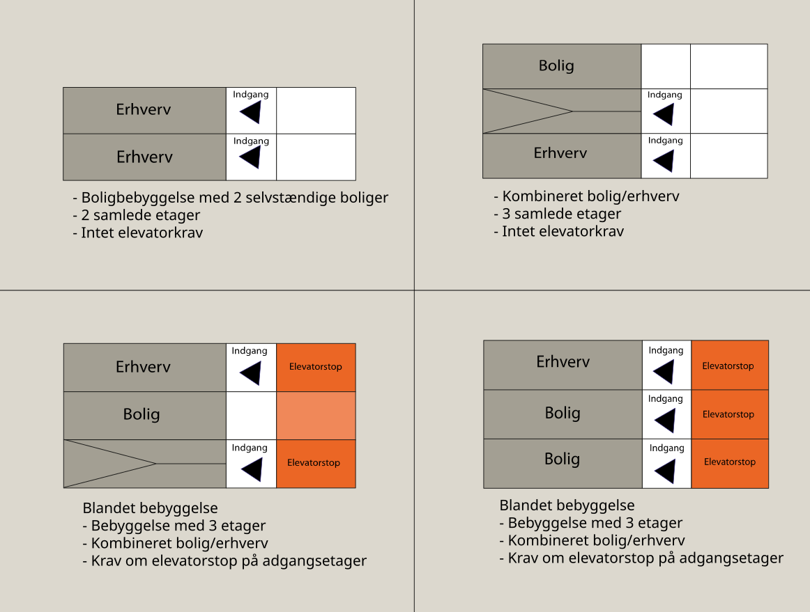

# Elevatorer (§ 242 - § 249)

## Bygningsreglementets vejledning om elevatorer

[0.0.](../forord)

### Forord

[1.0.](../kap-1_0)

### Generelt

[1.1.](./)

### Anvendelsesområde

Nybyggeri

Ifølge bygningsreglementet 2018, § 244 skal der i nybyggeri med 3 etager og derover installeres mindst én elevator, der kan betjene hver etage, herunder udnyttet tagetage og kælder. I bygninger med flere opgange gælder kravet for hver opgang. En bygning med stueplan, 1. sal og 2. sal, regnes for en bygning med 3 etager. Kælder medregnes i denne sammenhæng ikke ved opgørelse af etageantallet. For boliger med flere internt forbundne etager, skal elevatoren alene føres til boligens adgangsetage*,* jf. bygningsreglementet 2018, § 245. Bygningen kan således have 3 etager og derover, men ikke nødvendigvis adgang på alle etager, hvilket alligevel kan udløse et elevatorkrav. I figur 1, 2 og 3 beskrives en række eksempler på dette (eksemplerne er vejledende og ikke udtømmende).

Kravet om elevatorer gælder ikke for fritliggende enfamiliehuse, rækkehuse og dobbelthuse og lignende, der alene anvendes til boligformål, samt sommerhuse i sommerhusområder, jf. bygningsreglementet 2018, § 243.

\

Tilbygning og ombygning

Ifølge bygningsreglementet 2018, § 247, er ombygninger og mindre tilbygninger til eksisterende boligbebyggelse ikke omfattet af krav om etablering af elevator.

Ombygninger i eksisterende boligbyggeri omfatter for eksempel inddragelse af en eksisterende tagetage til bolig.

Mindre tilbygninger omfatter for eksempel etablering af tårne til bade- og wc-rum, køkkener mv. i tilknytning til eksisterende boliger.

Der henvises til *Bekendtgørelse nr. 1250 af 13/12/2004 om tilgængelighedsforanstaltninger i forbindelse med ombygninger i eksisterende byggeri*, der omhandler tilgængelighedskrav i offentlig tilgængelige bygninger og erhvervsbyggeri ved ombygning. 

 

### 

Figur 1: Eksempler på etager i bygninger (snit) - Eksemplerne er vejledende og ikke udtømmende

### 

Figur 2: Eksempler på etager i bygninger (snit) - Eksemplerne er vejledende og ikke udtømmende

### 

Figur 3: Eksempler på etager i bygninger (snit) - Eksemplerne er vejledende og ikke udtømmende

[2.0.](../kap-2_0)

### Tilgængelighed

[3.0.](../kap-3_0)

### Sikkerhed

[4.0.](../kap-4_0)

### Energiforbrug

[5.0.](../kap-5_0)

### Dispensationer

\
