# Energiforbrug og klimapåvirkning (§ 250 - § 298)

## Se alle vejledninger om Energiforbrug og klimapåvirkning (§ 250 - § 298)

- [Spørgsmål og svar om energiforbrug](../qa)
- [Spørgsmål og svar om bygningers klimapåvirkning](../spoergsmaal-og-svar-om-bygningers-klimapaavirkning)
- [Bygningsreglementets vejledning om energiforbrug](../energiforbrug-2)
- [Bygningsreglementets vejledning om efterisolering](../ofte-rentable-konstruktioner)
- [Vejledning om funktionsafprøvning](../version-2-funktionsafprovning)
- [Vejledning om håndtering af forskelligt energibehov i energirammen](../haandtering-af-forskelligt-energibehov)
- [Bygningsreglementets vejledning om bygningers klimapåvirkning](./)
- [Vejledning om energiberegning af hospitaler](../energiberegning-af-hospitaler)
- [Eksempelsamling for energi](../eksempelsamling)

## Bygningsreglementets vejledning om bygningers klimapåvirkning

### 1.0. Forord {#c4e82f76-29dc-4348-b44f-61a9665f10a8}

Kapitel 11 i bygningsreglementet indeholder krav om bygningers energiforbrug og klimapåvirkning.

Den overordnede metode til beregningen af bygningers klimapåvirkning er baseret på EN 15978:2012 "Bæredygtighed inden for byggeri og anlæg -- Vurdering af bygningers miljømæssige kvalitet -- Beregningsmetode".

Kravet, som fremgår af henholdsvis §§ 297 og 298, indeholder to elementer:

•    Beregning af klimapåvirkning for nybyggeri (§ 297)

•    Grænseværdier for klimapåvirkning af nybyggeri, som er differentieret på baggrund af bygningstyper (§ 298)

Ved opførelse af bygninger og tilbygninger skal klimapåvirkningen dokumenteres iht. § 297. Grænseværdierne, der fremgår af § 298 skal overholdes.

Indførelse af krav om dokumentation af bygningers klimapåvirkning samt differentierede grænseværdier er indført på baggrund af National strategi for bæredygtigt byggeri, 2021 [se nærmere her](https://www.sbst.dk/Media/638696001442099861/National-strategi-for-b%C3%A6redygtigt-byggeri-a.pdf){rel="noopener" target="_blank"} (nyt vindue) samt tillægsaftale af 30. maj 2024 til strategi for bæredygtigt byggeri \[se nærmere her: [Tillægsaftale](https://www.sm.dk/Media/638560336830794358/Till%c3%a6gsaftale_om_stramning_af_CO2e-krav_til_bygninger_UA.pdf){rel="noopener" target="_blank"}\].

Formålet med kravene til klimapåvirkning i kapitel 11, hhv. §§ 297 - 298, er at synliggøre og begrænse bygningers klimapåvirkning. Mere specifikt er formålet med § 297 at få dokumenteret bygningers og tilbygningers klimapåvirkning igennem hele livscyklussen, og formålet med § 298 er, at begrænse klimapåvirkningen fra bygninger og tilbygninger.

For at have mulighed for at optimere en bygnings klimapåvirkning anbefales det at udarbejde livscyklusvurderingen allerede fra de tidlige designfaser. Livscyklusvurdering kan udføres gennem alle faser af byggeriet med henblik på at etablere beslutningsgrundlag for design- og materialevalg.

### 1.1. Generelt {#b54eb8a1-6702-4ead-8b0f-fe7e8e9e2793}

Formålet med bestemmelserne om bygningers klimapåvirkning i §§ 297 og 298 er at tilskynde til at projektere og udføre bygninger på en måde, så unødig klimapåvirkning så vidt muligt undgås, jf. dette formål som beskrevet i § 250.

Denne vejledning beskriver hvilke bygninger, der omfattes af kravet og de overordnede principper for beregning af klimapåvirkningen. De nærmere regler for, hvordan beregningen skal foretages, herunder hvilket data der anvendes, uddybes i vejledningerne til § 297, stk. 2-15.

Beregningen og forudsætningerne for beregningen af klimapåvirkninger skal dokumenteres på byggesagen ved færdigmelding af bygninger, jf. bygningsreglementets § 40. Se i øvrigt yderligere i [Vejledning for dokumentationskrav for bygningsreglementets tekniske bestemmelser i forbindelse med færdigmelding af byggeriet (nyt vindue)](../../../../media/ncpjhogw/vejledning-dokumentation-af-bygningsreglementets-tekniske-bestemmelser-i-forbindelse-med-frdigmeldi-2025.pdf "Vejledning Dokumentation Af Bygningsreglementets Tekniske Bestemmelser I Forbindelse Med Frdigmeldi (2025)"){rel="noopener" target="_blank"}.

Kravet om udarbejdelse af livscyklusvurdering omfatter alene nybyggeri, herunder tilbygninger jf. § 2, nr. 1-2. Renoveringsprojekter mv., hvor der ikke bygges til, skal ikke foretage beregning og dokumentation af klimapåvirkningen.

Hvis en bygning har forskellige funktioner, kan der godt være flere energirammer pr. bygning, men der skal alligevel kun laves én beregning over bygningens klimapåvirkning. Hvis en bygning har flere energirammer, skal disse arealvægtes til beregningen om bygningens klimapåvirkning. Det vil sige, at der beregnes et vægtet gennemsnit af energibehov baseret på de arealer, som de forskellige energibehov relaterer sig til.

#### **1.1.1 Tilbygninger**

Fra 1. juli 2025 skal der foretages beregning af tilbygningers klimapåvirkning, ligesom tilbygninger skal overholde den relevante grænseværdi. Den relevante grænseværdi for en tilbygning følger af anvendelsen af tilbygningen. Hvis man f.eks. udvider en kontorbygning med yderligere kontorareal, så skal tilbygningen overholde grænseværdien for kontorbygninger. Beregningen af tilbygningens klimapåvirkning skal kun foretages for tilbygningen. Dvs. at den eksisterende bygning ikke indgår i beregningen.

Der skal laves en beregning pr. tilbygning. Det vil sige, at hvis der er flere tilbygninger på den samme fysiske bygning, fx ved en række karnapper på en enkelt etagebolig bygning, så skal hver enkelt tilbygning anskues for sig.

Det vil dog ofte kunne lade sig gøre at slå tilbygninger sammen i beregningen på baggrund af reglen om samlet beregning for flere byggerier på samme byggesag, jf. §298, stk. 6. Her gives der mulighed for at samle flere bygninger i samme beregning, hvis de er udført med ensartet anvendelse, energibehov, bærende system, fundament og klimaskærm. Det gælder også for tilbygninger.

For visse bygningstyper gælder, at tilbygningen skal være over 250 m2 opvarmet etageareal før der skal foretages en klimaberegning. Disse bygningstyper er:

- Stuehuse
- Fritliggende enfamiliehuse
- Række-, kæde- og dobbelthuse
- Sommerhuse, campinghytter og lignende ferieboliger

Tilbygninger til disse bygningstyper beregnes enkeltvis pr. enhed. Hvis der f.eks. tilbygges 20 m2 til 15 enheder i et rækkehusbyggeri vil disse tilbygninger ikke være omfattet af § 297, selvom det samlet giver et areal på 300 m2, fordi grænsen for tilbygninger til rækkehuse er 250 m2 for hvert rækkehus.

#### **1.1.2  Bygningstyper, der ikke er omfattet af krav om beregning af bygningers klimapåvirkning**

Uopvarmede bygninger mindre end 50 m2, transportable konstruktioner og midlertidige flytbare pavilloner er ikke omfattet. Tilbygninger med et opvarmet etageareal på mindre end 250 m2 er ikke omfattet for følgende bygningstyper:

- Stuehuse
- Fritliggende enfamiliehuse
- Række-, kæde- og dobbelthuse
- Sommerhuse, campinghytter og lignende ferieboliger

Derfor skal der ikke foretages en beregning af klimapåvirkningen for tilbygninger til disse byggerier, hvis de har et opvarmet etageareal mindre end 250 m2.

#### **1.1.3 Beregning af klimapåvirkningen**

Der er ikke regler om, at et bestemt værktøj skal anvendes til livscyklusvurderingen, udover at beregningsforudsætningerne, jf. § 297 stk. 2-15, samt dokumentationskravet, jf. § 40, skal være overholdt.

#### **1.1.4 Sammenlægning af beregningen for flere bygninger**

Bygningsejer kan vælge at foretage beregningen for flere bygninger sammenlagt. Det kan være, hvis bygningsejer ser en økonomisk besparelse i at gøre det således. Det er ikke et krav, at bygningerne befinder sig på samme matrikel, så længe de behandles på samme byggesag.

For bygninger, som skal overholde grænseværdien i § 298, er det også muligt at foretage beregningen samlet, men her er det et krav, at bygningerne er så ens, at det ikke skaber tvivl om, at bygningerne hver især -- hvis de blev beregnet hver for sig -- ville kunne overholde grænseværdien. Der henvises til de nærmere forudsætninger for at beregne bygningerne samlet i § 298, stk. 6.

[Gå til krav om bygningers klimapåvirkning § 297 - § 298 (nyt vindue)](../../krav/297_298 "297_298"){rel="noopener" target="_blank"}

### 1.2. Livscyklus og betragtningsperiode {#e6bbf376-bc5d-42f7-aeed-492ba0a0a9b5}

I en livscyklusvurdering (Life Cycle Assessment, LCA) af en bygning opgøres bygningens påvirkning af forskellige miljøindikatorer, som for eksempel forsuring, klimapåvirkninger mv., igennem hele livscyklussen. Kravet i bygningsreglementet vedrører udelukkende klimapåvirkningen, der opgøres i CO2-ækvivalenter, og således ikke andre miljøindikatorer. I det følgende uddybes de forudsætninger, der skal lægges til grund for livscyklusvurdering i henhold til kravet i bygningsreglementet.

#### **1.2.1   Beregningsprincipper for beregning af klimapåvirkningen**

Til beregning af klimapåvirkningen skal der tages udgangspunkt i de beregningsprincipper, som fremgår af standarden DS/EN15978:2012 "Bæredygtighed inden for byggeri og anlæg - Vurdering af bygningers miljømæssige kvalitet -- Beregningsmetode".

Standarden DS/EN15978:2012 skal følges med de præciseringer, der fremgår af § 297. Det vil sige, at:

·         modulerne og betragtningsperioden som defineret i stk. 4

·         arealer skal opgøres som defineret i stk. 5

·         de bygningsdele, der skal medregnes, fremgår af stk. 6

·         det datagrundlag, der skal anvendes, fremgår af stk. 7-9 og de levetider, der skal anvendes, fremgår af stk. 10

·         de emissionsfaktorer, der skal anvendes, fremgår af stk. 11 og stk. 12

#### **1.2.2    Livscyklusfaser og moduler**

Ifølge standarden er bygningers livscyklus opdelt i forskellige faser, som igen er opdelt i moduler.

Figur 2.1 og figur 2.2 viser samtlige livscyklusfaser og -moduler, der indgår i en LCA-beregning ifølge standarden EN15978. Ikke alle moduler i en LCA-beregning skal opgøres og dokumenteres ved overholdelse af kravet i bygningsreglementet § 297.

De moduler, som skal medregnes og dokumenteres, jf. kravet i bygningsreglementet, omfatter A1-A5, B4, B6, C3-C4 og D. De moduler, der skal medregnes, er markeret med grøn tekst i figur 2.1. De moduler, der ikke skal medtages, er markeret med gråt og parentes. Modul D angiver de potentielle klimamæssige gevinster eller belastninger, som kan forekomme. Klimapåvirkningerne fra modul D skal medtages i beregningen, jf. § 297, men skal ikke indgå i overholdelse af grænseværdien jf. § 298.

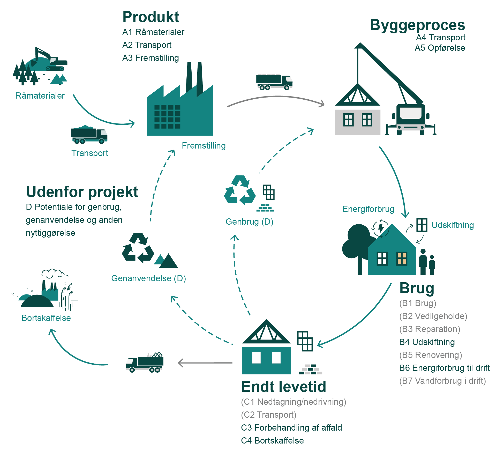{width="500" height="452"}

***Figur 2.1:** Grafisk illustration af bygningens livscyklus iht. EN15978. De moduler og faser, der indgår i beregningen, jf. § 297, er fremhævet med grøn skrift. Moduler, der ikke indgår, er markeret med grå skrift og parentes.*

Figur 2.2 understøtter figur 2.1 på en alternativ grafisk måde. Det, der fremgår som "uden for projektet"/"udenfor systemgrænsen", angiver de potentielle klimamæssige gevinster (modul D), som for eksempel kan forekomme efter bygningens levetid.

*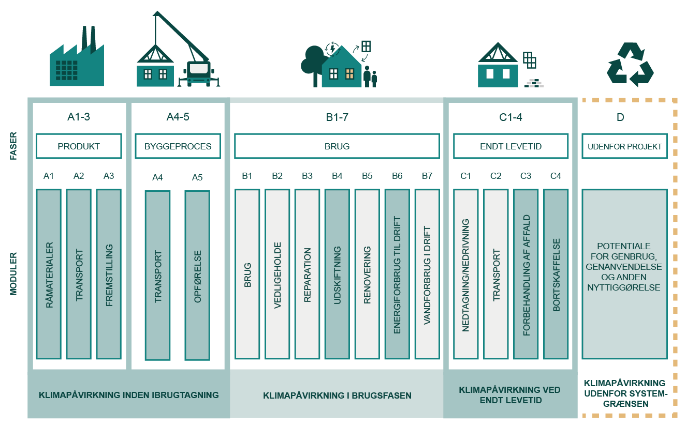{width="617" height="384"}*

***Figur 2.2:** Oversigt over moduler og faser i en bygnings LCA, jf. EN15978. Modulerne A1-A3, A4-A5, B4, B6, C3-C4 og D skal dokumenteres, jf. [§ 297 (nyt vindue)](../../krav/297_298 "297_298"){rel="noopener" target="_blank"}.*

I tabel 2.1 fremgår de moduler, der indgår i beregningen med en forklaring på, hvad de enkelte moduler indeholder. Det datagrundlag, der skal anvendes til beregning af klimapåvirkningen, er allerede opdelt på de moduler, der fremgår af tabellen. I forhold til dokumentation af overholdelse af grænseværdien er det derfor ikke nødvendigt at forholde sig konkret til de enkelte moduler i forbindelse med beregningen, dog med undtagelse af modul A4-A5, som har en selvstændig grænseværdi jf. § 298, stk. 5 (se i øvrigt nærmere i vejledning: § 297, stk. 7-8, Datagrundlag)

<table style="width:99%;">
<colgroup>
<col style="width: 6%" />
<col style="width: 2%" />
<col style="width: 24%" />
<col style="width: 65%" />
</colgroup>
<tbody>
<tr>
<td>Faser</td>
<td colspan="2">Moduler</td>
<td>Uddybning af modulers processer</td>
</tr>
<tr>
<td rowspan="3">Produkt</td>
<td>A1</td>
<td>Råmaterialer</td>
<td>Klimamæssige konsekvenser som følge af processer for udvinding af råstoffer og brug af sekundære materialer.</td>
</tr>
<tr>
<td>A2</td>
<td>Transport til fremstilling</td>
<td>Klimamæssige konsekvenser som følge af transport til fabrikken til fremstilling af den færdige byggevare eller det præfabrikerede system.</td>
</tr>
<tr>
<td>A3</td>
<td>Fremstilling</td>
<td>Klimamæssige konsekvenser som følge af processer til fremstilling af den færdige byggevare eller det præfabrikerede system.</td>
</tr>
<tr>
<td rowspan="2">Byggeproces</td>
<td>A4</td>
<td> Transport</td>
<td>Klimamæssige konsekvenser som følge af transport til og fra byggepladsen.</td>
</tr>
<tr>
<td>A5</td>
<td>  Opførelse</td>
<td>Klimamæssige konsekvenser som følge af påvirkninger relateret til opførelse af bygningen.</td>
</tr>
<tr>
<td rowspan="2">Brug</td>
<td>B4</td>
<td>Udskiftning</td>
<td>Klimamæssige konsekvenser som følge af påvirkninger relateret til udskiftninger af bygningsdele.</td>
</tr>
<tr>
<td>B6</td>
<td>Energiforbrug til drift</td>
<td>Klimamæssige konsekvenser som følge af produktion af energi til bygningsdrift.</td>
</tr>
<tr>
<td rowspan="2">Endt levetid</td>
<td>C3</td>
<td>Forbehandling af affald</td>
<td>Klimamæssige konsekvenser som følge af affaldsbehandling forud for nyttiggørelse.</td>
</tr>
<tr>
<td>C4</td>
<td>Bortskaffelse</td>
<td>Klimamæssige konsekvenser som følge af bortskaffelse af affald, inklusive forbehandling forud for bortskaffelse.</td>
</tr>
<tr>
<td>Udenfor projekt</td>
<td>D</td>
<td>Potentiale for genbrug, genanvendelse og anden nyttiggørelse</td>
<td>Potentielle miljømæssige gevinster eller belastninger fra genbrug og genanvendelse af byggevarer og anden nyttiggørelse som for eksempel energiindvinding fra afbrænding.</td>
</tr>
</tbody>
</table>

***Tabel 2.1:** Oversigt og beskrivelse af de moduler, der skal indgå i beregning af klimapåvirkningen jf. § 297*

Da modul D ifølge standard EN15978 er udenfor projektet, opgøres modul D separat fra den øvrige opgørelse, jf. § 297. I forbindelse med overholdelse af grænseværdien, jf. § 298, medregnes modul D ikke. Se yderligere vejledning til § 298, stk. 1.

#### **1.2.3    Betragtningsperioden**

For at opfylde kravet om beregning af bygningers klimapåvirkning i bygningsreglementet skal klimapåvirkningen opgøres for en betragtningsperiode på 50 år. De 50 år tælles fra tidspunktet, hvor bygningen færdigmeldes.

Betragtningsperioden angiver den beregningsmæssige periode, som bygningens livscyklus beregnes over. Den fastsatte betragtningsperiode på 50 år svarer ikke nødvendigvis til den konkrete bygnings forventede levetid, men er fastsat i bygningsreglementet for at gøre beregningerne af klimapåvirkning fra de enkelte bygninger sammenlignelige.

Alle moduler i tabel 2.1 skal medtages i beregningen, også selvom bygningen eller byggematerialer vurderes at have en levetid på mere end betragtningsperiodens 50 år. Det gælder også modulerne C3 og C4, som vedrører endt levetid.

#### **1.2.4    Beregningsenhed**

Klimapåvirkninger opgøres i enheden kg CO~2~-ækvivalenter pr. m^2^ pr. år.

CO~2~-ækvivalenter er en samlet betegnelse for effekten af alle drivhusgasarter omregnet til en fælles enhed. De data, der skal anvendes i beregningen af klimapåvirkning, fremgår af [BR18, bilag 2 (nyt vindue)](../../../../bilag/b2/bilag_2 "Bilag_2"){rel="noopener" target="_blank"}. Data er opgjort samlet i Global Warming Potential (GWP) i enheden CO2-ækvivalenter. Den samlede klimapåvirkning skal i beregningen sættes i forhold til den konkrete bygnings referenceareal og opvarmede etageareal, som beregnes iht. § 297 stk. 5 og § 256, nr. 3 og betragtningsperioden på 50 år.

Den beregnede klimapåvirkning for materialeforbrug og driftsenergi kan fordeles ud på hhv. referenceareal og opvarmet etageareal, jf. følgende formel:

((A1 + A2 + A3 + B4 + C3 + C4) / (A~*ref*~ \* 50 år)) + (B6 / (A~*opv *~*\* *50 år))

Hvor A1 angiver modul A1, A2 angiver modul A2 osv., A*~ref~* angiver referencearealet beregnet iht. § 297, stk. 5 (se vejledningen til dette stk.), og A*~opv~* angiver det opvarmede etageareal beregnet iht. § 256, nr. 3.

Den beregnede klimapåvirkning for byggeprocessen kan fordeles ud på referenceareal jf. følgende formel:

(( A4 + A5 ) / ( A~ref~ \* 50 år))

Modul D kan opgøres på lignende vis:

((D~*mat*~ / (A*~ref~* \* 50 år)) + (D*~drift~* / (A~*opv*~ \* 50 år))

Hvor D*~mat~* angiver materialernes D-modul, og D*~drift~* angiver driftens D-modul.

### 1.3. Arealopgørelse {#94c6b7f1-87fc-4471-8202-edd44157722a}

Til brug for beregning af klimapåvirkningen fra materialerne og byggeprocessen skal der opgøres et areal som CO2e-udledningerne opgøres i forhold til. Arealet baseres på det faktuelle areal som opgjort, jf. § 455, og omtales i dette afsnit som referenceareal. Dog er det nødvendigt at tilpasse det faktuelle areal af bygningen, da visse arealer har et væsentligt mindre materialebehov end almindelige, lukkede arealer. Ved at foretage disse tilretninger af det faktuelle areal forudsættes en mere retvisende opgørelse af klimapåvirkning pr m2.

I det følgende uddybes principperne for at opgøre referencearealet i forbindelse med beregningen af bygningers klimapåvirkning. Endvidere gives eksempler på, hvordan arealet konkret beregnes i forskellige scenarier.

Referencearealet tager udgangspunkt i beregningen til etagearealet, som skal opgøres ifølge § 455. Her medtages alle etagearealer, herunder alle opvarmede etagearealer. Dog skal følgende modifikationer foretages til det opgjorte etageareal;

- Alle kælderarealer, affaldsrum i terrænniveau og sikringsrum medregnes. Det vil sige, at disse arealer regnes fuldt med (100 pct.). Det er dog kun rum, som er integreret i bygningen. Fritstående sikringsrum og affaldsrum medregnes hverken i forhold til materialer eller arealer. Kælder regnes med, uanset om den er opvarmet eller uopvarmet.
- *Udestuer, altanlukninger og lignende medregnes alene med 50 pct*. Er der f.eks.  lukkede altaner, skal arealet for disse kun medregnes med 50 pct. i opgørelsen af klimapåvirkning.
- *Integrerede garager til enfamiliehuse, rækkehuse og lignende medregnes alene med 50 pct.* Integrerede garager betyder, at garagen er en del af og opført sammen med bygningen, dvs. deler ydervæg, tag mm.
- *Udvendige ramper, trapper, brandtrapper, altaner, altangange og lignende, medregnes med 25 pct.* Det vil sige, at hvor disse arealer ikke indgår i arealopgørelsen ifølge § 455, skal de medregnes med 25 pct. af arealet i opgørelsen af klimapåvirkning. Andre eksempler på arealer, der kan være omfattet af 25 pct., kan for eksempel være Stack-parking områder, som muliggør parkering i flere niveauer inden for en etage.
- *Integrerede carporte, udhuse, overdækninger, skure og lignende medregnes alene med 25 pct.* Dette dækker konstruktioner, der er opført som integreret del af bygningen, som for eksempel integrerede overdækkede legeområder. Det betyder fx, at der for en bygning opført på søjler, hvor arealet under dækket, som søjlerne bærer, anvendes til parkeringspladser, skal medregne 25 pct. af arealet under søjlerne i referencearealet. Et andet eksempel er teknikhuse på tage, som også skal medregnes med 25 pct. af arealet.
- *Walk-on-ceilings og lignende medregnes alene med 25 pct.* Walk-on-ceilings er for eksempel installationslofter, hvis højde svarer til rumhøjde, og som kan bære personlaster.
- *Overdækkede, ikke-integrerede terrasser samt udnyttede tagflader og lignende medtages ikke,* hverken hvad angår materialer anvendt til opførelsen eller arealet af disse områder. Overdækkede terrasser kan f.eks. være en  tagkonstruktionen med det formål, at have mulighed for ophold herunder.
- Almindelige tagudhæng vil ikke udløse et referenceareal, men materialerne skal medregnes.

Det fremhæves, at det for de beskrevne områder kun er arealet, der reduceres, og ikke mængderne af materialer. Materialernes mængder indgår stadig med 100 *pct.*, jf. [BR18, bilag 2, tabel 6](../../../../bilag/b2/bilag_2/tabel_6){rel="noopener noreferrer" target="_blank"}.

#### **1.3.1 Eksempler** {#e53ebfa8-1dea-4737-aa53-69c8a848b30c}

I det følgende er det skitseret, hvordan arealer opgøres i konkrete situationer.

Hvert eksempel indeholder en illustration for at tydeliggøre hvilke arealer, der medregnes. Arealer markeret med blå (A~1~) medregnes 100 pct. Arealer markeret med orange (og prikker) (A~2~) medregnes med 25 pct.

Til beregning af referencearealet er følgende formel anvendt:

A~reference~ = 100 pct*.* ∙ A~1~ + 25 pct.* \* *A~2~

#### Trapper og altaner

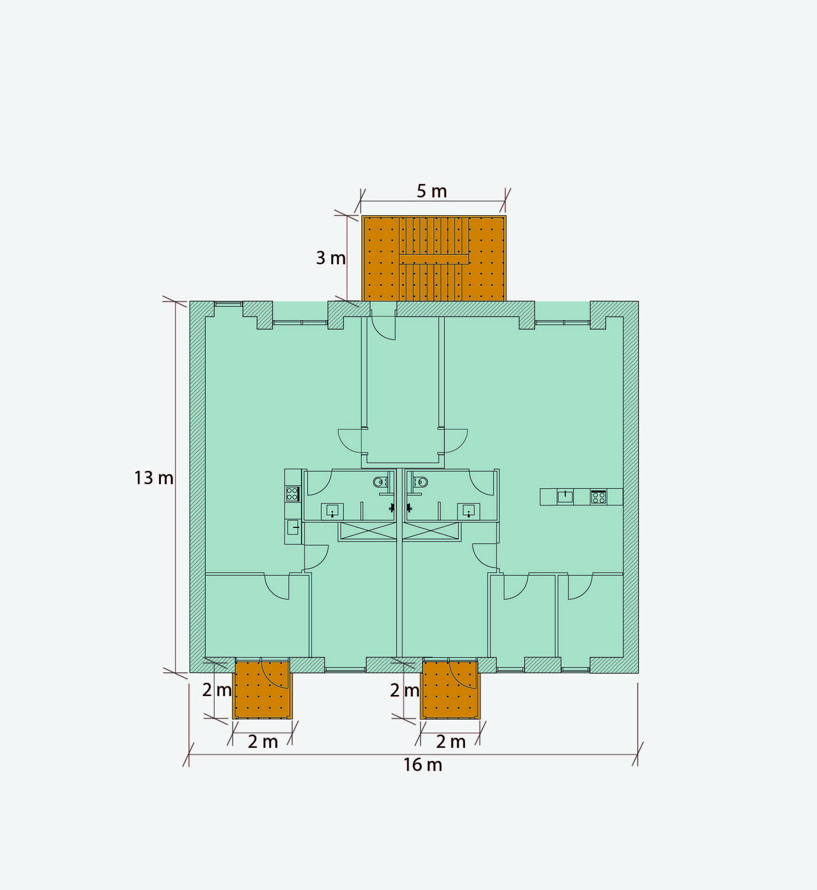{width="459" height="500"}

**Figur 3.1:** Plan af etageboligbyggeri med n antal etager, med udvendig trappe.

Etageareal: 13 m \* 16 m = 208 m^2^

Udvendig trappe: 3 m \* 5 m  25 pct. = 3,75 m^2^

Altaner: 2 m \* 2 m \* 25 pct. \* 2 altaner = 2 m^2^

Sum =  213,75 m^2^ \* n antal etager

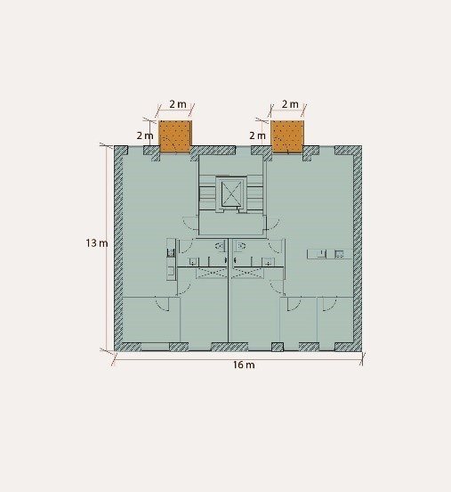{width="459" height="500"}

**Figur 3.2:** Plan af etageboligbyggeri med n antal etager, med indvendig trappekerne.

*Udvendige ramper, trapper, brandtrapper, altangange og lignende medregnes alene med 25 pct.*

*Indvendige trapper indgår fuldt i etagearealet, jf. § 455. *Trappen er her inden for klimaskærmen, og tæller derfor fuldt ud (100 pct.).

Etageareal: 13 m \* 16 m = 208 m^2^

Altaner: 2 m \* 2 m \* 25 pct. \* 2 altaner = 2 m^2^

Sum = 210 m^2^ \* n antal etager

#### Integreret og fritstående carport

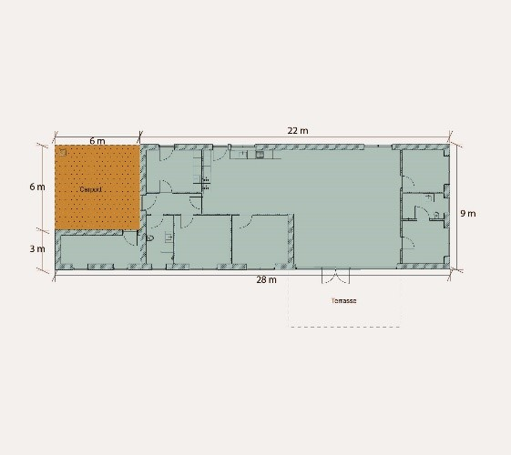{width="500" height="446"}

**Figur 3.3:** Plan af enfamiliehus med integreret carport.

*Integrerede carporte, udhuse, overdækninger, skure og lignende medregnes alene med 25 pct.*

Etageareal: 22 m \* 9 m + 3 m \* 6 m = 216 m2

Integreret carport: 6 m \* 6 m \* 25 pct.= 9 m2

Sum = 225 m2

Terrasseoverdækningen er ikke integreret i tagkonstruktionen og medtages derfor ikke i beregningen.

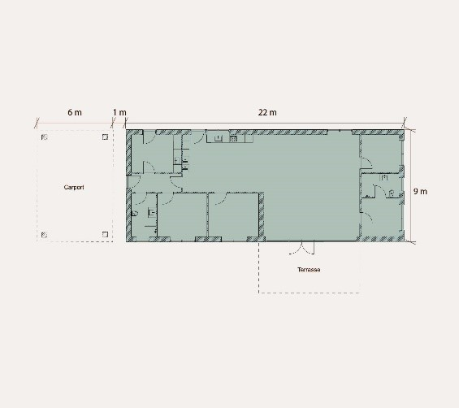{width="500" height="444"}

**Figur 3.4:** Plan af enfamiliehus med særskilt carport.

*Overdækkede terrasser og lignende medtages ikke i beregning om bygningers klimapåvirkning.*

Etageareal: 22 m \* 9 m = 198 m^2^

Terrasseoverdækningen er ikke integreret i tagkonstruktionen og medtages derfor ikke i beregningen. Carporten skal beregnes selvstændigt fordi det er en separat bygning, og fordi den er over 50m^2^.

#### Walk-on-ceiling

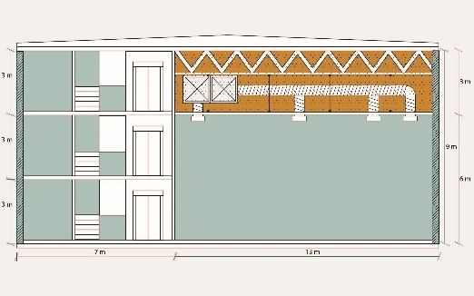{width="500" height="312"}

**Figur 3.5:** Snit af en produktionsbygning med walk-on-ceiling i produktionsrummet til installationer.

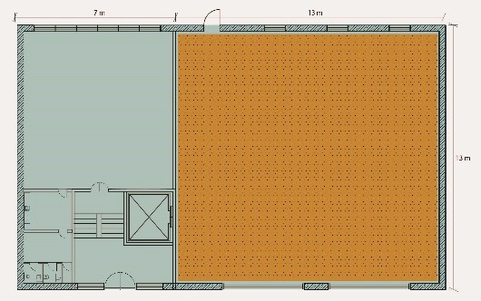{width="500" height="313"}

**Figur 3.6:** Plan af en produktionsbygning.

Walk-on-ceilings og lignende medregnes alene med 25 pct.

Etagearealet:

7 m \* 13 m \* 3 etager = 273 m^2^ (tre etager til venstre på snittet)

13 m \* 13 m \* 1 etage = 169 m^2^ (etage af dobbelthøjt rum)

Walk-on-ceiling: 13 m \* 13 m \* 1 etage \* 25 pct. = 42,25 m^2^

Sum = 484,25 m^2^

Udnyttede tagflader

Der etableres en tagterrasse på bygningens tagopbygning. Hverken arealet herfra medtages, og hellere ikke materialerne, der er nødvendige for tagterrassen, afgrænsningen ift. materialerne fremgår fra [BR18, bilag 2, tabel 6.](../../../../bilag/b2/bilag_2/tabel_6 "Tabel_6")

#### **1.3.2 Definition af integrerede carporte eller garager**

For §297, stk. 5 gælder den samme definition for hvornår en carport eller garage anses for værende integreret som beskrevet under bygningsreglementets administrative bestemmelser, vejledning pkt. 6.1 integrerede bygninger. Definitionen lyder som følge:

*"En integreret bygning kan eksempelvis være en garage, carport, udhus eller lignende, der ligger under samme tagkonstruktion som den primære bygning. En bygning kan også være integreret, hvis opførelse, ændring eller nedrivning af den integrerede bygning, kan påvirke den samlede bebyggelses konstruktive forhold."*

### 1.4. Bygningsdele {#9dc5204d-6894-4a4c-94d2-8d0e4984c95c}

Til brug for beregning af klimapåvirkningen skal udledningerne fra de materialer, der indgår i de enkelte dele af bygningen, medregnes. Som udgangspunkt bør en bygnings livscyklusvurdering omfatte så mange bygningsdele som muligt, for at repræsentere bygningens klimapåvirkning så godt som muligt. Da en bygning består af mange bygningsdele, kan der opstå spørgsmål om, hvor grænsen skal trækkes, for at afspejle den rette balance mellem ressourceforbrug og præcision.

For at sikre ensartede livscyklusvurderinger med samme afgrænsning for alle bygninger er der udarbejdet en oversigt over de dele af en bygning, der som minimum skal indgå i livscyklusvurderingen (markeret med ja), herunder også præcisering af det detaljeringsniveau, der skal ligge til grund for opgørelsen. Oversigten fremgår af [BR18, bilag 2, tabel 6](../../../../bilag/b2/bilag_2/tabel_6){rel="noopener noreferrer" target="_blank"} (nyt vindue). Der skelnes generelt mellem bygningsdele og så de materialer, der indgår i hver bygningsdel.

I det følgende uddybes, hvordan BR18, bilag 2, tabel 6 skal anvendes i forbindelse med beregningen. Det uddybes også, hvordan man kan opgøre klimapåvirkningerne for visse dele af bygningen, hvor det ikke er muligt at opgøre de enkelte materialer grundet manglende data, jf. [BR18, bilag 2, tabel 7](../../../../bilag/b2/bilag_2/tabel_7){rel="noopener noreferrer" target="_blank"} (nyt vindue).

#### **1.4.1 Tabellens opbygning og anvendelse** {#787e83a6-b7d9-4a83-a4be-37574156daef}

BR18, bilag 2, tabel 6 er opbygget sådan, at der først er delt op i overordnede bygningskategorier. Hver kategori indeholder en opdeling i typer, og for hver type fremgår de enkelte bygningsdele. Hver bygningsdel har en hovedgruppe og en undergruppe, disse to grupperinger er med som vejledning og er derfor frivillige at benytte. Se et uddrag af tabellen nedenfor.

###

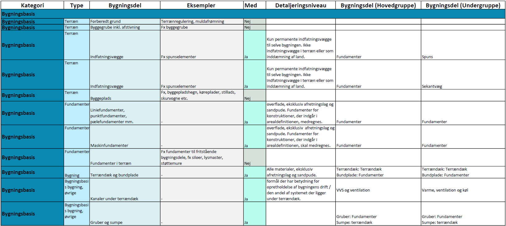

Figur 4.1: Eksempel fra BR18, bilag 2, tabel 6, for hvilke bygningsdele, der skal medtages for bygningsdele i terræn.

I figur 4.1 ses en særlig vejledende udgave af tabellen, hvor der ud over de bygningsdele, der indgår i tabellen, er tilføjet flere rækker som eksempler på dele af byggeriet, der ikke skal medtages. Hvorvidt en bygningsdel skal medtages i beregningen, fremgår af kolonnen 'Med', i den vejledende udgave af tabellen. Hvis der for den konkrete bygningsdel står "Ja", så skal bygningsdelen og tilhørende materialer medregnes. For at undgå mulige tvivlstilfælde er der også en række bygningsdele med i tabellen, som ikke skal indgå i beregningen. Disse er angivet ved et "Nej".

Af tabellen fremgår endvidere informationer om Detaljeringsniveauet, som kan afgrænse yderligere hvilke delkomponenter og materialer, der skal medregnes for den pågældende bygningsdel. I de tilfælde, hvor der ikke er nærmere beskrivelse af detaljeringsniveauet, betyder det, at alle materialer i bygningsdelen som udgangspunkt medregnes. Der kan være visse undtagelser fra denne regel, som er nærmere uddybet senere i denne vejledning.

Endvidere fremgår det for nogle bygningsdele; "Evt. som mængde råmateriale". For disse bygningsdele er det muligt at opgøre påvirkningen ved at opgøre mængden af råmateriale, frem for at opgøre påvirkningen fra det specifikke produkt. Dette gælder særligt for tekniske installationer, hvor opgørelse af klimapåvirkninger kan være vanskelig at foretage. Se nærmere herom under "Vejledningen til datagrundlaget afsnit 1.5; Mængde råmateriale".

Overordnet kan nævnes, at for de tekniske installationer medregnes tekniske anlæg og hovedføringsveje, dog kun de lige kanaler og rør, samt ventilationsaggregat, inklusiv varme- og køleflader samt kanalsystemet til ventilation. Indblæsningsarmaturer, spjæld eller lignende medregnes ikke. Nærmere afgrænsninger fremgår ligesom for de øvrige bygningsdele af BR18, bilag 2, tabel 6.

#### **1.4.2 Hoved- og undergruppe**

Ud over ovenstående excel-baserede skema, er der som supplement udviklet et bygningssnit. Bygningssnittet har til formål at illustrere og uddybe de enkelte bygningsdeles placering i hovedgrupper og undergrupper. ([Bilag 2, tabel 6 -- Skitse til vejledning](../../../../bilag/b2/bilag_2/tabel_6){rel="noopener noreferrer" target="_blank"})

Bygningssnittet illustrer under hvilke hovedgrupper de enkelte konstruktioner skal placeres. Eksempelvis placeres murkronens overflader under hovedgruppen "Ydervægge" lige så vel som murkronens primærbygningsdel også placeres under hovedgruppen "ydervægge". Et andet eksempel er Etagedæk hvis primær bygningsdel placeres under hovedgruppen "dæk" og hvis gulvkonstruktion placeres under undergruppen "gulve".

Her er det vigtigt at præcisere, at strukturering af mængder på LCA-beregningens input- side frit kan vælges af LCA-rådgiveren. For standardformatet er det alene afgørende, at der knyttes information om den rette hoved- og undergruppe på den enkelte konstruktion så dokumentationen til myndighederne efterfølgende kan ske i den korrekte struktur.

#### 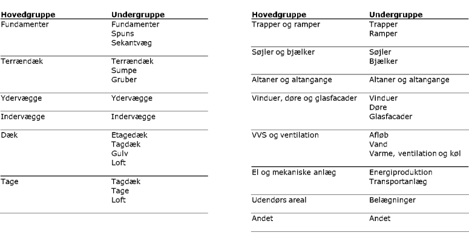{width="774" height="398"}

#### **Figur 4.2: Samlet oversigt over de enkelte hoved- og undergrupper.**

Valg af hoved- og undergrupper og sammenhæng med input-mængder i tabel 6 er foretaget ud fra en række forhold:

•    Sammenhæng med model for særlige forhold på bygningsdelsniveau

•    Sammenhæng med standardværdier for installationer

•    Metoder til opgørelse af mængder, eksempelvis ift. systemleverancer

•    Detaljeringsniveau der ikke fordrer større detaljering end i mest anvendte klassifikationssystemer

#### **1.4.3    Mapping af tabel 6 mod forskellige klassifikationssystemer** 

Ved brug af klassifikationssystemer til projektering og udførsel af byggeri er der udviklet en mapping, der giver mulighed for at se, hvordan bygningsdele i et byggeri relaterer sig til bygningsdele i tabel 6. Mappingen er lavet ud fra fem forskellige klassifikationssystemer: BIM7AA, BIMTypeCode, Cuneco Classification System (CCS), Construction Classification International (CCI) og Industry Foundation Classes (IFC).

I mapping-arket, som er en excel-fil, fremgår der en separat vejledning på første fane. Denne forklarer opbygningen af resten af arket, som indeholder tabel 6 og et ark til hver mapping mellem det specifikke klassifikationssystem og tabel 6.

Excel-filen med mapping kan findes her: [Tabel 6 Mapping](../../../../media/xh3hxzsx/tabel_6_mapping.xlsx "Tabel 6 Mapping"){rel="noopener" target="_blank"}

#### **1.4.4    Frit valg af placering for enkelte konstruktioner**

Enkelte konstruktioner kan placeres efter eget ønske. Det gælder "kviste" og "glasvægssystemer". Som vist og beskrevet på bygningssnittet kan "kviste" enten opgøres som et samlet element under "tage" eller fordelt på de respektive bygningsdele og overflader. Det skyldes, at metode for opgørelse af mængder i kviste både kan være som system-leverance med samlede mængder pr styk, eller opgjort for de enkelte bygningsdele og overflader f.eks. via opgørelser fra 2D eller 3D BIM-modeller.

På samme måde kan glasvægssystemer være en samlet system-leverance, hvor det ikke er muligt at opgøre "døre" for sig. Her kan det samlede glasvægssystem placeres under "indervægge". Alternativt -- hvis mængderne i forvejen opgøres opdelt og opmåling derfor tilsvarende lettest også foretages særskilt, kan døre i glasvægssystemer opgøres som undergruppen "døre" og resterende dele af væggen som undergruppen "indervægge".

#### **1.4.5    Placering af elementer, der ikke indgår i tabel 6**

Visse komponenter som badekabiner, skakt-moduler eller andre komponenter der leveres som systemleverance kan såfremt LCA-rådgiveren finder det nemmest opgøres f.eks. pr styk og placeres under bygningsdelshovedgruppen "andet". Derved undgås en opdeling af typiske producent / leverandørmængder i øvrige hoved- og undergrupper.

#### **1.4.6    Øvrige principper for hvilke bygningsdele, der skal medtages**

Udover selve tabellen indeholder BR18, bilag 2, tabel 6, et indledende afsnit, som beskriver overordnede principper for, hvad der skal medtages, og hvilke forenklinger, der kan foretages i beregning for bygningers klimapåvirkning.

#### **1.4.7    Accepterede udeladelser**

For visse bygningsdele kan det være svært at opgøre konkrete mængder. Derfor kan følgende kategorier af materialer udelades i beregningen

1.     Fastgørelsesmidler, for eksempel søm, skruer, kiler, hulplader til søm eller skruer, murbindere eller lignende

2.     Fugemateriale

3.     Lokale membraner (fx fugtspærrer, der er placeret lokale mindre steder og ikke er del af den regulære opbygning af bygningsdelen)

4.     Fugtspærre i fundamenter

5.     Håndlister, fodpaneler og lignende lister

#### **1.4.8    Forenklinger ift. mængdeopgørelse**

Større samlinger af væsentlig betydning for det bærende system, for eksempel boltesamlinger, skal medregnes, men kan eventuelt medregnes som et samlet skøn af mængden af råmateriale. Hvis det ikke er muligt at opgøre konkrete mængder inden for den enkelte samling, kan en samlet mængde opgøres. Se hertil: Eksempel for mængder for samlinger.

Udstøbning af fuger mellem betonelementer, udstøbning af et filigrandæk eller lignende samling mellem elementer kan forenkles ved at medregne den øvrige konstruktion som gennemgående. Denne forenkling kan anvendes, hvis der er tale om den samme materialetype. Hvis fx en stålbjælke udstøbes med beton, så kan dette ikke ses som et homogent materiale.

Hvis der er eventuelle huller mm. i en bygningsdel, kan man for at forsimple opgørelsen se bort herfra. Det betyder dog, at klimapåvirkningen vil være lidt højere, end hvis man laver en mere nøjagtig beregning. Det gælder fx recesser, udsparinger eller rørgennemføringer, hvor den underliggende bygningsdel kan regnes som gennemgående homogen konstruktion. På baggrund af det behøver brandlukninger og andre former for lukninger af udsparinger mm. ikke at blive medregnet.

Delvist præfabrikerede konstruktioner kan beregnes uden at medtage udfyldning imellem elementerne.

Tegloverliggere og lignende kan indregnes som det omkringliggende murværk, dvs. det kan antages, at tegloverliggere anses som almindeligt murværk.

#### **1.4.9    Anvendelse af standardværdier for installationer**

For tekniske installationer kan opgørelsen af klimapåvirkning enten opgøres specifikt for de materialer og produkter, der anvendes, eller alternativt ved at anvende standardværdier for installationer. Der er udviklet standardværdier for følgende tre installationskategorier:

1.  Afløb
2.  Vand
3.  Varme, ventilation og køl.

Værdierne er forskellige alt efter bygningstypologien, det vil sige:

1.  Enfamiliehuse
2.  Rækkehuse
3.  Etageboligbyggeri
4.  Kontorer, skoler og daginstitutioner

Bygningstypologier, som ikke er dækket af ovenstående, kan anvende standardværdier for:

1.  Øvrigt byggeri

Disse værdier fremgår af BR18, bilag 2, tabel 7.

Standard installationsværdierne er angivet i enheden kg CO2-ækvivalenter pr. m2 opvarmet areal pr. år. Værdierne skaleres altså med arealet, som svarer til det samlede opvarmet etageareal, jf. § 256 stk. 3, plus arealet for opvarmet kælder. Hvis der er forskellige anvendelser af en bygning, kan man arealvægte standardværdierne.

Værdierne er fastsat ud fra en betragtningsperiode på 50 år. Det betyder, at der ikke skal knyttes levetider til værdierne (læs mere om levetider i vejledningen om § 297, stk. 10). Udskiftninger undervejs i betragtningsperioden er indregnet i henholdsvis modulerne A1-A3 og C3/C4. Klimapåvirkningerne fra installationer ved anvendelse af standard installationsværdier fremgår derfor kun for modulerne A1-A3 og C3 og C4, og modul D.

Da værdierne er opdelt i tre kategorier

1) Afløb,

2) Vand,

3) Varme, ventilation og køl, er det muligt at vælge en, to eller alle tre værdier samlet i én beregning.

Værdierne er fastsat på baggrund af rapporter om udvikling af standardværdier og er fastsat konservativt. Se baggrundsrapporterne [her](https://sbst.dk/byggeri/baeredygtigt-byggeri/national-strategi-for-baeredygtigt-byggeri/klimakrav-lca-i-bygningsreglementet){rel="noopener" target="_blank"} (nyt vindue).

Der er altid mulighed for at opgøre installationer på den samme måde som de resterende bygningsdele, dvs. at der ikke behøves anvendt standardværdierne, disse er udelukkende et tilbud for en nemmere opgørelse.

Se "Eksempel for anvendelse af standardværdier for installationer" for uddybning om brug af standardværdier for installationer.

#### **1.4.10    Råhuse**

Hvis en bygning ikke afleveres i en sådan stand, at den er klar til ibrugtagning, men for eksempel betegnes som et råhus, og ved færdigmelding mangler dele, som for eksempel gulv, vægmaling mm., som er nødvendige for at sikre funktionaliteten af bygningen, medregnes sådanne dele af bygningen i beregningen af bygningens klimapåvirkning. Dette gælder, uanset at bygningsdelene ikke er til stede i bygningen på færdigmeldingstidspunktet. Se eksempel for råhus nedenfor.

#### **1.4.11    Solceller**

Materialernes klimapåvirkning regnes kun med til den andel af solceller, hvis ydelse kan indregnes i energiberegningen. Dette er en afgrænsning, jf. BR18, bilag 2, tabel 6, under "Solcelleanlæg". Det vil sige, at kun materialernes klimapåvirkning fra de solceller, som er medregnet i bygningens driftsforbrug eller indgår som en del af tagbeklædningen, medtages i modulerne A1-5, B4, C3-4 og D. Se nærmere herom under vejledning til stk. 11 emissionsfaktorer.

Hvis der for en bygning opføres solceller, som ikke placeres på bygningen, men et andet sted, skal disse stadigvæk medtages i beregningen af bygningers klimapåvirkning, såfremt disse medtages i energirammen, jf. § 259 og § 260.

#### **1.4.12   Eksempler**

#### **1.4.13   Eksempel på en mængdeberegning for samlinger**

En større fleretagers kontorbygning projekteres som søjle-bjælkekonstruktion i CLT-træ. Søjlerne er forankret i fundamentet ved hjælp af fodbeslag, mens søjler og bjælker samles i etagekryds. Begge samlinger udføres i metal. Samlingerne er kraftige og går udover mindre samlinger med sømplader i materialemængde. Det betyder, at disse samlinger skal opgørelse i beregningen om bygningers klimapåvirkning. Det kan være svært at finde mængder på samlinger og det rette data, jf. BR18, bilag 2, tabel 7.

Herunder vises, hvordan der findes mængden på samlinger og hvilket data, der vælges ift. BR18, bilag 2, tabel 7. Selvom bygningens samlede klimapåvirkning kun skal angives med et decimal, kan det for mere nøjagtige beregninger anbefales at være mere præcis i mellemregningerne.

<table style="width:98%;">
<colgroup>
<col style="width: 18%" />
<col style="width: 24%" />
<col style="width: 14%" />
<col style="width: 14%" />
<col style="width: 14%" />
<col style="width: 11%" />
</colgroup>
<tbody>
<tr>
<td></td>
<td> <strong>Formel</strong></td>
<td> <strong>Areal</strong> [mm2]</td>
<td> <strong>Tykkelse</strong> [mm]</td>
<td><strong>Volumen </strong>[m3]</td>
<td><strong>Vægt </strong>[kg]</td>
</tr>
<tr>
<td colspan="6"> <strong>Fodbeslag</strong></td>
</tr>
<tr>
<td> Dorn plade</td>
<td></td>
<td> 98.850</td>
<td> 15</td>
<td> 0,00135</td>
<td></td>
</tr>
<tr>
<td> Ankerplade</td>
<td></td>
<td> 442.500</td>
<td> 15</td>
<td> 0,00634</td>
<td></td>
</tr>
<tr>
<td> Forskydningsknast</td>
<td></td>
<td> 50.400</td>
<td> 6</td>
<td> 0,00030</td>
<td></td>
</tr>
<tr>
<td> Dorne</td>
<td></td>
<td> 4 x 200</td>
<td> 24</td>
<td> 0,00036</td>
<td></td>
</tr>
<tr>
<td> Samlet volumen</td>
<td></td>
<td></td>
<td></td>
<td> 0,00835</td>
<td></td>
</tr>
<tr>
<td> Samlet vægt for samling</td>
<td>
Volumen x densitet af stål

0,00835 m3 x 7.850 kg/m3
</td>
<td></td>
<td></td>
<td></td>
<td> 65,548</td>
</tr>
<tr>
<td> Samlet vægt i projektet</td>
<td>
Vægt for samling x antal i projektet

65,548 kg x 32
</td>
<td></td>
<td></td>
<td></td>
<td>2.097,52</td>
</tr>
<tr>
<td colspan="6"><strong> Etagekryds</strong></td>
</tr>
<tr>
<td>Dorn plader</td>
<td></td>
<td> 760.000</td>
<td> 760.000</td>
<td> 0,01140</td>
<td></td>
</tr>
<tr>
<td> Ankerplader</td>
<td></td>
<td> 360.400</td>
<td> 360.400</td>
<td> 0,00721</td>
<td></td>
</tr>
<tr>
<td> Bundplader</td>
<td></td>
<td> 193.800</td>
<td> 193.800</td>
<td> 0,00388</td>
<td></td>
</tr>
<tr>
<td> Dorne</td>
<td></td>
<td> 40 x 200</td>
<td> 40 x 200</td>
<td> 0,00251</td>
<td></td>
</tr>
<tr>
<td> Bolte</td>
<td></td>
<td> 20 x 460</td>
<td> 20 x 460</td>
<td> 0,00289</td>
<td></td>
</tr>
<tr>
<td> Samlet volumen</td>
<td></td>
<td></td>
<td></td>
<td> 0,02789</td>
<td></td>
</tr>
<tr>
<td> Samlet vægt for samling</td>
<td>
volumen * densitet af stål

0,02789 m3 * 7880 kg/m3
</td>
<td></td>
<td></td>
<td></td>
<td>218,937</td>
</tr>
<tr>
<td> Samlet vægt i projektet</td>
<td>
Vægt for samling x antal i projektet

218,937 x 105
</td>
<td></td>
<td></td>
<td></td>
<td> 22.988,33</td>
</tr>
<tr>
<td colspan="6"> <strong>Sum samlinger</strong></td>
</tr>
<tr>
<td colspan="2"> <em>Samlet vægt af fodbeslag og etagekryds i projektet</em></td>
<td></td>
<td></td>
<td></td>
<td> <em>22.085,85</em></td>
</tr>
</tbody>
</table>

Følgende miljødata fra BR18, bilag 2, tabel 7, vælges:

#### **Datagrundlaget for materialerne**

|  |  |  |  |  |  |  |
|:---|:---|:---|:---|:---|:---|:---|
|  **Materiale** | **ID**  |  **A1-3** |  **C3** |  **C4** |  **D** |  **Funktionel enhed** |
|  Stål, varmvalset plade, 2-20 mm |  #G0767  |  2,78247 |   |   | -1,50772 |  1 kg |

#### ** **

#### **1.4.13    Eksempel for anvendelse af standardværdier for installatione**r

Bygherren skal lave en beregning om bygningens klimapåvirkning for sit enfamiliehus. Grundet arbejdsomfanget vurderes det mest optimalt at bruge standardværdier for installation for dokumentationen om bygningens klimapåvirkning, da der spares tid på den måde. Følgende værdier fra BR18, bilag 2, tabel 7, er relevante for enfamiliehuset; #S0001, #S0002, #S0003.

<table style="width:98%;">
<colgroup>
<col style="width: 9%" />
<col style="width: 22%" />
<col style="width: 17%" />
<col style="width: 16%" />
<col style="width: 16%" />
<col style="width: 15%" />
</colgroup>
<tbody>
<tr>
<td colspan="6"> <strong>Standardværdier for installationer</strong> [i kg CO2-ækv. pr. m2 pr. år]</td>
</tr>
<tr>
<td> ID</td>
<td> Navn</td>
<td> Global Opvarmning, modul A1-A3</td>
<td> Global Opvarmning, modul C3</td>
<td> Global Opvarmning, modul C4</td>
<td> Global Opvarmning, modul D</td>
</tr>
<tr>
<td> #S0001</td>
<td> Enfamiliehuse, afløb</td>
<td> 0,008</td>
<td> 0,012</td>
<td> -</td>
<td> -0,01</td>
</tr>
<tr>
<td> #S0002</td>
<td> Enfamiliehuse, vand</td>
<td> 0,048</td>
<td> 0,012</td>
<td> -</td>
<td> -0,025</td>
</tr>
<tr>
<td> #S0003</td>
<td> Enfamiliehuse, varme, ventilation og køl</td>
<td> 0,475</td>
<td> 0,105</td>
<td> -</td>
<td> -0,274</td>
</tr>
</tbody>
</table>

Bygherren kender det samlede opvarmede etageareal, jf. § 256 stk. 3, som i dette eksempel svarer til 110 m2.

Klimapåvirkningen for afløb for enfamiliehus for bygningens livscyklus beregnes vha.:

Bygningens livscyklus A1-C4: (0,008+0,012+0) ∙ 110m^2^ ∙ 50 år = 110 kg CO^2^ - ækv.

Modul D: (-0,01) ∙ 110m^2^ ∙ 50 år = -55 kgCO2 - ækv.

Hvor 50 år svarer til betragtningsperioden, for at ende med den samme enhed og opgørelse som for de resterende bygningsdele i kg CO2-ækvivalenter.

Resultaterne anvendes i den samlede beregning for bygningens klimapåvirkning.

Samme beregning foretages også for vand samt varme, ventilation og køl.

#### **1.4.14    Eksempel på beregning af bygningsdele ved færdigmelding af råhus**

Et etageboligbyggeri færdigmeldes uden køkken og bad og overfladebehandlinger i disse rum, da det er op til fremtidige købere at indrette dette personligt.

Gulve og vægmaling samt fliser er nødvendige for at sikre funktionaliteten og skal ifølge BR18, bilag 2, tabel 6, medregnes. Beregningen af bygningers klimapåvirkning skal afspejle de mængder og materialer, der anvendes i bygningen, når den står færdig og kan tages i brug. Da de sidste dele til endelig ibrugtagning ikke kendes, skal disse opgøres ud fra bedste vurdering. Det vil sige, at påvirkninger medtages, selvom den faktiske overfladebehandling ikke kendes.

Der medtages standard fliser, vægbehandling og en typisk gulvbelægning i køkken og bad, samt den nødvendige gulvopbygning hertil. Værdier hertil findes i BR18, bilag 2, tabel 7.

For fliser vælges for eksempel datasættet #G0340, Keramikfliser, u-glaseret. Det betyder ikke, at den fremtidig ejer af bygningen skal anvende disse typer af fliser.

Køkken og bad inventar medtages ikke, da det ikke skal opgøres, jf. BR18, bilag 2, tabel 6.

### 1.5. Datagrundlag {#2bea61d1-61aa-4d7b-a6e9-5411306c289d}

For at kunne opgøre en bygnings samlede klimapåvirkning skal der knyttes miljødata til de forskellige bygningsdele og materialer, der indgår i bygningen. Miljødata indeholder informationer om klimapåvirkningen pr. enhed produkt, og udgør derfor et vigtigt element i en livscyklusvurdering.

Ved beregning af klimapåvirkningen skal der for hvert materiale, som indgår i bygningen, anvendes et datasæt fra BR18, bilag 2, tabel 7, eller data fra miljøvaredeklarationer (EPD'er). Hvis der anvendes EPD'er skal reglerne jf. § 297, stk. 8 følges.

Datagrundlaget, som fremgår af BR18, bilag 2, tabel 7, er generiske miljødata, baseret på gennemsnitsværdier for materialer, der anvendes i byggeri. Datasættet kan tilgås direkte på bygningsreglementets hjemmeside eller via dette [link](../../../../bilag/b2/bilag_2/tabel_7){rel="noopener noreferrer" target="_blank"} (nyt vindue). I datasættet kan der også ses links til den datakilde, der har dannet grundlag for fastsættelsen af data om den pågældende type materiale. Fra linket fremgår der typisk en udløbsdato for datasættet. Datakilden og udløbsdatoen er ikke relevante for kravet.

Det er ikke muligt at anvende andet generisk data end det, der fremgår af BR18, bilag 2, tabel 7. Andet miljødata kan udelukkende komme fra miljøvaredeklarationer, jf. § 297, stk. 8 I det følgende beskrives det, hvordan BR18, bilag 2, tabel 7, anvendes. Derudover gives der konkrete eksempler på, hvilket data og hvordan beregningen foretages, hvis ikke der findes et datasæt, der stemmer overens med det materiale, der anvendes i bygningen.

#### **1.5.1    Tabellens opbygning og anvendelse**

BR18, bilag 2, tabel 7, er opdelt i følgende kolonner:

**ID** angiver et identifikationsnummer. Hver datalinje har et specifikt nummer, som der kan refereres til for nemmere kommunikation og orientering om datasæt. I identifikationsnummeret er et bogstav som angiver hvor data stammer fra. G angiver generisk data fra Ökobaudat, B angiver at data stammer fra branche EPD'er, D angiver at data stammer fra EPD'er på typisk anvendte danske produkter og S angiver standardværdier for installationer.

**Navn** beskriver produktet/materialets navngivning;

**Global opvarmning:** Tabellen rummer fire kolonner, der angiver data for bidrag til klimapåvirkningen for hver af faserne A1-A3, C3, C4 og D i det omfang, det er relevant for det pågældende ID.

**Den deklarerede faktor og enhed** angiver den mængde og enhed, som klimapåvirkningen i de forrige kolonner (Global opvarmning), er udregnet på baggrund af.

**Massefaktor og -enhed** angiver produktets vægt (i kg) pr. deklareret enhed, som er nødvendig for eventuel omregning fra en enhed til en anden.

<table style="width:100%;" data-border="1" data-cellspacing="0" data-cellpadding="0">
<colgroup>
<col style="width: 10%" />
<col style="width: 10%" />
<col style="width: 10%" />
<col style="width: 10%" />
<col style="width: 10%" />
<col style="width: 10%" />
<col style="width: 10%" />
<col style="width: 10%" />
<col style="width: 10%" />
<col style="width: 10%" />
</colgroup>
<tbody>
<tr>
<td width="51" data-valign="top">
ID
</td>
<td width="40" data-valign="top">
Navn
</td>
<td width="60" data-valign="top">
Global opvarmning, fase A1-A3
</td>
<td width="60" data-valign="top">
Global opvarmning, fase C3
</td>
<td width="66" data-valign="top">
Global opvarmning, fase C4
</td>
<td width="65" data-valign="top">
Global opvarmning, fase D
</td>
<td width="65" data-valign="top">
Deklareret factor (FU)
</td>
<td width="65" data-valign="top">
Deklareret enhed (FU)
</td>
<td width="64" data-valign="top">
Masse factor
</td>
<td width="64" data-valign="top">
Masse enhed
</td>
</tr>
<tr>
<td width="51" data-valign="top">
#G0984
</td>
<td width="40" data-valign="top">
Glas 4

mm
</td>
<td width="60" data-valign="top">
13,346
</td>
<td width="60" data-valign="top">
 

0
</td>
<td width="66" data-valign="top">
0,176
</td>
<td width="65" data-valign="top">
0
</td>
<td width="65" data-valign="top">
1
</td>
<td width="65" data-valign="top">
m2
</td>
<td width="64" data-valign="top">
10
</td>
<td width="64" data-valign="top">
kg/m2
</td>
</tr>
</tbody>
</table>

**Tabel 5.1** Oversigt over opbygningen af BR18, bilag 2, tabel 7, med et eksempel for byggematerialet 4 mm glas.

I tabellen på bygningsreglementets hjemmeside indgår der for hvert produkt/materiale et link, hvor det er muligt at læse mere om datakilden. Tabellen kan også tilgås [her](../../../../bilag/b2/bilag_2/tabel_7){rel="noopener noreferrer" target="_blank"} (nyt vindue).

#### **Valg af datasæt for et konkret materiale** {#787e83a6-b7d9-4a83-a4be-37574156daef}

Som beskrevet, skal der for hvert materiale, som indgår i bygningen, anvendes et datasæt fra BR18, bilag 2, tabel 7, eller miljøvaredeklarationer, jf. § 297, stk. 8. Hvis der for et konkret materiale ikke findes et generisk datasæt i tabellen eller en miljøvaredeklaration, skal der anvendes det generiske datasæt fra BR18, bilag 2, tabel 7, hvor materialesammensætning svarer bedst muligt til det pågældende materiale. Med materialesammensætning forstås de materialetyper og repræsentative mængder, der fremgår af tabellen for det konkrete materiale. På nuværende tidspunkt er der fx ikke datagrundlag for at invertere til solcelleanlæg eller lignende. Derfor bliver man nødt til at angive et materiale, der så godt som muligt svarer til en inverter. Det kunne fx være "aluminiumsplade" eller "fjernvarmeanlæg".

Hvis data for eksempel er angivet for en bygningsdel, sammensat af flere materialer, hvor sammensætningen af data afviger iht. den anvendte bygningsdel, kan det vurderes, om data vil være mere retvisende ved at sammensætte det af enkelte datasæt.

Der kan kun afviges fra datagrundlaget i BR18, bilag 2, tabel 7 i de tilfælde, hvor der anvendes miljøvaredeklarationer iht. EN15804 for specifikke produkter, jf. § 297, stk. 8

For tekniske installationer kan opgørelsen af klimapåvirkning enten opgøres specifikt for de materialer og produkter, der anvendes, eller alternativt ved at anvende standardværdier for installationer, som vil gøre dokumentationen nemmere. Der er udviklet værdier for henholdsvis afløb, vand, samt varme, ventilation og køl. Disse værdier fremgår ligeledes af BR18, bilag 2, tabel 7.

#### **1.5.2    Omregning af data ved ændring af enhed**

Som det kan ses i BR18, bilag 2, tabel 7, er klimapåvirkningen angivet for produktet i en bestemt deklareret enhed.

Der er behov for at ændre enhed, hvis de oplysninger, man har om et materiale, er opgivet i andre enheder, end det der fremgår af datasættet. Hvis der bruges et beregningsværktøj til dokumentation om bygningens klimapåvirkning, kan det godt være, at værktøj har integreret omregningen af enhed.

#### **1.5.3    Eksempel på omregning af enhed ved anden deklareret faktor end kg.**

Datasættet #G0768 Stål, Varmgalvaniseret stålplade har en deklareret faktor på 1 med enheden m^2^ og en massefaktor på 5,72 kg/m^2^. GWP for A1-A3 modulet for dette datasæt kan beregnes som:

16,789 kg CO~2~-ækv./ 1 m^2^ / 5,72 kg/m^2^ = 2,935 kg CO~2~-ækv./kg

|  |  |  |  |  |  |  |  |  |  |
|----|-----------|---------|---------|---------|--------|--------|-------|-----|-----|
| ID | Navn | Global opvarmning, fase A1-A3 | Global opvarmning, fase C3 | Global opvarmning, fase C4 | Global opvarmning, fase D | Deklareret factor (FU) | Deklareret enhed (FU) | Masse factor | Masse enhed |
| #G0768 | Stål, Varmgalvaniseret stålplade | 16,789 | 0 | 0 | -7,8865 | 1 | m^2^ | 5,72 | kg/m^2^ |

*Eksempel på anvendelse af standardværdier for tekniske installationer*

Se et eksempel i vejledningen til [bygningsdele afsnit 1.4](kap-1_4 "Kap 1_4"){rel="noopener" target="_blank"} (nyt vindue).

#### **1.5.4      Metode for opgørelse af klimapåvirkning ved en mængde råmateriale**

Hvor det af BR18, bilag 2, tabel 6, fremgår, at bygningsdelene kan opgøres eventuelt som mængde råmateriale, kan miljødata findes ved at foretage en samlet opgørelse af det materiale, som indgår i bygningsdelene. Denne undtagelse er der behov for, da der på nuværende tidspunkt ikke findes generiske miljødata for alle produkter, som indgår i et byggeri.

Når et datagrundlag skal findes vha. mængde råmateriale, kan overordnet to scenarier og metoder være relevante:

1.     Materialesammensætningen kendes: her indhentes data om materialemængden og eventuelt indeholdte væsker og luftarter indhentes for det specifikke produkt.

2.     Materialesammensætningen er ikke tilgængelig: her vælges det primære materiale med den antagelsesvis største vægtandel i produktet.

Begge metoder medfører en række usikkerheder og vil undervurdere påvirkningen af produktet, hvorfor denne metode kun bør anvendes, hvis intet andet datasæt, jf. BR18, bilag 2, tabel 7, vurderes værende repræsentativ, og hvis der gives mulighed herfor, jf. BR18, bilag 2, tabel 6.

***Metode for opgørelse af klimapåvirkning ved en mængde råmateriale***

Hvor det af BR18, bilag 2, tabel 6, fremgår, at bygningsdelene kan opgøres *eventuelt som mængde råmateriale*, kan miljødata findes ved at foretage en *samlet opgørelse* af det materiale, som indgår i bygningsdelene. Denne undtagelse er der behov for, da der på nuværende tidspunkt ikke findes generiske miljødata for alle produkter, som indgår i et byggeri.

Når et datagrundlag skal findes vha. mængde råmateriale, kan overordnet to scenarier og metoder være relevante:

1.  Materialesammensætningen kendes: her indhentes data om materialemængden og eventuelt indeholdte væsker og luftarter indhentes for det specifikke produkt.
2.  Materialesammensætningen er ikke tilgængelig: her vælges det primære materiale med den antagelsesvis største vægtandel i produktet.

Begge metoder medfører en række usikkerheder og vil undervurdere påvirkningen af produktet, hvorfor denne metode kun bør anvendes, hvis intet andet datasæt, jf. BR18, bilag 2, tabel 7, vurderes værende repræsentativ, og hvis der gives mulighed herfor, jf. BR18, bilag 2, tabel 6.

### **Eksempler**

***Eksempel på beregning af klimapåvirkning efter metoden for mængde råmateriale med kendt materialesammensætning***

I en bygning anvendes et integreret komfortmodul til opvarmning, køling og ventilation i bygningen. Der findes ikke et datasæt i BR18, bilag 2, tabel 7, som syntes at repræsentere det anvendte produkt. Til gengæld fremgår det af BR18, bilag 2, tabel 6, at bygningsdelen kan opgøres efter metoden for mængde råmateriale. Derfor findes data ved at opgøre produktet vha. mængde råmateriale.

Beregning af klimapåvirkning af 1 stk. integreret komfortmodul til opvarmning, køling og ventilation starter med at finde databladet til produktet.

I databladet for det konkrete produkt er materialesammensætning oplyst med en samlet vægt på 22,6 kg. Materialesammensætningen er:

#### **1.5.5 Materialesammensætning**

|                   |            |
|:------------------|:-----------|
| **Materiale**     | **Mængde** |
| Galvaniseret stål |  18,2 kg   |
|  Aluminium        |  2,5 kg    |
|  Kobber           |  1,6 kg    |
|  Plast            |  0,2 kg    |
|  Zink             |  0,1 kg    |

Af BR18, bilag 2, tabel 7, fremgår det, at datasættet for modul A1-3 for galvaniseret stål er opgjort i kvadratmeter og derfor er det først omregnet til kilogram efter ovenstående vejledning:

*Eksempel på omregning af data ved ændring af enhed.*

#### **1.5.6 Datagrundlaget for materialerne omregnet til den samme funktionelle enhed på 1 kg**

|                   |        |        |        |          |        |                  |
|:------------------|:-------|:-------|:-------|:---------|:-------|:-----------------|
| **Materiale**     | ID     | A1-3   | C3     | C4       | D      | Funktionel enhed |
| Galvaniseret stål | #G0768 | 2,935  | 0      | 0        | -1,379 | 1 kg             |
| Aluminium         | #G0333 | 10,698 | 0      | 0        | -7,277 | 1 kg             |
| Kobber            | #G0768 | 2,935  | 0      | 0        | -1,379 | 1 kg             |
| Plast             | #G0496 | 2,497  | 3,22   | 0,00161  | -1,223 | 1 kg             |
| Zink              | #G0015 | 3,222  | 0,0573 | 0,000264 | -2,498 | 1 kg             |

Det vil sige, at GWP for komfortmodulet, beregnet ud fra princippet om mængde råmateriale, er:

#### **1.5.7 Beregning**

|  |  |  |
|:---|:---|:---|
| **Modul** | **Formel** | **Sum** **-** **kg** **CO2-ækv.** |
| A1-3 | 2,935 x 18,2 kg + 10,698 x 2,5 kg + 2,935 x 1,6 kg + 2,467 x 0,2 kg + 3,222 x 0,1 kg | 85,683 |
| C3 | 3,22 x 0,2 + 0,00573 x 0,1 | 0,650 |
| C4 | 0,00161 x 0,2 kg + 0,000264 x 0,1 kg | 0,000348 |
| D | -1,379 x 18,2 kg - 7,277 x 2,5 kg - 1,379 x 1,6 kg - 1,223 x 0,2 kg - 2,498 x 0,1 kg | -45,985 |

*Eksempel på beregning af klimapåvirkning efter metoden for mængde råmateriale uden kendt materialesammensætning*

I en bygning installeres en kølebaffel. Der findes ikke et datasæt i BR18, bilag 2, tabel 7, som syntes at repræsentere det anvendte produkt, og produktets materialeopbygning og sammensætning kendes heller ikke. Derfor findes klimapåvirkningen vha. mængde råmateriale.

BR18, bilag 2, tabel 6, oplyser, at der kan anvendes miljødata til råmaterialerne. Databladet oplyser en samlet vægt på 24 kg uden vand, og at produktet består af en galvaniseret stålramme, aluminiumslameller og kobberrør. Materialernes vægtandele kendes ikke. Der findes dog oplysninger om vægtandele for et lignende produkt hos en anden producent, hvor galvaniseret stål har den største vægtandel. Det antages derfor, at galvaniseret stål er det primære materiale i nærværende produkt. Datasættet for galvaniseret stål er opgjort i kvadratmeter og omregnes derfor først til kilogram efter ovenstående vejledning.

#### **1.5.8 Datagrundlag**

|  |  |  |  |  |  |  |
|:---|:---|:---|:---|:---|:---|:---|
| **Materiale** | **ID** | **A1-3** | **C3** | **C4** | **D** | **Funktionel** **enhed** |
| Galvaniseret stål | #G0768 | 2,935 | 0 | 0 | -1,379 | 1 kg |

####  **1.5.9 Beregning**

|           |                |                   |
|:----------|:---------------|:------------------|
| **Modul** | **Formel**     | Sum - Kg CO2-ækv. |
| A1-3      | 2,935 x 24 kg  | 70,445            |
| C3        | 0              | 0                 |
| C4        | 0              | 0                 |
| D         | -1,379 x 24 kg | -33,09            |

### **1.5.10 Genbrugte materialer**

#### **1.5.11 Definition**

Genbrugte byggematerialer skal forstås som materialer, der har været brugt før. Det er ikke et krav, at materialets tidligere anvendelse skal opfylde samme formål igen.

Ved definitionen af genbrugte byggematerialer er der taget udgangspunkt

i affaldsbekendtgørelsen, dog uden at formålet skal være det samme, således: "Enhver operation, hvor produkter eller komponenter, der ikke er affald, bruges igen".

Affaldsbekendtgørelsen sondrer mellem genbrug og genanvendelse. Genanvendelse falder ikke under genbrug.

Som genanvendelse forstås at materialet har været omforarbejdet ved affaldsbehandling. Det kan eksempelvis være en nedknusning, omsmeltning, granulering eller pelletering. Det kan også være træ, som er høvlet til spån og anvendt i spånplader. Det er dog ikke udelukket, at et materiale, som stammer fra en genanvendelsesproces, f.eks. spånplader, har været brugt i et byggeri og genbruges i et andet byggeri.

Det er derfor afgørende, at byggematerialet består i sin oprindelige form. Det kan dog være skåret til, og der kan være boret huller i, og det kan være malet og lakeret, uden at dette kategoriseres som genanvendelse.

Det er uden betydning, om byggematerialerne på et tidspunkt har været klassificeret som affald, når de ikke er klassificeret som affald på tidspunktet for genbruget.

Som genbrug forstås ikke overskudsprodukter fra byggepladser eller restprodukter, jf. affaldsbekendtgørelsen, da disse produkter ikke har været brugt.

Det er ikke hensigten at ændre reglerne om byggeri i øvrigt. Byggeri opført med genbrugsprodukter skal derfor stadig kunne leve op til de almindelige krav i fx bygningsreglementet og arbejdsmiljølovgivningen.

#### **1.5.12 Miljødata af genbrugte byggematerialer**

Klimapåvirkningen af genbrugte byggematerialer er 0 for A1-A3, B4, C3-C4 og D. En eventuel forbehandling og/eller affaldsbehandling af materialet opgøres således heller ikke. Derved fraviges også de almindelige regler om udskiftning i modul B4 ved at beregningen foretages, som om der ingen udskiftning sker, ligesom levetidsprincipperne i § 297, stk. 10, ligeledes fraviges ved ikke at beregne levetiden.

Det vil sige, at der regnes med 0 kg CO~2~-ækvivalenter pr. m^2^ pr. år i hele betragtningsperioden.

Beregningsmæssigt betyder det, at miljødata af genbrugte byggematerialer indgår i beregningen -- sådan at det er synligt at materialerne er brugt -- men sættes til 0 kg CO~2~-ækvivalenter.

Bemærk, at for genbrugte byggematerialer medregnes udledning fra modulerne A4-A5 i beregningen i §297 og i grænseværdien i §298.

#### **1.5.13 Tilførsel af nye materialer**

Hvis der sammen med det genbrugte materiale også anvendes nye materialer, tæller de nye materialer med på samme måde som andre nye materialer, jf. § 297.

Som undtagelse til ovenstående så indgår behandling af det genbrugte materiale i form af maling, lak mm., som er sammenligneligt med reparation og vedligehold, ikke i beregningen. Det gælder også, selv om behandlingen har været nødvendig for at forberede materialet til et nyt formål. Dette gælder, så længe behandlingen er sammenlignelig med reparation og vedligehold af materialet, som det indgår i sin nye funktion.

####  **1.5.14 Eksempler**

*Eksempler vedrørende forskel på genbrug og genanvendelse*

Gulvbrædder, der anvendes til gulvbrædder -- genbrug

Gulvbrædder, der anvendes til facadebeklædning -- genbrug

Gulvbrædder, der anvendes til produktion af spånplader -- genanvendelse, ikke genbrug.

Spånplader, der har været brugt og tages ud for at bruges igen i et andet byggeri -- genbrug.

#### Eksempel -- fastsættelse af miljødata for genbrugte gulvbrædder

{width="500" height="340"}

*Figur 1 Eksempel på afslibning og oliebehandling af genbrugte gulvbrædder.*

Gulvbrædder, som udskiftes i et eksisterende hus, ønskes anvendt i et nyt byggeri. Dette betragtes som genbrug, jf. bilag 2, tabel 7.

Klimapåvirkning af gulvbrædderne anses for at være 0 kg CO2-ækvivalenter pr. m2 igennem bygningens livscyklus.

Inden gulvbrædderne anvendes i den nye bygning, skal de afslibes og oliebehandles.

Afslibningen er forudsat at indgå i den fastsatte klimapåvirkning på 0.

Oliebehandlingen er en forarbejdning af det genbrugte byggeprodukt for at kunne indgå i den nye bygning og er et nyt materiale. Men da oliebehandlingen er sammenlignelig med vedligehold, vil klimapåvirkningerne fra denne forarbejdning ikke skulle beregnes separat, men er også inkluderet i klimapåvirkningen på 0.

Da levetider ikke skal opgøres for genbrugte materialer, ses der bort fra dem. Det angives i LCA-beregningen, at der ingen udskiftning sker af de brugte gulvbrædder.

For at skabe en fyldestgørende dokumentation, jf. § 40, dokumenteres mængderne af de brugte gulvbrædder i dokumentationen, som indsendes i forbindelse med færdigmelding af bygningen:

*"53 m^2^, 30 mm tyk -- genbrugte gulvbrædder i stueetagen, undtagen bad -- sat til 0 kg CO^2^-ækvivalenter. i hele bygningens livscyklus."*

#### Eksempel - beregning af mørtel til genbrugte mursten

{width="500" height="368"}

*Figur 2 Eksempel på genbrugte mursten, som samles med mørtel ved opførelsen.*

Mursten, som stammer fra en bygning, der rives ned, ønskes anvendt i forbindelse med et nyt byggeri.

Resterende mørtel fjernes fra murstenene, denne forberedelse har jf. disse regler ingen påvirkning. Murstenene sættes til 0.

Murstenene samles med ny mørtel. Mørtelen er ikke sammenlignelig med reparation og vedligehold. For mørtel anvendes data som efter regler for nye materialer, det vil sige det generiske datasæt eller en EPD, jf. § 297 stk. 7 og 8.

### 1.6. Miljøvaredeklarationer {#345ca30a-1bea-4b76-8b01-d4b940cbb6b2}

Ved beregning af klimapåvirkningen skal der for hvert materiale eller produkt anvendes oplysninger om miljøpåvirkninger. For nogle materialer eller produkter findes mere specifikke miljødata, end det, der fremgår af det generiske datagrundlag, beskrevet i Vejledning: § 297, stk. 7. Specifikke miljødata, såkaldte produktspecifikke EPD'er (Environmental Product Declaration, EPD) er mere retvisende for de faktiske miljøpåvirkninger af det anvendte materiale eller produkt end generiske miljødata. Derfor kan EPD'er anvendes, hvis de er gyldige og relevante for de konkrete materialer eller produkter, der anvendes i bygningen. Gyldigheden fremgår af EPD'en. Det er ikke et krav, at EPD'en skal være dansk.

EPD'er kan også være projektspecifikke, dvs. udarbejdet for et specifikt materiale eller produkt, der anvendes i det specifikke projekt. Udover det, findes der branche EPD'er, som repræsenterer et gennemsnit for en bestemt produkttype. Et eksempel på en EPD, der repræsenterer et gennemsnit for en bestemt produkttype, er en branche-EPD, hvor et repræsentativt antal producenter og leverandører er gået sammen om at udregne en produkttypes gennemsnitlige miljøbelastning.

I det følgende uddybes reglerne for, hvornår EPD'er kan anvendes. Endvidere beskrives specifikke eksempler på, hvilke data fra en EPD, man skal anvende i beregningen af bygningers klimapåvirkning.

#### **1.6.1 Gyldighed af EPD'er ****

EPD'er kan være projektspecifikke, produktspecifikke eller repræsentere et gennemsnit for en bestemt produkttype. Fælles for dem er, at de skal være udført i henhold til EN15804, være verificeret af en 3. part og godkendt af en EPD programoperatør, før de betragtes som gyldige og kan anvendes i beregning af bygningens klimapåvirkning i henhold til § 297. EPD'er er gyldige i op til 5 år fra udstedelse, og gyldighedsperioden fremgår fra EPD'en.

Grundlæggende gælder, at den anvendte EPD skal repræsentere det anvendte produkt og produktets produktion.

EPD'er er udført iht. standarden EN15804. Standarden EN15804 (+A1) blev revideret i 2019 til en ny version (+A2), og i en overgangsperiode (fra slut 2019 frem til 1. oktober 2022) kunne der udføres miljøvaredeklarationer efter begge standarder. Det medfører, at der i den periode blev udarbejdet miljøvaredeklarationer efter både +A1 og +A2, som er gyldig til op til 5 år efter udstedelse.

Alle gyldige miljøvaredeklarationer, uanset hvilken version de er udført efter, kan anvendes. Selvom der er forskel på, hvordan klimapåvirkningen opgøres i henholdsvis +A1 og +A2 standarden, kan begge versioner anvendes.

For at kunne bruge en EPD iht. § 297, stk. 8, skal den være gyldig, hvilket i denne sammenhæng betyder, at EPD'en har været gyldig på det tidspunkt, hvor materialet eller produktet blev anvendt i byggeriet. Det vil sige, at en EPD kan være gyldig, selvom selve EPD'en evt. er udløbet, inden bygningen er færdigmeldt.

Man kan også forestille sig tilfælde, hvor der er anvendt et materiale eller produkt, som der senere udarbejdes en EPD for. Det vil det også være inden for rammerne af kravet om gyldighed at anvende denne EPD, så længe EPD'en er gyldig og repræsenterer det konkret anvendte materiale eller produkt ved anvendelse i byggeriet.

#### **1.6.2 Relevans af EPD'er ****

Projekt- og produktspecifikke EPD'er er relevante, hvis det "deklarerede produkt", som fremgår af EPD'en repræsenterer det konkrete produkt, der anvendes i bygningen. Endvidere findes EPD'er, der repræsenterer et gennemsnit af produkter i en branche, og dermed gælder for en type produkter. Disse EPD'er anses for at være relevante, hvis det anvendte produkt i bygningen stemmer overens med det deklarerede produkt henholdsvis den angivne produktbeskrivelse, jf. EPD'en.

Visse EPD'er indeholder mulighed for at man kan bruge dem til flere forskellige produkter. Disse EPD'er er derfor normalt angivet med skaleringsfaktorer, så værdierne kan tilpasses det konkrete produkt. Hvis skaleringsfaktorerne i EPD'erne anvendes som tiltænkt, vil EPD'en fortsat være relevant for produktet.

#### **1.6.3 Anvendelse af data fra EPD'er ****

En EPD dokumenterer produkters miljøpåvirkning inden for flere miljøpåvirkningskategorier. For at opgøre bygningers klimapåvirkninger, er det udelukkende miljøindikatoren global opvarmning (Global warming potential, GWP), som skal anvendes, da kun bygningens klimapåvirkning skal opgøres, jf. § 297, stk. 4. GWP opgøres i enheden kg CO2-ækvivalenter (kg CO2-ækv.).

I en EPD er GWP angivet for de deklarerede livscyklusmoduler for et produkt. For at opgøre og dokumentere klimapåvirkningen for produktet, skal data fra modul A1-A3, A4, C3, C4 og D anvendes, jf. § 297, stk. 4.

Klimapåvirkningen aflæses under enten GWP eller GWP-total, afhængigt af om miljøvaredeklarationen er udført efter standarden 15804+A1 eller +A2. Se figur 6.1 og 6.3. Vær opmærksom på, hvilken enhed (deklareret enhed) GWP er opgjort i, da der er forskellige enheder i forskellige EPD'er, se figur 6.2.

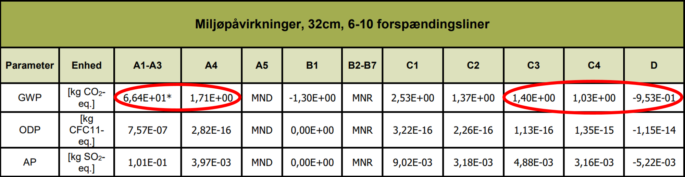{width="500" height="130"}

**Figur 6.1:** Eksempel på hvilket data fra miljøpåvirkningen der typisk anvendes for en EPD iht. +A1.

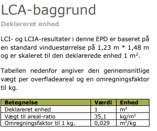{width="314" height="261"}

**Figur 6.2:** Eksempel på hvad der er relevant at forholde sig til i en EPD, som eksempel at kende til den deklarerede enhed, som oplyses i starten af EPD'en, for at vide hvad miljøpåvirkningen forholder sig til.

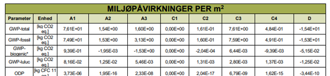{width="670" height="154"}

**Figur 6.3:** Eksempel på hvilket data fra miljøpåvirkningen, der typisk anvendes for en EPD iht. +A2. Når der anvendes EPD'er til opgørelse af klimapåvirkningen fra produkter, skal de moduler, der medregnes, stamme fra den samme EPD.

#### **1.6.4 Håndtering af modul C3/C4**

Ved anvendelse af EPD'er skal affaldsscenarierne (modul C3/C4), som de fremgår af EPD'en, anvendes i beregningen.

#### **1.6.5  Manglende C3 modul**

Hvis ikke der er en opgjort påvirkning for modul C3, så bruges kun C4 for endt-levetid.

#### **1.6.6 Forskellige scenarier for affaldshåndtering (C3/C4)**

Hvis en EPD i modul C3/C4 indeholder flere forskellige scenarier for affaldshåndtering (fx et scenarie for både genbrug og forbrænding), vil det relevante scenarie være det, som bedst beskriver den nuværende affaldshåndtering. Ved tvivl om scenariet, anbefales det at anvende det mest konservative for ikke at undervurdere bygningens påvirkning.

#### **1.6.7 Manglende scenarie for affaldshåndtering**

Hvis EPD'er hverken indeholder et C3- eller C4-modul, kan der anvendes et passende modul fra det generiske datagrundlag (BR18, bilag 2, tabel 7).

Der gøres opmærksom på, at sammensat data kun skal benyttes, hvis der ikke findes den nødvendige data indenfor samme datasæt af et materiale.

Hvis der mangler en værdi for D-modulet i EPD'en, anbefales det at sætte værdien til 0, da dette vil være på den mest konservative side.

For biogene materialer, hvor der mangler modul C3 og/eller C4, kan der være en forskel i det CO2-optag, der ligger i modul A1-A3, som kan afvige fra det CO2-udslip, der ligger i det valgte C3 og C4-modul. Dette er en usikkerhed, som pt. ikke kan imødekommes fuldt korrekt.

### 1.7. Byggeproces {#a6f69c03-c971-480c-81ca-cefcaf7991d1}

Fra 1. juli 2025 skal byggeprocessens klimapåvirkning opgøres i forbindelse med beregningerne af bygningers klimapåvirkning, og byggeprocessen skal overholde en selvstændig grænseværdi.

Byggeprocessens klimapåvirkning kommer primært fra transport af materialer og materiel til byggepladsen, energiforbrug på byggepladsen samt affaldshåndtering af byggeaffald og bortkørsel af byggeaffald og affaldsjord.

Man har flere forskellige muligheder for at dokumentere byggeprocessens klimapåvirkning. Dokumentationen kan basere sig på specifikke oplysninger fra byggeprocessen eller man kan benytte de standardværdier, der er indført i bygningsreglementets bilag 2. Denne tilgang sikrer, at man har forskellige måder at dokumentere på afhængigt af ens ønsker i den konkrete byggesag.

Grænseværdierne for modulerne A4-A5 (byggeprocessen), jf. § 298, stk. 5 og § 297, stk. 15, er hovedsageligt fastsat ud fra rapporten Ressourceforbrug på byggepladsen (BUILD Rapport 2023:14).

Opgørelsen af klimapåvirkning fra byggeprocessen følger standard DS/EN 15978:2012, dog med nogle modifikationer.

I det følgende gennemgås modulerne A4 og A5 samt de respektive modifikationer til standarden. Ved nogle af modifikationerne benyttes udtrykket "kan udelades". At der står "kan" understreger, at grænseværdien kun skal overholdes under iagttagelse af de data, der skal medregnes. Det vil dog omvendt ikke skulle anses for at være en fejl i beregningen, hvis de nævnte data alligevel er medtaget. Der er ikke pligt til at undtage dem.

Det skyldes, at de dele af beregningen udgør så relativt lille en del af det samlede resultat, at det ikke vil være meningsforstyrrende at have dem med i beregningen, og det kan være en praktisk fordel på byggepladsen, hvis der ikke skal bruges kræfter på at undtage dem.

#### **1.7.1 Transport (A4)**

Hvad er omfattet af standarden?

For transport til og fra byggepladsen skal følgende opgøres som følge af standarden (bygningsreglementets modifikationer til standarden fremgår efterfølgende):

- Transport af materialer og produkter fra fabrikken til byggeplads, inklusiv al transport, oplagring (terminalprocesser) og distribution
- Transport af materiel (kraner, stillads osv) til og fra byggepladsen

Transport af personer til og fra byggepladsen skal ikke inkluderes ifølge standarden.

*Hvordan afviger kravet i bygningsreglementet fra standarden?* 

Der er flere af de ovenstående processer, der er modificeret i bygningsreglementet, jf. § 297, stk. 9. Modifikationerne fremgår herunder:

-      Tab og beskadigelse af materialer under transport (i modul A4) kan udelades. Hvis man følger standarden, så skal tab og beskadigelse af materialer under transport medregnes. Derfor vil det belaste bygningens klimapåvirkning, hvis lastbilen på vej til byggepladsen er ude for en ulykke, der medfører beskadigelse af byggematerialerne. Dette behøver man dog ikke at indregne ifølge kravet, da det kunne påvirke resultatet på en måde som indretningen af byggepladsen ikke kan forhindre. Dette gælder ligeledes, hvis man ved levering af materialer kan konstatere, at der er beskadigelser eller defekte materialer, uden der er sket en ulykke. Hvis materialer imidlertid beskadiges på byggepladsen, så vil det dog indgå i byggeprocessens klimapåvirkning.
- Transport af materiel (i modul A4) der vejer under 1 ton kan udelades. Når man transporterer materiel (fx kraner og stilladser) til og fra byggepladsen, så behøver man ikke opgøre transporten for mindre materiel. Det er materiellets størrelse, og ikke transportens, som afgør om bagatelgrænsen anvendes. Et stillads skal opgøres som et stillads, også hvis stilladset er fordelt på flere sendinger.

- Transport af materialer, som ikke indgår i tabel 6, kan udelades. Det er kun nødvendigt at medregne transport af materialer for de materialer, der indgår i tabel 6. Det er således de samme materialer, som opgøres i A1-A3-modulerne.

*Principper for opgørelse*

Der er tre metoder til dokumentation af materialers transport fra fabrik til byggeplads, jf. teksten til bilag 2, tabel 10. Det er op til bygningsejer at vælge, hvilken metode, der anvendes for det enkelte materiale.

1)    Opgørelse med brændstof- og elforbrug. Det kan opgøres ved måling eller som beregnet ud fra antal kørte kilometer.

2)    Opgørelse baseret på data i EPD'er, jf. § 297, stk. 7.

3)    Opgørelse med standardværdierne i bilag 2, tabel 10

Hvis man bruger opgørelse baseret på data i EPD'er skal man være opmærksom på at de fleste EPD'er er baseret på en standardafstand og man skal derfor (ifølge afsnit 10.2.3 i EN15978) skalere resultatet i EPD'en hvis transportafstanden adskiller sig fra standardafstanden.

Der skal desuden indregnes en standardværdi for terminalprocesser på 0,02 kg CO~2~e/m²/år uanset hvilken af de tre metoder, der vælges. Terminalprocesser er bl.a. omlastning, ompakning og lignende.

Hvis en lastbil leverer materialer eller materiel til flere forskellige byggepladser skal beregningen fordeles ved en forholdsmæssig fordeling af forbruget blandt transportens leverancer jf. beregningsprincipperne i tabel 10. Det kan fx gøres ved at lave en vægt- og afstandsvægtet fordeling. Hvis opgørelsen foretages ud fra standardværdierne i tabel 10, er det ikke nødvendigt at foretage en forholdsmæssig fordeling.

Det er op til bygningsejer at foretage en beregning, som vurderes retvisende og forholdsmæssig. Det vil i sidste ende være op til bygningsmyndigheden at vurdere, om en anvendt beregning anerkendes som forholdsmæssig.

Nedenfor er et simpelt eksempel på en forholdsmæssig fordeling af transport med materiel eller materialer til flere byggepladser.

*Eksempel på beregning af klimapåvirkning ved levering af materiel og materialer til flere byggepladser*

*En lastbil kører med leverancer til to byggepladser fra Kolding mod Aarhus, men har også byggematerialer med til en byggeplads i Vejle. I Vejle leveres 40 pct. af byggematerialerne opgjort på vægt, mens resten leveres til byggepladsen i Aarhus. Der er 30 km fra Kolding til Vejle og 70 km fra Vejle til Aarhus. Dermed er der 100 km fra Kolding til Aarhus.*

*Den forholdsmæssige fordeling af forbruget kan foretages på følgende måde:*

*Først findes den samlede vægtning*

*Vejle: (40 pct. \* 30 km) / 100 km = 0,12*

*Aarhus: (60 pct. \* 100 km) / 100 km = 0,6*

*Samlet vægtning = 0,72*

*Procentmæssig fordeling af de enkelte kørsler på den samlede vægtning:*

*Vejle: 0,12/0,72 = 17 pct.*

*Aarhus: 0,6/0,72 = 83 pct.*

Man kan dermed benytte denne fordeling til at fordele brændstofforbruget på de enkelte leverancer.

Hvis der er flere byggepladser, som modtager materiel, deles udledningerne fra transport af materiellet forholdsmæssigt. Da man ifølge standarden skal medregne både transport af materiel til byggepladsen og transport af materiel væk fra byggepladsen, så kan man komme ud for at en kørsel med materiel både er en transport væk fra en byggeplads, mens det ligeledes er en transport hen til en anden byggeplads. Da udledningerne dermed vil skulle tildeles to forskellige byggepladser kan man dermed fordele CO2-udledningen mellem byggepladserne. Hvis man fx flytter en kran fra en byggeplads til en anden byggeplads, så kan man antage, at transporten tæller ligeværdigt med for begge byggepladser og man vil derfor kunne fordele transporten forholdsmæssigt. I en byggeplads med to ligeværdige byggepladser, vil det normalt være med 50 pct. til hver byggeplads.

Hvis man i stedet har en mere sammensat forsyningskæde for materiellet, så kan man fordele forholdsmæssigt. Nedenfor fremgår et eksempel.

Eksempel på beregning af klimapåvirkning ved materiellevering fra en byggeplads til flere andre byggepladser:

* *

Fx hvis en minigraver på 1,5 ton og en dumper på 2,6 ton hentes på en byggeplads i Slagelse og minigraveren afleveres på en byggeplads i Ringsted 30 km væk og dumperen afleveres på en byggeplads i Køge 55 km fra Slagelse, så kan et brændstofforbrug (CO2-udledningen) fordeles på følgende måde:

* *

*Samlet vægtning:*

*Ringsted: (1,5 ton / 4,1 tons) \* (30 km / 55 km) = 0,20*

*Køge: (2,6 ton / 4,1 ton) \* (55 km / 55 km) = 0,63*

*Samlet vægtning: 0,83*

Derefter kan udledningerne fordeles mellem de tre byggepladser. Byggepladsen i Slagelse tildeles halvdelen af udledningen fordi det er der materiellet hentes og halvdelen af transporten vil derfor være transport væk fra byggepladsen i Slagelse, mens den øvrige udledning fordeles mellem de to andre byggepladser.

* *

*Byggeplads i Ringsted: 0,20 / 0,83 \* 0,5 = 12 pct.*

*Byggeplads i Køge: 0,63 / 0,83 \* 0,5 = 38 pct.*

*Byggeplads i Slagelse: 50 pct.*

#### **1.7.2 Byggeproces (A5)**

*Hvad er omfattet af standarden?*

Klimapåvirkning fra selve byggeprocessen skal opgøres som følge af standarden.

Det vil sige, at klimapåvirkningen fra følgende processer skal opgøres ifølge standarden (bygningsreglementets modifikationer til standarden fremgår efterfølgende):

-       Jordarbejde og landskabsarbejde

-       Oplagring af byggematerialer, inklusiv energiforbrug forbundet med oplagring

-       Transport af byggematerialer, affald og materiel internt på matriklen

-       Midlertidige konstruktioner

-       On-site bearbejdning af et byggemateriale

-       Energiforbrug på byggepladsen

-       Montage af materialerne i bygningen, inklusiv brug af hjælpe-/interimsmaterialer ("ancillary materials")

-       Vandforbrug

*Hvordan afviger kravet i bygningsreglementet fra standarden?*

Der er flere af de ovenstående processer, der er modificeret i bygningsreglementet, jf. § 297, stk. 9. Modifikationerne fremgår herunder:

-    *Kun byggeproces (i modul A4 og A5) relateret til bygningens bebyggede areal, jf. BBR-bekendtgørelsen, er omfattet.* Der kan foregå andet arbejde på matriklen i forbindelse med en byggesag. Der skal dog kun medregnes den del af byggeprocessen, der henhører til det bebyggede areal, herunder eksempelvis byggemodning og terrænregulering. Derfor vil fx byggematerialer til støttemure i terræn og dieselforbrug til maskiner, der laver terrænregulering uden om bygningens areal, ikke indgå i opgørelsen af bygningens klimapåvirkning.

-     *Energiforbrug (i modul A5) fra maskiner, der vejer under 1 ton, kan udelades*. Man behøver ikke opgøre energiforbrug fra mindre maskiner. Det vil fx sige, at hvis man har en række håndværktøj eller mindre maskiner (fx en pladevibrator eller en motorbør), så behøver man dermed ikke indregne energiforbruget fra disse maskiner.

-    *Vandforbrug og forbrug af ikke-blivende materialer under byggeprocessen (i modul A5) undtages.* Vandforbruget under byggeprocessen skal ikke opgøres. Hvis der forbruges materialer i forbindelse med on-site bearbejdning af byggematerialer (fx sandpapir eller kemikalier til afrensning), skal det heller ikke medregnes.

Byggeprocessens klimapåvirkning skal herefter beregnes ved at opgøre brændsels-, el- og fjernvarmeforbrug på byggepladsen og omdanne dette forbrug til emissioner ved brug af bilag 2, tabel 8.1 og 8.2.

"Brug af hjælpe-/interimsmaterialer" er forbrug forbundet med at benytte materialerne, fx ophejsning af stillads. Produktion af interimsmaterialerne selv (stilladser, støbeforme) tæller ikke med.).

Produktion af materialer på pladsen, fx sammenstøbningsbeton indgår ikke i A5. Sådanne indgår i stedet i A1-A3, hvis de er med i bygningsmodellen (bilag 2, tabel 6). Fx er udfyldning mellem elementer (sammenstøbningsbeton) udtrykkeligt undtaget fra beregningen (se teksten til bilag 2, tabel 6) og derfor skal det hverken opgøres i A1-A3 eller A5.

I standarden fremgår det ikke klart om udledningerne fra præfabrikation af bygningselementer, som fx præfabrikerede trækassetter skal indgå i A1-A3 eller i A4-A5. Det er op til bygningsejer at vurdere, hvor det passer bedst, samt at sikre, at alle udledningerne bliver talt med.

Hvis der bygges flere bygninger fra samme byggeplads, eller hvis der både bygges en bygning og foretages et større jordarbejde, så kan energiforbruget være vanskeligt at beregne nøjagtigt. I så fald må foretages bedst kvalificerede skøn over forbruget. Det kan være ved at fordele et beregnet forbrug forholdsmæssigt mellem de forskellige delarbejder. Hvis der for eksempel bygges et klubhus til en fodboldklub samtidig med at der bygges en kunstbane til fodbold, så kan energiforbruget fordeles forholdsmæssigt mellem de to byggearbejder.

#### **1.7.3      Affaldshåndtering (A5)**

*Hvad er omfattet af standarden?*

For affaldshåndtering skal følgende opgøres som følge af standarden (bygningsreglementets modifikationer til standarden fremgår efterfølgende):

-       Affaldshåndtering af affald frembragt på byggepladsen

-       Transport af affald fra byggepladsen

*Hvordan afviger bygningsreglementets krav fra standarden?*

I bygningsreglementet er dette afgrænset til kun at være affaldshåndtering af byggeaffald relateret til bygningen og transport af affald (herunder jord som er affald) relateret til bygningen jf. nedenstående modifikationer:

-    *For behandling af affald indgår kun byggeaffald.* Når behandlingen af affald skal opgøres, skal man kun medregne byggeaffald jf. tabel 11. Man skal derfor ikke opgøre behandling af bortkørt jord og det almindelige husholdningsaffald eller lignende fra skurbyen.

-    *For transport af affald indgår kun byggeaffald og jord.* Transport af jordaffald indgår, men transport af jord, der ikke er affald, indgår ikke. Når transporten af affald skal opgøres, så skal man kun opgøre byggeaffald og bortkørt jord, hvis jorden er affald. Man skal derfor ikke opgøre transport af det almindelige husholdningsaffald eller lignende fra skurbyen. Affald forstås som defineret i affaldsbekendtgørelsen[&#91;1&#93;](#_ftn1){#_ftnref1} § 2. Miljøstyrelsen træffer afgørelse, om et stof eller en genstand er affald, jf. affaldsbekendtgørelsen § 4.

For bygninger med affaldsjord fra både opførelsen af en bygning og terrænarbejde skal man derfor fordele klimapåvirkningen mellem bygning og terrænarbejde.

*Eksempel på afgrænsning af byggeproces og affaldshåndtering på byggepladsen:*

På figur 7.1 vises forskellige områder for udgravning af jord. Det gule område illustrerer, hvor man skal opgøre klimapåvirkningerne og det røde område illustrerer, hvor man ikke skal opgøre klimapåvirkningerne.

Udgravning af jord kan fordeles efter fordelingstal mellem jordvolumenerne. På den øverste illustration i figur 7.1 udgøres den udgravede jord under bygninger fx 95 pct. af den samlede udgravede jord, mens den i den nederste illustration udgør fx 10 pct. Brændselsforbrug til gravemaskiner og til flytning af jord på matriklen kan derfor fordeles efter disse forholdstal. Dette gælder uanset om jorden er affald.

Bortkørsel af jord skal kun regnes med, hvis jorden er affald. Derfor kan ovenstående måde at fordele på ikke umiddelbart anvendes på bortkørsel. Som alternativ til den reelle opgørelse af forbruget til bortkørsel af affaldsjord kan standardværdierne i tabel 10 benyttes. Jord, som er affald, skal endvidere følge kommunens anvisning og er genstand for kontrolsystemer i henhold til affaldslovgivningen.

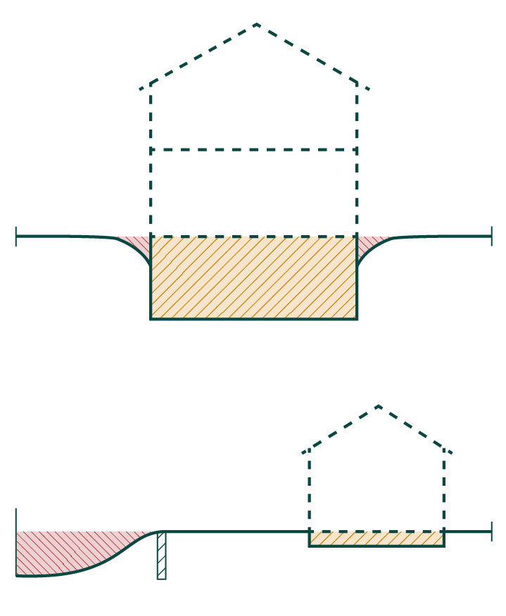{width="411" height="500"}

**Figur 7.1 -** afgrænsning af byggeproces og affaldshåndtering på byggepladsen.

------------------------------------------------------------------------

[&#91;1&#93;](#_ftnref1){#_ftn1} https://www.retsinformation.dk/eli/lta/2024/1749

### 1.8. Levetider {#b7facc0b-7a44-4398-be71-c1fd8daa0640}

Afvigelse fra levetidstabellenSom nærmere uddybet i vejledning: § 297, stk. 4, udføres beregningen for bygningers klimapåvirkning over en betragtningsperiode på 50 år. Det 50-årige perspektiv medfører, at beregningen skal inkludere klimapåvirkninger fra udskiftning af bygningsdele og materialer i løbet af denne betragtningsperiode.

For at vide hvornår udskiftningerne sker, skal der knyttes forventede levetider til bygningsdele og -materialer.

Levetider for bygningsdele er anført i rapporten BUILD RAPPORT 2021:32 -- BUILD levetidstabel -- Version 2021, [se her](https://vbn.aau.dk/ws/portalfiles/portal/465276076/BUILD_Levetidstabel_version_2021.pdf){rel="noopener" target="_blank"} (nyt vindue)*,* under rapportens bilag 4. Endvidere er principperne i rapportens kapitel 3 vigtige at forholde sig til.

Hvis levetiden af en konkret bygningsdel eller materiale er kortere end betragtningsperioden på 50 år, antages denne at skulle udskiftes i løbet af de 50 år, og dermed skal klimapåvirkningen fra den nye bygningsdel, der installeres, også medregnes i bygningens samlede klimaregnskab. Desuden skal klimapåvirkningen fra endt levetidsfasen for den erstattede/forrige bygningsdel eller materiale medregnes.

#### *Opgørelse af energiforbrug*

Klimapåvirkningerne fra udskiftninger opgøres samlet under modul B4: "Udskiftninger" for den pågældende bygningsdel eller materiale. Modul B4 kommer kun i spil, når bygningsdelen eller materialets levetid er under 50 år. Udskiftningen svarer til summen af udskiftninger, det vil sige modulerne A1-3 og C3-4 for den pågældende bygningsdel eller materiale. Dermed skal A4-A5 ikke medregnes ved udskiftninger. Dette er illustreret i figur 7.1.

Modul C3-C4 i endt-levetid regnes med, da det antages, at levetiden ophører ved slutningen af betragtningsperioden på 50 år, selv om den reelle levetid kan være længere.

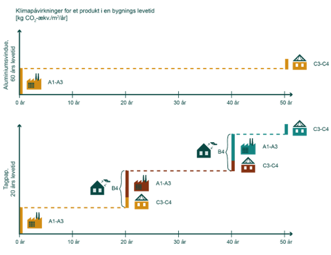{width="500" height="385"}

**Figur 8.1:** Ved en levetid under 25 år vil der være mindst to udskiftninger. Fx vil en bygningsdel eller et materiale med levetid på 20 år skulle medregnes tre gange. De påvirkninger, der medregnes ved to udskiftninger, vil for A1-A3 (produktion) falde i år 0, 20 og 40 og for C3 og/eller C4 (endt-levetid) i år 20, 40 og 50. Modul D er ikke vist på figuren.

#### *Forskel mellem udskiftninger og vedligehold*

Vedligehold af en bygning (modul B2) medregnes ikke i beregningen af bygningens klimapåvirkning, jf. § 297. Der fremgår derfor ikke levetider for maling, da fornyelse af maling er påvirkninger, der er del af modul B2 (vedligehold), men ikke del af udskiftninger (modul B4). Andet arbejde, som hører under vedligehold, som fx slibning af gulve, oliebehandling af træ mm. indgår heller ikke i beregningen.

Det er yderligere vigtig at fremhæve, at slutbehandlingen ved opførelsen af bygningen stadig medtages, jf. BR18, bilag 2, tabel 6. Her fremgår, at "Bygningsdele, der indgår i den færdige bygning som tag, ydervægge, indervægge, dæk og lignende, medregnes fra den indvendige overflade til den udvendige overflade". Hvis overflader udskiftes, medtages disse fortsat under modul B4.

#### *Afvigelse fra levetidstabellen*

I sjældne situationer er der behov for at anvende andre datakilder eller håndtere afvigelser i forhold til rapportens levetidstabel. For eksempel hvis tabellen ikke er dækkende, hvis materialet anvendes på en måde i bygningen som afviger fra den typiske anvendelse, eller hvis materialet har en påvist længere levetid, end hvad der fremgår af levetidstabellen. I afsnit 3.6 i BUILD rapport 2021:32 er opstillet en række principper for at anvende andre datakilder og håndtere afvigelser fra rapportens levetidstabel. Det er vigtigt at fremhæve, at principperne, jf. afsnit 3.6, skal følges, hvis der afviges fra levetidstabellen.

BUILD rapport 2021:32 angiver den tilstrækkelige dokumentation for eventuel afvigelse af levetidstabellen.

#### *Sammensatte bygningsdele*

Ved sammensatte bygningsdele, som ydervægge, tagopbygninger m.m., skal der tages stilling til, om der alt efter opbygningen er tale om en samlet levetid for bygningsdelen, eller om enkelte materialer kan udskiftes separat, dvs. uden destruktiv nedtagning.

Dette er nærmere beskrevet i afsnit 3.5 i BUILD rapport 2021:32. Hvis den sammensatte bygningsdel er opbygget således, at dele med kort levetid ikke er udskiftelige uden destruktiv nedtagning af dele med længere levetid, bestemmes levetiden af den sammensatte bygningsdel af delen med kortest levetid.

Eksempel

*Eksempel på fastsættelse af levetid ved sammensatte bygningsdele*

Ved opførelsen af bygningen vælges en løsning, som medfører, at byggemateriale A med en levetid på 30 år indbygges på en måde, så byggemateriale B med en levetid på 20 år ved udskiftning ikke kan fjernes uden at ødelægge byggemateriale A. På grund af denne sammensætning skal levetiden for den sammensatte bygningsdel dvs. byggemateriale A og B sættes til 20 år.

*Eksempel på håndtering af levetiden af et vindue som sammensat bygningskomponent*

Der henvises til levetidsrapporten fra BUILD "Levetidstabel BUILD 2021:32, Version 2021", som beskriver, at der kan antages forskellige udskiftningstidspunkter for komponenter i sammensatte bygningsdele, så længe udskiftningen ikke medfører at andre bygningsdele skal udskiftes i samme omgang.

Af levetidstabellen fremgår det, at vinduer har en levetid på 50 år eller 60 år, hvorimod termoruder har en levetid på 25 år. Hvis der anvendes et vindue, hvor ruden kan udskiftes uden destruktiv nedtagning af rammen/karmen, så kan ruden og ramme/karm have forskellige levetider. Hvis der derimod er tale om et vindue, hvor konstruktionsløsningen ikke muliggør en særskilt udskiftning af ruden, skal levetiden for hele vinduet sættes til 25 år.

*Eksempel: hvordan foretages beregningen i den ovenstående situation, hvis man vil anvende branche-EPD'er, hvor klimapåvirkningen kun angives samlet for hele vinduet?*

Samme princip gør sig gældende som beskrevet foroven. Der skal dog arbejdes med en mindre tilpasning i beregningen. De nuværende branche EPD'er angiver påvirkningen (deklarerede enhed) per m2 vindue, bestående af ramme/karm og rude samlet.

I forhold til princippet beskrevet i tidligere spørgsmål, at der kun skal regnes med en udskiftning af glasset undervejs i levetiden af vinduet også selv om den er håndteret af en branche-EPD så kan der tages branche EPD'en af vinduet, som regnes med 50 års levetid for vinduet, yderligere lægges en glasudskiftning ind efter 25 år.

### 1.9. Emissionsfaktorer {#f87ab10e-30e6-4998-9f70-3c43b33df6c2}

I en livscyklusvurdering ses på bygningens klimapåvirkning igennem en 50 års betragtningsperiode. Derfor medtages også brugsfasen, herunder modul B6, som dokumenterer klimapåvirkningen fra bygningens energibehov til drift.

I det følgende uddybes det, hvordan energiforbruget opgøres, og hvordan klimapåvirkningen for det pågældende forbrug beregnes ved hjælp af emissionsfaktorer.

Emissionsfaktorer er miljøpåvirkning for energiforsyninger opgjort pr. kWh.

Faktorer for el, fjernvarme og ledningsgas er baseret på 1 kWh og er fremskrevet i henhold til den forventede energiforsyning, jf. rapporten "Emissionsfaktorer El, fjernvarme og ledningsgas 2025-2075" (Artelia, 2023).

#### *Opgørelse af energiforbrug*

Bygningens energibehov kendes fra energirammeberegningen i bygningsreglementets

§§ 250 -- 256 eller fra standardværdier i bilag 2, tabel 12 og 13.

For alle bygninger skal energibehov til drift beregnes ud fra § 297, stk. 11 og 12, inkl. eventuelle tillæg hertil, jf. § 260, stk. 3. Det vil sige at bygninger der er underlagt energirammeberegningen i §§250-256 skal benytte denne som energibehov, mens andre opvarmede bygninger som tilbygninger eller sommerhuse kan vælge enten at beregne energibehovet ud fra tilsvarende energirammeberegning i §§250-256 eller benytte standardværdierne i bilag 2, tabel 12 og 13.

Det er energibehovet uden anvendelse af primærenergifaktorer, det vil sige fra den aktuelle energirammeberegning eller tabelværdi, der skal anvendes.

#### *Beregning af energiforbrugets klimapåvirkning i modul B6*

For at beregne klimapåvirkningen fra bygningens energiforbrug, anvendes emissionsfaktorerne, som er fastsat i BR18, bilag 2, tabel 8.1. På baggrund af det opgjorte energibehov, beregnes emissionerne for modul B6 ved at gange emissionsfaktorerne på det opgjorte energibehov (kWh/år). Modul B6 opgøres fra det år, hvor bygningen tages i brug, og med betragtningsperioden på 50 år.

Emissionsfaktorerne fremgår af BR18, bilag 2, tabel 8. Værdier efter 2050 fortsætter konstant.

Det er bygningens samlede energibehov, der skal medregnes i modul B6, det vil sige både el og varme. For eksempel gælder for en bygning, der er opvarmet med fjernvarme, at både el-behovet og fjernvarmebehovet opgøres. Derfor vil den samlede klimapåvirkning fra energiforbruget i bygningen opgøres ved, at man ganger det opgjorte el-behov med emissionsfaktoren for el og fjernvarmebehovet med emissionsfaktoren for fjernvarme.

#### *Indregning af el-produktion fra solceller og vindmøller*

Der kan indregnes bygningsintegreret el-produktion fra fx solceller eller vindmøller svarende til højst 25 kWh/m² pr. år opgjort i primærenergi. Det svarer således til en produktion på 13,2 kWh/m² pr. år. En bygning på 1.000 m² kan således højst indregne el-produktion svarende til 13.200 kWh pr. år i modul B6 i beregningen. Energibehovet til el kan derfor godt blive mindre end 0 kWh/m² pr. år, hvis el-behovet i bygningen er under 13,2 kWh/m² pr. år. Hvis man producerer mere elektricitet end 13,2 kWh/m² pr. år, så kan den resterende el-produktion godskrives i modul D med samme emissionsfaktorer, som den øvrige del af el-produktionen. Se nærmere vejledning: § 297, stk. 4, Livscyklus og betragtningsperiode.

Materialernes klimapåvirkning regnes kun med til den andel af solceller, hvis ydelse kan indregnes i energiberegningen. Dette er en afgrænsning, jf. BR18, bilag 2, tabel 6, under "Solcelleanlæg". Det vil sige, at kun materialernes klimapåvirkning fra de solceller, som er medregnet i bygningens driftsforbrug eller indgår som en del af tagbeklædningen, medtages i modulerne A1-5, B4, C3-4 og D.

#### *Brug af EPD'er for fjernvarmeværker*

Dette afsnit er relevant, hvis det fjernvarmeværk, som leverer varme til bygningen, som livscyklusvurderingen gennemføres for, har udarbejdet en specifik EPD for emissionsfaktorerne, og dermed ikke benytter emissionsfaktorerne for fjernvarme fra BR18, bilag 2, tabel 8.1.

Det er vigtigt at fremhæve, at en miljødeklaration, som fjernvarmeværker kan have liggende, som ikke er udført i henhold til ISO 14025, ikke er betragtet som gyldig i forhold til beregning af bygningers klimapåvirkning. Forskellen ligger bl.a. i, at miljødeklarationen ikke ser på hele livscyklussen, dvs. for eksempel ikke tager produktionen af energianlæggene med. En miljødeklaration vil derfor typisk have en lavere klimapåvirkning end en EPD, jf. ISO 14025.

Et lokalt fjernvarmeværk kan udarbejde en EPD for sin konkrete varmeforsyning, som kan benyttes til beregning af bygningers klimapåvirkning, i stedet for de generiske emissionsfaktorer opgjort i BR18, bilag 2, tabel 8.1. EPD'en skal være udført iht. ISO 14025. Lokale emissionsfaktorer kan erstatte hele eller dele af de generiske emissionsfaktorer, afhængigt af, hvordan de lokale emissionsfaktorer er udarbejdet.

Hvis et fjernvarmeværk kan dokumentere en 2025-værdi for deres fjernvarmeområde, der er lavere end de generiske værdier i BR18, bilag 2, tabel 8.1, kan bygningsejer benytte den specifikke værdi for 2025 frem til den ikke længere er lavere end de generiske værdier. Herefter skal de generiske værdier benyttes.

Hvis en EPD indeholder en fremskrivning baseret på projektgodkendte anlæg i henhold til varmeforsyningsloven, kan fremskrivningerne ligeledes erstatte værdier i datasættet, hvis de specifikke værdier er lavere end de generiske værdier.

### 1.10. Lavemissionsklassen {#493fac9a-6198-41c1-a9ec-c88b8129d92d}

Aftalen om national strategi for bæredygtigt byggeri giver mulighed for at overholde en frivillig lavemissionsklasse. Grænseværdierne for lavemissionsklassen er tilsvarende grænseværdierne i § 298 stk. 1 og 5 differentieret på baggrund af bygningstype. Lavemissionsklassen skal fremme interessen for at begrænse klimapåvirkningen fra bygninger yderligere.

I forbindelse med indsendelse af dokumentation for nye bygningers klimapåvirkning, er det muligt at fremhæve, at påvirkningen opfylder lavemissionsklassen, såfremt beregningen for den pågældende bygning er inden for de i § 297 stk. 13 og 15 angivne værdier.

I opgørelse af klimapåvirkningen for lavemissionsklassen skal de justeringer, der fremgår af § 298, stk. 2-8, anvendes. Det vil sige, at beregningen svarer til den, der laves iht. § 298.

### 1.11. Standardformat til LCA aflevering {#849da573-be32-4ba4-a8c3-7419bbbbb383}

I forbindelse med indsendelse af dokumentation for nye bygningers klimapåvirkning ved færdigmelding jf. § 40, er det muligt at benytte følgende frivillige standardformat: [Standardformat for LCA-dokumentation](../../../../media/nlbi4r0x/standardformat-for-lca-dokumentation_2025.xlsx "Standardformat For Lca Dokumentation 2025"){rel="noopener" target="_blank"}

For bygninger omfattet af § 297 skal der afleveres en dokumentation for klimapåvirkningen. Standardformatet skal være med til at gøre afleveringen af denne dokumentationen mere ensartet og struktureret, hvorved det kan understøtte indsamling af LCA-data for at give forskning og branchen bedre muligheder for læring.

### 1.12. Grænseværdi {#b522b6b0-154c-4c56-85b9-92cde139b124}

Formålet med at fastsætte en grænseværdi er at begrænse klimapåvirkningen gennem bygningens livscyklus ved opførelsen af nye bygninger.

Det er kun bygninger, der er omfattet af § 297, som skal overholde en grænseværdi. Beregningen foretages på baggrund af § 297, med de justeringer, der fremgår af § 298, stk. 7-8.

Grænseværdierne er differentierede på baggrund af bygningstyper, jf. § 298 stk. 1.

Der er to grænseværdier, man skal forholde sig til. Den ene grænseværdi (for bygninger) er differentieret på baggrund af bygningstype, jf. § 298, stk. 1, og omfatter modulerne A1-A3, B4, B6 og C3-C4 samlet set. Den anden grænseværdi (for byggeprocessen) er fastsat til 1,5 kg CO2-ækvivalenter pr. m2 pr. år for alle bygningstyper og omfatter modulerne A4-A5 jf. § 298 stk. 5.

For den differentierede grænseværdi, skal den konkrete bygning overholde den grænseværdi der gælder for den bygningstype, der opføres.

Hvis en bygning har flere anvendelser, der er underlagt forskellige grænseværdier, foretages en arealvægtet beregning for at få grænseværdien for den pågældende bygning. Det kan typisk gøre sig gældende når der i en samlet bygning er arealer med forskellige grænseværdier. Det kunne for eksempel være en bygning med både en butik og et parkeringshus eller en restaurant i en beboelsesbygning eller kontorbygning.

*Eksempel på beregning ved blandet anvendelse*

Hvis der i samme byggeri samlet opføres 1.800 m^2^, hvoraf fx stueetagen på 300 m^2^ (17%) er daginstitution (grænseværdi på 8,0) og øvrige etager på 1.500 m^2^ (83%) er etagebolig (grænseværdi på 7,5) vil grænseværdien for den pågældende bygning være:

(0,17 \* 8 kg CO~2~-ækvivalenter pr. m^2^ pr. år) + (0,83 \* 7,5 kg CO~2~-ækvivalenter pr. m^2^ pr. år) = 7,58, som afrundes til 7,6 kg CO~2~-ækvivalenter pr. m^2^ pr. år.

*Hvornår er det blandet anvendelse?*

I nogle tilfælde vil der indgå servicearealer (f.eks. kantine, fællesrum mm.), i en bygning, der udgør beboelse. Et eksempel er plejecentre, som utvivlsomt er et sted hvor folk bor, men hvor der samtidig findes en del arealer, som typisk ikke findes i almindelige etageboliger. Her kan spørgsmålet opstå, om bygningen da skal anses for beboelse, for øvrigt byggeri, eller for blandet anvendelse.

Som udgangspunkt vil fællesarealer i tilknytning til beboelse være at anse for beboelse. At et areal benyttes fælles for en række beboere, er ikke ensbetydende med, at arealerne ikke er beboelse. Der vil ofte heller ikke være andet end en dør imellem arealerne. Bygninger som anvendes til plejehjem kan også som udgangspunkt kaldes beboelse, og et fælles køkken for beboerne udgør ikke en selvstændig anvendelse andet end beboelse.

Derimod kan (særskilte) administrative bygninger, fx plejepersonales kontorer og pauselokaler, ofte ikke anses for beboelse men må kategoriseres som øvrigt.

Derimellem kan opstå en række situationer, hvor det kan være op til en konkret vurdering at tage stilling til, om en kantine udgør en del af beboelsen eller er et selvstændigt areal som må kategoriseres som andet. Såfremt det er tilfældet, og fx kantineområdet kategoriseres som andet men samtidig er del af den samme fysiske bygning som beboelsesområdet, må der foretages en arealvægtet beregning for at finde bygningens grænseværdi, jf. § 298 stk. 4.

For bygninger der har særlige forhold eller tillæg til energirammen, medfører det, at der skal dokumenteres to beregninger af bygningens klimapåvirkning -- en samlet beregning, jf. § 297, og en samlet beregning, jf. § 298.

Grænseværdien er angivet med én decimal i bestemmelsen. Det betyder, at fx et resultat på 6,73 for et rækkehus vil holde sig inden for grænseværdien, da der afrundes til 6,7.

Dokumentationen skal følge kravene, jf. § 40. [Se Vejledning om dokumentation af bygningsreglementets tekniske bestemmelser i forbindelse med færdigmelding af byggeriet (nyt vindue).](../../../../administrative-bestemmelser/brv/dokumentationsvejledning/dokumentationsvejledning){rel="noopener" target="_blank"}

Der kan med fordel udarbejdes beregninger for byggeriet fra de tidlige designfaser, så risikoen for overskridelse minimeres.

### 1.13. Modul D {#ef01f42f-058d-47f7-8294-c506727de71c}

Grænseværdien, der fremgår af § 298, stk. 1, for bygningens klimapåvirkning skal overholdes ved den samlede opgørelse for modul A1-A3, B4, B6, C3 og C4. Da modul D dokumenterer potentiale for nyttiggørelse, som fx potentiel substitution af ressourcer efter bygningens livscyklus er ophørt, skal potentielle klimapåvirkninger fra dette modul ikke indgå i beregningen af overholdelse af grænseværdien.

Potentielle klimabesparelser opgjort i kg CO~2~-ækvivalenter pr. m^2^ pr. år dokumenteres derfor separat i modul D, jf. § 297, stk. 4. Klimabesparelsen dokumenteret i modul D medregnes ikke ved dokumentation af, at grænseværdien er overholdt, jf. § 298.

### 2.4. Særlige forhold {#5b13625d-860e-4dd3-abef-ba4361094a44}

Grænseværdierne, jf. § 298, stk. 1 og § 297, stk. 9, er hovedsageligt fastsat ud fra erfaringer om almindeligt dansk byggeri, dvs. bygninger, som ikke har særlige bygningsfunktioner, jf. rapporten *Klimapåvirkninger fra 60 bygninger* (BUILD Rapport 2021:13).

Visse bygninger med særlige forhold kan have et berettiget behov for at anvende bestemte materialer eller mængder af materialer, der kan påvirke muligheden for at overholde grænseværdien for klimapåvirkning, som fx sygehuse. Det nødvendige materialeforbrug kan være specielle materialer eller ekstra materialemængder.

Det kan være nyttigt at afklare forståelsen af, om en bygning vurderes at havde særlige forhold, der kan give et berettig behovor øget klimapåvirkning, med kommunen ved forhåndsdialog.

Kun den del af klimapåvirkningen, som er en følge af det særlige forhold, er omfattet af undtagelsen. Hvis en del af en bygning er påvirket af det særlige forhold, men resten af bygningen ikke er, så er den øvrige del af bygningen ikke omfattet af undtagelsen.

Følgende eksempler er udelukkende af vejledende karakter, og det skal altid vurderes i den konkrete byggesag, om der er tale om særlige forhold eller ej.

|  |
|:---------------------------------------------------------------------|
|  **Eksempler på bygningers funktion og placering, der kan medføre en nødvendig øget klimapåvirkning (listen er ikke udtømmende)** |
|  Anvendelse af hospitals- og laboratorieudstyr (bygningens funktion) |
|  Høj last på dæk og andre påvirkede konstruktionsdele (bygningens anvendelse |
|  Ekstra højt sikkerhedsniveau (konsekvensklasse CC3+) (bygningens funktion) |
|  Særlige jordbundsforhold, herunder vandtryk (bygningens placering) |
|  Høje renhedskrav (bygningens funktion) |
|  Sikringskrav (bygningens funktion) |
|  Krav om særlig udformning som følge af planlovgivningen (bygningens placering) |

|  |
|:---|
|  **Eksempler på forhold der ikke tænkes omfattet af undtagelsen (listen er ikke udtømmende)** |
|  Æstetiske hensyn (bygningsejerens valg af udformning) |
|  Store rumvolumener |
|  Parkeringskældre |
|  Mange rum- og brandadskillelser |

### *Beregning af det tillægsgivende forhold*

Det er op til bygningsejer at redegøre for, at der er tale om et særligt forhold. Dette skal fremgå af dokumentationen, jf. §40. Beregningen af, hvor stor en del af bygningens klimapåvirkning, som ikke skal medregnes, foretages efter anvisningerne i BR18, bilag 2, tabel 9. Tabellen indeholder referenceværdier for konstruktioner uden særlige forhold.

Af BR18, bilag 2, tabel 9, fremgår også fire formler (Formel 1, 2, 3 og

4), der skal anvendes til beregning af forskellen.

- Formel 1 anvendes, hvis konstruktioner som etage- og kælderdæk, gulv, loft, vægge, tage, terrændæk og pladefundamenter er påvirket af et særlige forhold.
- Formel 2 anvendes, hvis søjler eller bjælker er påvirket af et særlige forhold.
- Formel 3 anvendes, hvis fundamenter, som ikke er pladefundamenter, er påvirket af et særlige forhold.
- Formel 4 anvendes, hvis installationer er påvirket af et særlige forhold.

Forskellen mellem påvirkningen af den faktiske bygningsdel og bygningsdelen, som den beregnes ifølge BR18, bilag 2, tabel 9, medtages ikke i det samlede resultat, jf. § 298.

Såfremt resultatet af Formel 1, 3 eller 4 er mindre end 0, udgør det særlige forhold under alle omstændigheder ikke et problem, da klimapåvirkningen fra bygningsdelen holder sig under referenceværdien for en almindelig bygning.

## Eksempel

### *Eksempel på beregning af tillæg ved høj last*

En produktionsbygning har behov for særlig høj last på en del af etagedækket grundet tungt procesudstyr. Den høje last vurderes for værende et særligt forhold. Formel 1 anvendes for at beregne forskellen og dermed den øgede klimapåvirkning, som ikke skal indgå i grænseværdien, jf. § 298, stk. 1.

Formel 1: ((x / 50 år) -- (r

m)) / a

hvor

x er klimapåvirkningen fra materialerne i den pågældende bygningskonstruktion (i kg CO~2~-ækv.) opgjort over den 50-årige betragtningsperiode, r er referenceværdien for den givne konstruktion (i kg CO~2~-ækv. /m^2^ /år), m er arealet af den konstruktion, som berøres af det særlige forhold (i m^2^), o a er arealet som opgjort ifølge § 297, stk. 3, (i m^2^).

Bygningen er på 2.000 m^2^ referenceareal (referenceareal beregnes, jf. § 297, stk. 3), og den særligt høje last forekommer på et areal på 500 m^2^ af etagedækket. Etagedækket designes i det område både tykkere og med kraftigere armering, hvilket medfører, at konstruktionen i det område har en CO~2~ udledning på 50.000 kg CO~2~-ækvivalenter. Bygningsejer beregner vha. referenceværdierne i BR18, bilag 2, tabel 9, og Formel 1, hvor stor en ekstra klimapåvirkning, som etagedækket har i forhold til en almindelig referencebygning. Arealet, jf. § 297, stk. 3, er på 2.000 m2.

((50.000 kg CO2-ækv. / 50 år) -- (1,30 kg CO2-ækv. /m2 /år 500 m2)) / 2000 m2 = 0,175 kg CO2-ækv./m2/år

Bygningsejer når derefter frem til, at bygningens særlige forhold udviser en merudledning af kg CO~2~-ækv. på = 0,175 kg CO~2~-ækv./m^2^ /år, i forhold til en referencebygning. Bygningsejer trækker derefter 0,175 fra det samlede resultat, og kan nu konstatere, om bygningen samlet set -- med iagttagelse af det særlige forhold - overholder grænseværdien på 12,0 kg CO~2~-ækv./m^2^/år.

## *Uddybende om eksemplerne på særlige forhold*

I det følgende uddybes hvilke forhold, som følge af de særlige funktioner, placeringer og lignende, der kan give anledning til høj klimapåvirkning.

### *Anvendelse af hospitals- og laboratorieudstyr*

Funktionaliteten af hospitals- og laboratorieudstyr sætter krav til bygningskonstruktionerne. Disse krav kan fx skyldes vibrationsfølsomt udstyr, røntgen- og partikelstråling i forbindelse med strålekanoner m.m. Kravene resulterer ofte i flere dobbeltkonstruktioner, fx vægge og massive bundplader, hvilket medfører en høj klimapåvirkning. Både vibrationsdæmpning og afskærmning fra stråling er dokumenterbare behov i bygningen, og anses derfor for at være et særligt forhold.

### *Høj last på dæk og andre påvirkede konstruktionsdele*

I bygninger med tung transport som for eksempel gaffel truck, tungt udstyr, såsom procesudstyr, eller lignende inden for bygningens klimaskærm, kan forekomme en høj last på dækket. Den høje last skyldes selve bygningens anvendelse, og kan medføre en højere klimapåvirkning grundet øgede dimensioner eller en begrænsning af materialevalget. Der kan altså forekomme situationer, hvor høj last på dækkonstruktionen eller bjælker og andre påvirkede konstruktionsdele anses som en særlig forudsætning for at kunne anvende bygningen efter sit formål.

Almindelige forekommende laster i kontorbygninger, butikker, institutioner, industri, lager og lignende iht. til DS/EN 1991-1-1 inklusiv DS/EN 1991-1-1 DK NA er ikke omfattet af dette særlige forhold.

### *Bygninger indplaceret i konsekvensklasse CC3*

For specifikke konstruktioner, hvor konsekvenser ved svigt i de bærende konstruktioner er alvorlige (CC3 jf. DS/EN 1990), kan konsekvenserne imødegås ved en forøgelse af sikkerhedsniveauet og dermed materialemængden, hvilket kan øge bygningens klimapåvirkning. Dette gælder bl.a. bolig-, kontor-, hospital- og undervisningsbyggeri i flere etager med mere en 12 m over terræn, byggeri med tribuner eller store spændvidder, der benyttes af mange personer som fx til forsamling, koncerter, teater, udstillinger og sport.

For de specifikke konstruktioner, hvor konsekvenser i svigt af de bærende konstruktioner er særligt alvorlige (CC3), og dette medfører en forøgelse af materialemængden, vil dette normalt være et særligt forhold.

### *Jordbundsforhold*

De aktuelle jordbundsforhold kan have stor betydning for mængden af materialer under terræn, hvis en bygning fx skal pælefunderes som følge af de særlige jordbundsforhold, fx dårlig bæreevne af jorden under bygningen, eller at bygningen opføres på en hældende grund. Opføres et byggeri på en grund med et højt grundvandsspejl, kan dette ligeledes øge materialeforbruget under terræn og dermed klimapåvirkningen fra disse. I begge tilfælde er der tale om særlige forhold.

Særlige jordbundsforhold kan ligeledes være højt grundvandsspejl på konstruktioner under jorden. Parkeringskældre er ikke i sig selv særlige i forhold til almindelige bygningers funktion, men kan ofte være forbundet med et særligt forhold i form af behov for sikring mod indtrængende vand på grund af jordbundsforholdene, hvor bygningen er placeret. Det er op til en konkret vurdering af behovet.

### *Bygninger med høje renhedskrav*

Ved opførelse af byggeri med høje renhedskrav som fx hospitaler, laboratorier og produktionsfaciliteter, stilles der krav til bygningsmaterialernes egnethed til de aktiviteter, der skal foregå i de enkelte rum. Ved høje renhedskrav skal der anvendes særlige materialer, som kan medføre yderligere klimapåvirkning, og renhedskravene vil derfor anses som særlige forhold.

### *Bygninger med sikringskrav*

Bygninger med specielle sikringskrav som fx museer, militære installationer, hospitaler og fængsler, kan have en højere klimapåvirkning for nogle konstruktioner end konventionelt byggeri. Overholdelse af sikringskravene kan være en nødvendighed for opretholdelse af disse bygningstypers funktionalitet og behov, og sikringskrav til bygninger kan på baggrund af dette anses for et særligt forhold.

### *Krav som følge af gældende plangrundlag*

Hvis en lokalplan stiller detaljerede krav til en bygnings udformning på bestemte steder, fx i forbindelse med krav om særlig byggestil i bevaringsværdigt bymiljø eller andre krav til bygningens fysiske fremtoning, kan dette krav resultere i en øget klimapåvirkning. Eftersom kravet som følge af plangrundlaget relaterer sig direkte til, hvor bygningen geografisk befinder sig, kan det ifølge § 298, stk. 4, anses for at være en følge af bygningens særlige placering. Der kan sondres mellem hensyn som følge af plankrav og bygningsejers egne valg af udformning. Førstenævnte kan henføres til en placering, sidstnævnte ikke. Ved behov kan der indledes en dialog med kommunen om byggeriet i forhold til lokalplanens krav.

### 1.14. Energitillæg {#982dcb96-508a-4510-988f-6075b56a2c68}

Bygninger med behov for ekstra højt energiforbrug, som fx svømmehaller, hvor der er behov for høj rumtemperatur eller lignende, vil have højere CO2-udledning fra bygningsdriften. Der er derfor indført en bestemmelse for at sikre, at disse bygninger ikke har sværere ved at overholde grænseværdien end tilsvarende bygninger uden disse høje energiforbrug.

For bygninger, der har et tillæg, jf. § 260, gælder, at det energibehov, som medfører tillægget, ikke indgår i beregningen for overholdelsen af grænseværdien. Det betyder, at man gennemfører beregningen, der skal dokumentere overholdelse af grænseværdien, uden tillægsgivende forhold. Dette svarer til den Be18-beregning der omtales i referenceberegningen i SBi 213.

#### **1.14.1 Eksempler**

Eksempel på beregning af tillæg ved høj rumtemperatur

I en svømmehal er der behov for at sikre en rumtemperatur på 28 °C. For at vise overholdelse af energirammen anvendes en rumtemperatur på 20 °C. Forskellen på den reelle rumtemperaturen på 28 °C og standardværdien på 20°C er således det tillægsgivende forhold. Ved eftervisning af overholdelse af grænseværdien i § 298 skal der således anvendes beregningen af energibehov i det tilfælde, hvor

rumtemperaturen er reduceret til 20 °C.

Eksempel på beregning af tillæg ved høj ventilationsmængde

En undervisningsbygning har på grund af høj persontæthed brug for en høj ventilationsmængde af hensyn til indeluftens kvalitet. Det betyder, at bygningen indrettes efter en ventilationsmængde på 2,0 l/s pr. m². I energirammeberegningen kan der derfor opnås tillæg for ventilationsmængde over 1,2 l/s pr. m2. I eftervisning af overholdelse af grænseværdien, jf. § 298, benyttes derfor energibehovet fra den energirammeberegning, hvor luftmængden er fastlagt til 1,2 l/s pr. m2.

### 1.15. Særlige forhold {#5102cdfe-a67f-4fb8-94f1-756240473ea4}

Grænseværdierne, jf. § 298, stk. 1 og § 297, stk. 13, er hovedsageligt fastsat ud fra erfaringer om almindeligt dansk byggeri, dvs. bygninger, som ikke har særlige bygningsfunktioner, jf. rapporten Klimapåvirkning fra nybyggeri (BUILD Rapport 2023:21).

Visse bygninger med særlige forhold kan have et berettiget behov for at anvende bestemte materialer eller mængder af materialer, der kan påvirke muligheden for at overholde grænseværdien for klimapåvirkning, som fx laboratorier. Det nødvendige materialeforbrug kan være specielle materialer eller ekstra materialemængder.

Det kan være nyttigt at afklare forståelsen af, om en bygning vurderes at have særlige forhold, der kan give et berettiget behov for øget klimapåvirkning, med kommunen ved forhåndsdialog.

Kun den del af klimapåvirkningen, som er en følge af det særlige forhold, er omfattet af undtagelsen. Hvis en del af en bygning er påvirket af det særlige forhold, men resten af bygningen ikke er, så er den øvrige del af bygningen ikke omfattet af undtagelsen.

Følgende eksempler er udelukkende af vejledende karakter, og det skal altid vurderes i den konkrete byggesag, om der er tale om særlige forhold eller ej.

|  |
|:---|
| **Eksempler på bygningers funktion og placering, der kan medføre en nødvendig øget klimapåvirkning (listen er ikke udtømmende)** |
| Anvendelse af laboratorieudstyr (bygningens funktion) |
| Høj last på dæk og andre påvirkede konstruktionsdele (bygningens anvendelse) |
| Ekstra højt sikkerhedsniveau (konsekvensklasse CC3) (bygningens funktion) |
| Særlige jordbundsforhold, herunder vandtryk eller blød bund (bygningens placering) |
| Høje renhedskrav (bygningens funktion) |
| Sikringskrav (bygningens funktion) |
| Krav om særlig udformning som følge af planlovgivningen (bygningens placering) |

|  |
|:---|
| **Eksempler på forhold der ikke tænkes omfattet af undtagelsen (listen er ikke udtømmende)** |
| Æstetiske hensyn (bygningsejerens valg af udformning) |
| Store rumvolumener |
| Parkeringskældre |
| Mange rum- og brandadskillelser |

*Beregning af det tillægsgivende forhold*

Det er op til bygningsejer at redegøre for, at der er tale om et særligt forhold. Dette skal fremgå af dokumentationen, jf. §40. Beregningen af, hvor stor en del af bygningens klimapåvirkning, som ikke skal medregnes, foretages efter anvisningerne i BR18, bilag 2, tabel 9. Tabellen indeholder referenceværdier for konstruktioner uden særlige forhold.

Af BR18, bilag 2, tabel 9, fremgår også fire formler (Formel 1, 2, 3 og

4), der skal anvendes til beregning af forskellen.

·         Formel 1 anvendes, hvis konstruktioner som etage- og kælderdæk, gulv, loft, vægge, tage, terrændæk og pladefundamenter er påvirket af et særligt forhold.

·         Formel 2 anvendes, hvis søjler eller bjælker er påvirket af et særligt forhold.

·         Formel 3 anvendes, hvis fundamenter, som ikke er pladefundamenter, er påvirket af et særligt forhold.

·         Formel 4 anvendes, hvis installationer er påvirket af et særligt forhold.

Forskellen mellem påvirkningen af den faktiske bygningsdel og bygningsdelen, som den beregnes ifølge BR18, bilag 2, tabel 9, medtages ikke i det samlede resultat, jf. § 298.

Såfremt resultatet af Formel 1, 3 eller 4 er mindre end 0, udgør det særlige forhold under alle omstændigheder ikke et problem, da klimapåvirkningen fra bygningsdelen holder sig under referenceværdien for en almindelig bygning.

#### **1.15.1 Eksempel** 

*Eksempel på beregning af tillæg ved høj last*

En produktionsbygning har behov for særlig høj last på en del af etagedækket grundet tungt procesudstyr. Den høje last vurderes for værende et særligt forhold. Formel 1 anvendes for at beregne forskellen og dermed den øgede klimapåvirkning, som ikke skal indgå i grænseværdien, jf. § 298, stk. 1.

Formel 1: ((x / 50 år) -- (r ×

m)) / a

Hvor

x er klimapåvirkningen fra materialerne i den pågældende bygningskonstruktion (i kg CO~2~-ækv.) opgjort over den 50-årige betragtningsperiode, r er referenceværdien for den givne konstruktion (i kg CO~2~-ækv. /m^2^ /år), m er arealet af den konstruktion, som berøres af det særlige forhold (i m^2^) og a er arealet som opgjort ifølge § 297, stk. 3, (i m^2^).

Bygningen er på 2.000 m^2^ referenceareal (referenceareal beregnes, jf. § 297, stk. 3), og den særligt høje last forekommer på et areal på 500 m^2^ af etagedækket. Etagedækket designes i det område både tykkere og med kraftigere armering, hvilket medfører, at konstruktionen i det område har en CO~2~ udledning på 50.000 kg CO~2~-ækvivalenter. Bygningsejer beregner vha. referenceværdierne i BR18, bilag 2, tabel 9, og Formel 1, hvor stor en ekstra klimapåvirkning, som etagedækket har i forhold til en almindelig referencebygning.

((50.000 kg CO~2~‐ækv. / 50 år) -- (0,99 kg CO~2~‐ækv. /m^2^ /år × 500 m^2^)) / 2000 m^2^ = 0,253 kg CO~2~‐ækv./m^2^/år

Bygningsejer når derefter frem til, at bygningens særlige forhold udviser en merudledning på = 0,253 kg CO~2~-ækv./m^2^ /år, i forhold til en referencebygning. Bygningsejer trækker derefter 0,253 fra det samlede resultat, og kan nu konstatere, om bygningen samlet set -- med iagttagelse af det særlige forhold - overholder grænseværdien.

#### 1.15.2    Uddybende om eksemplerne på særlige forhold

I det følgende uddybes hvilke forhold, som følge af de særlige funktioner, placeringer og lignende, der kan give anledning til høj klimapåvirkning.

*Anvendelse af laboratorieudstyr*

Funktionaliteten af laboratorieudstyr sætter krav til bygningskonstruktionerne. Disse krav kan fx skyldes vibrationsfølsomt udstyr, røntgen- og partikelstråling i forbindelse med strålekanoner m.m. Kravene resulterer ofte i flere dobbeltkonstruktioner, fx vægge og massive bundplader, hvilket medfører en høj klimapåvirkning. Både vibrationsdæmpning og afskærmning fra stråling er dokumenterbare behov i bygningen, og anses derfor for at være et særligt forhold.

*Høj last på dæk og andre påvirkede konstruktionsdele*

I bygninger med tung transport som for eksempel gaffeltruck, tungt udstyr, såsom procesudstyr, eller lignende inden for bygningens klimaskærm, kan forekomme en høj last på dækket. Den høje last skyldes selve bygningens anvendelse, og kan medføre en højere klimapåvirkning grundet øgede dimensioner eller en begrænsning af materialevalget. Der kan altså forekomme situationer, hvor høj last på dækkonstruktionen eller bjælker og andre påvirkede konstruktionsdele anses som en særlig forudsætning for at kunne anvende bygningen efter sit formål.

Almindelige forekommende laster i kontorbygninger, butikker, institutioner, industri, lager og lignende iht. til DS/EN 1991-1-1 inklusiv DS/EN 1991-1-1 DK NA er ikke omfattet af dette særlige forhold.

*Bygninger indplaceret i konsekvensklasse CC3*

For specifikke konstruktioner, hvor konsekvenser ved svigt i de bærende konstruktioner er alvorlige (CC3+ jf. DS/EN 1990), kan konsekvenserne imødegås ved en forøgelse af sikkerhedsniveauet og dermed materialemængden, hvilket kan øge bygningens klimapåvirkning. Dette gælder bl.a. bolig-, kontor-, hospital- og undervisningsbyggeri i flere etager med mere end 12 m over terræn, byggeri med tribuner eller store spændvidder, der benyttes af mange personer som fx til forsamling, koncerter, teater, udstillinger og sport.

For de specifikke konstruktioner, hvor konsekvenser i svigt af de bærende konstruktioner er særligt alvorlige (CC3), og dette medfører en forøgelse af materialemængden, vil dette normalt være et særligt forhold.

*Jordbundsforhold*

De aktuelle jordbundsforhold kan have stor betydning for mængden af materialer under terræn, hvis en bygning fx skal pælefunderes som følge af de særlige jordbundsforhold, fx dårlig bæreevne af jorden under bygningen, eller at bygningen opføres på en hældende grund. Opføres et byggeri på en grund med et højt grundvandsspejl, kan dette ligeledes øge materialeforbruget under terræn og dermed klimapåvirkningen fra disse. I begge tilfælde er der tale om særlige forhold.

Særlige jordbundsforhold kan ligeledes være højt grundvandsspejl på konstruktioner under jorden. Parkeringskældre er ikke i sig selv særlige i forhold til almindelige bygningers funktion, men kan ofte være forbundet med et særligt forhold i form af behov for sikring mod indtrængende vand på grund af jordbundsforholdene, hvor bygningen er placeret. Det er op til en konkret vurdering af behovet.

*Bygninger med høje renhedskrav*

Ved opførelse af byggeri med høje renhedskrav som fx hospitaler, laboratorier og produktionsfaciliteter, stilles der krav til bygningsmaterialernes egnethed til de aktiviteter, der skal foregå i de enkelte rum. Ved høje renhedskrav skal der anvendes særlige materialer, som kan medføre yderligere klimapåvirkning, og renhedskravene vil derfor anses som særlige forhold.

*Bygninger med sikringskrav*

Bygninger med specielle sikringskrav som fx museer og sikrede døgninstitutioner, kan have en højere klimapåvirkning for nogle konstruktioner end konventionelt byggeri. Overholdelse af sikringskravene kan være en nødvendighed for opretholdelse af disse bygningstypers funktionalitet og behov, og sikringskrav til bygninger kan på baggrund af dette anses for et særligt forhold.

*Krav som følge af gældende plangrundlag*

Hvis en lokalplan stiller detaljerede krav til en bygnings udformning på bestemte steder, fx i forbindelse med krav om særlig byggestil i bevaringsværdigt bymiljø eller andre krav til bygningens fysiske fremtoning, kan dette krav resultere i en øget klimapåvirkning.

Eftersom kravet som følge af plangrundlaget relaterer sig direkte til, hvor bygningen geografisk befinder sig, kan det ifølge § 298, stk. 8, anses for at være en følge af bygningens særlige placering. Der kan sondres mellem hensyn som følge af plankrav og bygningsejers egne valg af udformning. Førstnævnte kan henføres til en placering, sidstnævnte ikke. Ved behov kan der indledes en dialog med kommunen om byggeriet i forhold til lokalplanens krav.
