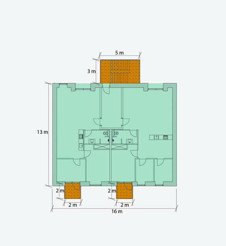
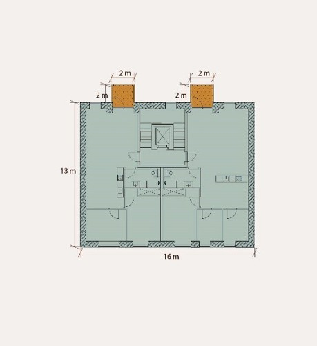
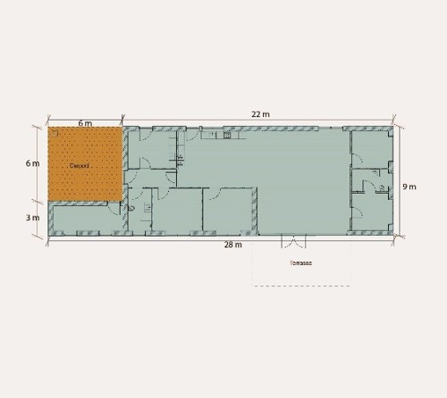
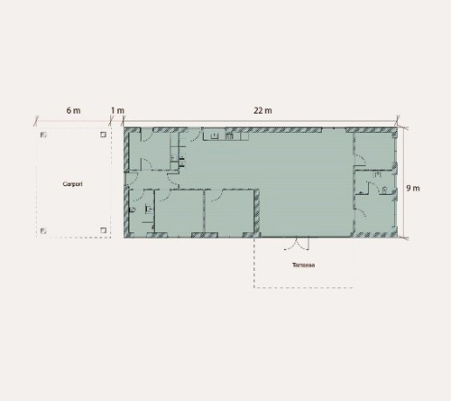
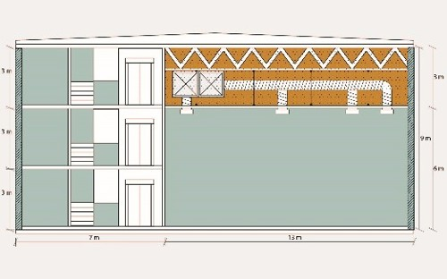
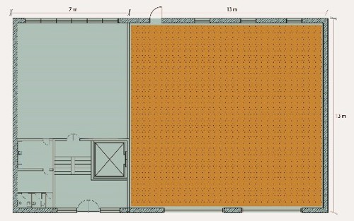

# Energiforbrug og klimapåvirkning (§ 250 - § 298)

## Se alle vejledninger om Energiforbrug og klimapåvirkning (§ 250 - § 298)

- [Spørgsmål og svar om energiforbrug](../../qa)
- [Spørgsmål og svar om bygningers klimapåvirkning](../../spoergsmaal-og-svar-om-bygningers-klimapaavirkning)
- [Bygningsreglementets vejledning om energiforbrug](../../energiforbrug-2)
- [Bygningsreglementets vejledning om efterisolering](../../ofte-rentable-konstruktioner)
- [Vejledning om funktionsafprøvning](../../version-2-funktionsafprovning)
- [Vejledning om håndtering af forskelligt energibehov i energirammen](../../haandtering-af-forskelligt-energibehov)
- [Bygningsreglementets vejledning om bygningers klimapåvirkning](..)
- [Vejledning om energiberegning af hospitaler](../../energiberegning-af-hospitaler)
- [Eksempelsamling for energi](../../eksempelsamling)

## Bygningsreglementets vejledning om bygningers klimapåvirkning

[1.0.](../kap_1_0)

### Forord

[1.1.](../kap-1_1)

### Generelt

[1.2.](../kap-1_2)

### Livscyklus og betragtningsperiode

[1.3.](./)

### Arealopgørelse

Til brug for beregning af klimapåvirkningen fra materialerne og byggeprocessen skal der opgøres et areal som CO2e-udledningerne opgøres i forhold til. Arealet baseres på det faktuelle areal som opgjort, jf. § 455, og omtales i dette afsnit som referenceareal. Dog er det nødvendigt at tilpasse det faktuelle areal af bygningen, da visse arealer har et væsentligt mindre materialebehov end almindelige, lukkede arealer. Ved at foretage disse tilretninger af det faktuelle areal forudsættes en mere retvisende opgørelse af klimapåvirkning pr m2.

I det følgende uddybes principperne for at opgøre referencearealet i forbindelse med beregningen af bygningers klimapåvirkning. Endvidere gives eksempler på, hvordan arealet konkret beregnes i forskellige scenarier.

Referencearealet tager udgangspunkt i beregningen til etagearealet, som skal opgøres ifølge § 455. Her medtages alle etagearealer, herunder alle opvarmede etagearealer. Dog skal følgende modifikationer foretages til det opgjorte etageareal;

- Alle kælderarealer, affaldsrum i terrænniveau og sikringsrum medregnes. Det vil sige, at disse arealer regnes fuldt med (100 pct.). Det er dog kun rum, som er integreret i bygningen. Fritstående sikringsrum og affaldsrum medregnes hverken i forhold til materialer eller arealer. Kælder regnes med, uanset om den er opvarmet eller uopvarmet.
- *Udestuer, altanlukninger og lignende medregnes alene med 50 pct*. Er der f.eks.  lukkede altaner, skal arealet for disse kun medregnes med 50 pct. i opgørelsen af klimapåvirkning.
- *Integrerede garager til enfamiliehuse, rækkehuse og lignende medregnes alene med 50 pct.* Integrerede garager betyder, at garagen er en del af og opført sammen med bygningen, dvs. deler ydervæg, tag mm.
- *Udvendige ramper, trapper, brandtrapper, altaner, altangange og lignende, medregnes med 25 pct.* Det vil sige, at hvor disse arealer ikke indgår i arealopgørelsen ifølge § 455, skal de medregnes med 25 pct. af arealet i opgørelsen af klimapåvirkning. Andre eksempler på arealer, der kan være omfattet af 25 pct., kan for eksempel være Stack-parking områder, som muliggør parkering i flere niveauer inden for en etage.
- *Integrerede carporte, udhuse, overdækninger, skure og lignende medregnes alene med 25 pct.* Dette dækker konstruktioner, der er opført som integreret del af bygningen, som for eksempel integrerede overdækkede legeområder. Det betyder fx, at der for en bygning opført på søjler, hvor arealet under dækket, som søjlerne bærer, anvendes til parkeringspladser, skal medregne 25 pct. af arealet under søjlerne i referencearealet. Et andet eksempel er teknikhuse på tage, som også skal medregnes med 25 pct. af arealet.
- *Walk-on-ceilings og lignende medregnes alene med 25 pct.* Walk-on-ceilings er for eksempel installationslofter, hvis højde svarer til rumhøjde, og som kan bære personlaster.
- *Overdækkede, ikke-integrerede terrasser samt udnyttede tagflader og lignende medtages ikke,* hverken hvad angår materialer anvendt til opførelsen eller arealet af disse områder. Overdækkede terrasser kan f.eks. være en  tagkonstruktionen med det formål, at have mulighed for ophold herunder. 
- Almindelige tagudhæng vil ikke udløse et referenceareal, men materialerne skal medregnes.

Det fremhæves, at det for de beskrevne områder kun er arealet, der reduceres, og ikke mængderne af materialer. Materialernes mængder indgår stadig med 100 *pct.*, jf. [BR18, bilag 2, tabel 6](../../../../../bilag/b2/bilag_2/tabel_6){rel="noopener noreferrer" target="_blank"}.

#### **1.3.1 Eksempler**

I det følgende er det skitseret, hvordan arealer opgøres i konkrete situationer.

Hvert eksempel indeholder en illustration for at tydeliggøre hvilke arealer, der medregnes. Arealer markeret med blå (A~1~) medregnes 100 pct. Arealer markeret med orange (og prikker) (A~2~) medregnes med 25 pct.

Til beregning af referencearealet er følgende formel anvendt:

A~reference~ = 100 pct*.* ∙ A~1~ + 25 pct.* \* *A~2~

#### Trapper og altaner

{width="459" height="500"}

**Figur 3.1:** Plan af etageboligbyggeri med n antal etager, med udvendig trappe.

Etageareal: 13 m \* 16 m = 208 m^2^

Udvendig trappe: 3 m \* 5 m  25 pct. = 3,75 m^2^

Altaner: 2 m \* 2 m \* 25 pct. \* 2 altaner = 2 m^2^

Sum =  213,75 m^2^ \* n antal etager

{width="459" height="500"}

**Figur 3.2:** Plan af etageboligbyggeri med n antal etager, med indvendig trappekerne.

*Udvendige ramper, trapper, brandtrapper, altangange og lignende medregnes alene med 25 pct.*

*Indvendige trapper indgår fuldt i etagearealet, jf. § 455. *Trappen er her inden for klimaskærmen, og tæller derfor fuldt ud (100 pct.).

Etageareal: 13 m \* 16 m = 208 m^2^

Altaner: 2 m \* 2 m \* 25 pct. \* 2 altaner = 2 m^2^

Sum = 210 m^2^ \* n antal etager

#### Integreret og fritstående carport

{width="500" height="446"}

**Figur 3.3:** Plan af enfamiliehus med integreret carport.

*Integrerede carporte, udhuse, overdækninger, skure og lignende medregnes alene med 25 pct.*

Etageareal: 22 m \* 9 m + 3 m \* 6 m = 216 m2

Integreret carport: 6 m \* 6 m \* 25 pct.= 9 m2 

Sum = 225 m2

Terrasseoverdækningen er ikke integreret i tagkonstruktionen og medtages derfor ikke i beregningen.

{width="500" height="444"}

**Figur 3.4:** Plan af enfamiliehus med særskilt carport.

*Overdækkede terrasser og lignende medtages ikke i beregning om bygningers klimapåvirkning.*

Etageareal: 22 m \* 9 m = 198 m^2^

Terrasseoverdækningen er ikke integreret i tagkonstruktionen og medtages derfor ikke i beregningen. Carporten skal beregnes selvstændigt fordi det er en separat bygning, og fordi den er over 50m^2^.

#### Walk-on-ceiling

{width="500" height="312"}

**Figur 3.5:** Snit af en produktionsbygning med walk-on-ceiling i produktionsrummet til installationer.

{width="500" height="313"}

**Figur 3.6:** Plan af en produktionsbygning.

Walk-on-ceilings og lignende medregnes alene med 25 pct.

Etagearealet:

7 m \* 13 m \* 3 etager = 273 m^2^ (tre etager til venstre på snittet)

13 m \* 13 m \* 1 etage = 169 m^2^ (etage af dobbelthøjt rum)

Walk-on-ceiling: 13 m \* 13 m \* 1 etage \* 25 pct. = 42,25 m^2^

Sum = 484,25 m^2^

Udnyttede tagflader

Der etableres en tagterrasse på bygningens tagopbygning. Hverken arealet herfra medtages, og hellere ikke materialerne, der er nødvendige for tagterrassen, afgrænsningen ift. materialerne fremgår fra [BR18, bilag 2, tabel 6.](../../../../../bilag/b2/bilag_2/tabel_6 "Tabel_6")

#### **1.3.2 Definition af integrerede carporte eller garager**

For §297, stk. 5 gælder den samme definition for hvornår en carport eller garage anses for værende integreret som beskrevet under bygningsreglementets administrative bestemmelser, vejledning pkt. 6.1 integrerede bygninger. Definitionen lyder som følge:

*"En integreret bygning kan eksempelvis være en garage, carport, udhus eller lignende, der ligger under samme tagkonstruktion som den primære bygning. En bygning kan også være integreret, hvis opførelse, ændring eller nedrivning af den integrerede bygning, kan påvirke den samlede bebyggelses konstruktive forhold."*

  [1.4.](../kap-1_4)

### Bygningsdele

[1.5.](../kap-1_5)

### Datagrundlag

[1.6.](../kap-1_6)

### Miljøvaredeklarationer

[1.7.](../kap-1_7)

### Byggeproces

[1.8.](../kap-1_8)

### Levetider

[1.9.](../kap-1_9)

### Emissionsfaktorer

[1.10.](../kap-1_10)

### Lavemissionsklassen

[1.11.](../kap-1_11)

### Standardformat til LCA aflevering

[1.12.](../kap-1_12)

### Grænseværdi

[1.13.](../kap-1_13)

### Modul D

[2.4.](../kap-2_4)

### Særlige forhold

[1.14.](../kap-1_14)

### Energitillæg

[1.15.](../kap-1_15)

### Særlige forhold

\
