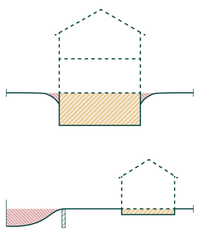

# Energiforbrug og klimapåvirkning (§ 250 - § 298)

## Se alle vejledninger om Energiforbrug og klimapåvirkning (§ 250 - § 298)

- [Spørgsmål og svar om energiforbrug](../../qa)
- [Spørgsmål og svar om bygningers klimapåvirkning](../../spoergsmaal-og-svar-om-bygningers-klimapaavirkning)
- [Bygningsreglementets vejledning om energiforbrug](../../energiforbrug-2)
- [Bygningsreglementets vejledning om efterisolering](../../ofte-rentable-konstruktioner)
- [Vejledning om funktionsafprøvning](../../version-2-funktionsafprovning)
- [Vejledning om håndtering af forskelligt energibehov i energirammen](../../haandtering-af-forskelligt-energibehov)
- [Bygningsreglementets vejledning om bygningers klimapåvirkning](..)
- [Vejledning om energiberegning af hospitaler](../../energiberegning-af-hospitaler)
- [Eksempelsamling for energi](../../eksempelsamling)

## Bygningsreglementets vejledning om bygningers klimapåvirkning

[1.0.](../kap_1_0)

### Forord

[1.1.](../kap-1_1)

### Generelt

[1.2.](../kap-1_2)

### Livscyklus og betragtningsperiode

[1.3.](../kap-1_3)

### Arealopgørelse

[1.4.](../kap-1_4)

### Bygningsdele

[1.5.](../kap-1_5)

### Datagrundlag

[1.6.](../kap-1_6)

### Miljøvaredeklarationer

[1.7.](./)

### Byggeproces

Fra 1. juli 2025 skal byggeprocessens klimapåvirkning opgøres i forbindelse med beregningerne af bygningers klimapåvirkning, og byggeprocessen skal overholde en selvstændig grænseværdi.

Byggeprocessens klimapåvirkning kommer primært fra transport af materialer og materiel til byggepladsen, energiforbrug på byggepladsen samt affaldshåndtering af byggeaffald og bortkørsel af byggeaffald og affaldsjord.

Man har flere forskellige muligheder for at dokumentere byggeprocessens klimapåvirkning. Dokumentationen kan basere sig på specifikke oplysninger fra byggeprocessen eller man kan benytte de standardværdier, der er indført i bygningsreglementets bilag 2. Denne tilgang sikrer, at man har forskellige måder at dokumentere på afhængigt af ens ønsker i den konkrete byggesag.

Grænseværdierne for modulerne A4-A5 (byggeprocessen), jf. § 298, stk. 5 og § 297, stk. 15, er hovedsageligt fastsat ud fra rapporten Ressourceforbrug på byggepladsen (BUILD Rapport 2023:14).

Opgørelsen af klimapåvirkning fra byggeprocessen følger standard DS/EN 15978:2012, dog med nogle modifikationer. 

I det følgende gennemgås modulerne A4 og A5 samt de respektive modifikationer til standarden. Ved nogle af modifikationerne benyttes udtrykket "kan udelades". At der står "kan" understreger, at grænseværdien kun skal overholdes under iagttagelse af de data, der skal medregnes. Det vil dog omvendt ikke skulle anses for at være en fejl i beregningen, hvis de nævnte data alligevel er medtaget. Der er ikke pligt til at undtage dem.

Det skyldes, at de dele af beregningen udgør så relativt lille en del af det samlede resultat, at det ikke vil være meningsforstyrrende at have dem med i beregningen, og det kan være en praktisk fordel på byggepladsen, hvis der ikke skal bruges kræfter på at undtage dem.

#### **1.7.1 Transport (A4)**

Hvad er omfattet af standarden?\
For transport til og fra byggepladsen skal følgende opgøres som følge af standarden (bygningsreglementets modifikationer til standarden fremgår efterfølgende):

- Transport af materialer og produkter fra fabrikken til byggeplads, inklusiv al transport, oplagring (terminalprocesser) og distribution
- Transport af materiel (kraner, stillads osv) til og fra byggepladsen

Transport af personer til og fra byggepladsen skal ikke inkluderes ifølge standarden.

*Hvordan afviger kravet i bygningsreglementet fra standarden? *\
Der er flere af de ovenstående processer, der er modificeret i bygningsreglementet, jf. § 297, stk. 9. Modifikationerne fremgår herunder:

-      Tab og beskadigelse af materialer under transport (i modul A4) kan udelades. Hvis man følger standarden, så skal tab og beskadigelse af materialer under transport medregnes. Derfor vil det belaste bygningens klimapåvirkning, hvis lastbilen på vej til byggepladsen er ude for en ulykke, der medfører beskadigelse af byggematerialerne. Dette behøver man dog ikke at indregne ifølge kravet, da det kunne påvirke resultatet på en måde som indretningen af byggepladsen ikke kan forhindre. Dette gælder ligeledes, hvis man ved levering af materialer kan konstatere, at der er beskadigelser eller defekte materialer, uden der er sket en ulykke. Hvis materialer imidlertid beskadiges på byggepladsen, så vil det dog indgå i byggeprocessens klimapåvirkning.
- Transport af materiel (i modul A4) der vejer under 1 ton kan udelades. Når man transporterer materiel (fx kraner og stilladser) til og fra byggepladsen, så behøver man ikke opgøre transporten for mindre materiel. Det er materiellets størrelse, og ikke transportens, som afgør om bagatelgrænsen anvendes. Et stillads skal opgøres som et stillads, også hvis stilladset er fordelt på flere sendinger.\
  \
- Transport af materialer, som ikke indgår i tabel 6, kan udelades. Det er kun nødvendigt at medregne transport af materialer for de materialer, der indgår i tabel 6. Det er således de samme materialer, som opgøres i A1-A3-modulerne.

 

*Principper for opgørelse*

Der er tre metoder til dokumentation af materialers transport fra fabrik til byggeplads, jf. teksten til bilag 2, tabel 10. Det er op til bygningsejer at vælge, hvilken metode, der anvendes for det enkelte materiale.

1)    Opgørelse med brændstof- og elforbrug. Det kan opgøres ved måling eller som beregnet ud fra antal kørte kilometer.

2)    Opgørelse baseret på data i EPD'er, jf. § 297, stk. 7.

3)    Opgørelse med standardværdierne i bilag 2, tabel 10

Hvis man bruger opgørelse baseret på data i EPD'er skal man være opmærksom på at de fleste EPD'er er baseret på en standardafstand og man skal derfor (ifølge afsnit 10.2.3 i EN15978) skalere resultatet i EPD'en hvis transportafstanden adskiller sig fra standardafstanden.

Der skal desuden indregnes en standardværdi for terminalprocesser på 0,02 kg CO~2~e/m²/år uanset hvilken af de tre metoder, der vælges. Terminalprocesser er bl.a. omlastning, ompakning og lignende.

Hvis en lastbil leverer materialer eller materiel til flere forskellige byggepladser skal beregningen fordeles ved en forholdsmæssig fordeling af forbruget blandt transportens leverancer jf. beregningsprincipperne i tabel 10. Det kan fx gøres ved at lave en vægt- og afstandsvægtet fordeling. Hvis opgørelsen foretages ud fra standardværdierne i tabel 10, er det ikke nødvendigt at foretage en forholdsmæssig fordeling.

Det er op til bygningsejer at foretage en beregning, som vurderes retvisende og forholdsmæssig. Det vil i sidste ende være op til bygningsmyndigheden at vurdere, om en anvendt beregning anerkendes som forholdsmæssig.

Nedenfor er et simpelt eksempel på en forholdsmæssig fordeling af transport med materiel eller materialer til flere byggepladser.

*Eksempel på beregning af klimapåvirkning ved levering af materiel og materialer til flere byggepladser*

*En lastbil kører med leverancer til to byggepladser fra Kolding mod Aarhus, men har også byggematerialer med til en byggeplads i Vejle. I Vejle leveres 40 pct. af byggematerialerne opgjort på vægt, mens resten leveres til byggepladsen i Aarhus. Der er 30 km fra Kolding til Vejle og 70 km fra Vejle til Aarhus. Dermed er der 100 km fra Kolding til Aarhus.*

*Den forholdsmæssige fordeling af forbruget kan foretages på følgende måde:*

*Først findes den samlede vægtning*

*Vejle: (40 pct. \* 30 km) / 100 km = 0,12*

*Aarhus: (60 pct. \* 100 km) / 100 km = 0,6*

*Samlet vægtning = 0,72*

 

*Procentmæssig fordeling af de enkelte kørsler på den samlede vægtning:*

*Vejle: 0,12/0,72 = 17 pct.*

*Aarhus: 0,6/0,72 = 83 pct.*

Man kan dermed benytte denne fordeling til at fordele brændstofforbruget på de enkelte leverancer.

 

Hvis der er flere byggepladser, som modtager materiel, deles udledningerne fra transport af materiellet forholdsmæssigt. Da man ifølge standarden skal medregne både transport af materiel til byggepladsen og transport af materiel væk fra byggepladsen, så kan man komme ud for at en kørsel med materiel både er en transport væk fra en byggeplads, mens det ligeledes er en transport hen til en anden byggeplads. Da udledningerne dermed vil skulle tildeles to forskellige byggepladser kan man dermed fordele CO2-udledningen mellem byggepladserne. Hvis man fx flytter en kran fra en byggeplads til en anden byggeplads, så kan man antage, at transporten tæller ligeværdigt med for begge byggepladser og man vil derfor kunne fordele transporten forholdsmæssigt. I en byggeplads med to ligeværdige byggepladser, vil det normalt være med 50 pct. til hver byggeplads.

Hvis man i stedet har en mere sammensat forsyningskæde for materiellet, så kan man fordele forholdsmæssigt. Nedenfor fremgår et eksempel.

Eksempel på beregning af klimapåvirkning ved materiellevering fra en byggeplads til flere andre byggepladser:

* *

Fx hvis en minigraver på 1,5 ton og en dumper på 2,6 ton hentes på en byggeplads i Slagelse og minigraveren afleveres på en byggeplads i Ringsted 30 km væk og dumperen afleveres på en byggeplads i Køge 55 km fra Slagelse, så kan et brændstofforbrug (CO2-udledningen) fordeles på følgende måde:

* *

*Samlet vægtning:*

*Ringsted: (1,5 ton / 4,1 tons) \* (30 km / 55 km) = 0,20*

*Køge: (2,6 ton / 4,1 ton) \* (55 km / 55 km) = 0,63*

*Samlet vægtning: 0,83*

 

Derefter kan udledningerne fordeles mellem de tre byggepladser. Byggepladsen i Slagelse tildeles halvdelen af udledningen fordi det er der materiellet hentes og halvdelen af transporten vil derfor være transport væk fra byggepladsen i Slagelse, mens den øvrige udledning fordeles mellem de to andre byggepladser.

* *

*Byggeplads i Ringsted: 0,20 / 0,83 \* 0,5 = 12 pct.*

*Byggeplads i Køge: 0,63 / 0,83 \* 0,5 = 38 pct.*

*Byggeplads i Slagelse: 50 pct.*

#### **1.7.2 Byggeproces (A5)**

*Hvad er omfattet af standarden?*

Klimapåvirkning fra selve byggeprocessen skal opgøres som følge af standarden.

Det vil sige, at klimapåvirkningen fra følgende processer skal opgøres ifølge standarden (bygningsreglementets modifikationer til standarden fremgår efterfølgende):

-       Jordarbejde og landskabsarbejde

-       Oplagring af byggematerialer, inklusiv energiforbrug forbundet med oplagring

-       Transport af byggematerialer, affald og materiel internt på matriklen

-       Midlertidige konstruktioner

-       On-site bearbejdning af et byggemateriale

-       Energiforbrug på byggepladsen

-       Montage af materialerne i bygningen, inklusiv brug af hjælpe-/interimsmaterialer ("ancillary materials")

-       Vandforbrug 

*Hvordan afviger kravet i bygningsreglementet fra standarden?*

Der er flere af de ovenstående processer, der er modificeret i bygningsreglementet, jf. § 297, stk. 9. Modifikationerne fremgår herunder:

-    *Kun byggeproces (i modul A4 og A5) relateret til bygningens bebyggede areal, jf. BBR-bekendtgørelsen, er omfattet.* Der kan foregå andet arbejde på matriklen i forbindelse med en byggesag. Der skal dog kun medregnes den del af byggeprocessen, der henhører til det bebyggede areal, herunder eksempelvis byggemodning og terrænregulering. Derfor vil fx byggematerialer til støttemure i terræn og dieselforbrug til maskiner, der laver terrænregulering uden om bygningens areal, ikke indgå i opgørelsen af bygningens klimapåvirkning.

-     *Energiforbrug (i modul A5) fra maskiner, der vejer under 1 ton, kan udelades*. Man behøver ikke opgøre energiforbrug fra mindre maskiner. Det vil fx sige, at hvis man har en række håndværktøj eller mindre maskiner (fx en pladevibrator eller en motorbør), så behøver man dermed ikke indregne energiforbruget fra disse maskiner.

-    *Vandforbrug og forbrug af ikke-blivende materialer under byggeprocessen (i modul A5) undtages.* Vandforbruget under byggeprocessen skal ikke opgøres. Hvis der forbruges materialer i forbindelse med on-site bearbejdning af byggematerialer (fx sandpapir eller kemikalier til afrensning), skal det heller ikke medregnes.

Byggeprocessens klimapåvirkning skal herefter beregnes ved at opgøre brændsels-, el- og fjernvarmeforbrug på byggepladsen og omdanne dette forbrug til emissioner ved brug af bilag 2, tabel 8.1 og 8.2.

"Brug af hjælpe-/interimsmaterialer" er forbrug forbundet med at benytte materialerne, fx ophejsning af stillads. Produktion af interimsmaterialerne selv (stilladser, støbeforme) tæller ikke med.).

Produktion af materialer på pladsen, fx sammenstøbningsbeton indgår ikke i A5. Sådanne indgår i stedet i A1-A3, hvis de er med i bygningsmodellen (bilag 2, tabel 6). Fx er udfyldning mellem elementer (sammenstøbningsbeton) udtrykkeligt undtaget fra beregningen (se teksten til bilag 2, tabel 6) og derfor skal det hverken opgøres i A1-A3 eller A5.

I standarden fremgår det ikke klart om udledningerne fra præfabrikation af bygningselementer, som fx præfabrikerede trækassetter skal indgå i A1-A3 eller i A4-A5. Det er op til bygningsejer at vurdere, hvor det passer bedst, samt at sikre, at alle udledningerne bliver talt med.

Hvis der bygges flere bygninger fra samme byggeplads, eller hvis der både bygges en bygning og foretages et større jordarbejde, så kan energiforbruget være vanskeligt at beregne nøjagtigt. I så fald må foretages bedst kvalificerede skøn over forbruget. Det kan være ved at fordele et beregnet forbrug forholdsmæssigt mellem de forskellige delarbejder. Hvis der for eksempel bygges et klubhus til en fodboldklub samtidig med at der bygges en kunstbane til fodbold, så kan energiforbruget fordeles forholdsmæssigt mellem de to byggearbejder.

#### **1.7.3      Affaldshåndtering (A5)**

*Hvad er omfattet af standarden?*

For affaldshåndtering skal følgende opgøres som følge af standarden (bygningsreglementets modifikationer til standarden fremgår efterfølgende):

-       Affaldshåndtering af affald frembragt på byggepladsen

-       Transport af affald fra byggepladsen

*Hvordan afviger bygningsreglementets krav fra standarden?*

I bygningsreglementet er dette afgrænset til kun at være affaldshåndtering af byggeaffald relateret til bygningen og transport af affald (herunder jord som er affald) relateret til bygningen jf. nedenstående modifikationer:

-    *For behandling af affald indgår kun byggeaffald.* Når behandlingen af affald skal opgøres, skal man kun medregne byggeaffald jf. tabel 11. Man skal derfor ikke opgøre behandling af bortkørt jord og det almindelige husholdningsaffald eller lignende fra skurbyen.

-    *For transport af affald indgår kun byggeaffald og jord.* Transport af jordaffald indgår, men transport af jord, der ikke er affald, indgår ikke. Når transporten af affald skal opgøres, så skal man kun opgøre byggeaffald og bortkørt jord, hvis jorden er affald. Man skal derfor ikke opgøre transport af det almindelige husholdningsaffald eller lignende fra skurbyen. Affald forstås som defineret i affaldsbekendtgørelsen[\[1\]](.#_ftn1){#_ftnref1} § 2. Miljøstyrelsen træffer afgørelse, om et stof eller en genstand er affald, jf. affaldsbekendtgørelsen § 4.

For bygninger med affaldsjord fra både opførelsen af en bygning og terrænarbejde skal man derfor fordele klimapåvirkningen mellem bygning og terrænarbejde.

*Eksempel på afgrænsning af byggeproces og affaldshåndtering på byggepladsen:*

På figur 7.1 vises forskellige områder for udgravning af jord. Det gule område illustrerer, hvor man skal opgøre klimapåvirkningerne og det røde område illustrerer, hvor man ikke skal opgøre klimapåvirkningerne.

Udgravning af jord kan fordeles efter fordelingstal mellem jordvolumenerne. På den øverste illustration i figur 7.1 udgøres den udgravede jord under bygninger fx 95 pct. af den samlede udgravede jord, mens den i den nederste illustration udgør fx 10 pct. Brændselsforbrug til gravemaskiner og til flytning af jord på matriklen kan derfor fordeles efter disse forholdstal. Dette gælder uanset om jorden er affald.

Bortkørsel af jord skal kun regnes med, hvis jorden er affald. Derfor kan ovenstående måde at fordele på ikke umiddelbart anvendes på bortkørsel. Som alternativ til den reelle opgørelse af forbruget til bortkørsel af affaldsjord kan standardværdierne i tabel 10 benyttes. Jord, som er affald, skal endvidere følge kommunens anvisning og er genstand for kontrolsystemer i henhold til affaldslovgivningen.

{width="411" height="500"}

**Figur 7.1 -** afgrænsning af byggeproces og affaldshåndtering på byggepladsen.

\

------------------------------------------------------------------------

[\[1\]](.#_ftnref1){#_ftn1} ../../../../../external/www.retsinformation.dk/eli/lta/2024/1749/

[1.8.](../kap-1_8)

### Levetider

[1.9.](../kap-1_9)

### Emissionsfaktorer

[1.10.](../kap-1_10)

### Lavemissionsklassen

[1.11.](../kap-1_11)

### Standardformat til LCA aflevering

[1.12.](../kap-1_12)

### Grænseværdi

[1.13.](../kap-1_13)

### Modul D

[2.4.](../kap-2_4)

### Særlige forhold

[1.14.](../kap-1_14)

### Energitillæg

[1.15.](../kap-1_15)

### Særlige forhold

\
