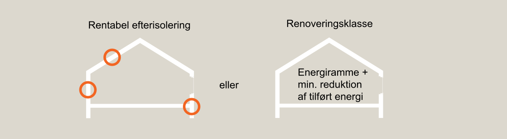
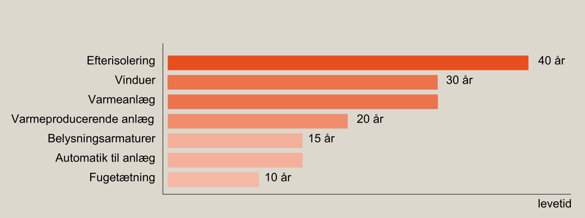

# Energiforbrug og klimapåvirkning (§ 250 - § 298)

## Se alle vejledninger om Energiforbrug og klimapåvirkning (§ 250 - § 298)

- [Spørgsmål og svar om energiforbrug](../../qa/)
- [Spørgsmål og svar om bygningers klimapåvirkning](../../spoergsmaal-og-svar-om-bygningers-klimapaavirkning/)
- [Bygningsreglementets vejledning om energiforbrug](../)
- [Bygningsreglementets vejledning om efterisolering](../../ofte-rentable-konstruktioner/)
- [Vejledning om funktionsafprøvning](../../version-2-funktionsafprovning/)
- [Vejledning om håndtering af forskelligt energibehov i energirammen](../../haandtering-af-forskelligt-energibehov/)
- [Bygningsreglementets vejledning om bygningers klimapåvirkning](../../bygningers-klimapaavirkning-1-juli-2025/)
- [Vejledning om energiberegning af hospitaler](../../energiberegning-af-hospitaler/)
- [Eksempelsamling for energi](../../eksempelsamling/)

## Bygningsreglementets vejledning om energiforbrug

### Forord {#e4a4aefb-350b-4266-827e-1508450a3f72}

### 1.0. Generelt {#5d0fd3cc-01f4-4dbe-bf46-d43a912b077e}

### 1.1. Energifaktorer {#e1939b7a-413e-4987-a882-c3c48ef87fe1}

### 1.2. Rum og bygninger med særlige bestemmelser {#b4a11b4b-0c28-4a2d-85c2-45a37fa9ae5b}

### 1.3. Begrænsning af varmetab {#cf5860b6-bc99-4151-85ee-cb008ec772b3}

### 1.4. Forudsætninger for beregning af bygningers varmetab {#515f7ad5-a193-4cbe-9c8f-f21e6f8edac6}

### 1.5. Mindste varmeisolering {#d809d0e5-9f02-47f6-96a0-afc042a05321}

### 1.6. Energikrav til vinduer, glasydervægge, ovenlysvinduer og glastage {#74b8dcb5-1d2c-4d26-a488-19aef6197097}

### 1.7. Energirammen {#38ddddea-b3b6-41a3-8596-10bbb3f0523c}

### 1.8. Tillæg til energirammen {#ca0d846b-3295-42ff-a331-b4da744c1ced}

### 1.9. Bygninger med blandet anvendelse {#1048bdcc-12ec-4aa3-a1a5-289ccd5e567f}

### 1.10. Tæthed og trykprøvning af bygninger {#8a5de75a-35a6-44ca-9312-35fe7c95663d}

### 1.11. Bestemmelse af det dimensionerede transmissionstab {#cc1f44c6-f7aa-44bb-a970-ca49db050ac1}

### 1.12. Vedvarende energi {#cea05059-f673-4746-86a6-8e6320193440}

### 2.0. Ændret anvendelse {#1768cdff-bc36-4979-b144-536aa44263bc}

### 2.1. Bygningsmæssige ændringer {#689f7df4-be19-40a4-bde0-8fccec531084}

### 3.0. Tilbygninger {#5eebe19f-379c-4856-9b7b-e761654d55e5}

### 3.1. Varmetabsrammen {#914d4817-1f61-4c94-a126-a1d823b14931}

### 4.0. Ombygninger og udskiftninger af bygningsdele {#667be8d0-d9db-472e-addd-bc927954fa7c}

I bygningsreglementets krav til bygningsdelene skelnes der mellem følgende situationer:

> 1\. Reparationer

> 2\. Ombygning

> 3\. Udskiftning

Reparationer dækker over mindre ændringer, der ikke udløser krav om gennemførelse af rentable energibesparelser. Det er typisk mindre arbejder, som for eksempel pudsreparation af en facade, udskiftning af enkelte brædder på en facade eller malerbehandling. Ved skader efter f.eks. en storm, et rørbrud eller en mindre rådskade, hvor størstedelen af bygningsdelen ikke er omfattet, vil der i de fleste tilfælde være tale om mindre reparationer.

Energikrav ved ombygning

Ombygning er, når en bygningsdel renoveres eller bygges om. For eksempel når en tagbeklædning skiftes. I det tilfælde skal der gennemføres efterisolering, hvis det er rentabelt.

Eksempler på arbejder, hvor der skal foretages rentabel isolering, er:

> •  Nyt tegltag eller tilsvarende.
>
> •  Nyt stålpladetag oven på gammelt tag af tagpap eller fibercementplader.
>
> •  Lægning af ny tagpapdækning i form af ny tagdug eller overpap på eksisterende tag.

Eksempler på arbejder hvor der skal foretages rentabel isolering

I nogle tilfælde vil det være sådan, at efterisolering op til det niveau, der er krav om i bygningsreglementet, ikke er rentabelt. Der kan dog være en mindre isoleringstykkelse, der er rentabelt. Denne merisolering skal så foretages.

I beregningen af rentabiliteten indgår kun materialer og arbejdsløn ved det energibesparende arbejde og det snævre følgearbejde af det energibesparende arbejde, og ikke f.eks. udgifter til tagdækning, stillads eller andre udgifter.

Ved evaluering af rentabilitet i eksisterende bygningskonstruktioner med hulrum, for eksempel tage, hvor der er plads til yderligere isolering uden ændringer af konstruktioner skal det først evalueres om opfyldning af hulrum er rentabelt. Det vil det ofte være og tiltaget skal derfor gennemføres, hvis det fugtteknisk kan lade sig gøre. Dernæst skal det evalueres om ændring af konstruktionen, for eksempel forhøjelse af taget, er rentabel. Her tages der udgangspunkt i en konstruktion, hvor merisoleringen i hulrummet allerede er foretaget. Det kan f.eks. være tilfældet på en skråvæg, hvor spæret skal forhøjes for, at der kan blive plads til den isolering, som bygningsreglementet stiller krav om. Her skal det først vurderes om der kan monteres mere isolering i skråvæggen uden forhøjelse af spæret og dernæst skal forhøjelse af spæret evalueres. Hvert trin evalueres hver for sig. De rentable dele af tiltaget skal gennemføres.

Udskiftning er, hvis hele bygningsdelen udskiftes. Det kan for eksempel være en hel tagkonstruktion, inklusiv tagdækning, spær, isolering og loft, eller det kan være komponenter, der udskiftes, som for eksempel vinduer eller en kedel. Ved udskiftning skal konstruktionen eller komponenten leve op til kravene i [§279](../../../krav/274_279/ "274_279") og installationsemnerne. Der kan dog være forhold, der gør at udskiftningen ikke kan gennemføres uden uforholdsmæssige meromkostninger på de omkringliggende konstruktioner. I disse tilfælde er der ikke krav om fuld isolering, men hvis der kan isoleres til et lavere niveau skal dette gennemføres. Dette vil for eksempel være tilfældet, hvis der skal understøbes fundamenter for at gulvkonstruktionen kan isoleres svarende til kravet. I dette tilfælde skal der i stedet isoleres svarende til det niveau, der kan opnås uden understøbning. Tilsvarende skal kravet til linjetab omkring vinduer ikke overholdes ved udskiftning af vinduer uden samtidig renovering af ydervæg. Kravet gælder alene vinduet.

Der henvises til Bygningsreglementets vejledning om efterisolering, der indeholder yderligere uddybninger af ombygningskravene og indeholder en række eksempelkonstruktioner, der er regnet igennem generisk. Disse beregninger kan benyttes som rettesnor. Hvis beregningen i vejledningen om efterisolering viser at en efterisolering ikke er rentabel, så behøver man ikke at lave en beregning på det konkrete byggeri, men kan bruge eksemplet i vejledningen som dokumentation.

 Levetider der normalt kan anvendes ved beregning af rentabiliteten:

<table>
<colgroup>
<col style="width: 50%" />
<col style="width: 50%" />
</colgroup>
<tbody>
<tr>
<td>Energibesparende tiltag </td>
<td>Levetid [år] </td>
</tr>
<tr>
<td>Efterisolering af bygningsdele 
</td>
<td>40 
</td>
</tr>
<tr>
<td>Vinduer samt forsatsrammer og koblede rammer 
</td>
<td>30</td>
</tr>
<tr>
<td>Varmeanlæg, radiatorer og gulvvarme samt ventilationskanaler og armaturer inklusive isolering 
</td>
<td>30</td>
</tr>
<tr>
<td>Varmeproducerende anlæg mv., f.eks. kedler, varmepumper, solvarmeanlæg, ventilationsaggregater 
</td>
<td>20</td>
</tr>
<tr>
<td>Belysningsarmaturer 
</td>
<td>15</td>
</tr>
<tr>
<td>Automatik til varme og klimaanlæg 
</td>
<td>15</td>
</tr>
<tr>
<td>Fugetætningsarbejder 
</td>
<td>10</td>
</tr>
</tbody>
</table>

Der kan gennemføres bygningsmæssige ændringer, der medfører et forøget energiforbrug, hvis der gennemføres tilsvarende kompenserende energibesparelser. Denne bestemmelse finder f.eks. anvendelse, hvis der ønskes etableret nye vinduespartier i facaden eller i taget. Den manglende energimæssige ydeevne dækkes f.eks. ved merisolering, solvarmeanlæg, varmepumpeanlæg eller solceller.

Levetider der kan anvendes ved beregning af rentabiliteten

- [Gå til energikrav ved ombygninger og udskiftning af bygningsdele (§ 274 - § 279)](../../../krav/274_279/#afb229c4-65a2-4b7d-8613-8fe584c21e25){target="_blank"}

Kravet til U-værdi for lystunneler eller lignende gælder for gennembrydningen af den isolerede flade, som lystunnelen er indsat i. Det kunne for eksempel være lysfordeleren i et isoleret loft. U-værdien skal dokumenteres i henhold til DS/EN 10077-1.

### 4.1. Fredede og bevaringsværdige bygninger {#3aac1332-4e3e-4198-8dcc-953807b0cf0b}

### 4.2. Forsatsvinduer, porte, lemme og ovenlyskupler {#0953d039-72d1-4db2-abb2-e88d6a7c7981}

### 5.0. Renoveringsklasser {#f2461737-622c-4c04-959d-885e24c53fdb}

### 6.0. Sommerhuse, campinghytter og lignende ferieboliger {#26f4b016-58b1-4881-b0a7-0d5cf7cbe85c}

### 7.0. Midlertidige, flytbare pavilloner {#563449d5-1d97-4ce3-a10b-492d3debb6ba}

### 8.0. Bygningsopvarmning {#6375337f-e65d-434b-85f9-1c57c716a8f0}

### 8.1. Fjernvarme og vedvarende energi {#bc6d590f-bf2d-4b90-b394-44b83c63dbca}

### 8.2. Individuel naturgasforsyning og vedvarende energi {#4012ace1-09e5-485b-93ba-9fffe44e0978}

### 8.3. Områder uden adgang til fjernvarme eller naturgas {#1a5f696b-8140-48d6-bc8b-0207d6ef699d}

### 8.4. Dispensation {#acc806ef-5e18-47b7-ac9e-f43662db0fa0}

### 8.5. Vedvarende energi {#1a15c63e-dc8f-487b-944e-16d1c009e26f}

### 9.0. Bygningsautomatik i større bygninger {#7e795995-247b-49e7-94d4-018b4d783347}

### 9.1. Formål {#4e9a8e45-ebd4-4d41-8104-46462f8364d3}

### 9.2. Omfang, nye bygninger: {#01860e96-c4ee-4106-9dbc-1a6b67870c70}

### 9.3. Omfang, eksisterende bygninger: {#b0cc7b64-4981-4f0d-adc2-0f6df91383e2}

### 9.4. Omfang, undtagelse: {#e90369ce-b58e-4244-aa9f-6e41302e49e4}

### 9.5. Eksempler på energibehov {#3058d94d-a8e8-4740-8b79-8e25740686c7}

### 9.6. Krav til bygningsautomatikken {#3a095cce-b7d0-4e11-837e-7194d984e382}
