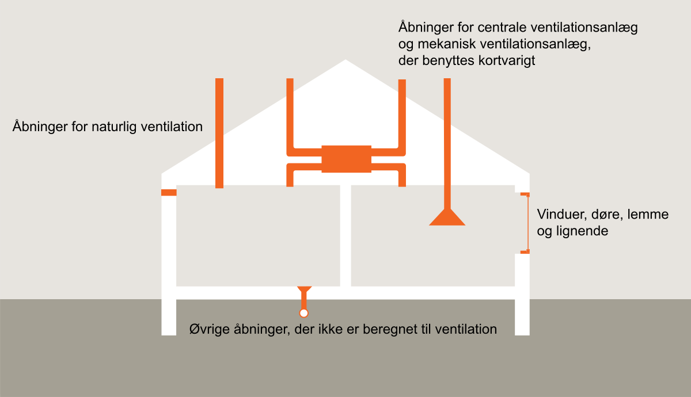
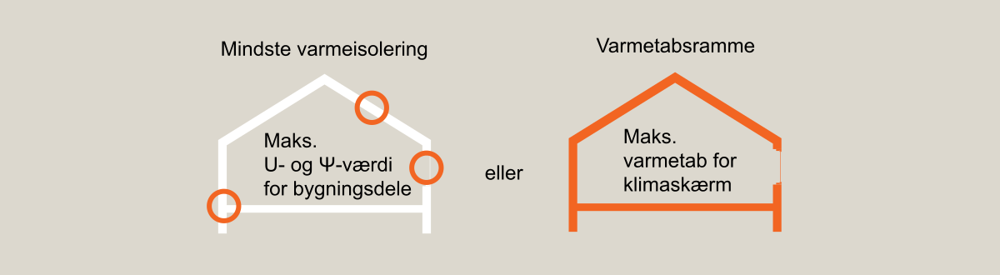

# Energiforbrug og klimapåvirkning (§ 250 - § 298)

## Se alle vejledninger om Energiforbrug og klimapåvirkning (§ 250 - § 298)

- [Spørgsmål og svar om energiforbrug](../../qa)
- [Spørgsmål og svar om bygningers klimapåvirkning](../../spoergsmaal-og-svar-om-bygningers-klimapaavirkning)
- [Bygningsreglementets vejledning om energiforbrug](..)
- [Bygningsreglementets vejledning om efterisolering](../../ofte-rentable-konstruktioner)
- [Vejledning om funktionsafprøvning](../../version-2-funktionsafprovning)
- [Vejledning om håndtering af forskelligt energibehov i energirammen](../../haandtering-af-forskelligt-energibehov)
- [Bygningsreglementets vejledning om bygningers klimapåvirkning](../../bygningers-klimapaavirkning-1-juli-2025)
- [Vejledning om energiberegning af hospitaler](../../energiberegning-af-hospitaler)
- [Eksempelsamling for energi](../../eksempelsamling)

## Bygningsreglementets vejledning om energiforbrug

### Forord

###

Energikrav til nye bygninger

Bygningsreglementet indeholder krav til bygningens energimæssige ydeevne. Den overordnede, generelle tilgang er baseret på krav i EU-direktiv 2010/31/EU om bygningers energimæssige ydeevne (bygningsdirektivet).

Bygninger opført efter energirammen i BR18, svarende til energimærke A2015, er Danmarks definition af næsten energineutrale bygninger (NZEB) for nye bygninger i henhold til bygningsdirektivet. Tilsvarende er renoveringsklasse 2 Danmarks definition af kravniveauet for større renoveringsarbejder og næsten energineutrale bygninger (NZEB) for eksisterende bygninger.

Teknisk bygningsinstallation er i bygningsreglementets kapitel 11 defineret som "teknisk udstyr til en bygnings eller bygningsenheds rumopvarmning, rumkøling, ventilation, varmt brugsvand, indbygget belysning, automatisering og kontrol, elproduktion på stedet eller en kombination heraf, herunder sådanne installationer, der anvender energi fra vedvarende energikilder". Definitionen stammer fra bygningsdirektivet. Kravene der knytter sig til tekniske bygningsinstallationer er i Danmark gennemført ved specifikke krav til de konkrete bygningsinstallationer i stedet for krav til fællesbetegnelsen teknisk bygningsinstallation. Kravene, der knytter sig til definitionen er derfor primært gennemført gennem kravene i kapitel 11 i bygningsreglementet, men også i kapitlerne 12, 18, 19, 21 og 22 i bygningsreglementet.

Detaljer om beregningsmetoden fremgår af SBi-anvisning 213 Bygningers energibehov.

Reglerne om energibehovet i bygninger er baseret på at sikre, at bygninger opføres, så deres energimæssige ydeevne lever op til kravene. Det betyder ikke nødvendigvis, at det reelle energiforbrug er identisk med det beregnede, da beregningen af energibehovet er baseret på en standardiseret brug af bygningen. Forudsætninger for konstruktioner, installationer osv, der benyttes i energiberegningen skal dog svare til bygningens reelle udførelse.

Nye bygninger skal overholde energirammen, mens øvrigt byggearbejde som alternativ til energirammen kan benytte følgende alternativer:

> \- Ændret anvendelse af eksisterende bygninger fremgår af [§ 267 - § 270](../../../krav/267_270#9a9a97b3-01e2-4af4-af72-faf0fdbd74ce){target="_self"}
>
> \- Tilbygninger til eksisterende bygninger fremgår af [§ 271 - § 273](../../../krav/271_273#660bcd55-d949-4c59-8e07-94cad1f2116a){target="_self"}
>
> \- Ombygninger fremgår af [§ 274 - § 279](../../../krav/274_279#afb229c4-65a2-4b7d-8613-8fe584c21e25){target="_self"}
>
> \- Sommerhuse og lignende fremgår af [§ 283 - § 286](../../../krav/267_270#9a9a97b3-01e2-4af4-af72-faf0fdbd74ce){target="_self"}
>
> \- Midlertidige, flytbare pavilloner fremgår af [§ 287 - § 292](../../../krav/287_292#f83468ad-c2a0-4b59-840a-7f0e0afc27f9){target="_self"}

Dog gælder det for bygningsfredede bygninger og bygninger, som er en del af et fredet fortidsminde, at der kan ske lempelser fra bestemmelserne i bygningsreglementet, såfremt kommunalbestyrelsen vurderer, at bestemmelserne er uforenelige med frednings- og bevaringsværdierne.

Der henvises til følgende vejledninger til bygningsreglementets energikrav.

#### EU-direktiv 2010/31/EU om bygningers energimæssige ydeevne

#### Beskrivelse

Dette direktiv fremmer forbedring af bygningers energimæssige ydeevne i Unionen, under hensyntagen til udeklima og lokale forhold, samt indeklimakrav og omkostningseffektivitet.

#### [Link til EU-direktiv 2010/31/EU (eur-lex)](http://eur-lex.europa.eu/legal-content/DA/TXT/PDF/?uri=CELEX:32010L0031&from=EN "EU-direktiv 2010/31/EU om bygningers energimæssige ydeevne"){target="_blank"}

#### SBi-Anvisning 213

Bygningers energibehov

#### Beskrivelse

​Anvisningen beskriver, hvordan man bruger beregningsprogrammet Be15 til beregning af bygningers energibehov. Programmet skal bruges, når man skal eftervise, at en bygning opfylder energibestemmelserne i bygningsreglementet. Anvisning og beregningsprogram henvender sig til rådgivende ingeniører, arkitekter, entreprenører, andre projekterende og udførende inden for byggeri samt til offentlige myndigheder.

#### [Find SBi-Anvisning 213 på Statens Byggeforskningsinstituts (SBi) hjemmeside her](https://sbi.dk/anvisninger/Pages/213-Bygningers-energibehov-4.aspx "SBi-Anvisning 213"){target="_blank"}

Anvisning og beregningsprogram er betalingsbelagt.

### 1.0. Generelt {#5d0fd3cc-01f4-4dbe-bf46-d43a912b077e}

Det primære formål med kravene i kapitel 11 - Energiforbrug (§ 250 - § 296), er at begrænse primærenergiforbruget til bygningsdrift set på årsplan. Der er dog visse energikrav i emnet, der er fastlagt ud fra hensyn om at minimere risikoen for kondensproblemer og ud fra hensyn om at begrænse afhængigheden af tilført energi til bygningsdrift fra energisystemet.

Gå til krav om energiforbrug § 250 - § 298 (nyt vindue).

-  [Gå til krav om energiforbrug (§ 250 - § 298)](../../../krav){target="_blank"}

### 1.1. Energifaktorer {#e1939b7a-413e-4987-a882-c3c48ef87fe1}

###

Energifaktorerne benyttes ved beregningen af behovet for tilført energi for bygninger og skal benyttes i forbindelse med energirammeberegningerne. Energifaktorerne bør også benyttes i forbindelse med andre energiberegninger, hvor der arbejdes med forskellige energiformer. For eksempel vil en ændring af opvarmningskilde fra fjernvarme til direkte elvarme være en ændring, der medfører et væsentligt højere primærenergi.

Energifaktorerne udtrykker primærenergiforbruget ved forskellige forsyningsformer og er baseret på Energistyrelsens energistatistik og basisfremskrivning. Primærenergi er et udtryk for hvor meget energi, der benyttes til at producere energibærerne. For eksempel vil en primærenergifaktor på 1,9 indikere, at der i gennemsnit benyttes 1,9 kWh energi i produktionsfasen til at producere 1,0 kWh el til slutkunderne.

Den energimæssige ydeevne af bygninger beregnet med energifaktorer afspejler derfor hvor stort et primærenergiforbrug, der benyttes til at producere den slutenergi, som driver bygningerne.

Fjernkøling er ofte sammensat af forskellige køleprocesser. Det kan f.eks. være køling med havvand eller grundvandskøling suppleret med et konventionelt køleanlæg til at dække kølebehovet i de perioder, hvor temperaturniveauet i f.eks. havvand ikke er tilstrækkeligt koldt. Yderligere kan køling med havvand eller grundvandskøling være erstattet eller suppleret med køling fra et fjernvarmesystem, hvor overskudsvarme fra affaldsforbrænding eller industri via et absorptionskøleanlæg benyttes til at fremstille kølevand. Denne køleproces er i energimæssig henseende ikke særlig effektiv, men giver mening i perioder af året, hvor alternativet til at anvende denne overskudsvarme til køleformål er at bortkøle den.

Til brug for eftervisning af overholdelse af energirammen beregnes kølevirkningsgraden som et vægtet gennemsnit af de forskellige køleprocesser i de respektive driftsperioder for bygningen. For frikøling med havvand og grundvandskøling er det elforbruget til pumper og hjælpeudstyr, der indgår. For absorptionskøleanlæg, der er baseret på overskudsvarme, kan der i stedet for anlæggets energimæssige virkningsgrad indregnes kølevirkningsgraden COP på 4,0 for et godt konventionelt køleanlæg. Herved er der et incitament til at benytte køling på grundlag af overskudsvarme, men samtidig er der valgt en robust løsning, der også er holdbar, når muligheden for overskudsvarmeproduktion ophører.

-  [Gå til krav om energifaktorer (§ 251 - § 253)](../../../krav/251_256#ac3ec9cc-582d-4399-b58f-a5a7253bfa32){target="_blank"}

### 1.2. Rum og bygninger med særlige bestemmelser {#b4a11b4b-0c28-4a2d-85c2-45a37fa9ae5b}

Visse typer af rum og bygninger har specielle vilkår, der retfærdiggør, at de udføres anderledes end normale rum eller bygninger.

> a\) Bygninger eller rum, der har et varmeoverskud som følge af spildvarme, skal isoleres svarende til anvendelsen. Det kan medføre, at rummet skal være uisoleret mod udeklimaet, men isoleret mod resten af bygningen for ikke at overføre for meget varme. I hvert konkret byggeri skal isoleringen derfor tilpasses, så den passer til den reelle brug under hensyntagen til komfort i de tilstødende lokaler og det samlede energiforbrug.
>
>

> b\) Hvis rummene ikke, eller kun kortvarigt, varmes op, skal rummene isoleres svarende til anvendelsen. Det vil normalt medføre, at rummene skal isoleres mod resten af bygningen.

>

>
> c\) Uopvarmede bygninger eller bygninger opvarmet til under 5 °C skal ikke isoleres af hensyn til opvarmning. Hvis bygningen køles skal bygningen isoleres af hensyn til energiforbruget til køling.

-  [Gå til krav om rum og bygninger med særlige bestemmelser (§ 254)](../../../krav/251_256#ac3ec9cc-582d-4399-b58f-a5a7253bfa32){target="_blank"}

### 1.3. Begrænsning af varmetab {#cf5860b6-bc99-4151-85ee-cb008ec772b3}

Når bygninger projekteres, skal der tages højde for en række forhold i forbindelse med projektering og udførelse. Konstruktionerne skal beskyttes mod fugt, vind og kuldebroer, da det forøger varmetabet væsentligt.

>

> a\) Fugt i konstruktioner skal undgås, primært af hensyn til skader på bygningen og risiko for personers sundhed, jf. [kapitel 14 - Fugt og vådrum (§ 334 - § 339)](../../../../14/krav/334_338 "334_338").

>

> b\) Indgangspartier ved hoteller, større forretningslokaler, adgang til opvarmede trapperum og lignende er udsat for vindpåvirkning og skal normalt forsynes med vindfang eller lignende for at overholde bestemmelsen.

>

> c\) Varmeisolering, der udsættes for vindpåvirkning skal normalt afdækkes med vindtæt materiale for at sikre mod øget varmetab som følge af fugt eller blæst. Isolering, der er udsat for vindpåvirkning kan normalt ikke opretholde den samme isoleringsgrad som hvis isoleringen ikke var udsat for vindpåvirkning.

>

> d\) Hvis kuldebroer ikke kan undgås, skal kuldebroerne minimeres, så de ikke medfører problemer med fugt og kuldebroerne skal indregnes i energiberegningerne.

-  [Gå til krav om begrænsning af varmetab (§ 255)](../../../krav/251_256#ac3ec9cc-582d-4399-b58f-a5a7253bfa32){target="_blank"}

### 1.4. Forudsætninger for beregning af bygningers varmetab {#515f7ad5-a193-4cbe-9c8f-f21e6f8edac6}

Når energiberegningerne i henhold til bygningsreglementets krav gennemføres er der en række forhold, der skal iagttages.

>

> a\) DS 418 Beregning af bygningers varmetab indeholder beregningsreglerne for beregning af varmetab fra bygninger. Brugen af DS 418 Beregning af bygningers varmetab er obligatorisk for at sikre, at beregningerne gennemføres på en ensartet måde. Materialernes isoleringsevne bestemmes efter relevante DS/EN standarder.

>

> b\) Kuldebroer er meget vigtige at medtage i beregningen af varmetabet. I moderne velisolerede bygninger er kuldebroer normalt en væsentlig andel af det samlede transmissionstab. Hvis transmissionstabet udregnes uden kuldebroer vil transmissionstabet normalt være 50-70 pct højere når kuldebroerne medregnes. Det er derfor vigtigt, at effekten af kuldebroer indregnes fra starten af. Hvis man i de tidlige projektfaser baserer energiberegningerne på U-værdiberegninger af konstruktionerne uden kuldebroer, så bør man forhøje U-værdierne med mindst 50 pct. indtil der er regnet nøjere på kuldebroerne. DS 418 Beregning af bygningers varmetab indeholder en række eksempler og hjælp til beregning af kuldebroer.

>

> c\) Energiberegningerne foretages med det opvarmede etageareal som grundlag. Det opvarmede etageareal kan ikke omfatte rum, der ikke er indeholdt i bygningens etageareal. Det betyder, at opvarmede kældre, der indgår i bygningens etageareal skal indregnes. Hvis kælderarealet ikke indgår i det opvarmede etageareal, skal det medtages i energiberegningen som angivet i [§ 266](../../../krav/261_266 "261_266").

>

> d\) Der henvises til Bygningsreglementets vejledning om håndtering af forskelligt energibehov i energirammeberegningen.

>

Transmissionstabet for konstruktioner med buede overflader og bygningsfremspring er ofte beregnet med det udvendige areal og skal således også indgå i energiberegningen med det tilsvarende udvendige areal.

-  [Gå til krav for energiberegningers beregningsforudsætninger (§ 256)](../../../krav/251_256#ac3ec9cc-582d-4399-b58f-a5a7253bfa32){target="_blank"}

#### DS 418

Beregning af bygningers varmetab

#### Beskrivelse

Standarden angiver regler for beregning af beboelsesbygningers varmetab. Beregning af konstruktionsdeles transmissionskoefficienter samt fastsættelse af materialers varmeledningsevne.

#### [Standarden findes i Dansk Standards Webshop.ds.dk her](https://webshop.ds.dk/da-dk/s%C3%B8gning/91-120-10-varmeisolering-af-bygninger/ds-4182011 "DS 418"){target="_blank"}

### 1.5. Mindste varmeisolering {#d809d0e5-9f02-47f6-96a0-afc042a05321}

Kravet om mindste varmeisolering er ikke kun begrundet i hensynet om energibesparelse, men også til hensyn om komfort og risiko for fugtproblemer. Det angivne maksimale varmetab gælder for hele bygningsdelen, inklusiv kuldebroer. DS 418 Beregning af bygninger varmetab indeholder beskrivelse af typiske kuldebroer og deres betydning for varmetabet.

Høje bygninger eller bygninger med vanskelige jordbundsforhold har særlige udfordringer i forhold til linjetabet ved fundament. I disse særlige tilfælde kan der afviges fra linjetabskravene i §257 under forudsætning af at der fortsat sikres mod fugt, samt at kuldebroen ved fundament indregnes i energirammeberegningen.

Kravet til U-værdi for lystunneler eller lignende gælder for gennembrydningen af den isolerede flade, som lystunnelen er indsat i. Det kunne for eksempel være lysfordeleren i et isoleret loft. U-værdien skal dokumenteres i henhold til DS/EN 10077-1.

-  [Gå til generelle mindstekrav til klimaskærm (§ 257)](../../../krav/257#2e287fd3-1b3e-438a-9600-d843248b8d99){target="_blank"}

####

Dansk standard: DS 418 – Beregning af bygningers varmetab

#### Anvendelsesområde

Standarden indeholder beregningsregler for beregning af bygningers varmetab.

#### Standarden findes i Dansk Standards Webshop.ds.dk her [Standarden findes i Dansk Standards Webshop.ds.dk her](https://webshop.ds.dk/){target="_blank"}

### 1.6. Energikrav til vinduer, glasydervægge, ovenlysvinduer og glastage {#74b8dcb5-1d2c-4d26-a488-19aef6197097}

###

Beregning af energitilskud for vinduer (Eref)

Beregningen af energikrav til vinduer, glasydervægge (Curtain Walls), ovenlysvinduer og glastage er baseret på en beregning af vinduessystemet som helhed og tager udgangspunkt i en beregning af et vindue i referencestørrelse.

Energitilskuddet for vinduer beregnes som:

Eref = I x g~w~ – G x U~w~ = 196,4 x g~w~ – 90,36 x U~w~

hvor:

I: Solindfald korrigeret for g-værdiens afhængighed af indfaldsvinklen.

g~w~ : Total solenergitransmittans for vinduet.

G: Kilogradtimer i fyringssæsonen baseret på en indetemperatur på 20 °C.

U~w~: Varmetransmissionskoefficient for vinduet.

Solindfaldet I og antallet af gradtimer G i løbet af fyringssæsonen er bestemt ud fra referenceåret DRY (før revisionen i 2014). Solindfaldet gennem vinduer afhænger af vinduernes orientering og der er derfor benyttet et enfamiliehus som reference med følgende vinduesfordeling:

Nord: 26 pct.

Syd: 41 pct.

Øst/vest: 33 pct.

Beregningen foretages for et enkeltfags oplukkeligt referencevindue på 1,23 m x 1,48 m. Energitilskuddet Eref er et relevant udtryk til at sammenligne forskellige vinduers ydeevne i opvarmningssæsonen og udgør derfor et energikrav til vinduessystemet. I konkrete byggesager skal energiberegningen og beregninger af indeklimaet foretages med de valgte vinduers data i de valgte størrelser og udformninger.

Med hensyn til gener af solindfald og eventuel overophedning om sommeren må der eventuelt foretages en særskilt vurdering heraf.

Der kan benyttes funktionsruder, fx af sikkerhedshensyn, så længe vinduessystemet med referenceruden opfylder kravet til energibalancen. Referenceruden er ruden inden der bliver indført funktionsruder. Det betyder, at der fx kan tilføjes laminerede glas i vinduet som sikkerhedsglas, hvis der er behov for det, selvom det kan betyde, at vinduet ikke længere overholder kravet til energibalancen. Dog skal ruden ellers svare til referenceruden. Det betyder, at der fortsat skal benyttes energibelægning og gasfyldning med den samme gasart. En ændring til funktionsglas kan dog medføre, at hulrummet i glasset bliver en smule mindre. Funktionsruder kan fx være ruder, der opfylder særlige behov i forhold til lyd, sikring, indkig, personsikkerhed eller brand.

Der kan ligeledes anvendes solafskærmende ruder, hvis der kan påvises en energibesparelse i primærenergi herved. Som ved andre funktionsruder skal ruden i øvrigt svare til referenceruden og ændringen skal alene være de solafskærmende tiltag. Man kan fx beregne energibesparelse ved en timebaseret simulering af energibehovet ved de to scenarier eller man kan benytte Be18. Når man sammenligner energibesparelsen skal det termiske indeklima overholde kravene i bygningsreglementet for begge scenarier, så det er to rimeligt ens scenarier man vurderer. Hvis man vælger at indføre solafskærmende glas i et scenarie, hvor der ikke er mekanisk køling, men hvor scenariet uden solafskærmende glas ikke kan overholde kravene til termisk indeklima uden mekanisk køling kan der regnes med en gennemsnitlig COP på kølemaskinen på 4,0 ved sammenligningen.

Selvom Eref er baseret på nyttiggørelsen af solenergitransmissionen gennem vinduer i et enfamiliehus, anvendes Eref også til sammenligning mellem vinduer ved udskiftning i andre bygninger end boliger. Dette gælder ikke sommerhuse, da de ifølge bestemmelser i planloven kun benyttes kort tid i opvarmningssæsonen.

Beregningen af facadevinduer, jf. EN 14351-1 Vinduer og yderdøre uden brandmodstandsevne, foretages for et enkeltfags oplukkeligt referencevindue.

Beregningen af ovenlysvinduer foretages for et oplukkeligt referencevindue for et referencehus med 45° taghældning.

For ovenlysvinduer beregner vinduesproducenten energitilskuddet som:

Eref = I x gw – G x U = 345 x gw – 90,36 x U

hvor:

I: Solindfald korrigeret for g-værdiens afhængighed af indfaldsvinklen.

gw : Total solenergitransmittans for vinduet ved en taghældning på 45°

G: Kilogradtimer i fyringssæsonen baseret på en indetemperatur på 20 °C.

U: Varmetransmissionskoefficient for vinduet.

Beregningen foretages for et oplukkeligt referencevindue på 1,23 m x 1,48 m. Beregningen af Eref gælder for et referencehus med 45° taghældning og vinduesorientering, som angivet for facadevinduer. På grund af taghældningen kan solindfaldet både i opvarmningssæsonen og om sommeren blive ganske stort, hvorfor behovet for afskærmning også bør overvejes.

Eref benyttes også som grundlag for udskiftning af ovenlysvinduer i andre bygninger end boliger. Dog benyttes Eref ikke for sommerhuse, da de som følge af bestemmelserne i planloven kun benyttes kortvarigt i opvarmningssæsonen.

For glasydervægge, jf. EN 13830 Curtain Walling, og glastage, beregnes energibalancen som for vinduer. Det beregnes Eref fra profilsystemets centerlinjer i et fast felt i referencestørrelsen. Oplukkelige felter skal overholde kravene til facadevinduer og ovenlys.

For glastage beregner producenten energitilskuddet som for ovenlysvinduer. Dog beregnes Eref fra profilsystemets centerlinjer i et fast og et oplukkeligt felt (hvis et sådant findes) i størrelsen 1,230 x 1,480 m.

Ved beregning af U-værdi benyttes DS/EN 12631 Termisk ydeevne for curtainwalling – Beregning af varmetransmissionskoefficient.

-  [Gå til generelle mindstekrav til vinduer, glasydervægge, ovenlysvinduer og glastage (§ 258)](../../../krav/258#fd620db7-f2ed-41e9-8e42-3f4b75f234be){target="_blank"}

#### DS/EN 14351-1 + A1:2010

Vinduer og døre - Produktstandard, ydeevneegenskaber - Del 1: Vinduer og yderdøre uden brandmodstandsevne og/eller røgtæthedsegenskaber

#### Beskrivelse

Denne europæiske standard identificerer materialeuafhængige ydeevneegenskaber, som gælder for vinduer (herunder ovenlysvinduer, ovenlysvinduer med udvendig brandmodstandsevne og franske døre), yderdøre (herunder glasdøre uden rammer, døre til flugtveje) og dør- og vinduespartier.

Denne europæiske standard gælder for:

- Manuelt betjente eller elektrisk drevne vinduer, franske døre og dør- og vinduespartier til installation i lodrette vægåbninger og ovenlysvinduer til installation i skrå tage, komplette med:

- evt. tilhørende beslag

#### [Standarden findes i Dansk Standards Webshop.ds.dk her](https://webshop.ds.dk/standard/M251339/history "DS/EN 14351-1 + A1:2010"){target="_blank"}

Bemærk, engelske udgaver af europæiske standarder kan købes hos [alle europæiske standardiseringsorganisationer](https://standards.cen.eu/dyn/www/f?p=CENWEB:5){target="_blank"}.

####

DS/EN ISO 12631:2017 - Termisk ydeevne for curtainwalling – Beregning af varmetransmissionskoefficient

#### Beskrivelse

Denne standard specificerer en procedure til beregning af den termiske transmissionskoefficient for curtain wall konstruktioner.

#### [Standarden findes i Dansk Standards Webshop.ds.dk her](https://webshop.ds.dk/da-dk/s%c3%b8gning/91-120-10-varmeisolering-af-bygninger/ds-en-iso-126312017){target="_blank"}

Bemærk, engelske udgaver af europæiske standarder kan købes hos [alle europæiske standardiseringsorganisationer](https://standards.cen.eu/dyn/www/f?p=CENWEB:5){target="_blank"}.

####

DS/EN 13830:2003 - Curtain walling - Produktstandard

#### Beskrivelse

Denne standard specificerer karakteristika for curtain walling og giver teknisk information om de forskellige ydeevnekrav, som gælder for hele Europa, samt kriterier og rækkefølge for prøvning af krav til produktet med henblik på at vise overensstemmelse. Der refereres til andre europæiske standarder, som omhandler ydeevne og prøvning af curtain walling og, hvor det er hensigtsmæssigt, til europæiske standarder, som omhandler produkter, der indgår i curtain walling.

#### [Standarden findes i Dansk Standards Webshop.ds.dk her](https://webshop.ds.dk/da-dk/standard/ds-en-138302003){target="_blank"}

Bemærk, engelske udgaver af europæiske standarder kan købes hos [alle europæiske standardiseringsorganisationer](https://standards.cen.eu/dyn/www/f?p=CENWEB:5){target="_blank"}. 

#### DS/INF 60:1990

Overfladebeskaffenhed. Overfladeruhed. Ordliste over nordiske termer for overfladen og dens parametre

#### Anvendelsesområde

Informationsbladet opstiller i tabelform de anvendte termer i Danmark, Finland, Norge og Sverige for overfladeruhed, som er defineret i de Internationale Standarder, ISO 4287/1 og ISO 4287/2.

#### Standarden findes i Dansk Standards Webshop.ds.dk her [webshop.ds.dk](https://webshop.ds.dk/default.aspx?id=118&productId=11035 "DS/INF 60:1990"){target="_blank"}

### 1.7. Energirammen {#38ddddea-b3b6-41a3-8596-10bbb3f0523c}

Bygningers energimæssige ydeevne er reguleret ved brug af energirammen, som er en ramme for hvor meget primærenergi, der må benyttes i bygningen til bygningsdrift.

Energirammen omfatter leveret energi til ejendommen til opvarmning, ventilation, varmt vand, køling og eventuel belysning, multipliceret med den relevante energifaktor for hver energibærer.

For fjernvarme tages der ikke hensyn til distributionstab i fjernvarmeledninger, konverteringstab i fjernvarmeværker, effektiviteten i kraftvarmeværker m.m., som den enkelte bygningsejer ikke har indflydelse på. Disse elementer indgår i stedet i energifaktoren for fjernvarme. For en bebyggelse med fælles blokcentral eller varmecentral, hvorfra intern fordeling af varmen finder sted, medregnes et eventuelt tab i varmecentralen samt distributionstab fra varmeledningerne i beregningerne.

SBi-anvisning 213 skal benyttes til beregning af bygningers energibehov og til eftervisning af at energirammen overholdes.

-  [Gå til krav om energirammer for boliger, kollegier, hoteller og lignende (§ 259)](../../../krav/259#f803fa8e-fd9d-42a3-b49c-ec1fbb3cb655){target="_blank"}
-  [Gå til krav om energirammer for andre bygninger end boliger (§ 260)](../../../krav/260#2ec6323f-f853-4f09-9134-38834617a035){target="_blank"}
-  [Gå til krav ved brug af energiramme (§ 261 - § 266)](../../../krav/261_266#3a8ca349-26eb-45ea-919c-350ef44b666a){target="_blank"}

####

SBi-Anvisning 213 Bygningers energibehov

#### BEREGNINGSVEJLEDNING

​Anvisningen beskriver, hvordan man bruger beregningsprogrammet Be15 til beregning af bygningers energibehov. Programmet skal bruges, når man skal eftervise, at en bygning opfylder energibestemmelserne i bygningsreglementet. Anvisning og beregningsprogram henvender sig til rådgivende ingeniører, arkitekter, entreprenører, andre projekterende og udførende inden for byggeri samt til offentlige myndigheder.

#### Find SBi-Anvisning 213 på Statens Byggeforskningsinstituts (SBi) hjemmeside her [Find SBi-Anvisning 213 på Statens Byggeforskningsinstituts (SBi) hjemmeside her](https://sbi.dk/anvisninger/Pages/213-Bygningers-energibehov-4.aspx){target="_blank"}

Anvisning og programmet er betalingsbelagt.

### 1.8. Tillæg til energirammen {#ca0d846b-3295-42ff-a331-b4da744c1ced}

Danmark har valgt en implementering af bygningsdirektivet, hvor forskellige erhvervsbygningers forudsætninger håndteres gennem brugen af tillæg sammenholdt med energikrav til installationer. Dermed får forskellige erhvervsbygninger forskellige energirammer afhængigt af brugen af bygningerne og den energimæssige ydeevne af bygningerne kan dermed sammenholdes på tværs. Der skal gennemføres energirammeberegning af energibehovet både med og uden tillæg.

Den nærmere afgrænsning af tillæggene fremgår af SBi-anvisning 213 Bygningers energibehov.

-  [Gå til krav om energirammer for andre bygninger end boliger (§ 260)](../../../krav/260){target="_blank"}
-  [Gå til krav ved brug af energiramme (§ 261 - § 266)](../../../krav/261_266#3a8ca349-26eb-45ea-919c-350ef44b666a){target="_blank"}

#### SBi-Anvisning 213

Bygningers energibehov

#### Beregningsvejledning

​Anvisningen beskriver, hvordan man bruger beregningsprogrammet Be15 til beregning af bygningers energibehov. Programmet skal bruges, når man skal eftervise, at en bygning opfylder energibestemmelserne i bygningsreglementet. Anvisning og beregningsprogram henvender sig til rådgivende ingeniører, arkitekter, entreprenører, andre projekterende og udførende inden for byggeri samt til offentlige myndigheder.

#### Find SBi-Anvisning 213 på Statens Byggeforskningsinstituts (SBi) hjemmeside her [Find SBi-Anvisning 213 på Statens Byggeforskningsinstituts (SBi) hjemmeside her](https://sbi.dk/anvisninger/Pages/213-Bygningers-energibehov-4.aspx "SBi-Anvisning 213"){target="_blank"}

Anvisning og beregningsprogram er betalingsbelagt.

### 1.9. Bygninger med blandet anvendelse {#1048bdcc-12ec-4aa3-a1a5-289ccd5e567f}

I bygninger med blandet anvendelse, f.eks. hvor der indenfor samme bygning er både boliger og butikker, foretages der en underopdeling af bygningens samlede opvarmede etageareal i bygningsafsnit med samme brug. Ved fastlæggelse af energirammen for bygningen anvendes den samme opdeling i bygningsafsnit med forskellig anvendelse.

For bygninger med blandet anvendelse, hvor hovedanvendelsen udgør mindst 80 pct. af det samlede etageareal, kan anvendelsen regnes helt som hovedanvendelsen. Eksempelvis regnes en boligejendom med butikker, der udgør 15 pct. af etagearealet, som en boligejendom. Tilsvarende gælder, hvis en bygning er opført med forskellige temperaturer, fx en lagerbygning opvarmet til højst 15 °C med en mindre kontordel opvarmet til 20 °C.

I energirammeberegningen skal butiksarealet derfor gennemføres med samme data for fx interne belastninger, brugstid, ventilation osv som resten af bygningen. Komponentkravene til installationerne og konstruktionerne skal dog samtidig overholdes for de særlige konstruktioner eller installationer i butiksarealet.

-  [Gå til krav for bygninger med blandet anvendelse (§ 261 - § 262) og øvrige krav ved brug af energiramme (§ 263 - § 266)](../../../krav/261_266#3a8ca349-26eb-45ea-919c-350ef44b666a){target="_blank"}

### 1.10. Tæthed og trykprøvning af bygninger {#8a5de75a-35a6-44ca-9312-35fe7c95663d}

###

Håndtering af åbninger i klimaskærmen, i forbindelse med trykprøvning

Bygninger skal udføres, så bygningernes konstruktioner er tætte mod utilsigtede utætheder. Uanset om der trykprøves, skal bygningen udføres, så konstruktionerne er tætte.

En af metoderne til at dokumentere overholdelse af kravet om tæthed er ved at gennemføre trykprøvning af bygningen eller repræsentative dele af bygningen. Det er vigtigt for overholdelse af bestemmelsen at det reelt er en repræsentativ del af bygningen.

Hvis der gennemføres trykprøvning af bygningen eller dele af bygningen, så kan trykprøvningen danne grundlag for energiberegningen for de etagearealer, hvor der er foretaget trykprøvning. De områder af bygningen, der ikke er trykprøvet skal benytte 1,5 l/s pr. m² ved 50 Pa ved fastlæggelse af infiltrationen i energirammeberegningen.

Trykprøvning af bygninger gennemføres i henhold til *DS/EN ISO 9972 Bygningers termiske ydeevne - Bestemmelse af bygningers luftgennemtrængelighed - Prøvningsmetode med overtryk skabt af ventilator*. Kravene eftervises ved brug af Metode 3 i DS/EN ISO 9972, hvor nedenstående tabel benyttes i forhold til hvordan åbninger i klima- skærmen skal håndteres. Tabellen svarer til Tabel 1 i afsnit 5.2.3 i DS/EN ISO 9972.

<table style="width:99%;">
<colgroup>
<col style="width: 51%" />
<col style="width: 47%" />
</colgroup>
<tbody>
<tr>
<td style="text-align: left;">Type af åbning i klimaskærm 
</td>
<td style="text-align: left;">Hvordan åbningen håndteres i forbindelse med trykprøvning</td>
</tr>
<tr>
<td style="text-align: left;"> Åbninger for naturlig ventilation 
</td>
<td style="text-align: left;"> Lukkes</td>
</tr>
<tr>
<td style="text-align: left;"> Åbninger for centrale ventilationsanlæg eller lignende 
</td>
<td style="text-align: left;"> Forsegles - Anlæg slukkes under måling</td>
</tr>
<tr>
<td style="text-align: left;"> Åbninger til mekanisk ventilationsanlæg, der benyttes kortvarigt 
</td>
<td style="text-align: left;"> Forsegles - Anlæg slukkes under måling</td>
</tr>
<tr>
<td style="text-align: left;"> Vinduer, døre, lemme og lignende i klimaskærmen 
</td>
<td style="text-align: left;"> Lukkes</td>
</tr>
<tr>
<td style="text-align: left;"> Øvrige åbninger, der ikke er beregnet til ventilation 
</td>
<td style="text-align: left;"> Lukkes - Vakuumventiler eller afløb uden vandlås forsegles</td>
</tr>
</tbody>
</table>

Bygninger over 10 meter kan testes, hvis bygningshøjde gange temperaturforskel er mindre end 500 mK.

-  [Gå til krav om tæthed og trykprøvning af bygninger (§ 263)](../../../krav/261_266#3a8ca349-26eb-45ea-919c-350ef44b666a){target="_blank"}

#### DS/EN ISO 9972:2015

Bygningers termiske ydeevne - Bestemmelse af bygningers luftgennemtrængelighed - Prøvningsmetode med overtryk skabt af ventilator

#### Anvendelsesområde

Denne standard er beregnet til in situ måling af bygningers eller bygningsdeles luftgennemtrængelighed. Den specificerer brugen af mekanisk tryk og undertryk i en bygning eller en del af en bygning. Den beskriver målingen af det resulterende luftflow ved en serie af forskellige indendørs-udendørs statiske tryk-differenser. Standarden er til brug ved målinger af luft-utætheder i klimaskærmen i bygninger med kun én zone.

#### Standarden findes i Dansk Standards Webshop.ds.dk her [Standarden findes i Dansk Standards Webshop.ds.dk her](https://webshop.ds.dk/da-dk/standard/ds-en-iso-99722015 "DS/EN ISO 9972:2015"){target="_blank"}

Bemærk, at de engelske versioner af de europæiske standarder kan købes hos alle europæiske standardiseringsorganisationer.

### 1.11. Bestemmelse af det dimensionerede transmissionstab {#cc1f44c6-f7aa-44bb-a970-ca49db050ac1}

Bestemmelsen skal sikre, at klimaskærmen som helhed udformes med en rimelig isoleringsevne. Det dimensionerende transmissionstab bestemmes som angivet i DS 418 Beregning af bygningers varmetab.

Etageantallet beregnes som forholdet mellem etagearealet og det bebyggede areal. Det bebyggede areal følger BBR, hvor det bebyggede areal er arealet af den største etage. Der kan dog ikke medtages uopvarmede arealer. Hvis en bygning for eksempel har et samlet etageareal på 8277 m², men det bebyggede areal er 2500 m², så er etageantallet der skal benyttes til at finde kravet til det dimensionerende transmissionstab 3,31. Etageantallet er her angivet med to decimaler, men ved beregning af det dimensionerende transmissionstab foretages beregningen uden afrunding af mellemregningen.

-  [Gå til krav om bestemmelse af det dimensionerede transmissionstab (§ 264)](../../../krav/261_266#3a8ca349-26eb-45ea-919c-350ef44b666a){target="_blank"}

####

Dansk standard: DS 418 – Beregning af bygningers varmetab

#### Anvendelsesområde

Standarden indeholder beregningsregler for beregning af bygningers varmetab.

#### Standarden findes i Dansk Standards Webshop.ds.dk her [Standarden findes i Dansk Standards Webshop.ds.dk her](https://webshop.ds.dk/){target="_blank"}

### 1.12. Vedvarende energi {#cea05059-f673-4746-86a6-8e6320193440}

Bygningsdirektivet kræver, at vedvarende energi indgår i beregningen af bygningens energimæssige ydeevne. I Danmark er der fastlagt en række regler i bygningsreglementet for at afbalancere effekten af vedvarende energi i forhold til energieffektivisering af bygningen, for eksempel ved at isolere bygningen. Derfor er der indført en regel om at der maksimalt kan indregnes 25 kWh/m² primærenergi i energirammeberegningen.

Bestemmelsen om vedvarende energi medfører at vedvarende energianlæg kan indregnes i energirammen, hvis anlægget er etableret i nærheden af bygningen. I nærheden er i denne sammenhæng i kommunen. For en yderligt beliggende bygning er en beliggenhed i umiddelbar nærhed af bygningen, selvom denne placering er i nabokommunen, også i nærheden.

Bygningsreglementet indeholder ikke krav til hvordan det vedvarende anlæg er tilkoblet i bygningen og hvordan afregningen af den producerede energi foretages. Det vigtige er i denne sammenhæng om det vedvarende energianlæg er etableret til energiforsyning af den konkrete bygning. Det betyder fx at man ikke kan indregne vedvarende energianlæg, der allerede er etableret af andre grunde end energiforsyning af den konkrete bygning.

-  [Gå til krav om vedvarende energi (§ 265)](../../../krav/261_266#3a8ca349-26eb-45ea-919c-350ef44b666a){target="_blank"}

### 2.0. Ændret anvendelse {#1768cdff-bc36-4979-b144-536aa44263bc}

Når bygninger ændrer anvendelse, der indebærer et væsentligt større energiforbrug, skal bygningerne overholde kravene i bygningsreglementet til ændret anvendelse.

Der er indført en undtagelse for bl.a. fredede og bevaringsværdige bygninger, hvor man bliver undtaget for energikravene ved ændret anvendelse, hvis det er i strid med den pågældende planlægning at efterleve kravene. Ved ændret anvendelse af fredede og bevaringsværdige bygninger skal der foretages en vurdering af de byggetekniske forhold når der skal udføres energibesparende tiltag. Det overordnede hensyn bag energikravene i bygningsreglementet er at begrænse primærenergiforbruget til bygningsdrift under hensyntagen til at minimere risikoen for kondensproblemer og uden at medføre store, urentable investeringer. Formålet er at lave flest mulige energibesparende tiltag under hensyntagen til ønsket om at værne og bevare den byggede kulturarv, herunder undgå risiko for bygge- og fugttekniske problemer. Det er særligt vigtigt ved indvendig isolering af ydervægge og isolering af terrændæk. Hvis en bevaringsværdig bygning derfor ændrer anvendelse, der medfører et højere primærenergiforbrug, så skal de rentable energibesparelser, der ikke går ud over bevaringsværdierne gennemføres.

Eksempler på bygninger, der er omfattet af krav til ændret anvendelse i §267-270:

> • Inddragelse af et udhus til beboelse.
>
> • Inddragelse af en udnyttelig tagetage til beboelse.
>
> • Ændring af uopvarmet lade/lager til kontorbygning

Ændring fra en bygningstype til en anden, hvor temperaturforholdene og klimakravene er ens udløser ikke yderligere energikrav. Skift fra boliger til kontorer udløser dog f.eks. krav til belysning.

En ny tagetage eller nye boliger på flade tage er tilbygninger.

Konstruktionerne omkring bygninger, der ændrer anvendelse skal isoleres svarende til kravene i §268. Der kan dog være byggetekniske forhold, der gør at overholdelsen af kravene ikke kan lade sig gøre. Der kan derfor i stedet kompenseres for den manglende energimæssige ydeevne ved brug af andre energimæssige løsninger. Det kan f. eks. være vanskeligt at opfylde kravene til linjetab for eksisterende vinduer og fundamenter. Der kan derfor i stedet spares en tilsvarende energimængde for eksempel gennem yderligere isolering, installation af vedvarende energianlæg eller forbedret energiforsyning. Til sammenligning af forskellige energiforsyninger benyttes energifaktorerne i §252-253.

Kravet til U-værdi for lystunneler eller lignende gælder for gennembrydningen af den isolerede flade, som lystunnelen er indsat i. Det kunne for eksempel være lysfordeleren i et isoleret loft. U-værdien skal dokumenteres i henhold til DS/EN 10077-1.

-  [Gå til energikrav ved ændret anvendelse (§ 267 - § 270)](../../../krav/267_270#9a9a97b3-01e2-4af4-af72-faf0fdbd74ce){target="_blank"}

### 2.1. Bygningsmæssige ændringer {#689f7df4-be19-40a4-bde0-8fccec531084}

Bestemmelsen finder f.eks. anvendelse, såfremt der ønskes etableret nye vinduespartier i facaden eller i taget. Den manglende energimæssige ydeevne kan eksempelvis dækkes ved merisolering, solvarmeanlæg, varmepumpeanlæg eller solceller.

-  [Gå til energikrav ved ændret anvendelse (§ 267 - § 270)](../../../krav/267_270#9a9a97b3-01e2-4af4-af72-faf0fdbd74ce){target="_blank"}

### 3.0. Tilbygninger {#5eebe19f-379c-4856-9b7b-e761654d55e5}

Reglerne om tilbygninger kan benyttes når der laves mindre tilbygninger til eksisterende bygninger.

-  [Gå til energikrav ved tilbygninger (§ 271 - § 273)](../../../krav/271_273#660bcd55-d949-4c59-8e07-94cad1f2116a){target="_blank"}

### 3.1. Varmetabsrammen {#914d4817-1f61-4c94-a126-a1d823b14931}

###

Energikrav ved tilbygninger

Som alternativ til energirammen kan varmetabsrammen benyttes for mindre tilbygninger. Varmetabsrammen er en beregning af hvor meget energi, en tilbygning ville have behov for, hvis den var opført så den netop opfyldte kravene i §268. Varmetabsrammen etableres ved at benytte U-værdierne og linjetabene i §268, ligesom vinduesarealet tilpasses så det svarer til 22 pct. af det opvarmede etageareal. Beregningen af varmetabet fra den reelle tilbygning skal være mindre end varmetabsrammen. Der er et eksempel på en beregning af varmetabsrammen i SBi-anvisning 213 Bygningers energibehov.

Når der gennemføres beregninger af varmetabsrammen kan vinduerne indregnes som de reelle vinduer eller som vinduer med U-værdi på 1,2 W/m²K. I beregningen af de reelle forhold i bygningen skal der benyttes de reelle vinduer.

Når der gennemføres beregninger af de reelle forhold i bygningen, så er det vigtigt at medregne kuldebroer, inhomogene lag og tilsvarende, der har betydning for den resulterende U-værdi.

Hvis der etableres eksempelvis tagboliger eller tilbygges ekstra etager på et eksisterende tag kan det eksisterende varmetab gennem taget ikke medregnes i varmetabsrammen, da varmetabet ikke foregår gennem facaden.

Benyttes energirammen for tilbygninger, gælder energirammen kun for tilbygningen. Den eksisterende bygning skal således ikke opfylde energirammen. Størrelsen af energirammen for tilbygningen beregnes på grundlag af arealet af den samlede bygning. Sker der fx en tilbygning på 20 m2 til et hus på 130 m2 bliver energirammen 36,7 kWh/m2 pr. år.

Uanset om der er vandinstallationer i tilbygningen eller ikke, benyttes standardforudsætningerne om brugsvandsforbrug for tilbygningen. Såfremt der ikke indgår en ny varmeforsyning i tilbygningen, kan bygningsreglementets mindstekrav for varmeanlægget benyttes. Er der naturlig ventilation i tilbygningen, indgår det i beregningen. Forsynes tilbygningen med balanceret mekanisk ventilation, indgår det i beregningerne.

-  [Gå til energikrav ved tilbygninger (§ 271 - § 273)](../../../krav/271_273#660bcd55-d949-4c59-8e07-94cad1f2116a){target="_blank"}

####

SBi-Anvisning 213 Bygningers energibehov

#### Anvendelsesområde

Denne anvisning beskriver metoden til beregning af bygningers energibehov i henhold til bygningsreglementets energiramme.

#### [http://www.anvisninger.dk](http://www.anvisninger.dk){target="_blank"}

### 4.0. Ombygninger og udskiftninger af bygningsdele {#667be8d0-d9db-472e-addd-bc927954fa7c}

I bygningsreglementets krav til bygningsdelene skelnes der mellem følgende situationer:

> 1\. Reparationer

> 2\. Ombygning

> 3\. Udskiftning

Reparationer dækker over mindre ændringer, der ikke udløser krav om gennemførelse af rentable energibesparelser. Det er typisk mindre arbejder, som for eksempel pudsreparation af en facade, udskiftning af enkelte brædder på en facade eller malerbehandling. Ved skader efter f.eks. en storm, et rørbrud eller en mindre rådskade, hvor størstedelen af bygningsdelen ikke er omfattet, vil der i de fleste tilfælde være tale om mindre reparationer.

###

Energikrav ved ombygning

Ombygning er, når en bygningsdel renoveres eller bygges om. For eksempel når en tagbeklædning skiftes. I det tilfælde skal der gennemføres efterisolering, hvis det er rentabelt.

Eksempler på arbejder, hvor der skal foretages rentabel isolering, er:

> •  Nyt tegltag eller tilsvarende.
>
> •  Nyt stålpladetag oven på gammelt tag af tagpap eller fibercementplader.
>
> •  Lægning af ny tagpapdækning i form af ny tagdug eller overpap på eksisterende tag.

###

Eksempler på arbejder hvor der skal foretages rentabel isolering

I nogle tilfælde vil det være sådan, at efterisolering op til det niveau, der er krav om i bygningsreglementet, ikke er rentabelt. Der kan dog være en mindre isoleringstykkelse, der er rentabelt. Denne merisolering skal så foretages.

I beregningen af rentabiliteten indgår kun materialer og arbejdsløn ved det energibesparende arbejde og det snævre følgearbejde af det energibesparende arbejde, og ikke f.eks. udgifter til tagdækning, stillads eller andre udgifter.

Ved evaluering af rentabilitet i eksisterende bygningskonstruktioner med hulrum, for eksempel tage, hvor der er plads til yderligere isolering uden ændringer af konstruktioner skal det først evalueres om opfyldning af hulrum er rentabelt. Det vil det ofte være og tiltaget skal derfor gennemføres, hvis det fugtteknisk kan lade sig gøre. Dernæst skal det evalueres om ændring af konstruktionen, for eksempel forhøjelse af taget, er rentabel. Her tages der udgangspunkt i en konstruktion, hvor merisoleringen i hulrummet allerede er foretaget. Det kan f.eks. være tilfældet på en skråvæg, hvor spæret skal forhøjes for, at der kan blive plads til den isolering, som bygningsreglementet stiller krav om. Her skal det først vurderes om der kan monteres mere isolering i skråvæggen uden forhøjelse af spæret og dernæst skal forhøjelse af spæret evalueres. Hvert trin evalueres hver for sig. De rentable dele af tiltaget skal gennemføres.

###

Udskiftning er, hvis hele bygningsdelen udskiftes. Det kan for eksempel være en hel tagkonstruktion, inklusiv tagdækning, spær, isolering og loft, eller det kan være komponenter, der udskiftes, som for eksempel vinduer eller en kedel. Ved udskiftning skal konstruktionen eller komponenten leve op til kravene i [§279](../../../krav/274_279 "274_279") og installationsemnerne. Der kan dog være forhold, der gør at udskiftningen ikke kan gennemføres uden uforholdsmæssige meromkostninger på de omkringliggende konstruktioner. I disse tilfælde er der ikke krav om fuld isolering, men hvis der kan isoleres til et lavere niveau skal dette gennemføres. Dette vil for eksempel være tilfældet, hvis der skal understøbes fundamenter for at gulvkonstruktionen kan isoleres svarende til kravet. I dette tilfælde skal der i stedet isoleres svarende til det niveau, der kan opnås uden understøbning. Tilsvarende skal kravet til linjetab omkring vinduer ikke overholdes ved udskiftning af vinduer uden samtidig renovering af ydervæg. Kravet gælder alene vinduet.

Der henvises til Bygningsreglementets vejledning om efterisolering, der indeholder yderligere uddybninger af ombygningskravene og indeholder en række eksempelkonstruktioner, der er regnet igennem generisk. Disse beregninger kan benyttes som rettesnor. Hvis beregningen i vejledningen om efterisolering viser at en efterisolering ikke er rentabel, så behøver man ikke at lave en beregning på det konkrete byggeri, men kan bruge eksemplet i vejledningen som dokumentation.

 Levetider der normalt kan anvendes ved beregning af rentabiliteten:

<table style="width:99%;">
<colgroup>
<col style="width: 72%" />
<col style="width: 26%" />
</colgroup>
<tbody>
<tr>
<td style="text-align: left;">Energibesparende tiltag </td>
<td style="text-align: left;">Levetid [år]</td>
</tr>
<tr>
<td style="text-align: left;">Efterisolering af bygningsdele 
</td>
<td style="text-align: left;">40</td>
</tr>
<tr>
<td style="text-align: left;">Vinduer samt forsatsrammer og koblede rammer 
</td>
<td style="text-align: left;">30</td>
</tr>
<tr>
<td style="text-align: left;">Varmeanlæg, radiatorer og gulvvarme samt ventilationskanaler og armaturer inklusive isolering 
</td>
<td style="text-align: left;">30</td>
</tr>
<tr>
<td style="text-align: left;">Varmeproducerende anlæg mv., f.eks. kedler, varmepumper, solvarmeanlæg, ventilationsaggregater 
</td>
<td style="text-align: left;">20</td>
</tr>
<tr>
<td style="text-align: left;">Belysningsarmaturer 
</td>
<td style="text-align: left;">15</td>
</tr>
<tr>
<td style="text-align: left;">Automatik til varme og klimaanlæg 
</td>
<td style="text-align: left;">15</td>
</tr>
<tr>
<td style="text-align: left;">Fugetætningsarbejder 
</td>
<td style="text-align: left;">10</td>
</tr>
</tbody>
</table>

Der kan gennemføres bygningsmæssige ændringer, der medfører et forøget energiforbrug, hvis der gennemføres tilsvarende kompenserende energibesparelser. Denne bestemmelse finder f.eks. anvendelse, hvis der ønskes etableret nye vinduespartier i facaden eller i taget. Den manglende energimæssige ydeevne dækkes f.eks. ved merisolering, solvarmeanlæg, varmepumpeanlæg eller solceller.

###

Levetider der kan anvendes ved beregning af rentabiliteten

-  [Gå til energikrav ved ombygninger og udskiftning af bygningsdele (§ 274 - § 279)](../../../krav/274_279#afb229c4-65a2-4b7d-8613-8fe584c21e25){target="_blank"}

Kravet til U-værdi for lystunneler eller lignende gælder for gennembrydningen af den isolerede flade, som lystunnelen er indsat i. Det kunne for eksempel være lysfordeleren i et isoleret loft. U-værdien skal dokumenteres i henhold til DS/EN 10077-1.

### 4.1. Fredede og bevaringsværdige bygninger {#3aac1332-4e3e-4198-8dcc-953807b0cf0b}

Som udgangspunkt kræver alle bygningsarbejder vedrørende en fredet bygning tilladelse fra Slots- og Kulturstyrelsen, hvis arbejderne går ud over almindelig vedligeholdelse. Vurderingen af, om energimæssige tiltag efter §§274-282 er i strid med den fredede bygnings arkitektoniske eller kulturhistoriske værdier, foretages af Slots- og Kulturstyrelsen, mens det for bevaringsværdige bygninger er kommunen, der foretager vurderingen.

Planloven muliggør alene planlægning for bevaring af en bebyggelses ydre fremtræden. Undtagelsen for bevaringsværdige bygninger gælder for byggearbejder, der vil have en visuel indflydelse på de dele af en bygnings ydre, der er omfattet af den beskyttende planlægning eller udpegning.

Energimæssige tiltag bør udføres uden, at det forringer den pågældende bevaringsværdige bygning.

Det fremgår af §274, at byggetekniske forhold kan indebære, at energibesparelser ikke kan opfyldes på rentabel eller fugtteknisk forsvarlig måde. Hvis energimæssige forbedringer således alene kan ske ved indvendig efterisolering, men dette ikke kan udføres teknisk forsvarligt, eller efterisoleringen vil medføre et indeklima, der ikke lever op til de gældende regler, vil der i den konkrete situation ikke være krav om, at der foretages energimæssige forbedringer.

Der kan med hjemmel i byggelovens § 22 dispenseres fra bestemmelserne i §279, hvis det skønnes foreneligt med hensynene bag bestemmelserne. Dispensation kan eksempelvis meddeles, hvis en tilsvarende energibesparelse kan opnås på anden måde. Energiguide for fredede og bevaringsværdige huse, Bygningskultur Danmark 2019, indeholder eksempler på energibesparende løsninger som ikke går på kompromis med husets historiske og kulturelle kvaliteter.

I forbindelse med større renoveringsarbejder på bevaringsværdige bygninger bør potentielle energiforbedringer altid indgå i forhåndsdialogen mellem kommunen og bygningsejere og/eller dennes rådgiver. E-SAVE-Vejledning til kommunal sagsbehandling af byggesager med energitiltag i bevaringsværdige bygninger, udgivet af GATE 21, Bygherreforeningen m.fl. (2016), indeholder redskaber til denne dialog og forhandling.

-  [Gå til energikrav ved ombygninger og udskiftning af bygningsdele - fredede bygninger (§ 278)](../../../krav/274_279#afb229c4-65a2-4b7d-8613-8fe584c21e25){target="_blank"}

####

Byggeloven

#### Anvendelsesområde

Byggeloven

#### Se byggeloven her [Se byggeloven her](https://www.retsinformation.dk/forms/R0710.aspx?id=183662){target="_blank"}

####

Energiguide for fredede og bevaringsværdige huse, Bygningskultur Danmark 2019

#### Anvendelsesområde

En energiguide, som i et let forståeligt sprog uden indforstået teknisk jargon klæder husejere på til at gøre deres huse mere energivenlige - uden at gå på kompromis med husets historiske og kulturelle kvaliteter.

#### [Se energiguiden her](https://historiskehuse.dk/produkt/energiguide-for-fredede-og-bevaringsvaerdige-huse/){target="_blank"}

####

E-SAVE-vejledning til kommunal sagsbehandling af byggesager med energitiltag i bevaringsværdige bygninger

#### Anvendelsesområde

En guide til forhåndsdialog mellem kommunen og bygningsejere og/eller dennes rådgiver om potentielle energibesparelser i bevaringsværdige ejendomme.

#### Se guiden her [Se guiden her](https://gate21.dk/wp-content/uploads/2024/02/Esavevejledning.pdf){target="_blank"}

### 4.2. Forsatsvinduer, porte, lemme og ovenlyskupler {#0953d039-72d1-4db2-abb2-e88d6a7c7981}

Kravene i §279 gælder for de faktiske størrelser af porte, lemme, forsatsvinduer og ovenlyskupler.

For forsatsvinduer kan kravene i §279 eller de generelle regler for vinduer i §258 anvendes.

Nye forsatsvinduer (1+2) dækker den samlede løsning for nye vinduer kombineret med en ny ekstra, selvstændig ramme/karm.

Renoverede forsatsvinduer er vinduer, der demonteres, renoveres og genmonteres i en anden bygning. Udtagning af vinduer for arbejde, der kan sidestilles med løbende vedligeholdelse som for eksempel malerbehandling, kitning og reparation, er i denne sammenhæng ikke et renoveret vindue, hvis vinduerne genmonteres i samme bygning.

Der er ikke krav til den energimæssige ydeevne af forsatsrammer, der monteres på eksisterende, blivende vinduer.

Linjetab har væsentlig betydning for energiøkonomi og minimering af indeklimagener. Bestemmelserne om linjetab ved udskiftning af vinduer, forbedring af ydervægge eller gulvkonstruktioner finder imidlertid kun anvendelse, hvis der gennemføres samtidige forbedringer af de elementer, der er årsag til linjetabet.

Byggetekniske forhold kan betyde, at kravene i §279 ikke kan opfyldes, jf. §274.

-  [Gå til energikrav ved ombygninger og udskiftning af bygningsdele - fredede bygninger (§ 278)](../../../krav/274_279#afb229c4-65a2-4b7d-8613-8fe584c21e25){target="_blank"}

### 5.0. Renoveringsklasser {#f2461737-622c-4c04-959d-885e24c53fdb}

Renoveringsklasserne er energirammer for eksisterende bygninger. Renoveringsklasserne kan benyttes som alternativ til de almindelige ombygningskrav. Renoveringsklasserne er primært tiltænkt som en frivillig mulighed for de bygherrer, der laver gennemgribende energirenoveringer og som samtidig har et ønske om et mere helhedsorienteret tilgang til energirenovering. Samtidig er det en implementering af bygningsdirektivet.

Kravene til udskiftninger af bygningsdele eller installationer i §277, skal stadig overholdes.

For at benytte renoveringsklasserne skal kravene i §280 overholdes ligesom bygningen skal overholde energirammen i §281 eller §282.

Det er et krav, at energibehovet reduceres. Det er fordi renoveringsklasserne er en klasse, der kan benyttes når bygninger bliver energirenoveret. Hvis energibehovet ikke sænkes kan der ikke opnås en renoveringsklasse, men energimærket kan i stedet benyttes til at få et indtryk af bygningens energimæssige ydeevne.

Samtidig skal der være en andel af vedvarende energi i den samlede energiforsyning til bygningen, jf. §298.

Benyttes Renoveringsklasse 1 er der desuden en række indeklimakrav, der skal overholdes.

Beregningen foretages med brug af normalåret (DMI Technical Report 13-19: 2001-2010 Danish Design Reference Year, 2013).

-  [Gå til krav om renoveringsklasser for eksisterende bygninger (§ 280 - § 282)](../../../krav/280_282#794cbbfb-74ff-4078-933c-43679ab3e5ca){target="_blank"}

####

DMI Technical Report 13-19: 2001-2010 Danish Design Reference Year, 2013

#### Anvendelsesområde

Lorem ipsum dolor sit amet...

#### Se DMI Technical Report her [Se DMI Technical Report her](http://www.dmi.dk/fileadmin/user_upload/Rapporter/TR/2013/TR13-19.pdf){target="_blank"}

### 6.0. Sommerhuse, campinghytter og lignende ferieboliger {#26f4b016-58b1-4881-b0a7-0d5cf7cbe85c}

###

Energikrav til sommerhuse, campinhytter og lign. feriehytter

Sommerhuse, campinghytter og lignende ferieboliger bliver primært brugt i sommerhalvåret og har dermed en anden årlig brug end helårshuse. Derfor er der lempeligere krav til disse boliger.

Hvis det samlede areal af vinduer og yderdøre udgør mindre end 30 pct. af det samlede opvarmede etageareal, så kan energikravene til nye sommerhuse, campinghytter og lignende ferieboliger opfyldes ved at overholde kravene i §283. Hvis arealet af vinduer og yderdøre er større end 30 pct. eller der ønskes større fleksibilitet i isoleringsniveau kan energikravene overholdes ved at udføre en varmetabsberegning, der viser at varmebehovet er mindre end hvis kravene i  i §283 var overholdt. Det er muligt at anvende ydervægge af massivt tømmer til sommerhuse, campinghytter og lignende uden isolering, ligesom letbeton eller massivt blokmurværk kan anvendes hertil.

Når sommerhuse, campinghytter og lignende ferieboliger bliver ombygget, er der krav om gennemførelse af rentable energibesparelser. Vurderingen af rentabilitet gennemføres som i §275. Bygningsreglementets vejledning om ofte rentable konstruktioner indeholder en yderligere vejledning til fortolkning af ombygningskravene.

-  [Gå til energikrav for sommerhuse, campinghytter og lignende ferieboliger (§ 283 - § 286)](../../../krav/283_286#81b0a907-cbd5-4c5a-89fa-aacae6e0b169){target="_blank"}

### 7.0. Midlertidige, flytbare pavilloner {#563449d5-1d97-4ce3-a10b-492d3debb6ba}

Midlertidige flytbare pavilloner opstillet op til 5 år har lempeligere energikrav end permanente bygninger. For midlertidige opstillinger ud over 5 år eller permanente opstillinger skal de almindelige energikrav til nybyggeri overholdes. Det indebærer at disse pavilloner skal leve op til energirammen i §§259-260.

Det er muligt at opstille midlertidige flytbare pavilloner i tilknytning til et eksisterende byggeri i op til 5 år. Fra 1. juli 2020 er det ligeledes muligt at opstille midlertidige flytbare pavilloner uden tilknytning til et eksisterende byggeri i op til 2 år. Disse midlertidige bygninger kan for eksempel rumme flytningeboliger, kollegieboliger eller andre midlertidige anvendelser.

Beregningerne skal følge DS 418 Beregning af bygningers varmetab.

Hvis det samlede areal af vinduer og yderdøre ikke overstiger end 22 pct. af det samlede opvarmede etageareal, så kan energikravene til midlertidige, flytbare pavilloner opfyldes ved at overholde kravene i  §288. Hvis arealet af vinduer og yderdøre er større end 22 pct. eller der ønskes større fleksibilitet i isoleringsniveau kan energikravene overholdes ved at udføre en varmetabsberegning, der viser at varmebehovet er mindre hvis kravene i §288 var overholdt. Når der gennemføres beregninger af varmetabsrammen for midlertidige, flytbare pavilloner har man muligheden for at vælge om man vil indregne vinduerne som de reelle vinduer eller som vinduer med U-værdi på 1,5 W/m²K. I beregningen af de reelle forhold i bygningen skal der benyttes de reelle vinduer.

Nye vinduer, glasvægge, døre, glastage eller ovenlysvinduer skal leve op til kravene i §257 og §258. Vinduer, glasvægge, døre, glastage eller ovenlysvinduer, der bliver siddende i pavillonmodulet efter flytning af pavillonmodulet er ikke omfattet af komponentkravet til vinduer.

Opvarmningsformen kan være direkte elvarme for opstillinger op til 2 år, mens opstillinger mellem 2 og 5 år skal have en anden opvarmningsform. Det kan for eksempel være varmepumper eller fjernvarme. Alternativt skal der kompenseres herfor gennem etablering af tilsvarende produktion af vedvarende energi. Ved vægtning af forskellige typer af energi benyttes energifaktorerne i §252-253.

Når der bygges nybyggede pavillonmoduler skal modulerne være forberedt til at kunne opvarmes med anden opvarmningsform end direkte elvarme. Hvis pavillonerne er forsynet med et vandbårent varmesystem, som fx gulvvarme eller radiatorer, vil pavillonerne i højere grad kunne forsynes med forskellige typer af varme.

Når midlertidige, flytbare pavilloner bliver ombygget, er der krav om gennemførelse af rentable energibesparelser. Vurderingen af rentabilitet gennemføres som i §275, svarende til at investeringens tilbagebetalingstid er mindre en 75 pct. af bygningsdelens levetid. I tilfælde af at en ombygning ikke er rentabel skal det undersøges om en mindre ombygning er rentabel. Bygningsreglementets vejledning om ofte rentable konstruktioner indeholder en yderligere vejledning til fortolkning af ombygningskravene.

Kravet til U-værdi for lystunneler eller lignende gælder for gennembrydningen af den isolerede flade, som lystunnelen er indsat i. Det kunne for eksempel være lysfordeleren i et isoleret loft. U-værdien skal dokumenteres i henhold til DS/EN 10077-1.

-  [Gå til energikrav for midlertidige, flytbare pavilloner (§ 287 - § 292)](../../../krav/287_292#f83468ad-c2a0-4b59-840a-7f0e0afc27f9){target="_blank"}

### 8.0. Bygningsopvarmning {#6375337f-e65d-434b-85f9-1c57c716a8f0}

Bestemmelserne om bygningsopvarmning finder anvendelse på ny bebyggelse, der opføres efter bestemmelsens ikrafttræden og ved udskiftning af opvarmningssystemet i eksisterende bygninger. Hvorvidt omfanget af et ombygningsarbejde må sidestilles med et nybyggeri, beror på en konkret vurdering efter byggelovens § 2, stk. 1, litra b. Bestemmelsen finder tillige anvendelse på eksisterende bebyggelse, hvor der foretages en ombygning eller forandring, der er omfattet af byggelovens § 2, stk. 1, litra e, og som har betydning for opvarmningsformen i bygningen. Dette kan eksempelvis være i de tilfælde, hvor et oliefyr eller en kedel udskiftes.

Med vedvarende energi forstås energi fra vedvarende ikke-fossile kilder i form af bl.a. vindkraft, solenergi, varmepumper, vandkraft, biomasse, lossepladsgas, gas fra spildevandsanlæg biogas og bioolie.

Ved store bygninger installeres i visse tilfælde kollektive varmeforsyningsanlæg, herunder blokvarmecentraler, der reguleres efter varmeforsyningsloven. Disse kollektive varmeforsyningsanlæg, som har en varmekapacitet på 0,25 MW eller derover, er ikke omfattet af bestemmelsen.

Bestemmelsen omfatter desuden ikke højeffektive opvarmningssystemer, der anvendes i tilfælde af midlertidig manglende adgang til vedvarende energi, som den primære energikilde.

-  [Gå til energikrav for bygningsopvarmning (§ 293 - § 298)](../../../krav/293_294#86d6f121-955d-4989-a889-75c55e0d7634){target="_blank"}

####

Byggeloven

#### Anvendelsesområde

Lorem ipsum dolor sit amet...

#### Se byggeloven her [Se byggeloven her](https://www.retsinformation.dk/forms/R0710.aspx?id=183662){target="_blank"}

### 8.1. Fjernvarme og vedvarende energi {#bc6d590f-bf2d-4b90-b394-44b83c63dbca}

En undtagelse til kravet om, at bygningsopvarmning skal baseres på vedvarende energi, er områder, hvor der er mulighed for fjernvarme. I disse områder vil bebyggelse således kunne opvarmes med fjernvarme eller med vedvarende energi.

De enkelte kommuner har mulighed for at fastlægge tilslutningspligt til et bestemt forsyningsnet i henhold til varmeforsyningsloven.

-  [Gå til energikrav for bygningsopvarmning - Fjernvarme (§ 294)](../../../krav/293_294#86d6f121-955d-4989-a889-75c55e0d7634){target="_blank"}

### Individuel naturgasforsyning og vedvarende energi {#86d6f121-955d-4989-a889-75c55e0d7634}

Der gælder en undtagelse fra kravet om, at bygningsopvarmning skal baseres på vedvarende energi i områder, hvor kommunalbestyrelsen inden 1. januar 2013 har truffet endelig beslutning om, at bygninger skal have mulighed for individuel naturgasforsyning. I disse områder vil bebyggelse således kunne opvarmes med naturgas eller med vedvarende energi.

Siden indførelsen af projektsystemet i 1990 har kommunalbestyrelsen skullet træffe beslutning om individuel naturgasforsyning af et område efter kravene i projektbekendtgørelsen, der er udstedt med hjemmel i varmeforsyningsloven. Før indførelse af projektsystemet i 1990 kunne det også forekomme, at et område blev udlagt til kollektiv varmeforsyning via en overordnet kommunal varmeplan eller lokalplaner. I sådanne områder gælder undtagelsesbestemmelsen kun, hvis området allerede har etableret et naturgasnet.

De enkelte kommuner har mulighed for at fastlægges tilslutningspligt til et bestemt forsyningsnet i henhold til varmeforsyningsloven.

-  [Gå til energikrav for bygningsopvarmning - Individuel naturgasforsyning (§ 295)](../../../krav/295_296#0fa99ed3-1c44-426c-a3b3-6de893c65b2b){target="_blank"}

### 8.3. Områder uden adgang til fjernvarme eller naturgas {#1a5f696b-8140-48d6-bc8b-0207d6ef699d}

Eksisterende bygninger beliggende i områder uden adgang til fjernvarme eller naturgas er ikke omfattet af kravet om, at bygningsopvarmning skal baseres på vedvarende energi. Dette gælder ved såvel udskiftning af varmesystemet som ved mindre ombygninger. Hvorvidt omfanget af et ombygningsarbejde kan sidestilles med et nybyggeri, og derfor vil være omfattet af kravet i §293, beror på en konkret vurdering efter byggelovens § 2, stk. 1, litra b.

-  [Gå til energikrav for bygningsopvarmning - Områder uden adgang til fjernvarme eller naturgas (§ 296)](../../../krav/295_296#0fa99ed3-1c44-426c-a3b3-6de893c65b2b){target="_blank"}

####

Byggeloven

#### Anvendelsesområde

Lorem ipsum dolor sit amet...

#### Se byggeloven her [Se byggeloven her](https://www.retsinformation.dk/forms/R0710.aspx?id=183662){target="_blank"}

### 8.4. Dispensation {#acc806ef-5e18-47b7-ac9e-f43662db0fa0}

Dispensation kan alene meddeles, når alle relevante former for vedvarende energi eller fjernvarme er undersøgt og fundet uegnede. Relevante alternativer kan f.eks. være varmepumper, træpillefyr eller fjernvarme mv. Dispensation kan eksempelvis meddeles i tilfælde af genopførelse af en bygning uden adgang til fjernvarme, hvor grundens størrelse er for lille til, at jordvarme kan anvendes, hvor støjhensyn gør det uhensigtsmæssigt at installere luft/vand-varmepumpe, hvor der ikke er plads til at installere et træpillefyr, eller hvor bygningens placering på grunden umuliggør udnyttelse af solenergi. Ved vurderingen af de forskellige faktorer, kan følgende tages i betragtning:

> • Grundstørrelse. Grunden er for lille til, at der kan lægges jordslanger til brug for jordvarmeanlæg.

> • Bygningens placering på grunden. Bygningen skal placeres på en måde, så solfangere og solceller ikke vil kunne give et tilstrækkeligt udbytte til, at det kan dække bygningens energiforbrug. Der kan f.eks. være lokalplaner, der umuliggør, at bygningen kan placeres frit på grunden.

> • Nabohensyn. Bygningen ligger så tæt på naboer, at der ikke kan installeres luft/vand-varmepumper uden at påføre naboer støjgener. Det kan være tilfældet ved bygninger, hvor skellet ligger tæt på bygningen.

> • Lokale udbygningsplaner for fjernvarme. Området, som bygningen skal ligge i, vil inden for en kort årrække blive forsynet med fjernvarme, hvilket kan være mere fordelagtigt end at installere f.eks. jordvarme i bygningen.

> • Bygningens påtænkte anvendelse. Bygningens anvendelse betyder, at der f.eks. skal anvendes store mængder meget varmt vand, som ikke kan dækkes af vedvarende energikilder. En anden situation kan være, at en ny bygning har en midlertidig karakter (f.eks. en midlertidig pavillon til en skole) og inden for en kort årrække vil blive fjernet igen.

-  [Gå til krav vedr. dispensation ift. bygningsopvarmning (§ 297)](../../../krav/297_298#c64981c6-c158-4e7f-a6e4-11aa7c248abf){target="_blank"}

### 8.5. Vedvarende energi {#1a15c63e-dc8f-487b-944e-16d1c009e26f}

Ved væsentlige ombygninger og forandringer forstås i denne bestemmelse omfattende byggearbejder og gennemrenoveringer i henhold til EU-direktiv 2009/28/EF om fremme af anvendelsen af energi fra vedvarende energikilder, og væsentlige ombygninger og forandringer er derfor i denne bestemmelse renoveringer, der involverer en stor andel af klimaskærmen samt samtidig udskiftning af kedel eller fyr. Hvis der er elvarme, skal der indføres vedvarende energi, hvis en stor andel af klimaskærmen renoveres.

Forsyning med fjernvarme opfylder denne bestemmelse.

Vedvarende energi kan f.eks, være vindkraft, solenergi eller geotermisk energi, ligesom varmepumper opfylder kravet. Den vedvarende energiandel i elforsyningen kan ikke medregnes.

Bestemmelsen gælder ikke renoveringer af kirker, fredede og bevaringsværdige bygninger §278.

Der kan være lokalplaner, byplanvedtægter eller lignende, som forhindrer installationen af visse typer vedvarende energisystemer. I sådanne tilfælde er installationen af disse vedvarende energisystemer ikke omfattet af kravet.

-  [Gå til krav vedr. bygningsopvarmning ved væsentlige ombygninger og forandringer (§ 298)](../../../krav/297_298#c64981c6-c158-4e7f-a6e4-11aa7c248abf){target="_blank"}

####

EU-direktiv 2009/28/EF - om fremme af anvendelsen af energi fra vedvarende energikilder

#### Anvendelsesområde

#### Se EU-direktivet her [Se EU-direktivet her](http://eur-lex.europa.eu/legal-content/DA/TXT/PDF/?uri=CELEX:32009L0028&from=DA){target="_blank"}

### 9.0. Bygningsautomatik i større bygninger {#7e795995-247b-49e7-94d4-018b4d783347}

 Kravet til bygningsautomatik i større bygninger i § 295 er en direkte følge af det tilsvarende krav i EU-direktiv 2010/31/EU om bygningers energimæssige ydeevne (EPBD).

### 9.1. Formål {#4e9a8e45-ebd4-4d41-8104-46462f8364d3}

Den krævede bygningsautomatik skal sikre, at der opnås god styring, regulering, drift og overvågning af installationerne i bygningen. Kravene svarer til hvad der allerede i dag installeres i de fleste lidt større bygninger samt på ejendomme eller til bygningsejere med flere bygninger.

Såfremt denne vejledning bliver fulgt, anses kravene i BR18, §295 for opfyldt.

### 9.2. Omfang, nye bygninger: {#01860e96-c4ee-4106-9dbc-1a6b67870c70}

Hvis det dimensionerende varmebehov er større end 290 kW skal kravene i § 295 stk. 3. Det samme gælder for det dimensionerende kølebehov, hvis der er mekanisk køling i bygningen. Det dimensionerende varmebehov og det dimensionerende kølebehov opgøres hver for sig. Det er i den sammenhæng uden betydning, hvad summen af dem er.

Det dimensionerende varmebehov og det dimensionerende kølebehov bestemmes som beskrevet i DS 418 *Beregning af bygningers varmetab* og DS 469 *Varme og køleanlæg i bygninger*.

### 9.3. Omfang, eksisterende bygninger: {#b0cc7b64-4981-4f0d-adc2-0f6df91383e2}

For de fleste eksisterende større bygninger vil det kunne betale sig at etablere den krævede bygningsautomatik, specielt hvis det sker, når automatikken alligevel skal skiftes eller opgraderes. Der kan dog være nogle bygninger, der har forholdsvis ny automatik, som det ikke kan betale sig at udskifte inden 2025, eller hvor der ikke kan ske en opgradering.

§ 295 stk. 2 anvender på baggrund af EPBD-teksten begreberne "teknisk gennemførligt" og "rentabelt". I virkeligheden er der nok sjældent noget, som ikke er teknisk gennemførligt. Det er normalt alene et spørgsmål om, hvor dyrt det er. Så rentabiliteten af udskiftningen eller opgraderingen er egentlig det centrale spørgsmål i eksisterende bygninger.

Rentabilitet opgøres som for andre tiltag i eksisterende bygninger i henhold til § 275.

Ved opgørelse af udgifterne til den nye bygningsautomatik medtages alene merudgifterne til at etablere den nye mere avancerede automatik i forhold til en mere simpel og billigere automatik løsning. Alternativt, hvis det er muligt og mere rentabelt, merudgifterne til at etablere en opgradering af den eksisterende automatik med de nødvendige nye funktioner. Eventuelle ekstra årlige driftsudgifter eller -besparelser modregnes henholdsvis lægges til værdien af de årlige energibesparelser. Hvis bygningsautomatikken kan betjene flere bygninger, fordeles fællesomkostningerne på bygningerne efter deres areal.

Værdien af de årlige energibesparelser ved etablering af den nye bygningsautomatik beregnes med udgangspunkt i bygningens faktiske energiforbrug (el og varme samt evt. køling). Typisk kan der forventes besparelse på 15-25 % i energiforbruget samt bedre indeklima ved at implementere den krævede bygningsautomatik og følge op på informationerne fra den, set i forhold til en bygning med simpel automatik og ingen informationer, som der kan følges op på. De forventelige energibesparelser ved at etablere den krævede bygningsautomatik er også procentuelt størst i bygninger, der har et højt energiforbrug i forhold til tilsvarende bygninger med klimaskærm og installationer i samme stand, som den aktuelle bygning.

Ved beregning af rentabiliteten anvendes en levetid for automatikken på 15 år

Hvis ikke det er rentabelt at etablere den fulde automatikløsning, som er nødvendig for at opfylde kravene i § 295 stk. 3, undersøges det, om der er en mindre omfattende automatikløsning, som kun omfatter nogle af kravene, der er rentabel. Hvis det er tilfældet, skal den så etableres. Hvis der er flere rentable automatikløsninger, etableres den, som giver den største energibesparelse.

Det er bygningsejerens ansvar at kravene i §§295-296 er overholdt. I forbindelse med fx salg af en ejendom, vil der kunne stilles krav om at bygningsejer fremlægger dokumentation for hvorfor der i bygningen ikke er krav om etablering af bygningsautomatik. Det kunne fx være i form af en rentabilitetsberegning.

### 9.4. Omfang, undtagelse: {#e90369ce-b58e-4244-aa9f-6e41302e49e4}

Kravet gælder ikke for boliger herunder kollegier, plejehjem og døgninstitutioner med BBR anvendelseskoder 100-199.

### 9.5. Eksempler på energibehov {#3058d94d-a8e8-4740-8b79-8e25740686c7}

For nye bygninger med et dimensionerende varmebehov på op til 30 W/m² skal bygningen have et opvarmet etageareal over 9.600 m² for at kravet træder i kraft. For eksisterende bygninger med et dimensionerende varmebehov på op til 70 W/m² skal bygningen have et opvarmet etageareal over 4.100 m². Det er typisk bygninger med byggetilladelse før BR 82 ibrugtaget før ca. 1985. Hvis en bygning er dårligt isoleret, har mekanisk ventilation uden varmegenvinding eller stort varmtvandsforbrug kan det dimensionerende varmebehov blive større end 70 W/m² og arealgrænsen lavere. For bygninger med et dimensionerende kølebehov på op til 50 W/m² skal bygningen have et kølet etageareal over 5.800 m².

### 9.6. Krav til bygningsautomatikken {#3a095cce-b7d0-4e11-837e-7194d984e382}

For at bygningsautomatikken opfylder kravene i § 295 stk. 3 skal den overholde følgende krav:

*Et fælles eller flere separate systemer for bygningsautomatik:*

Kravene til bygningsautomatikken kan opfyldes med et eller flere it-baserede systemer, som tilsammen dækker funktionerne angivet i § 295 stk. 3. Hvis der er flere systemer, skal der være automatisk dataudveksling mellem systemerne og alle bygningsautomatikkens funktioner, indstillinger og indreguleringer skal kunne betjenes fra den samme enhed fx en pc. Desuden skal driftspersonalet underrettes om væsentlige fejlmeddelelser og alarmer, fx på mobiltelefon (smartphone).

Der er således frihed til at opbygge bygningsautomatikken, som det er mest hensigtsmæssigt i den aktuelle bygning. Det kan så være alt fra et CTS-anlæg med alle funktionerne inkluderet til en konstellation af fx individuelle automatik på de enkelte anlæg med fuld datadeling, vejrdata fra fx DMI, internet opkobling af målerne og software til energianalyse. Det afgørende er, at alt kan betjenes fra samme enhed med datadeling af de afgørende data mellem systemerne, og at driftspersonalet får de angivne fejlmeddelelser og alarmer på mobiltelefonen, så der bliver samme funktionalitet af bygningsautomatikken med de forskellige løsninger.

Der kan etableres separat selvvirkende automatik til regulering af varmetilførslen i rummene, som ikke tilkobles bygningsautomatikken, herunder elektroniske termostater og mekaniske radiatortermostatventiler. Det forudsætter dog at der etableres selvstændige følere til måling af rumtemperaturen således, at mindst 80 % af bygningens etageareal er omfattet af rumtemperaturmåling.

*Omfang:*

Bygningsautomatikken skal omfatte alle de parametre, styringer og reguleringer, der håndterer energitilførslen, energieffektiviteten, det termiske indeklima (herunder udluftning, mekanisk og naturlig ventilation og automatisk styret solafskærmning), luftkvaliteten og belysningen i bygningen og de enkelte rum. Det omfatter blandt andet, det der er stillet af krav til i bygningsreglementet og underliggende standarder: DS 447 og DS 469 samt i Ecodesign og Arbejdstilsynets regler.

Fra bygningsautomatikken opsamles data fra alle energi- og forbrugsmålere, der installeres som følge af krav i bygningsreglementet, eller benyttes til afregning.

*Dynamiske anlægsbilleder:*

Bygningsautomatikken viser diagrammer med installationerne, etageplaner og zoner med rummene med dynamisk angivelse af aktuelle værdier (setpunkter og parametre) og driftsform fra automatikken, samt eventuelle alarmer. Se fx Molio tegningsstandard C213, del 7 Bygningsautomatik.

*Alarmhåndtering:*

Overvågning og fejldetektering omfatter alarmgrænser på alle parametre, uanset om de er regulerede, målte eller styrede parametre samt driftsstatus for anlæggene. Det omfatter også detektering af pendlende regulerings- og styringssignaler. Overvågning omfatter desuden alarmer for vedligehold af anlæggene fx for filterskift.

*Datalogning:*

Alle data fra regulerede eller styrede parametre, regulerings- og styringssignaler, driftsstatus og alarmer skal opsamles med højst 5 minutters opløsning og gemmes i mindst 60 uger. Rum- og udetemperaturer behøver dog kun at blive logget med højst 15 minutters opløsning.

Desuden etableres mulighed for at driftspersonalet kan etablere samlede ad hoc logninger af parametre, signaler, driftsstatus og alarmer efter eget valg, med valgfri opløsning (5 sek. – 6 timer) og for tidsperioder, de selv kan bestemme.

Målerdata opsamles med interval på højest en time og gemmes mindst 10 år. Målerdata vises i diagrammer og i tabeller som timeværdier og summeret for døgn, uge, måned og år. Tabellerne udformes, så data kan trækkes over til videre anvendelse i andre it-systemer.

*Præsentation af loggede data:*

Datalogningerne skal kunne vises i diagrammer og i tabeller med hensigtsmæssig opløsning.

*Overvågning og analysering af energiforbruget:*

Analyse af energi- og forbrugsdata fra målerne tager udgangspunkt i bygningens forventede energiforbrug fra energiberegningen ved byggetilladelsen eller energimærkningen, justeret til den aktuelle anvendelse af bygningen fx hvad angår brugstid, rumtemperaturer, ventilationsrater og internt varmetilskud. For eksisterende bygninger tages der desuden højde for eventuelle ændringer i bygningen og dens installationer.

Målerdataene sammenholdes med vejrdata for lufttemperatur og soltilskud fx med energisignatur på døgn og ugebasis samt ved vejrkorrektioner af uge-, måneds- og årsforbrug. Vejrkorrektionen er tilpasset forholdene i bygningen. Ved afvigelse i forbrug udløses en alarm til driftspersonalet. Vejrdata kan være fra nærmeste meteorologiske station eller fra kalibreret vejrstation på bygningen.

*Funktionsafprøvning*

Bygningsautomatikken skal funktionsafprøves ifølge bygningsreglementets §296. Funktionsafprøvningen skal gennemføres, så det sikres, at bygningsautomatikken er korrekt installeret og virker efter hensigten. Se mere om funktionsafprøvning i bygningsreglementets vejledning om funktionsafprøvning.

