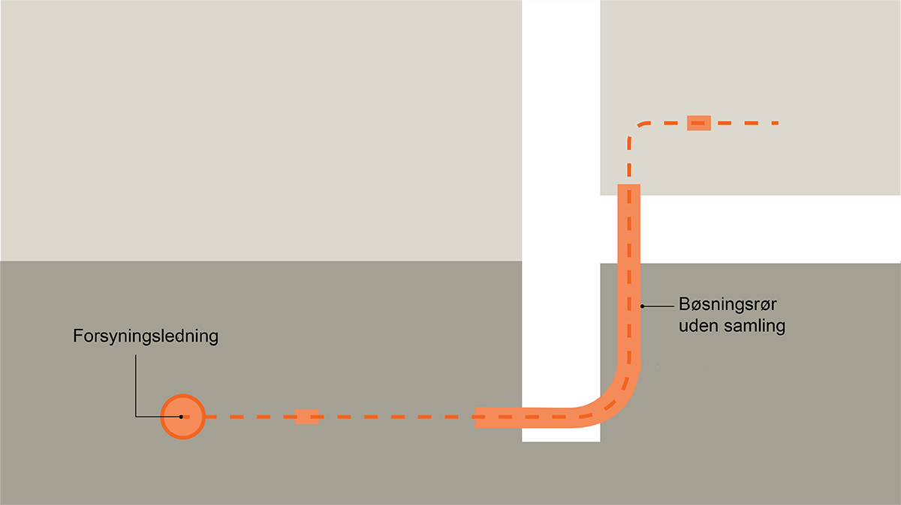
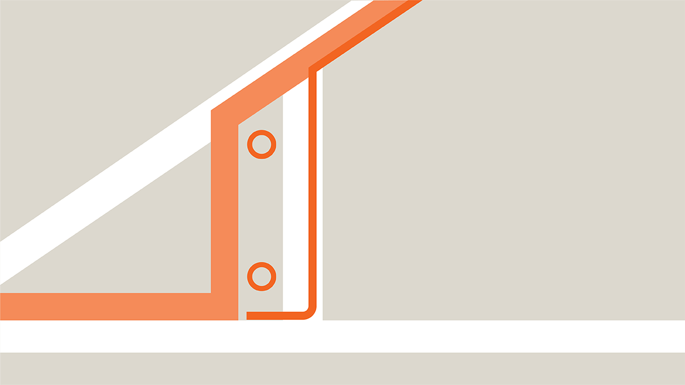

# Vand (§ 403 - § 419)

## Se alle vejledninger om Vand (§ 403 - § 419)

- [Vejledning om brug af regnvand](../../brug-af-regnvand)
- [Vejledning om legionella](../../legionella)
- [Vejledning om tilbagestrømningssikring af vandforsyningssystemer](../../tilbagestroemningssikring-af-vandforsyningssystemer)
- [Bygningsreglementets vejledning om vand](..)
- [Spørgsmål og svar](../../sporgsmaal_svaar)

## Bygningsreglementets vejledning om vand

### Forord

Formålet med bestemmelserne i bygningsreglementet er at sikre, at bygninger får ført vand ind i og rundt i bygningen svarende til det behov, som bygningen, de enkelte rum og deres installationer har i forhold til anvendelsen.\
\
Fælles for vand- og afløbsinstallationer er, at der er mange produkter, som ikke er omfattet af en harmoniseret standard. Bygningsreglementet indeholder derfor et kapitel som beskriver et kontrolsystem for vand- og afløbsinstallationer, som skal følges, hvis produkter ikke er omfattet af en harmoniseret standard jf. BR18, § 418.\
\
Kravene til vandinstallationer i bygningsreglementet har flere snitflader til drikkevandsbekendtgørelsen, som ligger under Miljøstyrelsens ressort, herunder reglerne for genanvendelse af regnvand og kravene til vandkvalitet.\
\
Generelt gælder det for vandinstallationer i eksisterende bygninger, at reparation af ledninger og mindre ændringer ved udskiftning af enkelte sanitetsgenstande, armaturer, apparater, beholder mv. i udgangspunktet kan udføres efter metoder, der var tilladte på installationens udførelsestidspunkt.\
\
Rørcenteranvisning 027 går i dybden med flere områder inden for bygningsreglementets kapitel om vand. Såfremt Rørcenteranvisningen følges, opnås en god sikkerhed for at overholde bygningsreglementets krav inden for disse områder.

#### DS 439

Norm for vandinstallationer

#### Beskrivelse

Denne norm gælder for vandinstallationer, der er tilsluttet almene vandforsyninger (offentlige eller private vandforsyningsanlæg) samt mindre ikke-almene vandforsyningsanlæg.\
\
Bygningsreglementets og normens overordnede, funktionelle krav gælder desuden for den del af regnvandsanlæg, der omfatter ledningssystemet, der forsyner wc\'er og vaskemaskiner med regnvand fra tank eller anden beholder. Regnvandsanlæg kan udføres som beskrevet i Rørcenter-anvisning 003 Brug af regnvand til wc-skyl og vaskemaskiner i boliger.\
\
Normen gælder såvel for nye installationer som for ændringer og tilføjelser i eksisterende anlæg.\
\
Reparation af ledninger og mindre ændringer ved udskiftning af enkelte sanitetsgenstande, armaturer, apparater, beholdere mv. kan udføres med materiel og efter metoder, der var tilladte på installationens udførelsestidspunkt.\
\
Vandinstallationer omfatter installationer i bygninger og i jord inden for grundgrænsen

#### [Standarden findes i Dansk Standards Webshop.ds.dk her](https://webshop.ds.dk/da-dk/standard/ds-4392009 "DS 439"){target="_blank"}

#### 

Rørcenteranvisning 027

#### 

#### [027](https://www.teknologisk.dk/ydelser/roercenter-anvisninger-og-rapporter-fra-roercentret/486){target="_blank"}

### Generelt for vandinstallationer

Ved projektering af vandinstallationer, skal der vælges en metode for sikring mod bakterier, herunder Legionella i vandinstallationen. Metoden kan være en kombination af korrekt projektering og udførelse af anlæg samt krav til vedligeholdelse og drift. I vurderingen af metodevalg skal anvendelsen og brugergruppen af den konkrete bygning indgå.

Ved vurdering af varmtvandstemperaturen i installationerne og ventetiden på, at det varme vand når ud i den enkelte installation, skal risikoen for Legionella indgå.

Det har desuden vist sig, at anvendelsen af nogle materialer som eksempelvis naturgummi og visse former for syntestisk gummi kan bidrage til bakterievækst, herunder Legionellavækst.

### Ledninger i jord og indførelse i bygninger

Vandledninger i jord udføres således, at der ved udgravning i forbindelse med udførelse, eventuel senere reparation eller i den permanente tilstand, ikke kan opstå skader på ejendommens fundering. Vandinstallationer skal placeres således i forhold til ejendommens fundering, at der ved udgravning for ledningerne på langs af ejendommen eller ved krydsning af denne ikke sker en forringelse af fundamenternes bæreevne eller opstår skader som følge af sætninger.

Overgangen fra ledninger i jord til ledninger i bygning er kritiske punkter i vandinstallationen. Der skal tages hensyn til:

> • at ledningen og dennes indføring i bygningen ikke svækker fundamentet
>
> • at sætninger i jord og fundamenter ikke beskadiger ledningen
>
> • at udstrømmende vand fra ledningsbrud eller utætte samlinger ikke kan underminere fundamenterne

Kravet vedrørende ledningers indføring i bygning kan opfyldes som vist på nedenstående figur

### 

*Indføring af ledning i bygning gennem et foringsrør der sikrer, at der ikke sker skader på fundament og bygningsdele*.        

 

Fastgørelsen af vandinstallationer til bygningsdele må ikke medføre skade på hverken installation eller bygningsdel.

Ledninger må kun fastspændes til bygningsdele, såfremt disse kan optage fastspændingskræfterne.

### Frost

Vandinstallationer planlægges, udføres og driftes således, at der ikke opstår frostskader, hvilket normalt sker ved at anbringe installationen, så den ikke bliver udsat for frost. Selv i opvarmede bygninger er der områder, hvor der kan forekomme frost, fx i forbindelse med lukkede skabe op mod ydervæg.

Frysning af vandrør kan udsættes med isolering af disse. I mange tilfælde kan isolering været tilstrækkelig til at forhindre gennemfrysning, såfremt vandrørene er i regelmæssig brug.

Ledninger, der er placeret, så de kan blive udsat for frost i længere perioder, bør forsynes med opvarmningsmulighed, fx elektriske varmekabler (eltracing), der automatisk sættes i funktion i frostperioder.

Risiko for frostskader vil normalt kunne undgås, når følgende vejledning iagttages:

> • Vandledninger i jord lægges i en dybde af mindst 1,2 m til top af ledning.
>
> • Ved indføring i bygninger holdes en afstand på mindst 1,0 m til f.eks. lyskasser og kældernedgange
>
> • I klimaskærmen, fx i ydervægge, på isolerede lofter, i krybekældre eller skunkrum, anbringes ledninger altid på den varme side af isoleringen\
> • I rum, hvor der periodevis er risiko for mild frost, skal vandledninger lægges på en sådan måde, at de kan udnytte opvarmede bygningsdele i tilstrækkelig grad til at forhindre frysning.

### 

*Rørinstallation der er korrekt anbragt på den varme side af isoleringen i et skunkrum*

* *

Såfremt der ikke er sikkerhed for at en bygning holdes frostfri, og såfremt installationerne i bygningen kun periodevis er benyttet, bør disse indrettes, således at de kan tømmes.

### Trykstød

Vandinstallationer projekteres og udføres på en sådan måde, at trykstød ikke kan forekomme, og således at pludselige og unødvendige variationer i tryk og flow undgås.

Trykstød kan opstå i forbindelse med følgende ventiler og komponenter, hvorfor der skal tages forholdsregler mod trykstød ved anvendelsen af:

> • hurtiglukkende ventiler fx kuglehaner, magnetventiler og lignende.
>
> • trykforøgeranlæg

Trykforøgeranlæg projekteres, udføres og styres, så der ikke opstår generende trykstød ved start og stop.

### Materialer

Vandinstallationen må ikke skades af påvirkning fra omgivelserne. Dette betyder, at denne, under hensyntagen til den aktuelle vandkvalitet, skal udføres af tilstrækkeligt korrosionsbestandige materialer. Samlinger skal ligesom materialer vælges med tanke på den aktuelle vandkvalitet og indbygningsmåde.

Der henvises til SBi-anvisning 227 Korrosion i VVS-installationer.

#### SBi-anvisning 227

Korrosion i VVS-installationer

#### Beskrivelse

Denne SBi-anvisning omhandler forebyggelse af korrosion i vvs-installationer iht. DS 432:2009 og DS 439:2009.\
\
Anvisningen afløser SBI-anvisning 129, Korrosionsforebyggelse i vvs-installationer.

#### [Find anvisningen her](https://sbi.dk/anvisninger/Pages/227-Korrosion-i-vvs-installationer-1.aspx "SBi-anvisning 227"){target="_blank"}

### Udskiftelighed

Som udgangspunkt skal installationen planlægges og udføres udskiftelig med hensyn til vedligeholdelse, reparation og ændring i anvendelsen af bygningen. De dele af installationen, som ikke anbringes udskiftelig, skal udføres i en kvalitet, der gør, at de har en levetid, der er tilsvarende eller større end den bygningsdel, i hvilken de er anbragt.

Installationer i den enkelte bolig udføres således, at de kan afspærres.

Udskiftelige ledninger er ledninger, som i jord kan tilgås ved opgravning, og i bygninger er det ledninger, der alene er skjult af f.eks. dækplader, der i hovedsagen har til formål at skjule installationen.

Ikke udskiftelige ledninger er ledninger som er vanskeligt tilgængelige f.eks. under konstruktioner i jord, og i bygninger indbyggede og skjulte installationer, som er vanskeligt tilgængelige.

### Henstand

Ved henstand vil vand over tiden ændre kvalitet. Dette kan have flere årsager som f.eks. bakterievækst, migration af installationer eller misfarvning.

For at sikre en god vandkvalitet i vandinstallationer, skal det sikres, at der ikke er ubenyttede ender i systemet eller dele af systemet, hvor der ikke er forbrug af vand gennem længere tid. Det bør ligeledes vurderes, om der er installationer, hvor behovet for varmt vand ikke er tilstede og kan undlades.

Dele af en vandinstallation, der ikke længere benyttes, skal afmonteres den del af installationen, der er i brug. Afmonteringen skal ske umiddelbart ved afgreningen fra den del af installationen, der er i brug.

Såfremt en del af en vandinstallation i mere end et år kan forventes at være ubenyttet bør den kunne afspærres fra den øvrige installation og tømmes, undtaget herfra er dog brandslukningsinstallationer.

### Utætheder

Bestemmelsen indebærer f.eks., at et brusearmatur beregnet til indbygning kan indmures i en betonvæg, når der samtidig indbygges et tomrør, som sikrer, at udstrømmende vand fra en utæthed kan udledes uden at skade bygningen, og så utætheden kan konstateres, inden der sker skade på bygningen.

I rum, hvor der opstilles apparater med automatisk vandpåfyldning, dvs. apparater som tilsluttes vandforsyningen som fx vaskemaskiner, opvaskemaskiner, nogle former for kaffemaskiner og vandkølere, kan der opnås sikkerhed mod udsivning og udstrømning af vand ved etablering af et gulvafløb eller ved at apparatet eller hele installationen, som apparatet er tilsluttet, udføres med mekanisk eller automatisk vandstop eller tilsvarende foranstaltning.

### Sikring af vandkvalitet

Hvor installationer for drikkevand kan komme i berøring med sundhedsskadelige stoffer, udføres installationerne på en sådan måde, at der ikke kan opstå sundhedsfare.

Såfremt der er risiko for, at drikkevandsinstallationen kan komme i berøring med flydende eller luftformige stoffer, som er under et højere tryk end det i vandledningsevnen, er det vigtigt at installationen udformes på en sådan måde, at risikoen for indtrængning ved korrosion mm. bliver adresseret.  Ovenstående gælder fx for beholdere tilsluttet direkte fjernvarmeanlæg, eller termiske solvarmeanlæg.

Ved anvendelse af en tømmeanordning skal denne udføres og placeres med henblik på at modvirke indtrængning af forurenende organismer og stoffer. Dette gør sig bl.a. gældende ved tanke og beholdere.

Vandledninger må ikke tilsluttes direkte til afløbsinstallationer.

DS/EN 1717 giver eksempler på, hvordan bestemmelsen omkring tilbagestrømningssikringer kan opfyldes. Rørcenter-anvisning 015 samler eksisterende viden om tilbagestrømningssikringer og angiver retningslinjer for valg af tilbagestrømningssikring.

DS/EN 806-5 giver eksempler på drift og vedligehold af tilbagestrømningssikringer.

#### 1717

DS/EN 1717

#### Beskrivelse

Sikring mod forurening af drikkevand i vandinstallationer samt generelle krav til tilbagestrømningssikringer

#### [Standarden findes i Dansk Standards Webshop.ds.dk her](https://webshop.ds.dk/da-dk/standard/ds-en-17172002 "1717"){target="_blank"}

#### 015

Rørcenter-anvisning 015

#### 

#### [Anvisning 015](https://www.teknologisk.dk/ydelser/roercenter-anvisninger-og-rapporter-fra-roercentret/486 "015"){target="_blank"}

#### 806-5

DS/EN 806-5

#### Beskrivelse

Specifikationer for drikkevandsinstallationer i bygninger - Del 5: Drift og vedligehold

#### [Standarden findes i Dansk Standards Webshop.ds.dk her](https://webshop.ds.dk/da-dk/s%C3%B8gning/91-140-60-vandinstallationer/ds-en-806-52013 "806-5"){target="_blank"}

### Koldt vand

Vandinstallationer udføres således, at en passende koldtvandstemperatur er til stede uden besværende ventetid.

Vandinstallationer udføres således, at generende overstrømning fra varmtvands- til koldtvandsinstallationen ikke kan forekomme.

Utilsigtet opvarmning af koldt vand skal i videst muligt omfang undgås.

### Varmt vand

Temperaturen på det varme vand skal ved normal drift overalt i installationen være minimum 50 °C. Det varme vand skal uden besværende ventetid være til stede ved tapstedet, alt efter den projekterede anvendelse af tapstedet. Centralt placerede fordelingsrør med koblingsledninger i handelsdimension ø15 på under 15 m anses normalt for ikke at medføre en besværende ventetid. Vandbesparende taparmaturer vil medføre længere ventetid. For andre typer af tapninger vil det være nødvendigt at foretage en vurdering af den enkelte installation.

Behovet for varmt vand ved alle tapsteder bør overvejes. For tapsteder med et lille vandforbrug og lange koblingsledninger bør lokal opvarmning overvejes.

Visse steder, som f.eks. brusepladser i børnehaver samt nogle plejeafdelinger bør det sikres ved blanding på tapstedet, at vandtemperaturen ikke kan overstige 38 °C. Blandekredse med lav temperatur bør undgås.

### Energi- og vandforbrug

Kravet om tilfredsstillende nøjagtighed af målere er opfyldt ved anvendelse af typegodkendte målere eller målere med en tilsvarende nøjagtighed.

### Drift og vedligehold

Som udgangspunkt skal installationen planlægges og udføres udskiftelig med hensyn til vedligeholdelse, reparation og ændring i anvendelse af bygningen. De dele af installationen, som ikke anbringes udskiftelig, skal udføres i en kvalitet, der gør, at de har en holdbarhed, der er tilsvarende eller større end den bygningsdel, i hvilken de er anbragt.

Under hensyntagen til, at eventuelle arbejder skal kunne foretages på en sikker måde, skal komponenter, som kræver pasning og vedligehold, være let tilgængelige og monteret på en hensigts- og sikkerhedsmæssig forsvarlig måde.

Betjeningsmåde og begrænsninger i anvendelse for installationsdele skal fremgå af forståelig afmærkning.

Der skal udarbejdes en drifts- og vedligeholdelsesvejledning, som skal foreligge ved ibrugtagning. Vejledningen skal bl.a. indeholde et sæt hovedtegninger med kontrol og målepunkter anført.

\
