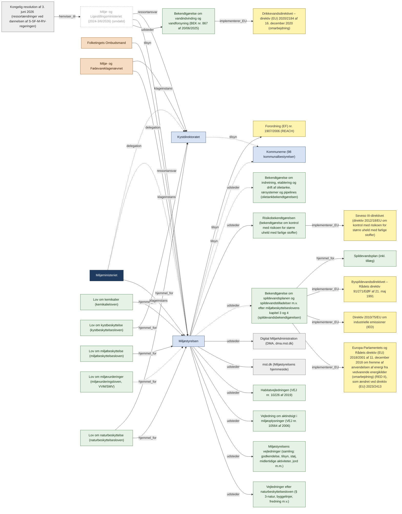

# Miljø- og Ligestillingsministeriet (2024-3/6/2026)

> Genereret af `scripts/build.py` fra `registry.yaml` (dato 2026-10-28). Redigér ikke i hånden.
> Fuldt optrukne pile = `verificeret`; stiplede = `sandsynlig`/`ukendt`. Grå stiplede bokse = nedlagt/omdøbt/ophævet.

Noder: 30 · kanter: 34

[← Overblik](oversigt.md)
