# Skatte- og Vækstministeriet

> Genereret af `scripts/build.py` fra `registry.yaml` (dato 2026-10-28). Redigér ikke i hånden.
> Fuldt optrukne pile = `verificeret`; stiplede = `sandsynlig`/`ukendt`. Grå stiplede bokse = nedlagt/omdøbt/ophævet.

Noder: 57 · kanter: 116

```mermaid
flowchart LR
    classDef ministerium fill:#1f3a5f,stroke:#0d1b2a,color:#fff
    classDef instans fill:#d7e3f4,stroke:#1f3a5f,color:#0d1b2a
    classDef klage fill:#f6dcc2,stroke:#8a4b08,color:#3b1f00
    classDef retsakt fill:#e6f2e6,stroke:#2e6b2e,color:#103010
    classDef eu fill:#fff3b0,stroke:#7a6a00,color:#333
    classDef kilde fill:#eee,stroke:#666,color:#222
    classDef nedlagt fill:#fff,stroke:#999,color:#999,stroke-dasharray:4 3
    min_skat_og_vaekst["Skatte- og Vækstministeriet"]:::ministerium
    eu_dir_2015_849["Direktiv (EU) 2015/849 om forebyggende foranstaltninger mod anvendelse af det finansielle system til hvidvask af penge eller finansiering af terrorisme (4. hvidvaskdirektiv)"]:::eu
    eu_dir_2009_138["Direktiv 2009/138/EF om adgang til og udøvelse af forsikrings- og genforsikringsvirksomhed (Solvens II)"]:::eu
    eu_dir_2013_36["Direktiv 2013/36/EU om adgang til at udøve virksomhed som kreditinstitut og om tilsyn med kreditinstitutter og investeringsselskaber (CRD IV)"]:::eu
    eu_dir_2014_65["Direktiv 2014/65/EU om markeder for finansielle instrumenter (MiFID II)"]:::eu
    eu_dir_2022_2555["Europa-Parlamentets og Rådets direktiv (EU) 2022/2555 (NIS 2-direktivet)"]:::eu
    eu_reg_2013_575["Forordning (EU) nr. 575/2013 om tilsynsmæssige krav til kreditinstitutter og investeringsselskaber (CRR)"]:::eu
    sty_administrations_og_servicestyrelsen["Administrations- og Servicestyrelsen"]:::instans
    raad_det_systemiske_risikoraad["Det Systemiske Risikoråd"]:::instans
    org_finansiel_stabilitet["Finansiel Stabilitet"]:::instans
    sty_finanstilsynet["Finanstilsynet"]:::instans
    sty_gaeldsstyrelsen["Gældsstyrelsen"]:::instans
    kommune_alle["Kommunerne (98 kommunalbestyrelser)"]:::instans
    sty_motorstyrelsen["Motorstyrelsen"]:::instans
    sty_skatteankestyrelsen["Skatteankestyrelsen"]:::instans
    sty_skatteforvaltningen["Skatteforvaltningen"]:::instans
    raad_skatteraadet["Skatterådet"]:::instans
    sty_skattestyrelsen["Skattestyrelsen"]:::instans
    sty_spillemyndigheden["Spillemyndigheden"]:::instans
    tilsyn_it_tilsynet["Tilsynet med told- og skatteforvaltningens it-område (It-tilsynet)"]:::instans
    sty_toldstyrelsen["Toldstyrelsen"]:::instans
    sty_udviklings_og_forenklingsstyrelsen["Udviklings- og Forenklingsstyrelsen"]:::instans
    sty_vurderingsstyrelsen["Vurderingsstyrelsen"]:::instans
    kilde_afgoerelsesdatabasen["Afgørelsesdatabasen (Landsskatterettens afgørelser)"]:::kilde
    kilde_juridisk_vejledning["Den juridiske vejledning (info.skat.dk)"]:::kilde
    kilde_finanstilsynet_lovsamling["Finanstilsynets danske lovsamling (love, bekendtgørelser og vejledninger)"]:::kilde
    kilde_finanstilsynet_tilsynsreaktioner["Finanstilsynets inspektionsredegørelser og tilsynsreaktioner"]:::kilde
    kilde_skm_databasen["SKM-databasen: afgørelser, domme, styresignaler og SKM-meddelelser (info.skat.dk)"]:::kilde
    kilde_spillemyndigheden_afgoerelser["Spillemyndighedens afgørelser og domme (spillemyndigheden.dk)"]:::kilde
    dom_byretterne["Byretterne"]:::klage
    naevn_erhvervsankenaevnet["Erhvervsankenævnet"]:::klage
    ombud_forbrugerombudsmanden["Forbrugerombudsmanden"]:::klage
    naevn_landsskatteretten["Landsskatteretten"]:::klage
    naevn_motorankenaevn["Motorankenævn"]:::klage
    naevn_skatteankenaevn["Skatteankenævn"]:::klage
    naevn_vurderingsankenaevn["Vurderingsankenævn"]:::klage
    bek_skatteraadet_forretningsorden["Bekendtgørelse af forretningsorden for Skatterådet (BEK nr. 1035 af 25/10/2005)"]:::retsakt
    bek_skatteankestyrelsen["Bekendtgørelse om Skatteankestyrelsen (BEK nr. 2372 af 10/12/2021)"]:::retsakt
    bek_skatteankestyrelsen_visse_klager["Bekendtgørelse om afgørelse af visse klager i Skatteankestyrelsen (BEK nr. 967 af 28/06/2023)"]:::retsakt
    bek_bbr_ajourfoering["Bekendtgørelse om ajourføring af Bygnings- og Boligregistret (BBR) (BEK nr. 1010 af 24/10/2012)"]:::retsakt
    bek_landsskatteretten_forretningsorden["Bekendtgørelse om forretningsorden for Landsskatteretten (BEK nr. 2373 af 10/12/2021)"]:::retsakt
    bek_motorankenaevn_forretningsorden["Bekendtgørelse om forretningsorden for motorankenævn (BEK nr. 1043 af 22/06/2022)"]:::retsakt
    bek_skatteankenaevn_forretningsorden["Bekendtgørelse om forretningsorden for skatteankenævn (BEK nr. 1041 af 22/06/2022)"]:::retsakt
    bek_vurderingsankenaevn_forretningsorden["Bekendtgørelse om forretningsorden for vurderingsankenævn (BEK nr. 2289 af 03/12/2021)"]:::retsakt
    bek_spillemyndigheden["Bekendtgørelse om spillemyndigheden (BEK nr. 1121 af 01/12/2011)"]:::retsakt
    bek_skatteforvaltningens_opgaver["Bekendtgørelse om varetagelsen af told- og skatteforvaltningens opgaver (BEK nr. 804 af 20/06/2018)"]:::retsakt
    lov_it_tilsynsloven["Lov om Tilsynet med told- og skatteforvaltningens it-område"]:::retsakt
    lov_lov_om_betalinger["Lov om betalinger"]:::retsakt
    lov_bbr_loven["Lov om bygnings- og boligregistrering (BBR-loven)"]:::retsakt
    lov_indskyder_og_investorgarantiordning["Lov om en indskyder- og investorgarantiordning"]:::retsakt
    lov_finansiel_virksomhed["Lov om finansiel virksomhed (FIL)"]:::retsakt
    lov_hvidvaskloven["Lov om forebyggende foranstaltninger mod hvidvask og finansiering af terrorisme (hvidvaskloven)"]:::retsakt
    lov_forsikringsvirksomhed["Lov om forsikringsvirksomhed i tværgående pensionskasser, livsforsikringsselskaber og skadesforsikringsselskaber m.v. (lov om forsikringsvirksomhed)"]:::retsakt
    lov_kapitalmarkedsloven["Lov om kapitalmarkeder (kapitalmarkedsloven)"]:::retsakt
    lov_restrukturering_og_afvikling["Lov om restrukturering og afvikling af visse finansielle virksomheder"]:::retsakt
    lov_skatteforvaltningsloven["Skatteforvaltningsloven"]:::retsakt
    lov_spilleloven["Spilleloven (lov om spil)"]:::retsakt
    lov_bbr_loven -->|hjemmel_for| bek_bbr_ajourfoering
    lov_bbr_loven -->|hjemmel_for| kommune_alle
    min_skat_og_vaekst -->|ressortansvar| lov_bbr_loven
    min_skat_og_vaekst -->|ressortansvar| sty_vurderingsstyrelsen
    sty_vurderingsstyrelsen -->|tilsyn| kommune_alle
    min_skat_og_vaekst -->|ressortansvar| sty_skatteforvaltningen
    min_skat_og_vaekst -->|ressortansvar| sty_skattestyrelsen
    min_skat_og_vaekst -->|ressortansvar| sty_toldstyrelsen
    min_skat_og_vaekst -->|ressortansvar| sty_gaeldsstyrelsen
    min_skat_og_vaekst -->|ressortansvar| sty_motorstyrelsen
    min_skat_og_vaekst -->|ressortansvar| sty_udviklings_og_forenklingsstyrelsen
    min_skat_og_vaekst -->|ressortansvar| sty_administrations_og_servicestyrelsen
    min_skat_og_vaekst -->|ressortansvar| sty_skatteankestyrelsen
    min_skat_og_vaekst -->|ressortansvar| sty_spillemyndigheden
    min_skat_og_vaekst -->|ressortansvar| raad_skatteraadet
    min_skat_og_vaekst -->|ressortansvar| naevn_landsskatteretten
    min_skat_og_vaekst -->|ressortansvar| naevn_skatteankenaevn
    min_skat_og_vaekst -->|ressortansvar| naevn_vurderingsankenaevn
    min_skat_og_vaekst -->|ressortansvar| naevn_motorankenaevn
    min_skat_og_vaekst -->|ressortansvar| tilsyn_it_tilsynet
    min_skat_og_vaekst -->|ressortansvar| lov_skatteforvaltningsloven
    min_skat_og_vaekst -->|ressortansvar| lov_spilleloven
    min_skat_og_vaekst -->|ressortansvar| lov_it_tilsynsloven
    bek_skatteforvaltningens_opgaver -->|hjemmel_for| sty_skatteforvaltningen
    bek_skatteforvaltningens_opgaver -->|hjemmel_for| sty_skattestyrelsen
    bek_skatteforvaltningens_opgaver -->|hjemmel_for| sty_toldstyrelsen
    bek_skatteforvaltningens_opgaver -->|hjemmel_for| sty_gaeldsstyrelsen
    bek_skatteforvaltningens_opgaver -->|hjemmel_for| sty_motorstyrelsen
    bek_skatteforvaltningens_opgaver -->|hjemmel_for| sty_udviklings_og_forenklingsstyrelsen
    bek_skatteforvaltningens_opgaver -->|hjemmel_for| sty_administrations_og_servicestyrelsen
    bek_skatteforvaltningens_opgaver -->|hjemmel_for| sty_vurderingsstyrelsen
    lov_skatteforvaltningsloven -->|hjemmel_for| bek_skatteforvaltningens_opgaver
    lov_skatteforvaltningsloven -->|hjemmel_for| sty_skatteankestyrelsen
    lov_skatteforvaltningsloven -->|hjemmel_for| bek_skatteankestyrelsen
    bek_skatteankestyrelsen -->|hjemmel_for| sty_skatteankestyrelsen
    lov_skatteforvaltningsloven -->|hjemmel_for| bek_skatteankestyrelsen_visse_klager
    bek_skatteankestyrelsen_visse_klager -->|hjemmel_for| sty_skatteankestyrelsen
    lov_skatteforvaltningsloven -->|hjemmel_for| raad_skatteraadet
    lov_skatteforvaltningsloven -->|hjemmel_for| bek_skatteraadet_forretningsorden
    bek_skatteraadet_forretningsorden -->|hjemmel_for| raad_skatteraadet
    lov_skatteforvaltningsloven -->|hjemmel_for| naevn_landsskatteretten
    lov_skatteforvaltningsloven -->|hjemmel_for| bek_landsskatteretten_forretningsorden
    bek_landsskatteretten_forretningsorden -->|hjemmel_for| naevn_landsskatteretten
    lov_skatteforvaltningsloven -->|hjemmel_for| naevn_skatteankenaevn
    lov_skatteforvaltningsloven -->|hjemmel_for| bek_skatteankenaevn_forretningsorden
    bek_skatteankenaevn_forretningsorden -->|hjemmel_for| naevn_skatteankenaevn
    lov_skatteforvaltningsloven -->|hjemmel_for| naevn_vurderingsankenaevn
    lov_skatteforvaltningsloven -->|hjemmel_for| bek_vurderingsankenaevn_forretningsorden
    bek_vurderingsankenaevn_forretningsorden -->|hjemmel_for| naevn_vurderingsankenaevn
    lov_skatteforvaltningsloven -->|hjemmel_for| naevn_motorankenaevn
    lov_skatteforvaltningsloven -->|hjemmel_for| bek_motorankenaevn_forretningsorden
    bek_motorankenaevn_forretningsorden -->|hjemmel_for| naevn_motorankenaevn
    lov_spilleloven -->|hjemmel_for| sty_spillemyndigheden
    lov_spilleloven -->|hjemmel_for| bek_spillemyndigheden
    bek_spillemyndigheden -->|hjemmel_for| sty_spillemyndigheden
    lov_it_tilsynsloven -->|hjemmel_for| tilsyn_it_tilsynet
    naevn_landsskatteretten -->|klageinstans| sty_skatteforvaltningen
    naevn_landsskatteretten -.->|klageinstans| raad_skatteraadet
    naevn_landsskatteretten -->|klageinstans| sty_spillemyndigheden
    sty_skatteankestyrelsen -->|klageinstans| sty_skatteforvaltningen
    naevn_skatteankenaevn -->|klageinstans| sty_skatteforvaltningen
    naevn_vurderingsankenaevn -.->|klageinstans| sty_vurderingsstyrelsen
    naevn_motorankenaevn -.->|klageinstans| sty_motorstyrelsen
    dom_byretterne -.->|klageinstans| naevn_landsskatteretten
    dom_byretterne -->|klageinstans| sty_skatteforvaltningen
    dom_byretterne -->|klageinstans| sty_spillemyndigheden
    dom_byretterne -.->|klageinstans| naevn_skatteankenaevn
    dom_byretterne -.->|klageinstans| naevn_vurderingsankenaevn
    dom_byretterne -.->|klageinstans| naevn_motorankenaevn
    raad_skatteraadet -->|tilsyn| naevn_skatteankenaevn
    raad_skatteraadet -->|tilsyn| naevn_vurderingsankenaevn
    raad_skatteraadet -->|tilsyn| naevn_motorankenaevn
    tilsyn_it_tilsynet -->|tilsyn| sty_skatteforvaltningen
    sty_skatteforvaltningen -->|udsteder| kilde_juridisk_vejledning
    sty_skatteforvaltningen -->|udsteder| kilde_skm_databasen
    naevn_landsskatteretten -->|udsteder| kilde_afgoerelsesdatabasen
    sty_spillemyndigheden -->|udsteder| kilde_spillemyndigheden_afgoerelser
    kilde_juridisk_vejledning -.->|henviser_til| lov_skatteforvaltningsloven
    kilde_skm_databasen -.->|henviser_til| kilde_juridisk_vejledning
    min_skat_og_vaekst -->|ressortansvar| sty_finanstilsynet
    min_skat_og_vaekst -.->|ressortansvar| org_finansiel_stabilitet
    min_skat_og_vaekst -.->|ressortansvar| raad_det_systemiske_risikoraad
    min_skat_og_vaekst -.->|ressortansvar| lov_finansiel_virksomhed
    min_skat_og_vaekst -.->|ressortansvar| lov_hvidvaskloven
    min_skat_og_vaekst -.->|ressortansvar| lov_lov_om_betalinger
    min_skat_og_vaekst -.->|ressortansvar| lov_kapitalmarkedsloven
    min_skat_og_vaekst -.->|ressortansvar| lov_forsikringsvirksomhed
    min_skat_og_vaekst -.->|ressortansvar| lov_restrukturering_og_afvikling
    min_skat_og_vaekst -.->|ressortansvar| lov_indskyder_og_investorgarantiordning
    lov_finansiel_virksomhed -.->|hjemmel_for| sty_finanstilsynet
    lov_finansiel_virksomhed -.->|hjemmel_for| raad_det_systemiske_risikoraad
    lov_hvidvaskloven -.->|hjemmel_for| sty_finanstilsynet
    lov_lov_om_betalinger -.->|hjemmel_for| sty_finanstilsynet
    lov_kapitalmarkedsloven -.->|hjemmel_for| sty_finanstilsynet
    lov_forsikringsvirksomhed -.->|hjemmel_for| sty_finanstilsynet
    lov_restrukturering_og_afvikling -.->|hjemmel_for| org_finansiel_stabilitet
    lov_indskyder_og_investorgarantiordning -.->|hjemmel_for| org_finansiel_stabilitet
    naevn_erhvervsankenaevnet -.->|klageinstans| sty_finanstilsynet
    naevn_erhvervsankenaevnet -.->|klageinstans| org_finansiel_stabilitet
    sty_finanstilsynet -->|udsteder| kilde_finanstilsynet_tilsynsreaktioner
    sty_finanstilsynet -->|udsteder| kilde_finanstilsynet_lovsamling
    lov_finansiel_virksomhed -.->|henviser_til| lov_restrukturering_og_afvikling
    lov_finansiel_virksomhed -.->|implementerer_EU| eu_reg_2013_575
    lov_finansiel_virksomhed -->|implementerer_EU| eu_dir_2013_36
    lov_forsikringsvirksomhed -->|implementerer_EU| eu_dir_2009_138
    lov_kapitalmarkedsloven -->|implementerer_EU| eu_dir_2014_65
    lov_hvidvaskloven -->|implementerer_EU| eu_dir_2015_849
    lov_finansiel_virksomhed -->|implementerer_EU| eu_dir_2009_138
    lov_finansiel_virksomhed -->|implementerer_EU| eu_dir_2014_65
    lov_finansiel_virksomhed -->|implementerer_EU| eu_dir_2015_849
    lov_forsikringsvirksomhed -->|implementerer_EU| eu_dir_2015_849
    lov_lov_om_betalinger -->|hjemmel_for| ombud_forbrugerombudsmanden
    lov_finansiel_virksomhed -->|implementerer_EU| eu_dir_2022_2555
    naevn_vurderingsankenaevn -->|klageinstans| sty_skatteforvaltningen
    naevn_motorankenaevn -.->|klageinstans| sty_skatteforvaltningen
    naevn_landsskatteretten -.->|klageinstans| sty_skattestyrelsen
```

[← Overblik](oversigt.md)
